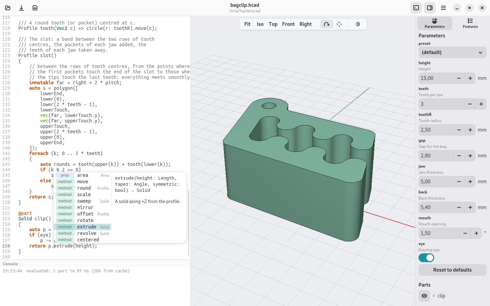
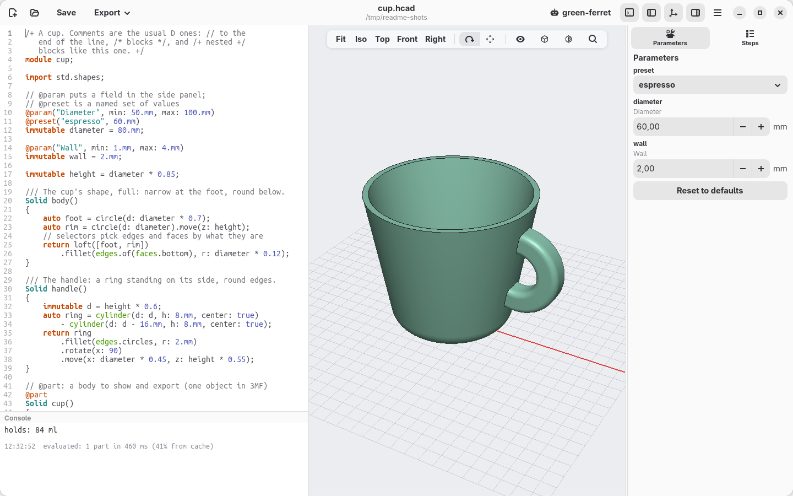

#  hackerscad

[](https://github.com/trikko/hackerscad/actions/workflows/build.yml)

**hackerscad** is the hacker's CAD: a solid model is a small program, and the
3D view follows while you type. Select a face with the mouse, pick "Fillet" or
"Hole at point", and hackerscad writes the code for you. The file stays the
only source of truth, so it diffs, versions and reviews like any other code.

**Documentation:** [tutorial](docs/TUTORIAL.md) ·
[language reference](docs/LANGUAGE.md) · [cheatsheet](docs/CHEATSHEET.md) · [examples](examples) ·
[for AI agents](#using-hackerscad-with-an-ai-agent)

* ✏️ **Models as code**: `.hcad` is a sandboxed scripting language inspired
  by D, with units (`60.mm`, `30.deg`), solids joined, cut and intersected
  with `+`, `-` and `&`, and selectors such as `edges.parallel(Z)` instead of
  edge numbers.
* 💡 **An editor that knows the language**: completion of methods, units,
  arguments and library functions, signatures while you type, help on hover,
  and a searchable cheatsheet (F1).
* 🖱️ **And with the mouse**: fillets, chamfers, shells, holes, pockets and
  bosses from the context menu, written back into the code.
* 🎛️ **Parameters**: `@param` gives a field in the side panel, `@preset` named
  sets of values, `unittest` the design's requirements.
* 🧱 **Exact solids**: OpenCascade B-rep with fillets, shells, drafts, sweeps,
  lofts and constrained sketches; Manifold for fast mesh booleans.
* 📦 **Exports**: 3MF with one object and colour per part, STL (a zip of one
  file per part), STEP with a named body per part, PNG, and
  drawings with views, sections and dimensions as PDF, SVG or DXF.
* 🔩 **Libraries**: screws, nuts, holes and inserts, ISO threads, gears,
  print-in-place hinges, snap fits, enclosures.
* 🤖 **AI agents**: an MCP server lets an agent write, check, look at and
  export models, and drive the application while you watch.
* 🐧 **Linux, Windows, macOS**: AppImage, zip, app bundle.

<p align="center"></p>

## Quickstart

Download the package for your system from the releases.

**Linux:** the AppImage runs on its own.

```sh
chmod +x hackerscad-*-x86_64.AppImage
./hackerscad-*-x86_64.AppImage                       # the application
./hackerscad-*-x86_64.AppImage hcad check model.hcad  # the command line tool
```

**Windows:** unzip it anywhere and run `hackerscad.exe` in the `hackerscad`
folder (the command line tool is `bin\hcad.exe`). On machines without a
recent enough OpenGL, such as virtual machines without 3D acceleration, it
draws with the software OpenGL it ships with. The program is not signed: if
SmartScreen stops it, choose "More info" and then "Run anyway".

**macOS** (Apple Silicon): unzip it, move `hackerscad.app` to Applications
and clear the attributes macOS puts on downloaded files (the quarantine). The
app is not signed by an Apple developer, so without this macOS says it is
damaged or cannot be opened:

```sh
xattr -cr /Applications/hackerscad.app
open /Applications/hackerscad.app                                    # the application
/Applications/hackerscad.app/Contents/Resources/bin/hcad check model.hcad  # the command line tool
```

The window opens on a small example: a clip that keeps bags of biscuits
closed. Change its parameters, edit its code, right-click its faces. The New
button starts a model of your own from a few lines: a cube with two holes
across it.

## A model

```d
/+ A cup. Comments are the usual D ones: // to the
   end of the line, /* blocks */, and /+ nested +/
   blocks like this one. +/
module cup;

import std.shapes;

// @param puts a field in the side panel;
// @preset is a named set of values
@param("Diameter", min: 50.mm, max: 100.mm)
@preset("espresso", 60.mm)
immutable diameter = 80.mm;

@param("Wall", min: 1.mm, max: 4.mm)
immutable wall = 2.mm;

immutable height = diameter * 0.85;

/// The cup's shape, full: narrow at the foot, round below.
Solid body()
{
    auto foot = circle(d: diameter * 0.7);
    auto rim = circle(d: diameter).move(z: height);
    // selectors pick edges and faces by what they are
    return loft([foot, rim])
        .fillet(edges.of(faces.bottom), r: diameter * 0.12);
}

/// The handle: a ring standing on its side, round edges.
Solid handle()
{
    immutable d = height * 0.6;
    auto ring = cylinder(d: d, h: 8.mm, center: true)
        - cylinder(d: d - 16.mm, h: 8.mm, center: true);
    return ring
        .fillet(edges.circles, r: 2.mm)
        .rotate(x: 90)
        .move(x: diameter * 0.45, z: height * 0.55);
}

// @part: a body to show and export (one object in 3MF)
@part
Solid cup()
{
    // the handle stops at the wall, not inside
    return body()
        .shell(open: faces.top, thickness: wall)
        + (handle() - body());
}

// the design's requirements, checked after every change
unittest
{
    assert(wall >= 1.2.mm, "walls under 1.2 mm leak");
    // what it holds: the full shape minus the cup
    immutable ml = (body.volume - cup.volume) / 1.cm ^^ 3;
    writeln("holds: $(format("%.0f", ml)) ml");
}
```

<p align="center"><br>
<em>The cup in hackerscad, with the "espresso" preset chosen in the side panel: the
diameter becomes 60 mm, the view follows, and the console shows what the cup holds,
printed by the <code>unittest</code>.</em></p>

## Using hackerscad with an AI agent

hackerscad is new, so it is not in the training data of the models: a model
left to guess writes OpenSCAD or CadQuery instead. Give it the MCP server
(best: the agent checks models, looks at renders, measures, exports and drives
the open application) or, for agents without MCP, the skill.

### 1. Find `hcad`

Both run `hcad`, the command line tool, and the agent starts it by itself from
any folder. `hcad --version` tells whether it is in your `PATH`. If it is not,
either put it there or use its full path in the commands below:

| System | Full path of `hcad` | To put it in the `PATH` |
|---|---|---|
| Linux (AppImage) | `/path/to/hackerscad-…-x86_64.AppImage hcad` (the AppImage, then the word `hcad`) | `ln -s /path/to/hackerscad-…-x86_64.AppImage ~/.local/bin/hcad`: a link named `hcad` runs the command line tool |
| Windows | `C:\path\to\hackerscad\bin\hcad.exe` | add `C:\path\to\hackerscad\bin` to the `Path` variable |
| macOS | `/Applications/hackerscad.app/Contents/Resources/bin/hcad` | in `~/.zshrc`: `export PATH="/Applications/hackerscad.app/Contents/Resources/bin:$PATH"` |
| Built from source | `/path/to/hackerscad/bin/hcad` | add `/path/to/hackerscad/bin` to the `PATH` |

### 2. Add the MCP server

One command, for all your projects; then restart the agent.

| Agent | With `hcad` in the `PATH` | Check |
|---|---|---|
| Claude Code | `claude mcp add -s user hcad -- hcad mcp` | `claude mcp list` |
| Codex | `codex mcp add hcad -- hcad mcp` | `codex mcp list` |
| Antigravity (CLI and IDE) | `agy mcp add hcad hcad mcp` | `agy mcp list` |

Without `hcad` in the `PATH`, the full path takes the place of the second
`hcad`, the one before `mcp`. For example, with the AppImage in `~/Apps`:

```sh
claude mcp add -s user hcad -- ~/Apps/hackerscad-0.3.1-x86_64.AppImage hcad mcp
codex mcp add hcad -- ~/Apps/hackerscad-0.3.1-x86_64.AppImage hcad mcp
agy mcp add hcad ~/Apps/hackerscad-0.3.1-x86_64.AppImage hcad mcp
```

(the name of the AppImage changes with every version: the link of step 1
does not), or on Windows:

```bat
claude mcp add -s user hcad -- C:\path\to\hackerscad\bin\hcad.exe mcp
```

Other tools take the same server in their MCP settings: the command (`hcad`,
or its full path) with the argument `mcp`.

### 3. Or the skill

For agents that work with the command line: the rules that avoid most
mistakes ([SKILL.md](docs/SKILL.md), or [AGENTS.md](docs/AGENTS.md) for tools
that want a rules file) and the whole reference
([llms-full.txt](docs/llms-full.txt); [llms.txt](docs/llms.txt) is a short
overview). `hcad` prints them, so they always match the installed version; in
Claude Code, for example:

```sh
mkdir -p ~/.claude/skills/hackerscad
hcad docs --skill > ~/.claude/skills/hackerscad/SKILL.md
hcad docs > ~/.claude/skills/hackerscad/llms-full.txt
```

The folder for each agent:

| Tool | For all projects | For one project |
|---|---|---|
| Claude Code | `~/.claude/skills/hackerscad/` | `.claude/skills/hackerscad/` |
| Antigravity (IDE, 2.0) | `~/.gemini/config/skills/hackerscad/` | `.agents/skills/hackerscad/` |
| Antigravity CLI | `~/.gemini/antigravity-cli/skills/hackerscad/` | `.agents/skills/hackerscad/` |
| Gemini CLI | `~/.gemini/skills/hackerscad/` | `.gemini/skills/hackerscad/` |
| Codex | `~/.agents/skills/hackerscad/` | `.agents/skills/hackerscad/` |

Then ask, for example: *"a hexagonal pen holder, 10 cm tall, with a rounded
bottom, as 3MF"*.

## Building

Linux and macOS: install LDC and dub, OpenCascade 7.9, GTK 4, libadwaita,
GtkSourceView 5, TBB, CMake and Ninja, then:

```sh
dub build          # bin/hcad, the command line tool
dub build :gui     # bin/hackerscad, the application
dub test :core     # the tests
```

Manifold is downloaded and built on the first build (`tools/build-native.sh`).

Packages:

```sh
packaging/linux/build-appimage.sh   # AppImage, built in an Ubuntu 24.04 container (podman)
tools/setup-win-cross.sh            # once: the Windows toolchain and libraries, in build/win
packaging/windows/package.sh        # Windows zip, built on Linux; try it with Wine
packaging/macos/package.sh          # macOS app bundle, on a Mac with Homebrew
tools/docs.sh                       # regenerate the agent documentation in docs/
```

## Credits

hackerscad is built on [Open CASCADE Technology](https://dev.opencascade.org),
[Manifold](https://github.com/elalish/manifold),
[Clipper2](https://github.com/AngusJohnson/Clipper2), [GTK](https://gtk.org),
[libadwaita](https://gnome.pages.gitlab.gnome.org/libadwaita/),
[GtkSourceView](https://wiki.gnome.org/Projects/GtkSourceView),
[giD](https://github.com/Kymorphia/gid) and
[bindbc-opengl](https://github.com/BindBC/bindbc-opengl). `hcad --version` and
the About window list them with their licences. The Windows package also
ships [Mesa](https://mesa3d.org)'s software OpenGL and Microsoft's Visual C++
runtime (`vcruntime140.dll`), redistributed under their licences.

It is inspired by [OpenSCAD](https://openscad.org), where a solid is a small
program, and by [Onshape](https://www.onshape.com), with its features,
constrained sketches and fillets picked on the model.

## Screenshots

The startup example on each system, taken by the CI from the packages of the
latest release.

| Linux | Windows | macOS |
|---|---|---|
|  |  |  |

## License

hackerscad is free software: © 2026 Andrea Fontana, licensed under the
[GNU General Public License version 3](LICENSE).

The [hackerscad Model Exception](MODEL-EXCEPTION.md) keeps the license out of
your work: the models you write, and what hackerscad makes from them (STL,
3MF, STEP, images, drawings), are yours under terms of your choice, even when
they use the libraries that come with hackerscad.
