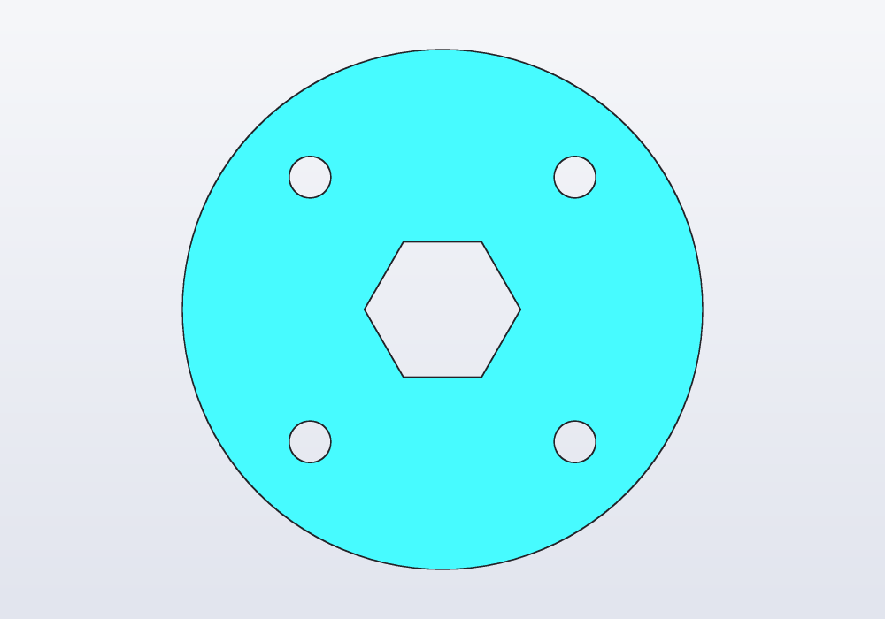
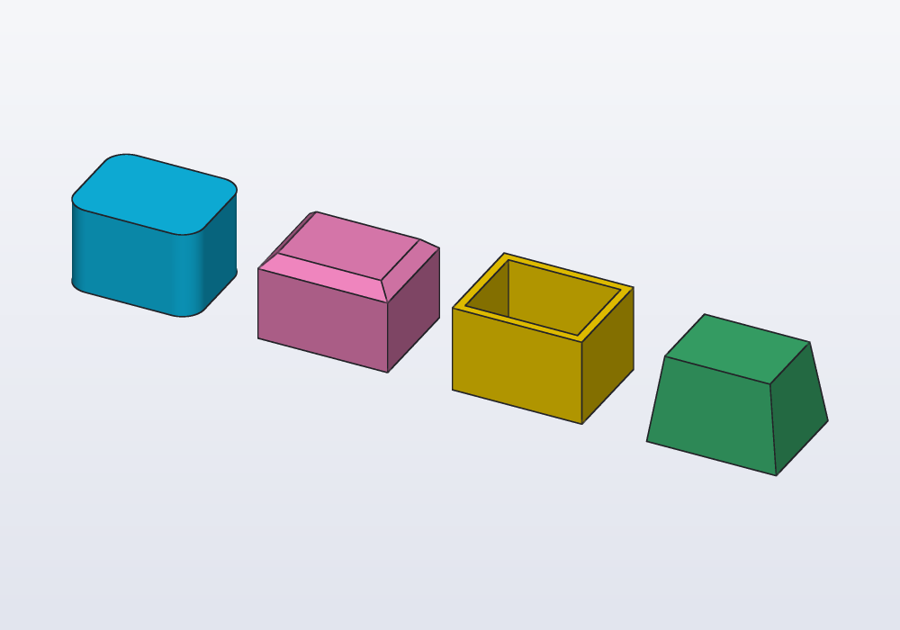
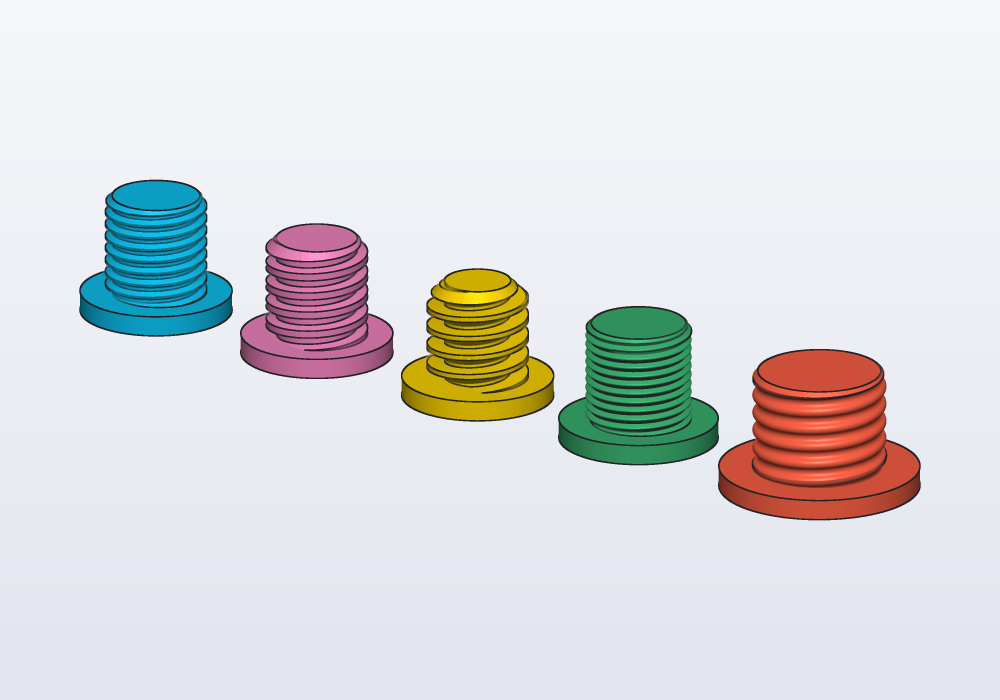
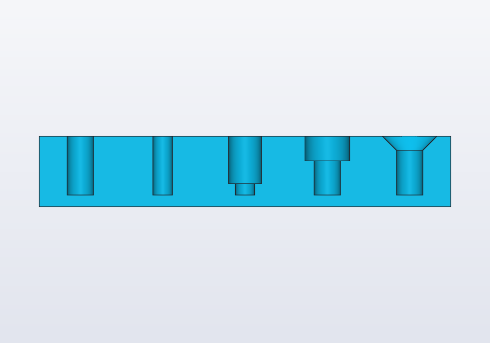
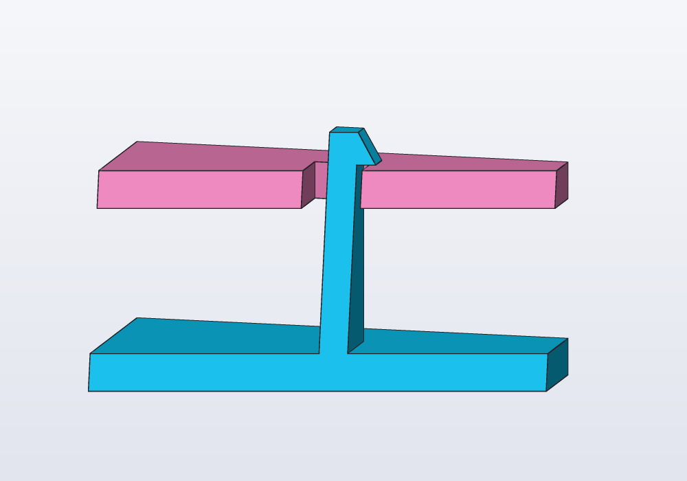
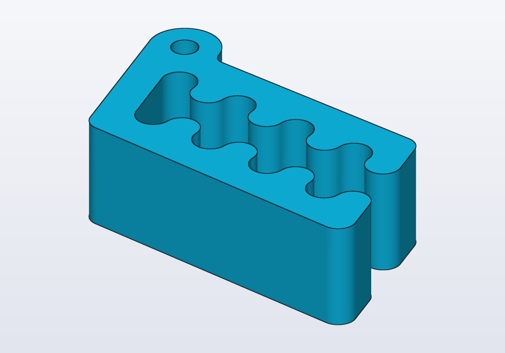
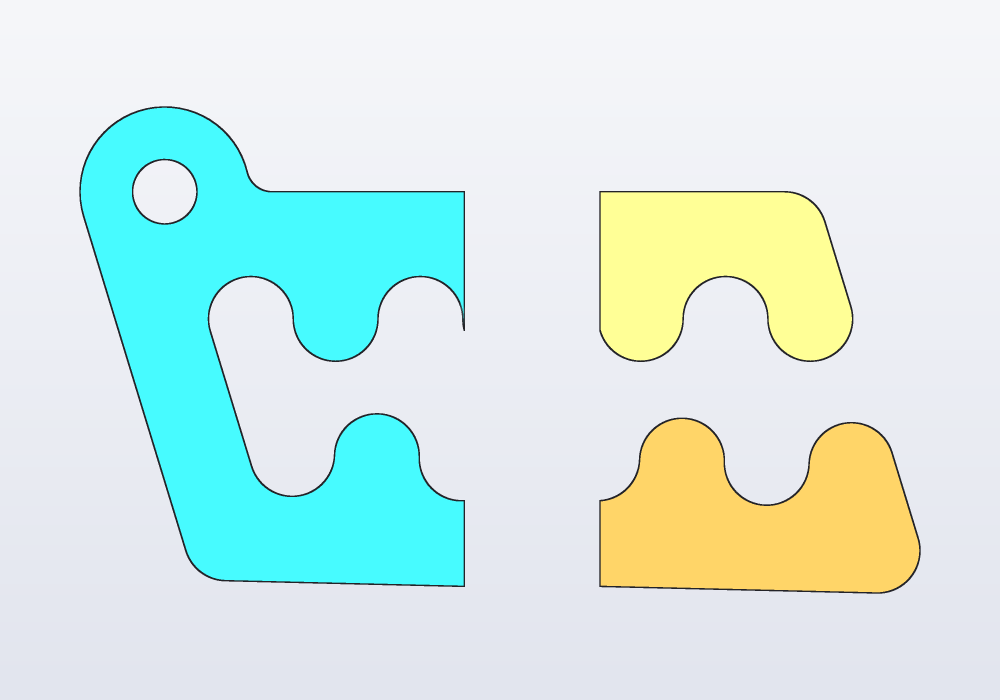

# Guides

One page for each topic: what it does, shown on examples, every parameter, the usual mistakes and where it is in the application. The [tutorial](TUTORIAL.md) goes step by step through a first model; the [language reference](LANGUAGE.md) lists everything in brief.

### [Constrained sketches](guides/sketches.md)

A sketch is a flat outline drawn from points, lines, arcs, circles, ellipses, splines and ready-made shapes, held in place by constraints (rules such as "this line is level" or "these two points are 30 mm apart"), then extruded (pushed up into a solid), revolved (turned round an axis) or cut into a part. This guide covers `sketch()`, every constraint, construction geometry, degrees of freedom and their warning, reading the solved sketch back, sketches on the faces of a solid, where a sketch beats shapes added together, and the sketch bar of the application.

### [From profile to solid](guides/profiles.md)

A profile is a flat outline; a solid is made from it by extruding it (pushing it up into a block of the same outline), revolving it (turning it round an axis, as on a lathe) or adding and cutting it on a face of another solid. This guide covers the profile shapes (rectangles, circles, polygons, slots, teardrops, text, SVG and DXF drawings), how they combine (`+ - &`, offset, round), extruding them (taper, twist, shear, along X or Y, symmetric), revolving them, standing them up with `across`, adding or cutting them on a face of a solid, and pushing or sinking the faces themselves.

### [Paths, sweeps and lofts](guides/sweeps.md)

Shapes that follow a curve or change along their length: paths (straight, bent, splines, helices, from a sketch, from a solid's edges, from two views), sweeping a profile along a path and deciding how it rolls on the way (`up:`, `guide:`, `twist:`, `frenet:`), and lofting between profiles.

### [Surfaces](guides/surfaces.md)

Open sheets with no inside: how to make one (an open curve swept along a path, a loft through paths), and what to do with it: split a solid along a curved cut, thicken it into a shell, sew several into a closed solid, push the pieces apart. Typical workflows, the limits, and the errors.

### [Planes, frames and placement](guides/planes.md)

Where things go. A plane is a flat surface without end, given by a point and the direction it faces; a frame is a place to build from, a point with its own three axes. This guide covers the three main planes XY, XZ and YZ (and which way each faces), planes of every other kind (through points, on a face, halfway between two faces, moved off another), frames to build on a face, placing parts on faces and next to each other, axes, sketching on a plane, and the planes shown in the 3D view with the menus that write them.

### [Selectors and features](guides/features.md)

Rounding, bevelling, hollowing and tapering a solid: `fillet`, `chamfer`, `shell` and `draft`, and the selectors that say which edges and faces they work on (`edges.parallel(Z)`, `faces.top`, `edges.between(…)`, `faces.from(tool)`). How to pick edges so that they stay the right ones when a parameter changes, in which order to apply the features, what their errors mean, and how to do the same with the mouse in the 3D view.

### [Patterns, textures and noise](guides/patterns.md)

Many copies of one thing: a row, a ring, a grid, a mirror image; layouts the plain patterns cannot make, written as loops; surfaces with a texture, ribbed or bumpy, from `noise`, `loopNoise` and `loft` through rings of points; how to keep them quick to evaluate, and when a pattern belongs in a library.

### [Threads](guides/threads.md)

A real helical thread on a shaft or in a hole: ISO metric, inch, trapezoidal and ACME, buttress, pipe threads, lamp bases, bottle necks. How to recognise one on a real object, every parameter, and how to print it.

### [Holes and hardware](guides/holes.md)

Holes for metric screws from M2 to M8, from the `hardware` library: clearance, tapping, heat-set insert, counterbore and countersink holes with `hole()`, nut traps, the screws, nuts and washers themselves, teardrop holes that print sideways, and the Hole entry of the 3D view's right-click menu.

### [Fits and printing](guides/fits.md)

How much play to leave between parts that slide, press or turn together, printed or machined; how to test a fit in a `unittest` before printing; snap hooks and print-in-place hinges from the `snaps` and `hinges` libraries; and how to make a part print well: overhangs, thin walls, which way up it lies.

### [Gears](guides/gears.md)

Spur gears and racks from the `gears` library: module, number of teeth and pressure angle, placing two gears so that they mesh, checking the mesh in the model, and printing gears that turn (backlash, the module for a printer, hubs, bores and set screws).

### [Enclosures and boxes](guides/enclosures.md)

Boxes, trays and cases with lids: the `enclosures` library (`roundedBox`, `tray`, `enclosure(…).base` and `.lid`) and every option of it, boxes hollowed with `shell()` or cut in two, screw bosses, ventilation slots and holes, and a worked example of a case for a circuit board.

### [Parameters, presets and checks](guides/parameters.md)

The sizes you may want to change, made parameters with `@param` (limits, steps, a list of choices) and grouped into named presets with `@preset`; units and the mistakes they catch, and the few they do not; design checks in `unittest` blocks with `assert`; measuring a model (its size, volume, weight, distances) and printing values with `writeln`; and changing parameters from the Parameters panel and the command line (`-D`, `--preset`).

### [Parts, export and drawings](guides/parts.md)

What becomes a separate object when a model is exported: `@part` and its options (colour, see-through, reference parts, names), `@parts` for the pieces of a cut, colours, the export formats (3MF, STL, zip, STEP, PNG) and what each holds, technical drawings with `@drawing`, and the Export menu of the application.

### [Working with an AI agent](guides/agents.md)

How to design with Claude Code, Codex or another agent and hackerscad together: installing the skill and the MCP server, what the agent asks before it starts and why, how it works in your windows without overwriting your files, pointing at things with annotations both ways, the loop it follows to check its work, the command line when there is no server, and the guides it reads.

