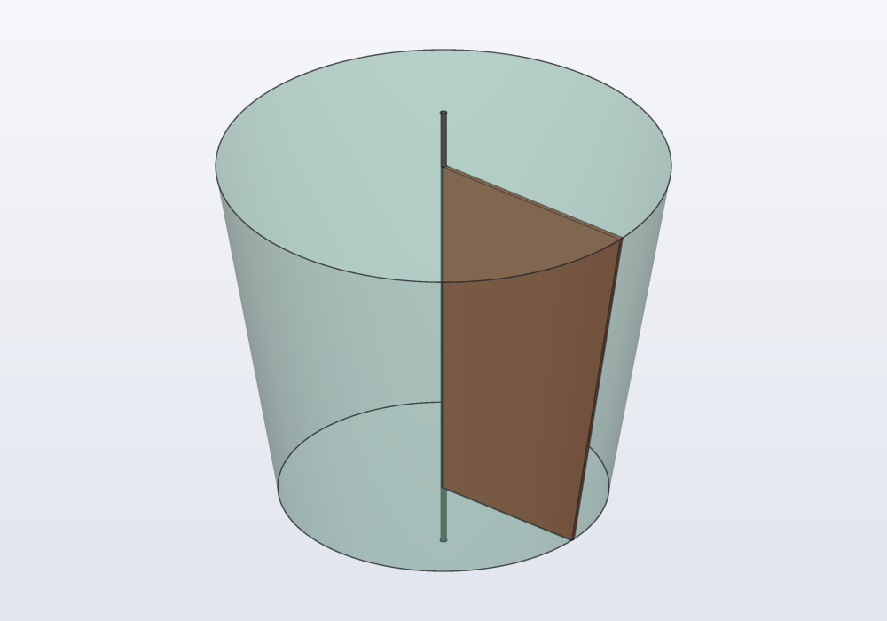
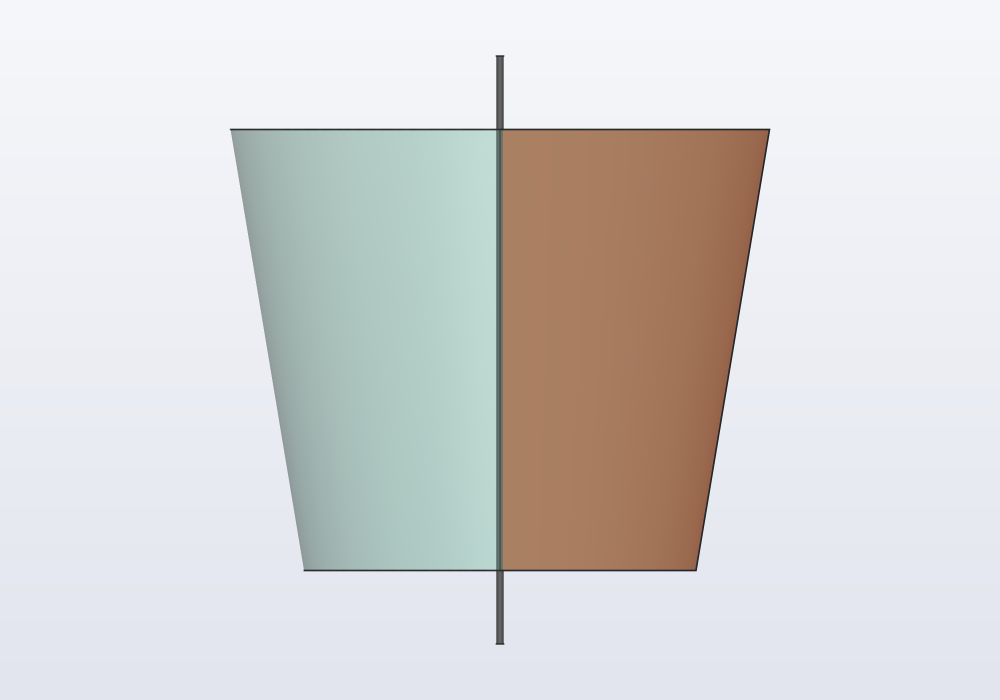
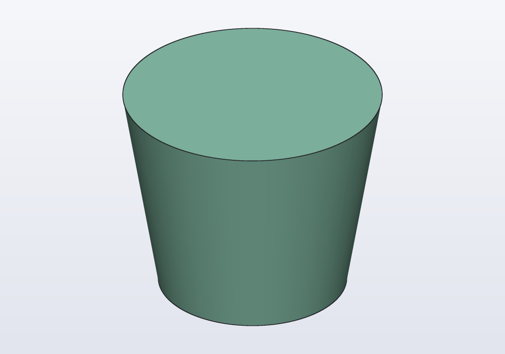
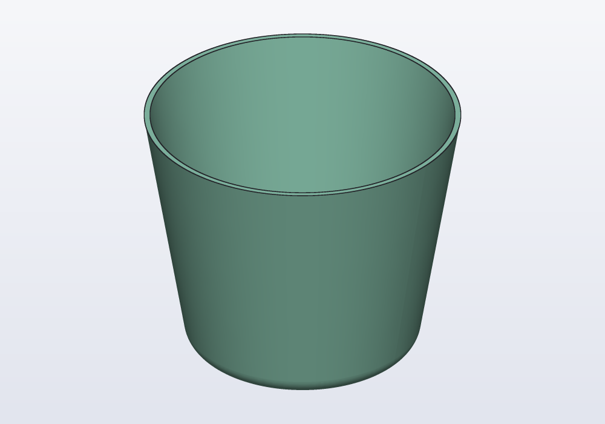
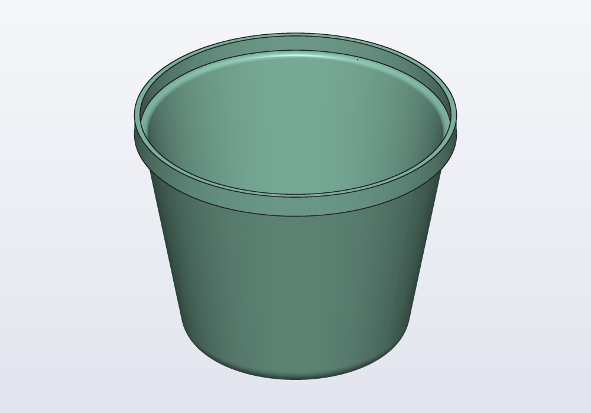
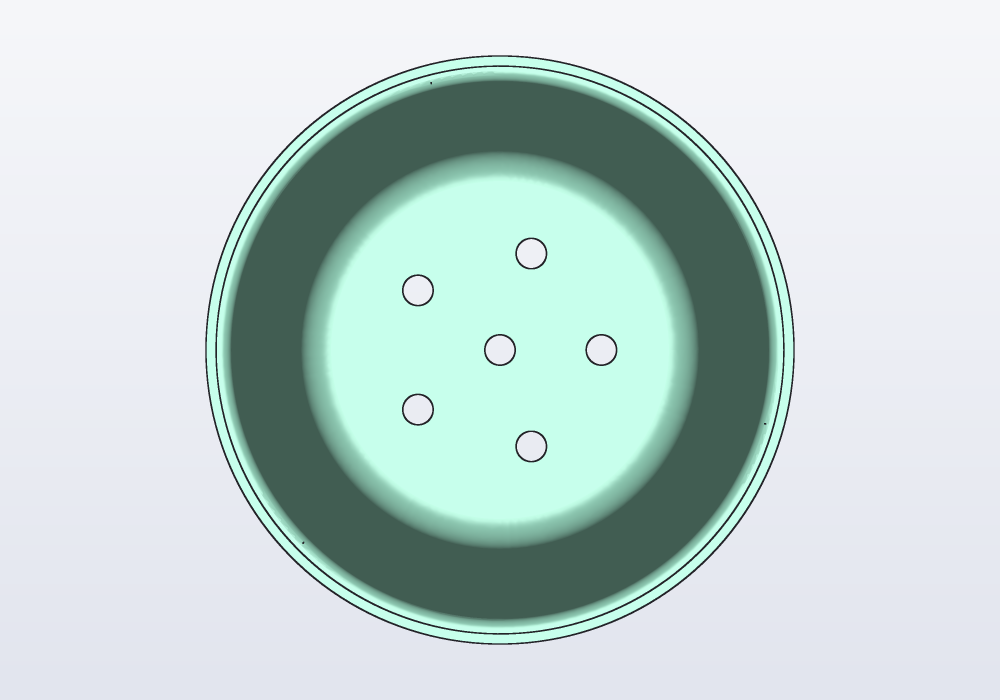
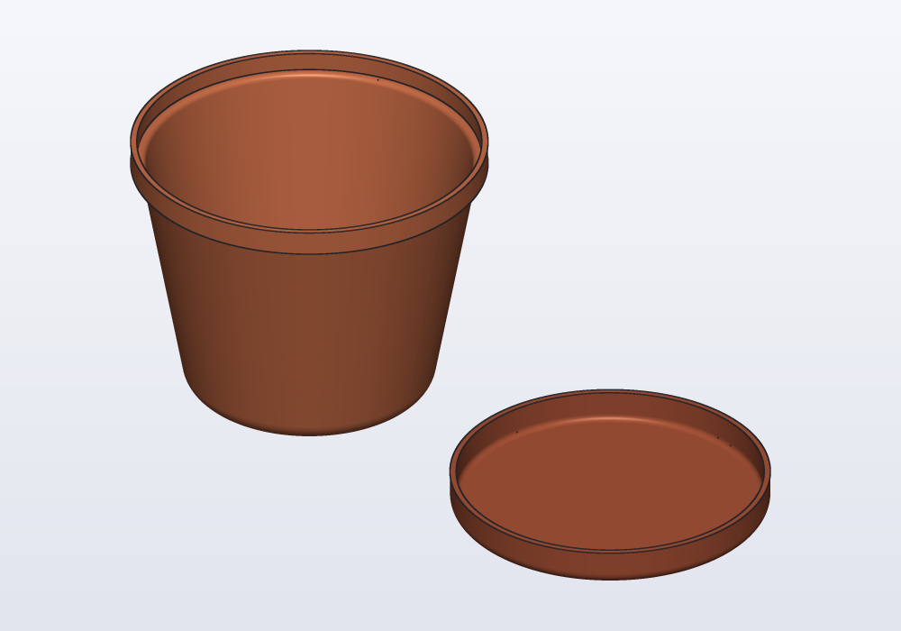

# hackerscad tutorial

hackerscad is a parametric CAD where a model is a small program. You write the
model in `.hcad`, a sandboxed subset of D, and the 3D view follows as you type.
You can also work with the mouse: select a face, pick "Fillet" or "Hole at point"
from the menu, and hackerscad writes the code for you. The file stays the only
source of truth, so it diffs, versions and reviews like any other code.

This tutorial builds one object from nothing: a plant pot with its saucer. It
starts from a rough shape and adds one idea at a time, until the pot is ready
to print. Each step's whole model is in [tutorial/](tutorial), so you can open
any step and carry on from there. The other tools come after the pot, and the
full reference is [LANGUAGE.md](LANGUAGE.md) (or the cheatsheet, F1).

1. [Getting started](#1-getting-started)
2. [The window](#2-the-window)
3. [A plant pot, step by step](#3-a-plant-pot-step-by-step)
4. [With the mouse](#4-with-the-mouse)
5. [Going further](#5-going-further)
6. [The command line](#6-the-command-line)
7. [AI agents](#7-ai-agents)
8. [When something goes wrong](#8-when-something-goes-wrong)

## 1. Getting started

- **Linux:** download `hackerscad-<version>-x86_64.AppImage`, make it
  executable (`chmod +x`) and run it. The same file also contains the command
  line tool: `./hackerscad.AppImage hcad check model.hcad`.
- **Windows:** unzip `hackerscad-<version>-windows-x86_64.zip` anywhere and
  run `hackerscad.exe` in the `hackerscad` folder (the command line tool is
  `bin\hcad.exe`). Without a recent enough OpenGL (virtual machines without
  3D acceleration) it draws with the software OpenGL it ships with. It is not
  signed: if SmartScreen stops it, choose "More info" and then "Run anyway".
- **macOS** (Apple Silicon): unzip `hackerscad-<version>-macos-arm64.zip`,
  move `hackerscad.app` to Applications and clear the attributes macOS puts on
  downloaded files (the quarantine), or it says the app is damaged (it is not signed by an
  Apple developer): `xattr -cr /Applications/hackerscad.app`.
  The command line tool is `hackerscad.app/Contents/Resources/bin/hcad`.
- **From source** (Linux, macOS): install a D compiler (LDC), dub,
  OpenCascade 7.9, GTK 4, libadwaita, GtkSourceView 5, TBB, CMake and Ninja,
  then:

```bash
dub build            # bin/hcad, the command line tool
dub build :gui       # bin/hackerscad, the desktop application
```

The Windows version is built on Linux and can be tried there with Wine:
`tools/setup-win-cross.sh` downloads the toolchain and the libraries once,
then `packaging/windows/package.sh` builds the zip.

Start the application with a file (`hackerscad model.hcad`) or without one. A
new file starts from a small example: a clip that keeps bags of biscuits
closed ([examples/bagclip.hcad](../examples/bagclip.hcad)). Try its sliders
first.

## 2. The window

- **Editor** (left): the model. Errors are underlined in red, and a banner over
  the view says what went wrong and where. While you type, a list proposes what
  can follow: the methods after a dot (`s.fi` → `fillet`), the units after a
  number (`30.` → `mm`), the functions of the libraries you import, and inside a
  call the arguments still to give, with the signature above the line and the
  current argument in bold. Up/Down choose, Enter or Tab accept, Escape closes,
  Ctrl+Space opens the list anywhere. Hover a name to read what it does.
- **Cheatsheet** (F1): every object and function in one line, what it takes
  and what it gives, plus "how do I…" recipes. Type in the search field
  ("copy", "hole", "frame"); double-click an entry to insert it at the cursor.
- **View** (centre):
  - right drag rotates, middle drag (or Ctrl + right drag) pans, the wheel
    zooms; left drag rotates or pans, as set by the buttons over the view;
  - Fit (F5), Iso, Top, Front and Right set the camera;
  - the cube button chooses how the parts are drawn (shaded with edges,
    shaded, or wireframe: edges and outlines only, the hidden ones faint) and
    the projection (perspective, or orthographic, where sizes do not change
    with depth: true front, top and right views);
  - the section button opens the section plane (see [Looking inside](#looking-inside-sections-and-rollback)).
- **Parameters** (right): a field for every parameter, the preset menu, and the
  list of parts with their colours, where the eye button hides a part.
- **Features** (right, second tab): the operations of the model, in order.
  Click one to see the model as it was at that step.
- **Console** (bottom, Ctrl+J): what the model prints, failed checks, and dimmed
  timestamped messages from hackerscad itself (evaluated, saved, exported).

Shortcuts: Ctrl+N new, Ctrl+O open, Ctrl+S save, Ctrl+Shift+S save as, Ctrl+E
export, F9 parameters panel, Ctrl+Q quit. hackerscad asks before discarding
unsaved changes, and reloads the file when another program changes it.

## 3. A plant pot, step by step

Make a new file (Ctrl+N), delete the example and follow along. The view
redraws at every change; when the code has an error, the last good model stays
and a banner says what is wrong.

### Step 1: a first shape

A pot is round, so draw half of its side and turn it around the axis. A
profile is a flat shape on XY: here `x` is the radius and `y` the height. In
the pictures, the profile (orange) stands where it turns, next to the axis,
inside the pot it makes (see-through):

<p align="center">
</p>

```d
module pot;

import std.shapes;

@part
Solid pot()
{
    // half of the pot's side, drawn on XY: x is the radius, y the height
    auto side = polygon([
        vec(0.mm, 0.mm),
        vec(40.mm, 0.mm),
        vec(55.mm, 90.mm),
        vec(0.mm, 90.mm),
    ]);
    // turned around the axis: x is the radius, y the height
    return side
        .revolve();
}
```

- `module pot;` names the file, `import std.shapes;` brings boxes, cylinders,
  profiles and the rest.
- `@part` marks a function whose solid is shown and exported: one object in a
  3MF file.
- Lengths have units (`40.mm`, `9.cm`, `1.in`), angles too (`90.deg`).
- `.revolve()` turns the profile all the way round its Y axis and stands the
  result up: the profile's x becomes the radius, its y the height along Z.
  With an axis, `.revolve(axis: X)` turns around that one and leaves the
  result where it is.
- Calls chain with a dot, one per line: each line is one operation.

<p align="center"></p>

[The whole model](tutorial/pot-1.hcad) ·
[the model of the pictures above](tutorial/pot-1-profile.hcad)

### Step 2: parameters

Numbers written in the code are hard to change. Give them names and mark them
`@param`: each gets a field in the side panel, with its limits.

```d
@param("Bottom diameter", min: 40.mm, max: 200.mm)
immutable bottom = 80.mm;

@param("Top diameter", min: 40.mm, max: 250.mm)
immutable top = 110.mm;

@param("Height", min: 30.mm, max: 250.mm)
immutable height = 90.mm;

@part
Solid pot()
{
    auto side = polygon([
        vec(0.mm, 0.mm),
        vec(bottom / 2, 0.mm),
        vec(top / 2, height),
        vec(0.mm, height),
    ]);
    return side
        .revolve();
}
```

The pot looks the same, but now drag the "Height" slider: the pot follows.
`immutable` is a value that never changes; values are never modified in
hackerscad, every operation gives a new one.

[The whole model](tutorial/pot-2.hcad)

### Step 3: hollow, with a rounded bottom

Split the pot in two functions. `block()` is the full shape, `pot()` the part
that hollows it. A function without `@part` is a helper: it is not shown, but
other code can use it.

```d
@param("Wall", min: 1.mm, max: 5.mm)
immutable wall = 2.mm;

/// The pot's shape, full: its side profile turned around the axis.
Solid block()
{
    // half of the side, drawn on XY: x is the radius, y the height
    auto side = polygon([…]);
    return side
        .revolve()
        .fillet(edges.of(faces.bottom), r: 8.mm);
}

@part
Solid pot()
{
    return block()
        .shell(open: faces.top, thickness: wall);
}
```

- `faces.bottom` and `faces.top` pick faces by where they look, and
  `edges.of(…)` the edges around them: no face numbers that change when the
  model changes.
- `fillet` rounds the edge around the bottom, `shell` empties the solid,
  leaving walls `wall` thick, open at the top.
- Round first, then hollow: the shell follows the rounded edge, inside too.

<p align="center"></p>

[The whole model](tutorial/pot-3.hcad)

### Step 4: a rim

A rim makes the pot stronger and easier to hold. It is part of the side, so
it goes into the profile: two more points make a step at the top.

```d
// the rim: how far it stands out, and how tall it is
immutable lip = 3.mm;
immutable band = 8.mm;

    auto side = polygon([
        vec(0.mm, 0.mm),
        vec(bottom / 2, 0.mm),
        vec(top / 2, height - band),
        vec(top / 2 + lip, height - band),
        vec(top / 2 + lip, height),
        vec(0.mm, height),
    ]);
```

`lip` and `band` have no `@param`: they are names for numbers, fixed but
readable.

<p align="center"></p>

[The whole model](tutorial/pot-4.hcad)

### Step 5: drainage holes

Make one hole as a cylinder, copy it around the axis, and subtract them all:
`-` takes one solid away from another (`+` joins them, `&` keeps what they
share).

```d
@part
Solid pot()
{
    auto body = block()
        .shell(open: faces.top, thickness: wall);
    // drainage: one hole in the middle and five around it
    auto hole = cylinder(d: 6.mm, h: 3 * wall)
        .move(z: -wall);
    auto holes = hole + hole
        .move(x: bottom / 4)
        .circularPattern(5, axis: Z);
    return body - holes;
}
```

- `auto` names a value inside a function; its type comes from what it holds.
- The cylinder starts below the bottom and ends above it, so the cut goes
  right through.
- `circularPattern(5, axis: Z)` makes five copies evenly around the Z axis.

From above, inside the pot:

<p align="center"></p>

[The whole model](tutorial/pot-5.hcad)

### Step 6: the saucer, and colours

A second `@part` is a second object: the saucer. The colour goes in `@part`.

```d
@part("#c96f4a")
Solid pot()
{
    …
}

@part("#a9553a")
Solid saucer()
{
    return cylinder(d: bottom + 24.mm, h: 12.mm)
        .fillet(edges.of(faces.bottom), r: 4.mm)
        .shell(open: faces.top, thickness: wall)
        .nextTo(pot, X, gap: 15.mm);
}
```

- Colours are CSS names (`"orange"`), `"#RRGGBB"` or `rgb(r, g, b)`. Without
  one a part is mint.
- `.nextTo(pot, X, gap: 15.mm)` puts the saucer beside the pot, 15 mm away
  along X: both print in one go. `pot` here is the pot part.
- The saucer is sized from the pot's `bottom`: change the pot and the saucer
  follows.
- A 3MF export keeps the two objects apart, with their colours.

<p align="center"></p>

[The whole model](tutorial/pot-6.hcad)

### Step 7: ribs

Ribs on the outside, leaning like the side. Each rib is a slim cone, sunk in
the wall: hidden at the bottom, it comes out little by little up to the rim.

```d
@param("Ribs", min: 0, max: 24)
immutable ribs = 8;

@part("#c96f4a")
Solid pot()
{
    auto body = block()
        .shell(open: faces.top, thickness: wall);
    // ribs on the outside, leaning like the side
    if (ribs > 0)
    {
        // slim cones sunk in the wall, from above the rounded bottom: hidden
        // at first, they come out little by little up to the rim
        immutable slope = atan((top - bottom) / 2 / (height - band));
        immutable start = 8.mm;
        auto rib = cone(d1: 0.5.mm, d2: 6.mm, h: (height - band - start) / cos(slope))
            .rotate(y: slope)
            .move(x: bottom / 2 + start * tan(slope) - 1.2.mm, z: start);
        // what would show inside the pot is cut away again
        auto inside = block() - body;
        body = body + rib.circularPattern(ribs, axis: Z) - inside;
    }
    // drainage: one hole in the middle and five around it
    …
    return body - holes;
}
```

- `if` works as in D, and so do `foreach`, functions and arrays.
- `atan`, `cos` and `tan` take and give angles; dividing two lengths gives a
  plain number.
- A rib is thicker than the wall near the rim, so it would show inside the
  pot. `block() - body` is exactly the inside of the pot: taking it away again
  keeps the inside smooth.
- `ribs` is a whole number: its slider moves in steps of one, and 0 turns the
  ribs off.

<p align="center"></p>

[The whole model](tutorial/pot-7.hcad)

### Step 8: checks

Some values make no sense: a 0.8 mm wall breaks, a pot narrower at the top
never lets its plant out. `unittest` blocks write such requirements next to the
model. They run after every change; when one fails, the console says which.

```d
// the design's requirements, checked after every change
unittest
{
    assert(wall >= 1.2.mm, "walls under 1.2 mm break when printed");
    assert(top >= bottom, "a pot narrower at the top keeps its plant forever");
    // the soil it holds: the full shape minus the pot
    immutable soil = block.volume - pot.volume;
    writeln("soil: $(format("%.2f", soil / (10.cm) ^^ 3)) l");
}
```

- A failed `assert` keeps the model in the view and shows its message in the
  console (and to `hcad check`, and to AI agents).
- Solids can be measured: `.volume`, `.bbox.size`. The console shows
  `soil: 0.60 l`.

[The whole model](tutorial/pot-8.hcad)

### Step 9: presets

A preset is a named set of values: "small", "large". Each parameter says its
value in each preset; the side panel gets a menu to switch.

```d
@param("Bottom diameter", min: 40.mm, max: 200.mm)
@preset("small", 60.mm) @preset("large", 120.mm)
immutable bottom = 80.mm;

@param("Top diameter", min: 40.mm, max: 250.mm)
@preset("small", 80.mm) @preset("large", 160.mm)
immutable top = 110.mm;

@param("Height", min: 30.mm, max: 250.mm)
@preset("small", 65.mm) @preset("large", 130.mm)
immutable height = 90.mm;

@param("Ribs", min: 0, max: 24)
@preset("small", 0) @preset("large", 12)
immutable ribs = 8;
```

A parameter without a value for a preset keeps its own: the wall stays 2 mm
in all three.

<p align="center"></p>

[The finished pot](tutorial/pot-9.hcad)

### Printing it

Ctrl+E exports: the dialog lists 3MF (one object per part, with its colour),
STL, STEP and PNG. For the printer, 3MF keeps the pot and the saucer as two
objects, ready to be placed and coloured in the slicer. The same from the
command line, with a preset:

```bash
hcad render pot.hcad -o pot.3mf --preset large
```

## 4. With the mouse

Click a face or an edge in the view to select it. The selection's details show
at the bottom of the view, and the editor jumps to the line that created it.
Shift+click adds to the selection.

Right-click opens the menu for the selection:

- **Fillet, Chamfer** for the selected edges; **Shell** opens the selected faces
  and hollows the solid; **Draft** tapers faces for moulding.
- **Hole at point**: a clearance, tapping or heat-set insert hole for M2…M8,
  exactly where you clicked. **Pocket** and **Boss** cut into or grow from the face.
- **Measure**: sizes, areas, distances. **Copy as code**: the selector that picks
  the selection, e.g. `faces.top + faces.front`.
- **View**: look at the face, fit, standard views.

Every action writes code into the right part, with a selector rather than a
face number, and puts each call on its own line:

```d
module mouse;

import std.shapes;

@part
Solid block()
{
    return box(40.mm, 30.mm, 20.mm)
        .fillet(edges.of(faces.top), r: 2.mm)
        .shell(open: faces.top, thickness: 1.5.mm);
}
```

Undo (Ctrl+Z) takes the code back as for any edit.

## 5. Going further

The pot used profiles, features and patterns. Here are the other tools,
each with a complete example to paste into a new file.

### Constrained sketches

For shapes defined by relations rather than coordinates, use a **constrained
sketch**. Add points, lines, arcs and circles, then the
constraints, and hackerscad's solver finds the positions:

```d
module sketched;

import std.shapes;

@part
Solid bracket()
{
    auto s = sketch();
    auto a = s.point(0, 0, fixed: true);
    auto b = s.point(40, 0);
    auto c = s.point(40, 30);
    auto d = s.point(0, 10);
    auto bottom = s.line(a, b), right = s.line(b, c), top = s.line(c, d), left = s.line(d, a);
    s.horizontal(bottom);
    s.vertical(right);
    s.vertical(left);
    s.length(bottom, 50.mm);
    s.length(right, 30.mm);
    s.length(left, 12.mm);
    s.fillet(c, 4.mm);
    return s.profile.extrude(8.mm);
}
```

`s.dof` says how many degrees of freedom are left. An under-constrained sketch
still works, with a warning naming the lines of the free points, while
conflicting constraints are an error pointing at them. In the view the pencil
button shows the sketch with its dimensions, and clicking a dimension edits it
in the code.


### Sweeps and lofts

A loft passes smoothly through outlines placed at different heights; a sweep
moves an outline along a path. Together, a jug and its handle:

```d
module jug;

import std.shapes;

// a vase: a smooth solid through outlines at three heights, hollowed
Solid body()
{
    return loft([
        circle(r: 20.mm),
        circle(r: 26.mm).move(z: 40.mm),
        circle(r: 12.mm).move(z: 80.mm),
    ]);
}

@part("orange")
Solid jug()
{
    auto vase = body()
        .shell(open: faces.top, thickness: 2.mm);
    // a handle: a circle moved along a smooth curve, from the neck to the belly
    auto curve = spline([
        vec(12.mm, 0.mm, 72.mm),
        vec(30.mm, 0.mm, 74.mm),
        vec(40.mm, 0.mm, 52.mm),
        vec(24.mm, 0.mm, 30.mm),
    ]);
    auto handle = circle(d: 7.mm).sweep(curve);
    // its ends go into the wall: what would show inside is cut away
    return vase + handle - (body() - vase);
}
```

- `loft([…])` goes through the circles in order; `ruled: true` gives flat
  sides instead of smooth ones.
- `spline([…])` is a smooth curve through its points; `path([…])` has straight
  segments, and `helix(r:, pitch:, height:)` is for springs and threads (sweep
  with `frenet: true`).
- The outline is drawn on XY around the origin: the sweep carries it along the
  curve, square to it.
- The ends of the handle go into the wall; `body() - vase` is the inside of
  the jug, and taking it away keeps the inside smooth, as for the pot's ribs.

### Libraries: screws, threads, gears, enclosures

```d
module fixings;

import std.shapes;
import hardware;
import gears : spurGear;

@part
Solid lid()
{
    auto l = box(50.mm, 50.mm, 6.mm);
    // tools to subtract: their top is on z = 0, going down
    l -= hole(M3, 6.mm, "counterbore").move(x: -15.mm, z: 6.mm);
    l -= hole(M3, 6.mm, "insert").move(x: 15.mm, z: 6.mm);
    l -= nutTrap(M3, 3.mm).move(y: 15.mm, z: 6.mm);
    return l;
}

// in its hole: the head sits on the floor of the counterbore
@part("silver")
Solid bolt()
{
    // a plain shank: threaded: true also models the thread (slower)
    return screw(M3, 12.mm)
        .move(x: -15.mm, z: 6.mm - M3.headHeight - 0.2.mm);
}

@part("orange")
Solid gear() => spurGear(1.5.mm, 24, 6.mm, bore: 5.mm).move(x: 70.mm);
```

- `hardware`: the sizes `M2`…`M8` (`M3.clearance`, `M3.tap`, `M3.insert`…),
  `screw`, `nut`, `washer`, `hole(size, depth, kind)` with kind `"clearance"`,
  `"tap"`, `"insert"`, `"counterbore"` or `"countersink"`, and `nutTrap`.
- `threads`: `threadedRod(d, pitch, length)` and `tappedHole(d, pitch, depth)` for real
  ISO threads. For an M3 printed in plastic, a `"tap"` hole and a self-tapping
  screw or a heat-set `"insert"` is usually better.
- `gears`: `spurGear`, `rack`, `centerDistance` to place meshing gears.
- `hinges`, `snaps`, `enclosures`: print-in-place hinges, snap-fit hooks, boxes
  with lids. [examples/library.hcad](../examples/library.hcad) shows them all.
- Your own: put functions in `lib/name.hcad` next to the model and
  `import lib.name;`. To use them in every project, put them in the personal
  library folder (`~/.local/share/hackerscad/lib` on Linux,
  `%APPDATA%\hackerscad\lib` on Windows, `~/Library/Application
  Support/hackerscad/lib` on macOS) or in a folder listed in `$HCAD_PATH`.
  A library of several files is a folder with a `package.hcad` that says
  `public import pizza.base, pizza.toppings;`: then `import pizza;` is
  enough.

### Transparency and reference parts

```d
module colours;

import std.shapes;

@part
Solid holder()
{
    return box(30.mm, 30.mm, 20.mm)
        .fillet(edges.parallel(Z), r: 4.mm)
        - cylinder(d: 14.mm, h: 20.mm).move(z: 4.mm);
}

// see-through, and left out of exports: the bottle the holder is for
@part("slategray", alpha: 0.35, export: false)
Solid bottle() => cylinder(d: 13.6.mm, h: 60.mm).move(z: 4.mm);

@part("#F2BE94")
Solid cap() => cylinder(d: 18.mm, h: 6.mm).move(x: 40.mm);
```

- `alpha:` below 1 makes a part see-through in the view and in pictures.
- `export: false` makes a reference part. It is drawn so you can check the fit
  (a shaft, a circuit board, the phone a stand holds), but STL, 3MF and STEP
  leave it out.

[examples/knob.hcad](../examples/knob.hcad) puts these together: a fluted knob,
printable without supports, on a see-through potentiometer shaft.

### Looking inside: sections and rollback

- **Section view:** the section button over the view opens a bar with the
  plane (XY, XZ, YZ or the selected face), a slider to move it and a button to
  flip its side. Cut solids show their inside filled and hatched. In face mode,
  clicking another face moves the plane there.
- **Steps:** the Steps tab lists how the model is built, in the order the code
  runs, grouped by function: operations, calls of your functions, moves, and
  what each function returns. Select a step to see what it made (a union or a
  difference shows its two operands in two colours, a loop all its runs); the
  bar over the view says you are not looking at the final model, and "Show
  final model" or Esc goes back.

### Drawings

A function marked `@drawing` describes a technical sheet:

```d
module sheet;

import std.shapes;

@part
Solid flange()
{
    auto f = cylinder(d: 60.mm, h: 8.mm) + cylinder(d: 30.mm, h: 20.mm);
    f -= cylinder(d: 16.mm, h: 20.mm);
    f -= cylinder(d: 6.mm, h: 8.mm)
        .move(x: 22.mm)
        .circularPattern(4, axis: Z);
    return f;
}

@drawing
Drawing flangeSheet()
{
    auto d = drawing(title: "Flange", material: "PETG");
    d.standardViews(flange);
    d.section(flange, XZ, label: "A");
    return d;
}
```

`standardViews` lays out front, top, side and isometric views, picks a
standard scale, and adds the overall dimensions and the hole callouts
("4× ⌀6"). `section` adds a hatched cut. Export with `hcad render sheet.hcad
-o flange.pdf` (or `.svg`, `.dxf`).

## 6. The command line

The command line tool does what the application does, without a window:

```bash
hcad render model.hcad -o model.3mf -o model.step      # several outputs at once
hcad render model.hcad -o shot.png                      # iso picture
hcad render model.hcad -o shot-views.png                # iso, front, top, right
hcad render model.hcad -o shot-top.png                  # one view: top, front, right…
hcad render model.hcad -o model.stl -D width=80.mm --preset large
hcad check model.hcad                                    # parts, sizes, checks
hcad check model.hcad --json                             # the same for scripts
hcad docs                                                # the language reference
```

## 7. AI agents

`hcad mcp` is a Model Context Protocol server: an agent such as Claude Code
can write models, check them, look at pictures of the result and export,
without guessing the language.

```bash
claude mcp add -s user hcad -- hcad mcp   # Claude Code
codex mcp add hcad -- hcad mcp            # Codex
agy mcp add hcad hcad mcp                 # Antigravity (CLI and IDE)
```

When `hcad` is not in your `PATH`, write its full path in place of the
`hcad` before `mcp`: the README tells where it is on each system.

Then ask, for example, "a hexagonal pen holder, 10 cm tall, with a rounded
bottom". The agent reads the reference (`hcad_docs`), writes the model, checks
it (`hcad_check`), looks at renders (`hcad_render`) and fixes it.

When the application is open, the `hcad_gui_*` tools drive it: open a file,
edit the code (Ctrl+Z undoes its changes too), set parameters, turn, pan and
zoom the view, select and measure faces, run the context menu, move the
section plane, save, take screenshots. You see the agent work in the window,
and the agent sees what you see: what you select, and which lines you changed.

Each window has a name in its header bar, random at start (say `blue-otter`):
click it to choose your own. With several windows open, tell the agent which
one to use: "add a 3 mm fillet to the lid in blue-otter".

## 8. When something goes wrong

- **Red underline and a banner over the view:** a syntax or evaluation error.
  The message names the problem and often suggests the fix ("did you mean
  `r`?").
- **Nothing changes in the view:** the last good model stays visible while the
  code has an error. Read the banner.
- **A feature fails:** fillets and shells are the delicate ones. Try a smaller
  radius, fewer edges at a time, or open all the faces in a single shell.
- **Slow models:** threads, text cut into curved faces and fillets on many
  edges take the longest. hackerscad caches every operation, so changing a
  parameter recomputes only what depends on it.
- **"Unknown argument":** the error lists the arguments the function takes.
  `hcad docs fillet` prints the reference of one function.
