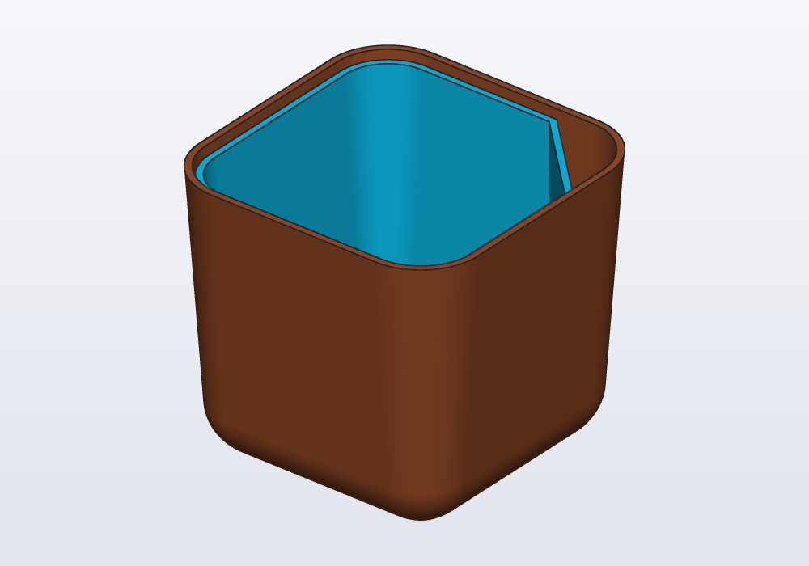
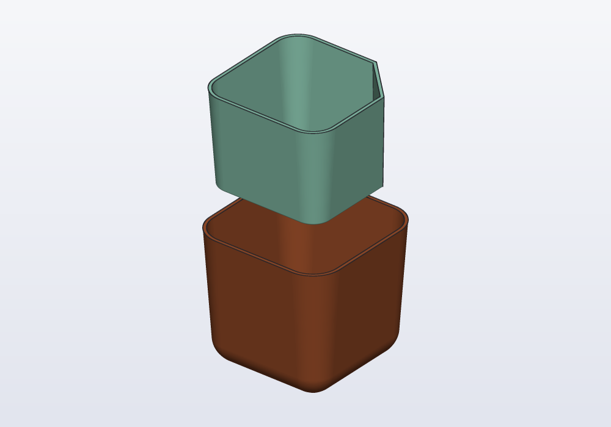

# hackerscad tutorial

This tutorial builds a **self-watering planter**, one step at a time, from a
plain block to two pieces ready to print. You do not need to know how to
program: most of the model is made with the mouse, and the few lines to write
are given, explained in words. Along the way you meet everything you need to
make models of your own.

The planter is two pieces. The tank, below, holds the water; the pot rests
on a shelf inside it and holds the soil. A cotton cord through the bottom of
the pot draws the water up, and a corner cut off the pot lets you fill the
tank without lifting the pot. It is 71 × 71 × 66 mm, and both pieces print
without supports.

## The pages

1. [Install and first start](tutorial/01-install.md): install hackerscad, open
   it, move around a model.
2. [The window](tutorial/02-the-window.md): what each part of the window is
   for.
3. [The first block](tutorial/03-the-first-block.md): a new model, and round
   corners made with the mouse.
4. [Shape the tank](tutorial/04-shape-the-tank.md): sides that open out, a
   round bottom, a hollow inside; sections and measures.
5. [Numbers you can change](tutorial/05-numbers-you-can-change.md):
   parameters.
6. [The pot inside](tutorial/06-the-pot-inside.md): a second part, holes made
   with the mouse, names and loops in the code.
7. [Reading the model](tutorial/07-reading-the-model.md): the steps, what one
   line makes, which line made a face.
8. [The shelf and the corner](tutorial/08-shelf-and-corner.md): flat
   shapes raised into solids, lists, a corner cut off.
9. [Sizes, a choice and a check](tutorial/09-sizes-and-a-check.md): presets, a
   yes-or-no parameter with `if`, a check that warns.
10. [Print it](tutorial/10-print-it.md): export, slice, put it together.
11. [Let an AI agent help](tutorial/11-ai-agents.md): ask an agent, and watch
    it work in the window.
12. [Going further](tutorial/12-going-further.md): the examples, a hook made
    ready to print, a label from a drawing, sketches, sweeps, libraries,
    drawings, the command line, and what to do when something goes wrong.

Each page ends with a picture of how the window should look, and with the
model as it is at that point, to open if something went wrong.

The full description of the language is the
[language reference](LANGUAGE.md); the [cheatsheet](CHEATSHEET.md) lists it
one line per function.
