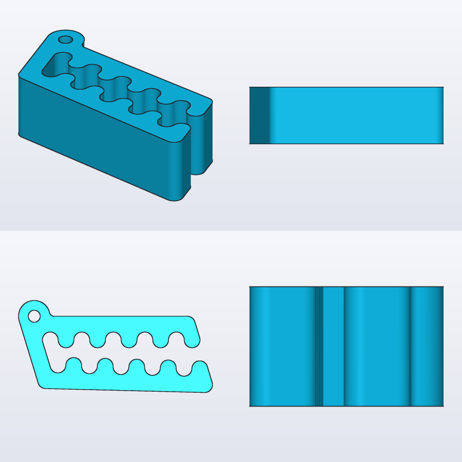
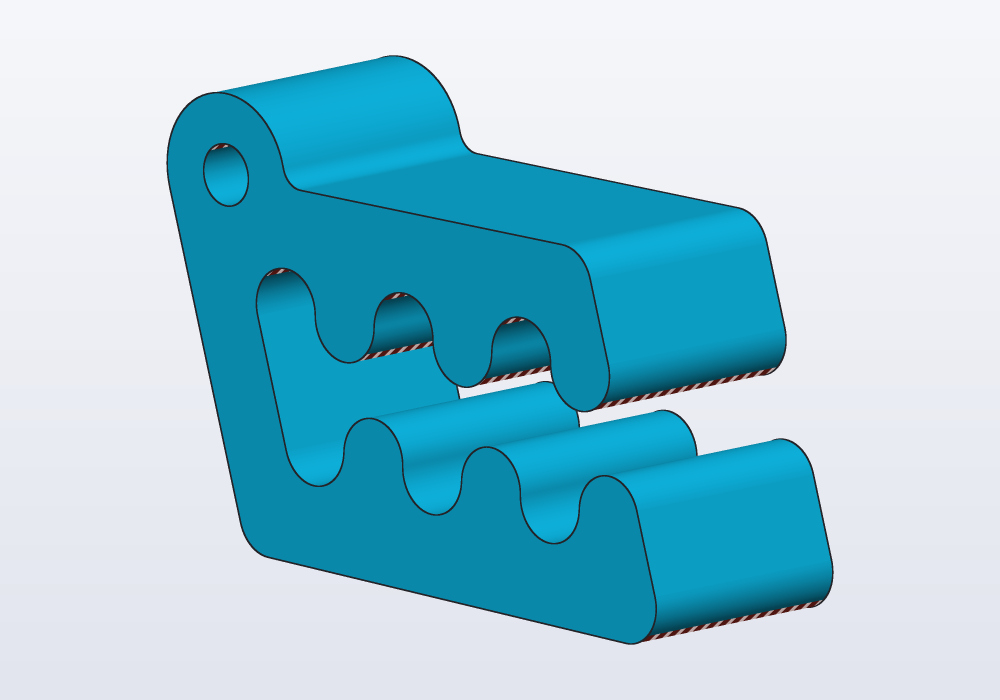

# Working with an AI agent

How to design with Claude Code, Codex or another agent and hackerscad together: installing the skill and the MCP server, what the agent asks before it starts and why, how it works in your windows without overwriting your files, pointing at things with annotations both ways, the loop it follows to check its work, the command line when there is no server, and the guides it reads.

## What you need

An agent does not know hackerscad from its training: left alone it writes OpenSCAD or CadQuery. Give it two things:

| | What it is | Without it |
|---|---|---|
| **the skill** | a text the agent reads: the language, the rules that avoid most mistakes, the tools and when to use them | the agent guesses the language from the tools' descriptions |
| **the MCP server** | `hcad mcp`: the tools themselves (check, render, export, measure, drive your window) | the agent uses the `hcad` command line: it works, without your window |

`hcad` must be on your `PATH` (`hcad --version` answers), or written with its full path below.

### The easy way

Ask the agent:

> Install the hackerscad skill for all my projects from
> https://raw.githubusercontent.com/trikko/hackerscad/main/docs/SKILL.md, with
> https://raw.githubusercontent.com/trikko/hackerscad/main/docs/llms-full.txt
> next to it, then follow its "Setup and updates" section.

It installs the skill, asks before installing hackerscad if it is missing, and adds the server.

### By hand

The skill, printed by your `hcad` so that it matches your version (Claude Code shown; Codex reads it from `~/.agents/skills/hackerscad/`):

```bash
mkdir -p ~/.claude/skills/hackerscad
hcad docs --skill > ~/.claude/skills/hackerscad/SKILL.md
hcad docs > ~/.claude/skills/hackerscad/llms-full.txt
```

The server, once, for all your projects; then restart the agent:

```bash
claude mcp add -s user hcad -- hcad mcp
codex mcp add hcad -- hcad mcp
```

`claude mcp list` and `codex mcp list` show it. Add it once, under one name: two servers give the agent every tool twice. Other agents take the same server in their MCP settings: the command `hcad`, the argument `mcp`.

### Keeping it up to date

The skill carries the stamp of the docs it was made from. At the start of a session the agent runs `hcad docs --stamp` (`hcad_docs` with format `stamp`): when hackerscad has been updated and the stamps differ, it regenerates the skill from the installed `hcad` and reads it again. You do not have to do anything.

## What the agent asks before starting

A good agent asks first, in one message, the few questions that change the result most, numbered, and says that you answer the ones you can: the rest it estimates and makes `@param`s, to change after a test print.

| When the request has | It asks | Why |
|---|---|---|
| a real object to copy or build onto | what to measure and how: *"with a caliper, the distance between the centres of the two holes"* | a photo has no scale; a wrong size is a reprint |
| a photo | one known size, and what the hidden sides look like | the scale, and what the photo cannot show |
| lettering | the font, or offers a similar installed one, or tracing the letters | it never swaps a font without asking |
| a fit (a lid, a pin in a hole) | how it will be made: FDM, resin, machined, which printer | the play depends on it: 0.2–0.3 mm for FDM |
| a thread onto a real thing | which thread, or how to find out (see [the guide on threads](threads.md)) | G1/2 and M20 look alike and do not mix |
| your window | which one, when several are open | it never assumes the most recent |
| a file to save | before overwriting it | your work |

From a photo or a real object its first reply is the questions, even when you said "make it". Say *"just estimate"* to skip them. To remodel a mesh or a STEP file it asks nothing: the sizes are in the file (see [the guide on remodelling](remodel.md)).

## Windows

With hackerscad open, the agent works where you can see it.

- Each window has a **name** in its header bar (*blue-otter*). Tell the agent which one: *"work in blue-otter"*. Click the name to change it.
- With several open, the agent lists them (`hcad_gui_windows`) and asks; it never takes the most recent for yours.
- With none open, or to show a trial or an example, it opens one of its own with `hcad_gui_launch`, giving it the model's code rather than a file: that window works on no file, so trying things there cannot overwrite anything, and your Save asks for a name.
- In a window on your model it changes the code with `hcad_gui_edit`, as typing does (Ctrl+Z undoes it), never by rewriting the file: you may have unsaved changes, and moving a part with the mouse edits the code too.
- At every turn it checks whether the code changed (`hcad_gui_state` with `source_hash` and `user_changed`) and works on your version, not on its earlier copy. Edit freely between requests.
- It leaves the view on what changed, and shows the work as it goes, not only at the end.

## Annotations, both ways

Words are poor at saying *where*. The view is a whiteboard you share.

- **The agent marks it** to ask or to show: an arrow on the face it means, a cross and a label where a wall is too thin, two numbered crosses for *"should the hole go here or here?"*. It frames the view first, and uses a colour that stands out against the part.
- **You mark it**: the **Annotate** button in the view bar, or A, then arrow, cross, circle, freehand line or text, in a colour of your choice. Then say *"put the hole here"* or *"look at my marks"*.
- The agent reads your marks as data, not as a picture: what each one is on (the part, the face, the point in mm) or points at, and its colour's name. A screenshot is needed only for the shape of a line drawn by hand.
- While marks are shown the view is locked: it cannot turn, and changes to the model wait. **Done** or Esc goes back to the live view. **Save** and **Copy** in the annotation bar make a picture with the marks, to send to someone.

## The loop

Whatever the request, the agent works in a loop until the model does what was asked:

1. **Read**: the rules (`hcad_docs`), and the guide for what it is about to use (`hcad_docs` format `guide`).
2. **Write** the model, with the sizes you may change as `@param`s, and your requirements in `unittest` blocks so that every check repeats them.
3. **Check**: `hcad_check` gives errors with line, column and a suggestion, the parts, their sizes and volumes, and the failed `unittest`s.
4. **Render and look**: `hcad_render` gives pictures from four sides. The agent must look at them, not only read the numbers.
5. **Fix**, and again, until the sizes and the pictures match the request; then **export**.

A request turned into a model, its requirement a `unittest`, and the views the agent looks at:

<!-- render: agents-views -->
```d
import carlo;

// the request: "Carlo with five teeth, for thicker bags,
// no taller than 20 mm"

@param("Teeth on each jaw", min: 1, max: 8)
immutable teeth = 5;

@part("Sky Pop")
Solid clip() => carlo(teeth: teeth, height: 18.mm);

unittest
{
    assert(clip.bbox.size.z <= 20.mm, "no taller than 20 mm");
}
```



For a part to print it also looks at printability: overhangs that need supports striped red, walls too thin hatched violet.

<!-- render: agents-printability --printability --from 1,-1,0.3 -->
```d
import carlo;

// Carlo stood on its long side: the undersides of the
// upper teeth hang over the bed

@part("Sky Pop")
Solid standing()
{
    auto c = carlo().rotate(x: 90);
    return c.move(z: -c.bbox.min.z);
}
```



Before saying it is done the agent checks: no errors and no warnings, the sizes match, reference parts fit with no overlap, printability looked at, the pictures looked at. It tells you what it could not check (a fit that needs a test print, a size it estimated) and which `@param`s to change for variants.

## Without the server: the command line

The same work, through the shell; the skill tells the agent these commands, and you can run them too:

```bash
hcad docs --guide threads
hcad check model.hcad --json
hcad render model.hcad -o model-views.png
hcad render model.hcad -o model.png --printability
hcad render model.hcad -o model.3mf -D width=80.mm
```

What the command line cannot do is your window: no editing, no annotations, no view. Ask the agent to write the model to a file, and open it yourself; hackerscad reloads it when the file changes.

## The guides

These pages are written for you and for the agent alike. The agent reads one in full before using a feature: `hcad_docs` with format `guide` and a topic (`threads`, `sketches`, `remodel`, `parts`…), or without a topic for the list; on the command line `hcad docs --guide NAME`. In the application, **☰ › Guides** opens them on the website.

## Common problems

| What happens | Why, and what to do |
|---|---|
| the agent writes `cube()`, `translate()`, `difference()` | it does not have the skill: install it, or tell it to run `hcad docs` first |
| the agent has no `hcad_*` tools | the server is not added, or the agent was not restarted after adding it; check with `claude mcp list` |
| every tool appears twice | two servers under different names: remove one |
| *hcad: command not found* | `hcad` is not on the `PATH`: use its full path in `claude mcp add`, or link it (see the README) |
| the window asks which version to keep | the file was rewritten while the window had changes: the agent should use `hcad_gui_edit`; keep yours |
| the agent changed the wrong window | say its name; it should have asked |

## In the application

- The window's **name** is in the header bar, with the agent icon: click it to rename the window (*Name for AI agents*).
- **Annotate** (A) in the view bar: arrows, crosses, circles, freehand lines and text, a colour for each; Clear, Done, Save, Copy in its bar.
- **☰ › Guides**, **Cheatsheet**, **Language Reference**: the same texts the agent reads.

## With an AI agent

This guide is `hcad_docs` format `guide`, topic `agents` (`hcad docs --guide agents`). The rules the agent follows in brief are in [AGENTS.md](../AGENTS.md), `hcad_docs` format `agents`: read them to know what to expect of it, and say so when it does not.
