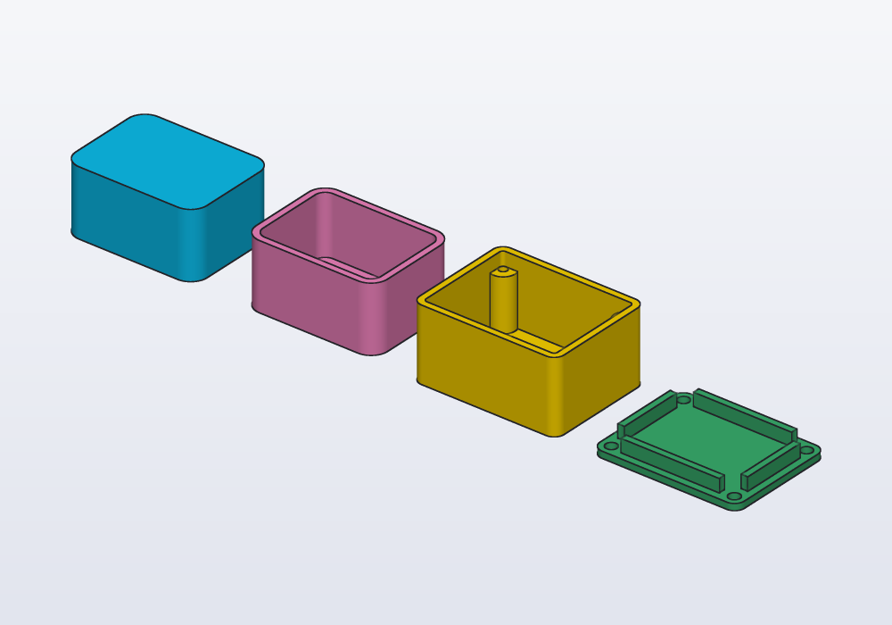
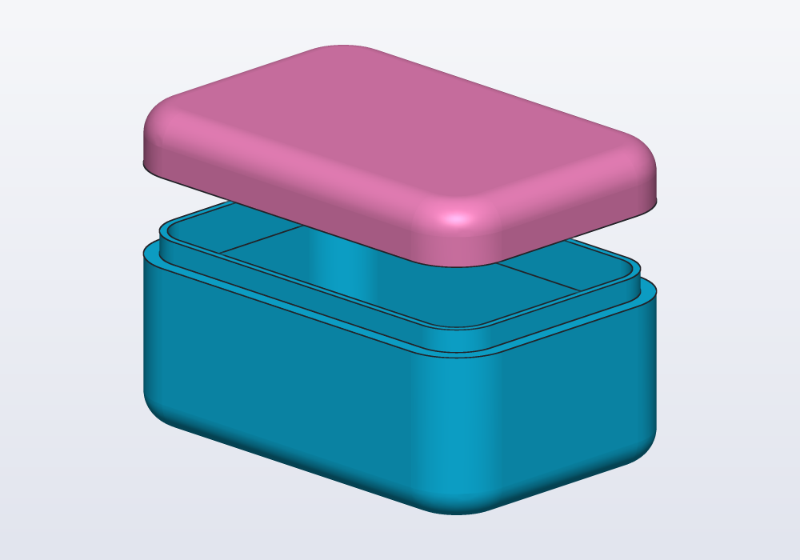
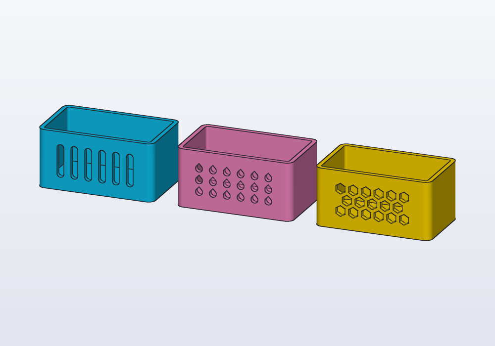
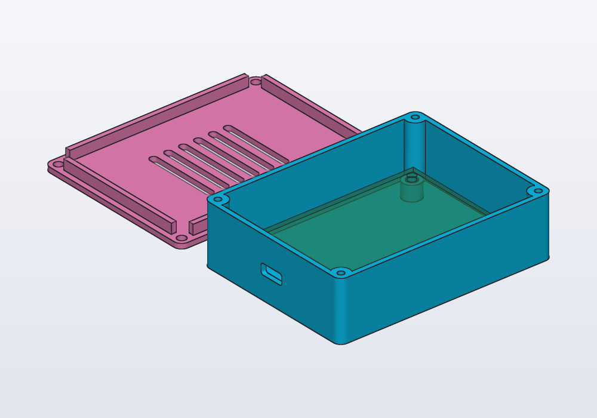

# Enclosures and boxes

Boxes, trays and cases with lids: the `enclosures` library (`roundedBox`, `tray`, `enclosure(…).base` and `.lid`) and every option of it, boxes hollowed by hand with `shell()` or cut in two, screw bosses, ventilation slots and holes, and a worked example of a case for a circuit board.

## Choosing a way to make one

| You want | Use |
|---|---|
| a block with rounded vertical edges, to start from | `roundedBox(x, y, z, r)` |
| an open box, a drawer, a tray | `tray(x, y, z, wall:, r:)` |
| a closed case with a lid that screws on | `enclosure(vec(x, y, z), …)`: `.base` and `.lid` |
| a box of another shape (a sketch, a loft, edges rounded all round) | the solid first, then `.shell(open: faces.top, thickness:)` |
| a closed soft shape opened later, base and lid from one solid | hollow it with `offset`, then cut it with `halves` |
| a lid that snaps on, or sits flush | **Examples › Box with lid** in the application (a snap, a lip, screws or a flush lid to choose) |

Whatever the way, the sizes that matter come from what goes inside: measure it first, then add the room round it.

## The enclosures library

`import enclosures;` gives three functions, each built on the one before.

<!-- render: enclosures-library -->
```d
import enclosures;

// the library's three shapes, side by side

@part("Sky Pop")
Solid block() => roundedBox(40.mm, 30.mm, 20.mm, 5.mm);

@part("Pink Pop")
Solid open() => tray(40.mm, 30.mm, 20.mm,
        wall: 2.mm, r: 5.mm)
    .move(x: 55.mm);

@part("gold")
Solid base() => enclosure(vec(40.mm, 30.mm, 20.mm))
    .base
    .move(x: 110.mm);

@part("mediumseagreen")
Solid lid() => enclosure(vec(40.mm, 30.mm, 20.mm))
    .lid
    .move(x: 165.mm);
```



### roundedBox and tray

`roundedBox(x, y, z, r)` is a box centred in X and Y, standing on z = 0, its four vertical edges rounded by `r` (3 mm unless given). `tray(x, y, z, wall:, r:)` is that box hollowed from the top: the outside measures `x × y × z`, the walls and the floor are `wall` thick (2 mm unless given), and the inside corners are rounded by `r - wall`.

| Parameter | What it does | Default |
|---|---|---|
| `x`, `y`, `z` | the outside size | — |
| `r` | radius of the vertical edges outside | `3.mm` |
| `wall` (tray only) | thickness of the walls and the floor | `2.mm` |

The radius must be less than half the narrower side, and not equal to the wall: a wall thinner than `r` leaves round corners inside, a thicker one sharp ones.

### enclosure

`enclosure(inner, …)` returns a struct with two solids, `.base` and `.lid`, both standing on z = 0 and laid out to print:

- **the base** is a tray whose free space inside is `inner` (x, y, z), so its outside is `inner.x + 2 * wall` by `inner.y + 2 * wall`, and `inner.z + wall` tall. In each corner stands a post with a pilot hole for the screw (`screw.tap`, ⌀2.5 for M3: a self-tapping screw, or a tap) from the rim to the floor;
- **the lid** is a plate as large as the base, `wall` thick, with a **lip** on it: a ring that goes `lidHeight` down inside the base with `clearance` all round, notched round the posts. It has a clearance hole (`screw.clearance`) over each post. It is made upside down, the plate on the ground, as it prints.

| Parameter | What it does | Default |
|---|---|---|
| `inner` | the free space inside, `vec(x, y, z)` | — |
| `wall` | walls, floor and lid plate | `2.mm` |
| `r` | radius of the vertical edges outside | `3.mm` |
| `lidHeight` | how far the lip goes down into the base | `4.mm` |
| `screw` | the screw size, from the `hardware` library (`M2` to `M8`) | `M3` |
| `clearance` | play between the lip and the walls, and round the posts | `0.2.mm` |

To pass a screw size, import it too: `import hardware : M3;` (or `M2_5`, `M4`…); the [guide on holes](holes.md) lists the sizes and what each hole is for.

What the numbers mean once it is closed:

- the case is `inner.z + 2 * wall` tall, the lid's plate resting on the rim of the walls;
- the lip takes the top `lidHeight` of the inside along the walls, `wall` thick: anything taller than `inner.z - lidHeight` must stay `wall + clearance` away from the walls;
- the posts stop `lidHeight + clearance` under the rim, so the screw crosses the plate and that gap before it bites: with the defaults an M3 × 12 goes about 6 mm into the post;
- the screw heads stand on the lid; for heads flush with it, cut a counterbore over each hole (`hole(M3, …, "counterbore")`, see the guide on holes).

To see it closed, turn the lid over onto the base:

```d
import enclosures;

// the lid turned over onto the base, as it closes

immutable inner = vec(40.mm, 30.mm, 20.mm);
immutable wall = 2.mm;

@part("gold")
Solid base() => enclosure(inner, wall: wall).base;

@part("mediumseagreen")
Solid lid() => enclosure(inner, wall: wall).lid
    .rotate(x: 180.deg)
    .move(z: inner.z + 2 * wall);

unittest
{
    // closed, the lid and the base must not overlap
    assert((base() & lid()).volume == 0.mm ^^ 3);
}
```

The library is a file of hackerscad code (`lib/enclosures.hcad`): when a case needs something it does not do, copy the function into the model and change it.

## Shells: a box of any shape

`solid.shell(open: faces, thickness:)` hollows a solid, leaving the faces in `open` open and making walls `thickness` thick inwards: the outside stays where it was. The faces are selected as for any feature: `faces.top`, two at once with `faces.top + faces.front`, or by a filter. Round the edges **before** shelling: the inside follows the rounds of the outside.

```d
// a box open on top, its edges rounded before the shell

@part("Sky Pop")
Solid cup() => box(40.mm, 30.mm, 20.mm)
    .fillet(edges.parallel(Z), r: 6.mm)
    .shell(open: faces.top, thickness: 2.mm);
```

A shell always has an opening. For a closed shape cut in two, a base and a lid that meet anywhere, hollow it with `offset` instead (the solid less itself shrunk by the wall), cut it with a plane, and add a lip so the two halves locate:

<!-- render: enclosures-soft --from 1,-1,0.5 -->
```d
// a soft box: every edge rounded, hollowed, cut in two

@param("Wall", min: 1.2.mm, max: 4.mm)
immutable wall = 2.mm;

@param("Play of the lid", min: 0.1.mm, max: 0.5.mm)
immutable play = 0.2.mm;

immutable cutZ = 22.mm;

Solid outside() => box(60.mm, 40.mm, 30.mm)
    .fillet(edges.parallel(Z), r: 8.mm)
    .fillet(edges.perpendicular(Z), r: 4.mm);

Solid hollow() => outside() - outside().offset(-wall);

Plane cut() => plane(origin: vec(0.mm, 0.mm, cutZ),
    normal: Z);

// a ring half a wall thick, inside the rim, 3 mm up
Solid lip() => (outside().offset(-wall)
        - outside().offset(-1.5 * wall))
    & box(100.mm, 100.mm, 6.mm).move(z: cutZ - 3.mm);

@part("Sky Pop")
Solid base() => hollow().halves(cut()).below + lip();

// the lid makes room for the lip, with some play
@part("Pink Pop")
Solid lid() => (hollow().halves(cut()).above
        - lip().offset(play))
    .move(z: 12.mm);
```



The lid is drawn lifted to show the lip; to print it, turn it over (`.rotate(x: 180.deg)`), its flat top on the bed.

## Screw bosses

A boss is a post that takes a screw. The kind of hole decides its size; the [guide on holes](holes.md) explains each one:

| Hole | In the boss | Boss diameter, about |
|---|---|---|
| `"tap"` | a pilot hole for a self-tapping screw (what `enclosure()` cuts) | 2.5 × the screw |
| `"insert"` | a heat-set brass insert, pressed in with a soldering iron: lasts many openings | the insert's hole + 3 mm |
| `"clearance"` with a nut | the screw goes through, a nut below (`nutTrap`) | the nut + 3 mm |

`hole(screw, depth, kind)` from `hardware` is a tool to subtract, its top on z = 0 going down: make the boss, then cut the hole from its top. Four bosses on a floor, with `linearPattern` (see the [guide on patterns](patterns.md)):

```d
import enclosures;
import hardware : M3, hole;

// four bosses for heat-set inserts, 40 × 30 mm apart

immutable floor = 2.mm;
immutable height = 6.mm;

Solid boss() => cylinder(d: M3.insert + 3.mm, h: height)
    - hole(M3, height, "insert").move(z: height);

@part("Sky Pop")
Solid holder() => tray(60.mm, 45.mm, 20.mm, wall: floor)
    + boss()
        .move(x: -20.mm, y: -15.mm, z: floor)
        .linearPattern(2, step: vec(40.mm, 0.mm, 0.mm))
        .linearPattern(2, step: vec(0.mm, 30.mm, 0.mm));
```

A tall boss in the open is weak: tie it to the nearest wall with a rib, or stand it in a corner as `enclosure()` does.

## Ventilation

Air goes through slots and holes cut in a wall or in the lid. `body.cut(profile, on: faces.front, depth: wall)` cuts a profile into a face, centred on it (`at:` a point of the model moves it); several shapes are one profile, added up with `+` or collected in an array and joined with `.sum`.

<!-- render: enclosures-vents --from 0.4,-1,0.4 -->
```d
import enclosures;

// three ways to let air through a wall

Solid housing() => tray(50.mm, 30.mm, 25.mm,
    wall: 2.mm);

// upright slots print clean on a wall
Profile slots()
{
    Profile[] v;
    foreach (i; 0 .. 6)
        v ~= slot(14.mm, 3.mm, angle: 90.deg)
            .move(x: i * 6.mm - 15.mm);
    return v.sum;
}

// round holes across a wall: teardrops, point up
Profile drops()
{
    Profile[] v;
    foreach (i; 0 .. 6)
        foreach (j; 0 .. 3)
            v ~= teardrop(d: 3.mm)
                .move(x: i * 6.mm - 15.mm,
                    y: j * 5.mm - 5.mm);
    return v.sum;
}

// a honeycomb: every other row shifted half a cell
Profile honeycomb()
{
    Profile[] v;
    foreach (j; 0 .. 3)
        foreach (i; 0 .. 6 - j % 2)
            v ~= polygon(6, d: 4.mm, fit: "sides",
                    angle: 90.deg)
                .move(x: (i + j % 2 / 2.0) * 5.5.mm
                        - 13.75.mm,
                    y: (j - 1) * 4.8.mm);
    return v.sum;
}

@part("Sky Pop")
Solid slotted() => housing()
    .cut(slots(), on: faces.front, depth: 2.mm);

@part("Pink Pop")
Solid holed() => housing()
    .cut(drops(), on: faces.front, depth: 2.mm)
    .move(x: 60.mm);

@part("gold")
Solid hexed() => housing()
    .cut(honeycomb(), on: faces.front, depth: 2.mm)
    .move(x: 120.mm);
```



- **Slots** are the plainest: upright in a wall they print without supports; lying across a wall their tops sag a little, which a slot 3 mm wide survives.
- **Round holes** in a wall print with a drooping top: make them teardrops (`teardrop(d:)`), point up.
- **A honeycomb** opens the most area for the strength it leaves; hexagons with a corner up print in a wall as teardrops do.
- In the lid or the floor any shape prints well: those faces lie flat on the bed.
- Keep the bars between openings at least two lines of the nozzle (0.8 mm for 0.4 mm) and the openings under 3 mm where fingers or screwdrivers could reach the board.
- Air needs a way in and a way out: low on one side, high on the other, or the floor and the lid.

## A worked example: a case for a circuit board

A case for a board with four mounting holes, a USB socket on a short side and vents in the lid. **The sizes are made up**: for a real board, measure them (below), and keep each one a `@param` to correct after a test print.

<!-- render: enclosures-pcb --from -1,-1.2,0.9 -->
```d
import enclosures;
import hardware : M3, hole;

// a case for a 70 × 50 mm board: made-up sizes,
// measure your own

@param("Board length", min: 20.mm, max: 150.mm)
immutable boardX = 70.mm;

@param("Board width", min: 20.mm, max: 150.mm)
immutable boardY = 50.mm;

immutable boardZ = 1.6.mm;

// the mounting holes' centres, from the board's edges
immutable holeInset = 3.5.mm;

// the tallest part on top, and the height of the
// standoffs, which leaves room for the pins underneath
immutable above = 14.mm;
immutable standoff = 5.mm;

// room round the board, for the posts and the cables
@param("Room round the board", min: 2.mm, max: 20.mm)
immutable room = 6.mm;

immutable wall = 2.mm;

// a USB-C socket, its middle on the board's
immutable usbW = 9.mm;
immutable usbH = 3.2.mm;

Vec3 inner() => vec(boardX + 2 * room,
    boardY + 2 * room, standoff + boardZ + above);

Enclosure housing() => enclosure(inner(),
    wall: wall, screw: M3);

// the board's top, measured from the ground
Length boardTop() => wall + standoff + boardZ;

Vec2[] holeCentres()
{
    immutable hx = boardX / 2 - holeInset;
    immutable hy = boardY / 2 - holeInset;
    return [vec(-hx, -hy), vec(hx, -hy),
        vec(-hx, hy), vec(hx, hy)];
}

Solid standoffs()
{
    Solid all;
    foreach (c; holeCentres())
    {
        auto post = cylinder(d: M3.insert + 3.mm,
                h: standoff)
            - hole(M3, standoff, "insert")
                .move(z: standoff);
        all += post.move(x: c.x, y: c.y, z: wall);
    }
    return all;
}

// the socket's opening, 0.5 mm of play all round
Profile usb() => rect(usbW + 1.mm, usbH + 1.mm,
    corner: 1.mm);

@part("Sky Pop")
Solid base() => (housing().base + standoffs())
    .cut(usb(), on: faces.left,
        at: vec(0.mm, 0.mm, boardTop() + usbH / 2),
        depth: wall);

// slots over the middle of the board, in the lid
Profile vents()
{
    Profile[] v;
    foreach (i; 0 .. 6)
        v ~= slot(30.mm, 3.mm, angle: 90.deg)
            .move(x: i * 6.mm - 15.mm);
    return v.sum;
}

@part("Pink Pop")
Solid lid() => housing().lid
    .cut(vents(), on: faces.bottom, depth: wall)
    .move(y: inner().y + 15.mm);

// the board itself, to see that it fits: not printed
@part("seagreen", alpha: 0.4, export: false)
Solid board()
{
    auto b = box(boardX, boardY, boardZ);
    foreach (c; holeCentres())
        b -= cylinder(d: 3.2.mm, h: 5.mm, center: true)
            .move(x: c.x, y: c.y);
    return b.move(z: wall + standoff);
}

unittest
{
    assert((base() & board()).volume == 0.mm ^^ 3,
        "the board must not run into the box");
}
```



How it is built, step by step:

1. **The space inside** is the board plus `room` on every side, and as tall as the standoffs, the board and its tallest part: `inner()`. Everything else follows from it.
2. **`enclosure()`** makes the base and the lid round that space, with M3 posts in the corners. The room round the board keeps its corners clear of the posts; the unittest checks it: with `room` at 2 mm, `hcad check` stops with *the board must not run into the box*.
3. **Standoffs** under the board's holes, with heat-set inserts, lift it off the floor: the solder joints underneath need the room.
4. **The opening** for the socket is a rounded rectangle cut into the left wall, at the height of the socket's middle (`at:`), with 0.5 mm of play all round.
5. **Vents** are cut into the lid's plate from its outer face (`faces.bottom`, as the lid is laid out to print).
6. **The board** is a see-through part that is not exported: it shows the fit and lets a unittest test it.

What to measure on a real board, with calipers:

- the board's length, width and thickness;
- the mounting holes: their diameter, and their centres from two edges (the distance between two holes' centres, axis to axis, is the more accurate);
- the tallest part on top, and how far the pins stick out underneath;
- each connector: which edge, its width and height, its middle from a corner of the board, and how far it overhangs the edge;
- buttons, LEDs and displays to reach or see through the lid: their position from the same corner.

## Printing boxes

- The base prints as it is made, open side up. The lid of `enclosure()` prints as it is made too, plate on the bed and lip up: neither needs supports.
- A wall of 2 mm is five lines of a 0.4 mm nozzle; under 1.2 mm a box flexes and a screw post cracks. `--printability` on `hcad render` (and `assert(part.thinWalls == 0.mm ^^ 2)` in a unittest) finds walls thinner than a limit.
- A lip fits with 0.2 mm of play on most printers (`clearance:`): print a corner of it first, and keep the play a `@param` (see the [guide on fits](fits.md)).
- Holes across a wall: teardrops, point up. Slots and openings with a flat top wider than about 10 mm sag: round their tops, or let the lid close them.
- Long, flat boxes warp at the corners in ABS and PETG: round the vertical edges (`r`) generously.

## Common errors

| Message | What to do |
|---|---|
| *shell failed: the kernel could not hollow this solid: the wall must be thinner than the smallest fillet radius…* | a thinner wall |
| *a wall of 25 mm leaves nothing inside a part 20 mm thin* | the wall is thicker than the part: a thinner one |
| *every face is open: nothing would be left to make the walls of* | the selector in `open:` took every face: select only the openings |
| *missing argument 'open' for shell(solid, open, thickness)* | a shell needs an opening; for a closed hollow, subtract `offset(-wall)` as above |
| *roundedBox: r must be more than 0 and less than half the shorter side* | a smaller radius |
| *tray: a wall as thick as r leaves sharp inside corners that cannot be built…* | a larger `r` (or a thicker wall) |
| *enclosure: the lid's lip (lidHeight) must be lower than the inside (inner.z)* | a shorter lip or a taller box |
| *undefined identifier 'M3'* | import the size: `import hardware : M3;` |

## In the application

- **Examples › Box with lid** opens a box with a lid to choose (snap, lip, screws, flush) and its parameters: a good start to change.
- In the 3D view, pick faces (Alt+2) and right-click: **Shell, opening this face…** (or *opening N faces*) writes `.shell(open: …, thickness: 2.mm)` with the selected faces. Fillet the edges first (**Fillet face edges…**).
- Right-click a face, at the point where it goes: **Hole at point** › *Clearance* or *Tapping* › M2 to M8 writes a `.cut(circle(d: …), on: …, at: …, depth: 5.mm)`, *Heat-set insert*, *Counterbore* or *Countersink* a `.cut(hole(M3, 5.mm, "insert"), on: …, at: …)`; **Boss at point…** an `.extrude(circle(d: 6.mm), …)`; **Pocket at point…** a rectangular pocket. Change the sizes in the code.
- The `@param`s of the case (the board's size, the room, the play) are sliders in the Parameters panel: the case follows.

## With an AI agent

An agent reads this guide with `hcad_docs` (format `guide`, topic `enclosures`), or `hcad docs --guide enclosures` from the command line. It follows these rules:

- Before modelling a case for something that exists (a board, a battery, a phone), it asks for the sizes, saying what to measure and how (the list above): the board, the hole centres, the tallest part, every connector and the side it is on. It also asks how the case closes (screws, inserts, a snap), how it will be printed (for the play), and whether the inside gets warm (for vents). Any it is not told, it estimates and makes `@param`s, and says so.
- It uses the library first: `enclosure()` for a screwed case, `tray()` for an open one, `hole()` from `hardware` for the screws; a box of its own only when the shape asks for it.
- It puts the thing inside as a see-through part not exported (`@part("…", alpha: 0.4, export: false)`) and checks the fit in a unittest, `(base() & board()).volume == 0.mm ^^ 3`, before showing the result.
- It checks with `hcad_check`, looks at `hcad_render` pictures (from the side of each opening), and with the window open adds a shell, a hole or a boss with `hcad_gui_feature` (actions `shell`, `hole` with `kind` and `size`, `boss`), which do what the right-click menu does.
