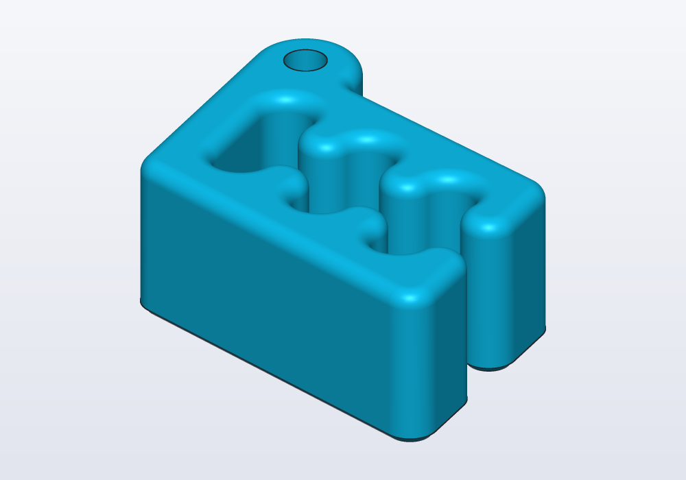
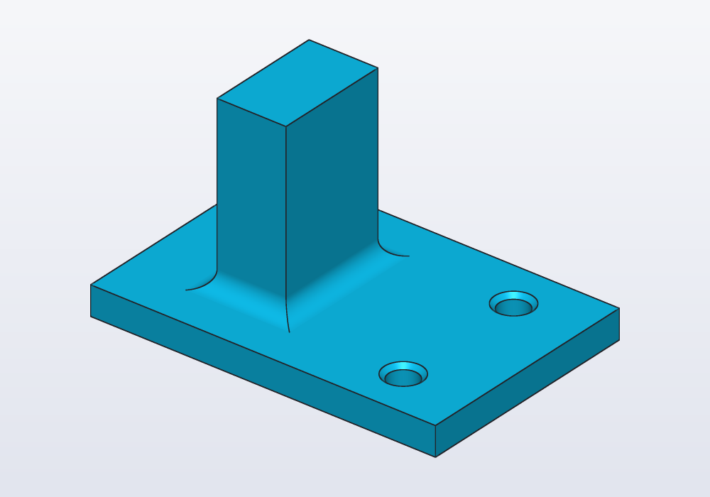
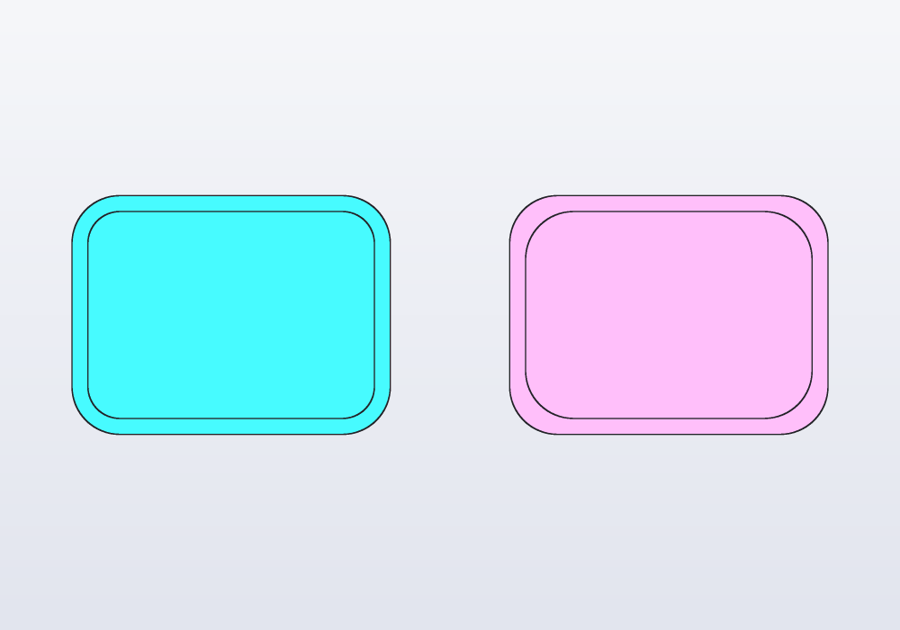

# Selectors and features

Rounding, bevelling, hollowing and tapering a solid: `fillet`, `chamfer`, `shell` and `draft`, and the selectors that say which edges and faces they work on (`edges.parallel(Z)`, `faces.top`, `edges.between(…)`, `faces.from(tool)`). How to pick edges so that they stay the right ones when a parameter changes, in which order to apply the features, what their errors mean, and how to do the same with the mouse in the 3D view.

## The four features

A feature changes a solid that is already there. A *fillet* is a rounded edge; a *chamfer* a bevelled one, cut flat at an angle; a *shell* hollows the solid out, leaving walls; a *draft* tilts the sides a little, so that a moulded part slides out of its mould. Each takes a *selector*, a description of which edges or faces to work on ("the top edges", "the edges along Z"), resolved against that solid at the moment the feature is applied:

| Feature | What it does | Takes |
|---|---|---|
| `s.fillet(edges, r:)` | rounds edges with an arc of radius `r` | edges |
| `s.chamfer(edges, d:)` | bevels edges at 45°, `d` back on each face | edges |
| `s.shell(open:, thickness:)` | hollows the solid, the `open` faces removed, walls `thickness` thick | faces |
| `s.draft(faces, angle:, pull:, neutral:)` | tilts faces so that the part comes out of a mould | faces |

<!-- render: features-four --from 0.5,-1,0.7 -->
```d
// the same block four ways: fillet, chamfer, shell, draft

Solid block() => box(30.mm, 24.mm, 20.mm);

@part("Sky Pop")
Solid rounded() => block()
    .fillet(edges.parallel(Z), r: 5.mm);

@part("Pink Pop")
Solid bevelled() => block()
    .chamfer(edges.of(faces.top), d: 3.mm)
    .move(x: 45.mm);

@part("gold")
Solid hollow() => block()
    .shell(open: faces.top, thickness: 2.mm)
    .move(x: 90.mm);

@part("mediumseagreen")
Solid tapered() => block()
    .draft(faces.normal(X) + faces.normal(-X)
        + faces.normal(Y) + faces.normal(-Y),
        angle: 8.deg, pull: Z)
    .move(x: 135.mm);
```


Features work on any shape, not only on boxes. Carlo, the mascot clip, with the rim of its top face rounded, teeth and keyring eye included, and the rim of its bottom face bevelled a little, as is usual for a part printed flat on that face:

<!-- render: features-carlo --from 1,-1,0.8 -->
```d
import carlo;

// the top rim rounded, the bottom rim bevelled
@part("Sky Pop")
Solid smooth() => carlo()
    .fillet(edges.loop(faces.top), r: 1.5.mm)
    .chamfer(edges.loop(faces.bottom), d: 0.6.mm);
```



`edges.loop(faces.top)` is every edge round the outside of the top face: the keyring hole's rim is left sharp.

## The parameters

| Parameter | What it does | Default |
|---|---|---|
| `edges` (fillet, chamfer) | which edges: an edge selector | — |
| `r:` | the fillet's radius; it must fit on the faces beside the edge | — |
| `d:` | how far back the chamfer cuts on each face | — |
| `open:` (shell) | the faces taken away: one or several, in one call | — |
| `thickness:` | the wall left all round, measured inwards | — |
| `faces` (draft) | the faces to tilt | — |
| `angle:` | how far they lean, between 0 and 90° (moulds use 1–3°) | — |
| `pull:` | the way the part leaves the mould | `Z` |
| `neutral:` | the height, along `pull`, where the faces keep their place | `0.mm` |

## Selectors

A solid is bounded by *faces* (flat or curved patches of its surface) that meet along *edges*. `edges` and `faces` stand alone, without a solid in front: they mean the edges and faces of the solid the feature is applied to. They narrow down by chaining, and combine with `+` (either), `-` (the first without the second) and `&` (both).

| Selector | Picks |
|---|---|
| `faces.top`, `.bottom`, `.left`, `.right`, `.front`, `.back` | the outermost face(s) facing +Z, −Z, −X, +X, −Y, +Y |
| `faces.normal(X)` | every face facing +X, outermost or not |
| `faces.largest` | the largest face (of those selected so far) |
| `faces.farthest(Z)` | the face whose centre is farthest that way, whichever way it faces: a tilted top |
| `faces.filter(f => f.area > 100 * 1.mm ^^ 2)` | by a property: `center`, `normal`, `area` |
| `faces.from(tool)` | the faces a tool or feature made: the walls of holes cut with it |
| `edges.parallel(Z)`, `edges.perpendicular(Z)` | straight edges along, or across, an axis (circles lying across it too) |
| `edges.lines`, `edges.circles` | straight or circular edges |
| `edges.of(faces.top)` | every edge round those faces, holes included |
| `edges.loop(faces.top)` | only the outer rim of each face, not the edges round its holes |
| `edges.between(a, b)` | the edges where a face of `a` meets a face of `b` |
| `edges.chain(e)` | those edges and every edge running on from them without a corner |
| `edges.from(tool)` | edges between two faces both made by the tool |
| `edges.filter(e => e.isCircle && e.radius == 3.mm)` | by a property: `start`, `end`, `mid`, `direction`, `length`, `isLine`, `isCircle`, `isParallel(axis)`, `isPerpendicular(axis)`; for circles `center`, `axis`, `radius` |

A face selector where edges are expected is an error that says so: `fillet(faces.top, …)` must be `fillet(edges.of(faces.top), …)`.

## Select by provenance, not by position

*Provenance* is where something came from. Every face remembers the tool or feature that made it. `faces.from(tool)` picks those faces, and `edges.between(faces.from(a), faces.from(b))` the edges where two pieces meet. A selector written this way follows the model when a parameter changes: the post below can be any height, and the fillet stays where the post meets the plate.

<!-- render: features-provenance -->
```d
// a post on a plate, rounded where they meet

@param("Height of the post", min: 10.mm, max: 60.mm)
immutable height = 30.mm;

@part
Solid post()
{
    auto plate = box(60.mm, 40.mm, 5.mm);
    auto upright = box(12.mm, 20.mm, height)
        .move(x: -10.mm, z: 5.mm);
    auto holes = cylinder(d: 5.mm, h: 20.mm, center: true)
        .linearPattern(2, step: vec(0.mm, 24.mm, 0.mm))
        .move(x: 18.mm, y: -12.mm);

    // the edges where the two meet, by where they came from
    auto body = (plate + upright)
        .fillet(edges.between(faces.from(upright),
            faces.from(plate)), r: 3.mm);

    // holes after the fillets; then their rims on top
    return (body - holes)
        .chamfer(edges.between(faces.from(holes),
            faces.normal(Z)), d: 0.8.mm);
}
```



Position-based selectors break in quiet ways:

- `edges.filter(e => e.mid.z == 5.mm)` would also catch the plate's outer top edges and the holes' rims, which lie at the same height; and it stops matching when the plate's thickness changes.
- `faces.top` is the *highest* face. Here it is the top of the post, not of the plate: `edges.between(faces.from(holes), faces.top)` matches nothing.
- `faces.normal(Z)` takes every face facing up; a curved face whose normal at its centre points up counts too.

**Keep the tool in a variable.** Provenance belongs to one value: `auto holes = …; body - holes; faces.from(holes)` reads best, and so does a module-level `immutable holes = …`. A function called twice, `body - holes()` then `faces.from(holes())`, makes a second tool; it still finds the faces, by the lines of code that made them, but the variable says plainly which tool it is.

## The order of operations

Build in the order a machine would, and the features stay simple:

1. the main shape (a sketch extruded, primitives united);
2. fillets and chamfers on its outside edges;
3. `shell`, so that the walls follow the rounded outside;
4. holes, pockets and slots;
5. the small chamfers on what the cuts left, picked by provenance.

Fillets before `shell` give walls of even thickness: the inside follows the outside at a smaller radius. Rounded after the shell, the inside corners get the same radius as the outside ones and the walls thicken there:

<!-- render: features-order --from top -->
```d
// rounded then hollowed; hollowed then rounded

Solid block() => box(40.mm, 30.mm, 20.mm);

@part("Sky Pop")
Solid filletFirst() => block()
    .fillet(edges.parallel(Z), r: 6.mm)
    .shell(open: faces.top, thickness: 2.mm);

@part("Pink Pop")
Solid shellFirst() => block()
    .shell(open: faces.top, thickness: 2.mm)
    .fillet(edges.parallel(Z), r: 6.mm)
    .move(x: 55.mm);
```



Fillets before holes, because a hole near an edge narrows the faces a fillet needs room on, and because `edges.of(faces.top)` taken after the holes also takes their rims.

## Common errors

| Message | What it means, what to do |
|---|---|
| *the selector matched no edges on this solid* | nothing fits: a face that is not where you think (`faces.top` is the highest face), a tool that never cut this solid, a filter on a position that moved |
| *fillet failed on the straight edge at (0, -15, 3)… a face beside them is only 3 mm wide there, and a fillet of r 5 needs that much room on it* | the radius is larger than a face next to the edge: a smaller `r`, or fillet before the cut that narrowed the face |
| *fillet failed: each of the 4 edges takes it on its own, not all together* | each edge alone works, but where they meet the rounds do not close: fillet them in groups, or a smaller `r` |
| *'edges' must be a edge selector (e.g. edges.parallel(Z)), not FaceSelector* | a face selector where edges are wanted: `edges.of(faces.top)` |
| *a wall of 20 mm leaves nothing inside a part 10 mm thin* | the shell's thickness is too large for the part |
| *every face is open: nothing would be left to make the walls of* | `open:` takes some faces, not all |
| *the draft angle goes from 0 to 90° (either way), both excluded* | a draft of 0° or 90° |
| *the kernel could not draft these faces* | a smaller angle, or fewer faces at a time |

## In the application

What a click picks is set by the four buttons in the view's bar: **parts** (Alt+1), **faces** (Alt+2), **edges** (Alt+3), **vertices** (Alt+4). Every click adds to the selection, a second click on the same item takes it away; a left drag selects by a box (from right to left, what it touches too). Clicking a face also shows, in the editor, the line of the feature that made it.

Right-click the selection:

- **Fillet edge…**, **Chamfer edge…** on edges (**Fillet 3 edges…** with several), and **Select the chain**, which grows the selection along edges running on without a corner (`edges.chain`).
- **Fillet face edges…**, **Chamfer face edges…**, **Shell, opening this face…**, **Draft face…** on faces, and **Select its outer edges** (`edges.loop`).
- With items of several parts selected, the same entries act on each part in turn (**Fillet edges on 2 parts…**).
- **Copy as code › Face selector** or **Edge selector** puts a selector for what is selected on the clipboard.

Each entry writes the feature into the part's code with a value to change (1 mm for a fillet, 2 mm for a shell, 3° for a draft). The selector it writes picks the clicked items by name or position (`faces.top`, `edges.of(faces.top).parallel(X)`, or a filter on a point when nothing shorter fits): it is right for the model as it is now. Where the part's sizes are parameters, rewrite it by provenance before relying on it.
