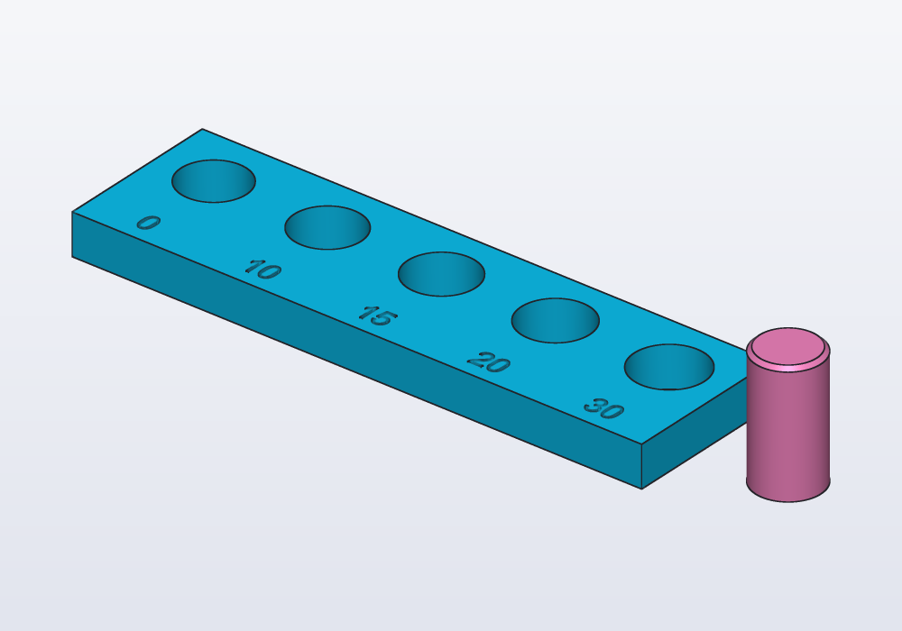
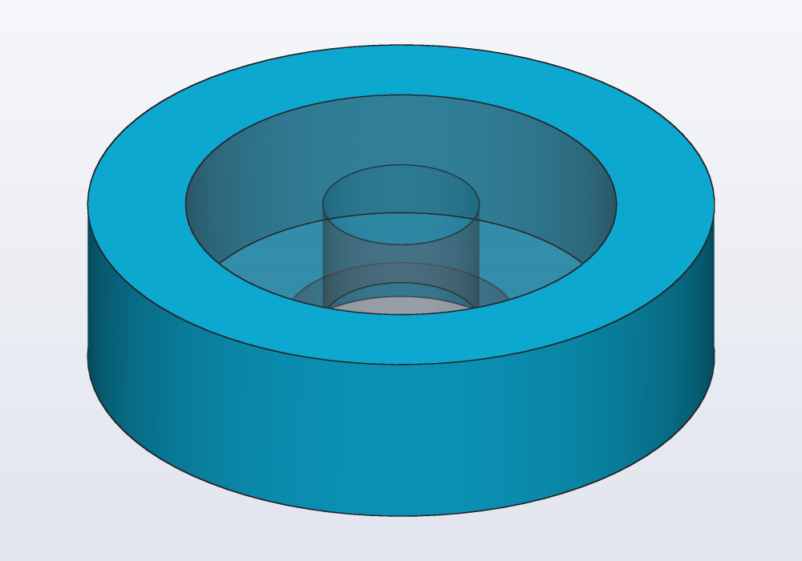
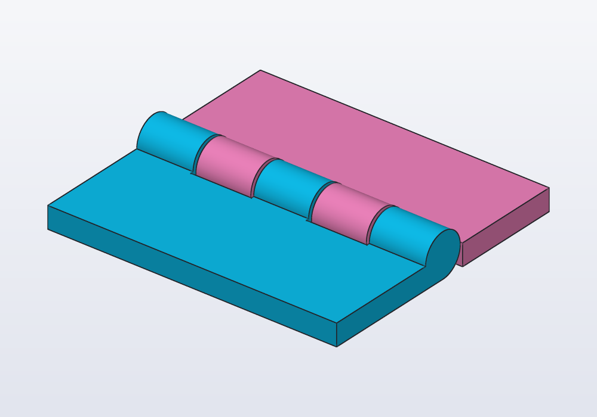
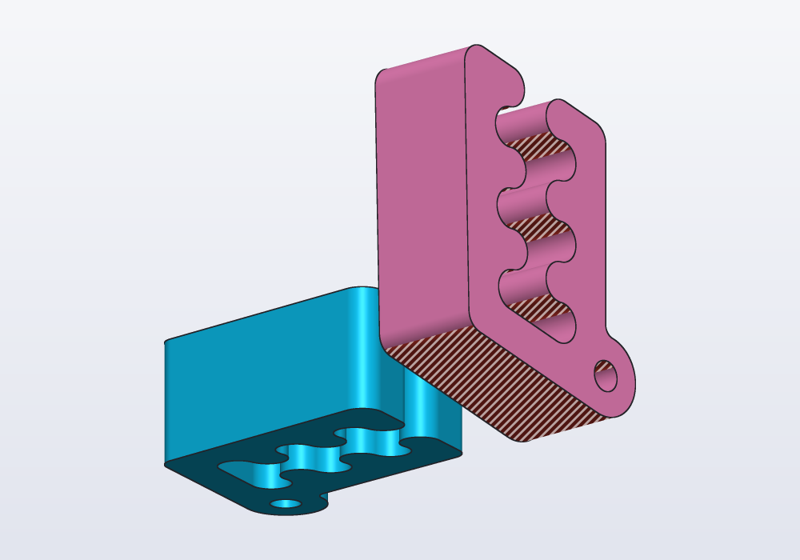

# Fits and printing

How much play to leave between parts that slide, press or turn together, printed or machined; how to test a fit in a `unittest` before printing; snap hooks and print-in-place hinges from the `snaps` and `hinges` libraries; and how to make a part print well: overhangs, thin walls, which way up it lies.


## Play, clearance, interference

Two parts that go together are never drawn at the same size. A pin drawn at ⌀8 does not go into a hole drawn at ⌀8: the hole is made larger than the pin by the **play** (also called clearance), the gap left on each side. A hole made smaller than the pin is an **interference**: the pin has to be pressed in, and the material round it holds it.

In a model the play is one number, written once as a `@param` (a value shown as a slider, to change without reading the code), so that it can be changed after a test print:

```d
@param("Play each side", min: 0.mm, max: 0.6.mm)
immutable play = 0.2.mm;
```

and every hole that takes a mating part grows by it: `cylinder(d: pinD + 2 * play, …)`. Play is given **each side**, as hackerscad's own `clearance:` arguments (threads, hinges, snaps, nut traps) take it.

## How much play

It depends first on how the part is made, then on the printer. Three ways of making it appear below:

- **FDM**, the common 3D printer: it melts a plastic thread and lays it down through a nozzle, a line at a time, a layer at a time.
- **Resin** (SLA, MSLA): a printer that hardens a liquid resin with light, layer by layer; finer and more exact than FDM.
- **Machined**: cut from a block of metal or plastic on a lathe or a mill.

These are starting points, each side:

| Fit | FDM (0.4 mm nozzle) | Resin (SLA, MSLA) | Machined |
|---|---|---|---|
| press fit: pressed in, holds by itself | 0 to 0.1 mm, from a test print | 0 to 0.05 mm | an interference fit (H7/p6) |
| snug: goes in by hand, does not wobble | 0.1 to 0.15 mm | 0.05 mm | a transition fit (H7/k6) |
| sliding or turning | 0.2 to 0.3 mm | 0.1 to 0.15 mm | a clearance fit (H7/g6, H7/f7) |
| printed in place (hinges, chains) | 0.3 to 0.5 mm | 0.2 to 0.3 mm | — |
| a thread in a printed hole | 0.15 to 0.3 mm (`clearance:`) | 0.1 mm | none: cut to the standard |

Things that move these numbers:

- **Holes come out small in FDM.** A printed ⌀8 hole is often ⌀7.8: the plastic squeezes inwards on curves. That is why a press fit for FDM is drawn at 0 to 0.1 mm of play, not with an interference.
- **Standing or lying.** A hole printed standing (its axis vertical) is round; across a wall it comes out a little oval and sags at the top (see the [guide on holes](holes.md) for teardrops).
- **Material.** PETG and TPU need more play than PLA; PLA cracks when pressed hard, PETG flexes.
- **The printer.** A well tuned printer takes the low end; an untuned one, or a first try, the high end.
- **Machined parts** are drawn at the nominal size, both of them: the machinist works to the fit you name, written on the drawing as a dimension's `text:` or a `d.note(…)`. Names like H7/g6 are standard (ISO) fits: the letter and number after the hole's size (⌀8 H7) and the shaft's (⌀8 g6) say how far each may be from the size.

The only sure number comes from a test print: make one before a part that takes hours.

## A test piece

A bar with the same hole at five plays and the pin that goes in them: print it, try the pin in each hole, and the number engraved under the one that fits as you want is the play to use (in hundredths of a millimetre).

<!-- render: fits-gauge -->
```d
import std;

// one pin, and its hole with more play each time

@param("Pin diameter", min: 3.mm, max: 20.mm)
immutable pinD = 8.mm;

immutable plays = [0.mm, 0.1.mm, 0.15.mm, 0.2.mm, 0.3.mm];
immutable step = pinD + 6.mm;

@part("Sky Pop")
Solid gauge()
{
    auto bar = box(plays.length * step, step + 6.mm, 5.mm);
    foreach (i, play; plays)
    {
        immutable x = (i - (plays.length - 1) / 2.0) * step;
        bar -= cylinder(d: pinD + 2 * play, h: 20.mm,
                center: true)
            .move(x: x, y: 3.mm);

        // the play engraved under each hole, in hundredths
        immutable label = format("%.0f", play / 0.01.mm);
        bar -= text(label, size: 3.5.mm)
            .centered
            .extrude(1.mm)
            .move(x: x, y: -step / 2, z: 4.5.mm);
    }
    return bar;
}

@part("Pink Pop")
Solid pin() => cylinder(d: pinD, h: 15.mm)
    .chamfer(edges.of(faces.top), 0.5.mm)
    .move(x: plays.length * step / 2 + 10.mm);
```



The pin's top edge is chamfered (bevelled) so that it finds the hole. Print it the way the real part will print (here the holes stand up), in the same material. Change `pinD` to the size that matters in the real part: play does not scale with the diameter, but roundness does.

## Testing a fit in a unittest

A fit can be checked before printing, with the parts it joins. The part you fit onto (a bearing, a shaft, a phone) goes in the model as a **reference part**: shown see-through and never exported, so it is there to look at and to test against, not to print. Then a `unittest`, a block of checks that runs with the model, says what must hold:

| Check | Means |
|---|---|
| `(a & b).volume` | the volume the two share: 0 when they only touch or are apart; above 0, an interference |
| `distance(a, b)` | the smallest gap between them: 0 when they touch or overlap |
| `a.bbox.max.z`, `a.bbox.size` | where it ends, how big it is: a part standing proud, a part too long |
| `a.pieces.length` | how many separate bodies: a print-in-place part fused into one, or a cut that left a loose piece |

A holder for a 608 skate bearing, pressed in:

<!-- render: fits-ex1 -->
```d
// a holder for a 608 skate bearing (⌀22 × 7 mm),
// pressed in from the top

@param("Play of the bearing's seat (each side)",
    min: -0.1.mm, max: 0.3.mm)
immutable play = 0.mm;

immutable bearingD = 22.mm;
immutable bearingW = 7.mm;
immutable bottom = 2.mm;

@part("Sky Pop")
Solid holder() => cylinder(d: 32.mm, h: bottom + bearingW)
    - cylinder(d: bearingD + 2 * play, h: 20.mm)
        .move(z: bottom)
    - cylinder(d: 12.mm, h: 20.mm, center: true);

// the real bearing, to check the fit: not exported
@part("slategray", alpha: 0.35, export: false)
Solid bearing() => (cylinder(d: bearingD, h: bearingW)
        - cylinder(d: 8.mm, h: 20.mm, center: true))
    .move(z: bottom);

unittest
{
    // flush with the top, not standing proud
    assert(bearing.bbox.max.z <= holder.bbox.max.z,
        "the bearing stands proud");

    // how much plastic the bearing displaces
    writeln("interference: ", (holder & bearing).volume);
}
```



With `-D play=-0.05.mm` the console says `interference: 24.1353 mm^3`: the plastic the bearing has to push aside. For a part that must move freely, assert the opposite: `assert((a & b).volume == 0.mm ^^ 3, "the pin is stuck")`, or a gap of at least the play, `assert(distance(a, b) >= play * 0.9)`.

In the application, select two faces of a part and right-click: **Measure** gives their **Distance** and, for two parallel faces, the **Gap between planes**; **Part volume** and **Part size** are there too.

`hcad fit` is not about fits: it tunes the sizes of a copy to its original.

## Snap hooks: the snaps library

A snap hook is a flexible beam with a barb (a small wedge) on its tip: pushed through a window, the beam bends, and the barb clicks over the window's edge. It holds two parts together with no screw.

```d
import std;
```

`snapHook(length:, thickness:, width:, overhang:, lead:)` stands on z = 0 with its barb towards +X; `snapSlot(thickness:, width:, overhang:, wall:, clearance:)` is the window to subtract from the mating wall, `clearance` larger all round than the hook bent aside.

| Parameter | What it does | Default |
|---|---|---|
| `length` | the beam, from its root to the barb: longer bends more easily | `10.mm` |
| `thickness` | the beam's thickness: thinner bends more easily, and breaks sooner | `1.5.mm` |
| `width` | across the beam | `5.mm` |
| `overhang` | how far the barb sticks out: how much it holds | `1.mm` |
| `lead` | the slope of the barb's top, which pushes the beam aside going in: 5° to 85° | `30.deg` |
| `wall` (slot) | the thickness of the wall the window goes through | `2.mm` |
| `clearance` (slot) | play round the hook in the window | `0.3.mm` |

`snapSlot` is a window round the beam with room on the side it bends to, so that the barb goes through and then rests on the window's far edge: subtract it where the hook stands, with the same `thickness`, `width` and `overhang`. The `unittest` proves it: lifted 0.5 mm, the barb meets the lid.

<!-- render: fits-snap --from 0.25,-1,0.2 --look-at 1,0,6 --size 15 --cut -->
```d
import std;

// a lid held by a snap hook: the barb clicks over the
// edge of a window in the lid

@param("Play round the hook", min: 0.1.mm, max: 0.5.mm)
immutable play = 0.3.mm;

immutable beam = 10.mm;
immutable barb = 1.mm;
immutable wall = 2.mm;

Solid hook() => snapHook(length: beam, overhang: barb);

@part("Sky Pop")
Solid base() => box(24.mm, 12.mm, 2.mm).move(z: -2.mm)
    + hook();

// the window on the side the beam bends to, so the
// barb rests on its edge (with play under it)
@part("Pink Pop")
Solid lid() => (box(24.mm, 12.mm, wall)
        - snapSlot(overhang: barb, wall: wall,
            clearance: play))
    .move(z: beam - wall - play);

unittest
{
    // assembled, they do not touch
    assert(distance(base, lid) > 0.mm, "the hook rubs");

    // pulled 0.5 mm apart, the barb meets the lid
    assert((hook.move(z: -0.5.mm) & lid).volume > 0.mm ^^ 3,
        "the barb does not hold");
}
```


For printing: stand the hook up, so that the layers run along the beam (lying down, it snaps off at the first bend). PETG and nylon bend many times; PLA a few times only. A longer or thinner beam bends more easily; a deeper barb holds harder and bends the beam further: if a hook breaks going in, lengthen the beam before thinning it.

## Print-in-place hinges: the hinges library

A hinge that comes out of the printer already assembled, nothing to put together. Each half, a **leaf**, carries rings round the axis, the **knuckles**; the knuckles of the two leaves alternate along the axis. A pin of the fixed leaf runs through the moving leaf's knuckles, and the play keeps them apart while printing so that they do not fuse.

<!-- render: fits-hinge -->
```d
import std;

@param("Play of the hinge", min: 0.2.mm, max: 0.6.mm)
immutable play = 0.4.mm;

immutable h = hinge(length: 40.mm, width: 15.mm,
    thickness: 3.mm, clearance: play);

@part("Sky Pop")
Solid fixedLeaf() => h.fixed;

@part("Pink Pop")
Solid movingLeaf() => h.moving;

// printed in place: the leaves must never touch
unittest
{
    assert(distance(h.fixed, h.moving) >= play * 0.9,
        "the leaves are fused");
}
```



| Parameter | What it does | Default |
|---|---|---|
| `length` | along the axis (X) | `40.mm` |
| `width` | of each leaf, away from the axis | `15.mm` |
| `thickness` | of the leaves; the knuckles are twice as thick, the axis at z = thickness | `3.mm` |
| `knuckles` | how many, alternating between the leaves: 3 or more, odd keeps it symmetric | `5` |
| `clearance` | the play between pin and knuckles and between neighbouring knuckles | `0.4.mm` |

`hinge()` returns two solids, `.fixed` and `.moving`: make them two parts (two colours, or two materials) or add each to the part it carries. Print it flat as it comes, leaves on the bed. After printing, break it free by bending it both ways a few times. If it stays fused, the next one wants 0.1 mm more `clearance`; resin printers take 0.2 to 0.3 mm.

## Printability

A part that checks may still print badly. Two things go wrong most often:

- **Overhangs:** a printer builds each layer on the one below. A surface facing down more steeply than about 45° from a wall has nothing under it to print on: it needs **supports** (scaffolding printed with the part and broken off after), or it sags.
- **Thin walls:** a wall thinner than two lines of the nozzle (0.8 mm for a 0.4 mm nozzle) prints with gaps, or not at all.

hackerscad finds both:

| Where | What |
|---|---|
| `hcad check model.hcad --printability` | per part, the area of the overhangs and of the thin walls, and the thinnest wall |
| `hcad render … --printability` | the same, and the pictures marked: overhangs striped red, thin walls hatched violet |
| `--overhang 60`, `--min-wall 0.6` | other limits than 45° and 0.8 mm |
| `s.overhangs(45.deg)`, `s.thinWalls(0.8.mm)` | the same areas in the model, for a `unittest` |
| `faces.overhanging()` | the faces that need supports, to select (`faces.overhanging(60.deg)` another angle) |

Faces lying on the bed are not overhangs. The report reads:

```
  standing          799 mm² overhangs beyond 45°, 0 mm² walls under 0.8 mm
```

A `unittest` keeps a model printable as it changes: `assert(part.thinWalls(0.8.mm) == 0.mm ^^ 2, "walls too thin to print")`.

## Which way up

Every part has a best way to lie on the bed, and choosing it is part of the design:

1. **The largest flat face down**, on the printer's bed (the plate it prints on): it holds the part and needs no supports. `.aligned` turns a solid onto its largest flat face (useful on a part loaded from a mesh).
2. **The fewest overhangs**: compare orientations with `--printability`.
3. **Strength along the layers.** A print is weakest between layers: a hook, a beam, a clip must have its layers running along it, not across.
4. **Holes that matter standing up**: round holes and threads print rounder with their axis vertical. Holes across a wall get a teardrop (see the [guide on holes](holes.md)).
5. **The visible face up**, or against a smooth bed, when looks matter.

The model is the part as it prints: draw it in the position it will print in, or turn it there in its `@part`. Carlo, the mascot clip, prints flat; stood on its back it would need supports under its teeth and its leaning back:

<!-- render: fits-orient --from 1,-1,-0.4 --printability -->
```d
import std;

// Carlo as it should print, flat, and stood on its back

@part("Sky Pop")
Solid flat() => carlo();

@part("Pink Pop")
Solid standing()
{
    auto c = carlo().rotate(y: -90.deg);

    // set down on the bed, next to the other one
    return c.move(x: 50.mm, z: -c.bbox.min.z);
}

// lying flat it needs no supports at all
unittest
{
    assert(flat.overhangs(45.deg) == 0.mm ^^ 2);
    assert(standing.overhangs(45.deg) > 0.mm ^^ 2);
}
```



## Common errors

| Message | What to do |
|---|---|
| *walls too thin to print* (your own `assert` on `thinWalls`) | `--printability` says where and the thinnest wall: thicken it, or make it a rib |
| *the leaves are fused*, *the pin is stuck* (your own asserts on `distance`, `&`) | more play, or the parts are not where you think: render them see-through |
| *a hinge needs at least 3 knuckles* | `knuckles: 3` or more |
| *--overhang expects degrees from 0 to 90 and --min-wall a positive number of mm* | the limits on the command line are out of range |
| a fit that checks but does not go together after printing | the play is a guess until the test piece is printed |

A failing `assert` in a `unittest` does not stop the model: the parts are still built and shown, and the failure is listed as a problem (`done in 14 ms, 1 failed check`).

## In the application

- The **display** menu of the view bar (the cube) has a **Printability** check box: overhangs in red, thin walls in violet, with fields for the overhang angle (**overhang °**) and the thinnest wall (**wall mm**). The status line gives their areas.
- Right-click a part: **Measure** gives distances between two selected faces, **Part size** and **Part volume**.
- Right-click a flat face: **Place on…** places another solid against it, writing `placeOn(…)`.
- Reference parts (`alpha:`, `export: false`) show see-through, so you see a fit from outside; a `unittest` runs with F5 or the bug button over the console, and before an export.
