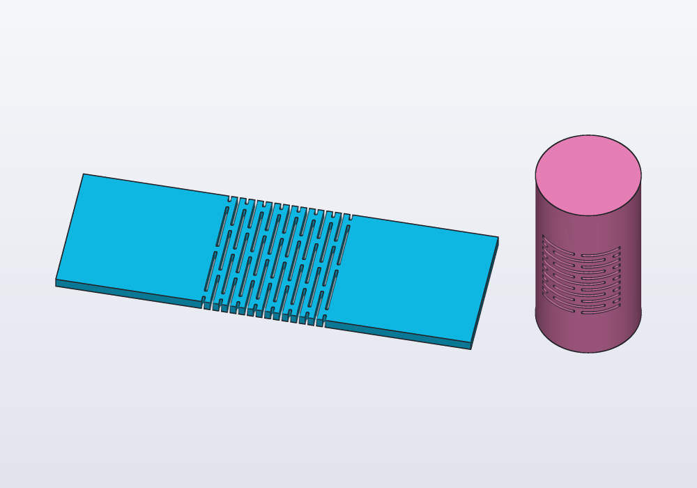

# Flexible parts and hinges

Parts that bend where they should: a rigid plate made to bend in a band by rows of slots (kerf bending), and the hinges of the `hinges` library. Printed flat, in one piece.

<!-- render: flex-kerf --from 0.2,-1,1.2 -->
```d
// a plate made to bend in a band across its middle, and
// a tube made to bow in a band round it

import flex;

@part("Sky Pop")
Solid plate() => kerf(box(120.mm, 40.mm, 3.mm),
    box(40.mm, 50.mm, 10.mm, center: true));

@part("Pink Pop")
Solid tube() => kerf(cylinder(d: 30.mm, h: 60.mm)
        - cylinder(d: 26.mm, h: 70.mm, center: true),
    box(40.mm, 10.mm, 30.mm).move(y: -15.mm, z: 15.mm))
    .move(x: 90.mm);
```



## Kerf bending

`kerf(body, zone)` makes `body` bend where it lies inside `zone`: any solid, a box across a plate, a ring round a tube. Rows of slots go through the part, each row shifted half a slot from the next; what is left between them is a lattice of thin bars, each of which twists a little, and together they bend far.

- The slots go through the part's thinnest way inside the zone (a plate's thickness, a tube's wall).
- They run across the body's length, so the part bends along it: a strip end to end, a tube bowing. `along: X` (or `Y`, `Z`) sets the way they run instead, whenever the guess is not what you want.

| Argument | What it does |
|---|---|
| `width:` | how wide each slot is, 0.8 mm unless given: two lines of a 0.4 mm nozzle leave it open |
| `bridge:` | the material between two slots of a row, 2 mm unless given: the narrower, the softer it bends |
| `pitch:` | from one row to the next, 2.5 mm unless given: the closer, the tighter it bends; the bars are `pitch` less `width` thick |
| `length:` | of each slot, six times the pitch unless given |
| `along:` | the way the slots run |

How far a band bends depends on the material: in PLA a few degrees a row, and it may crack if bent often; PETG takes a quarter turn in a band of 15 mm with bars 1 mm thick; TPU folds flat. Print the part lying on its flat side, the slots standing upright.

A strip with four bands folds into the walls of a box: half a wall, then wall and band in turn, then the other half wall, its ends locked edge to edge with jigsaw tabs, and its bottom edge dropped into a groove in a base. A band of width `b` bent through 90° makes a quarter circle of radius 2 `b` / π on the wall's middle: the corners of the groove.

## Common errors

| Message | What to do |
|---|---|
| *kerf: the zone does not meet the body* | move the zone onto the part |
| *kerf: the slots cannot run along the way they go through* | `along:` one of the other two axes |
| the part bends the wrong way | `along:` the other axis in its plane |
| *undefined identifier 'kerf'* | `import flex;` |
