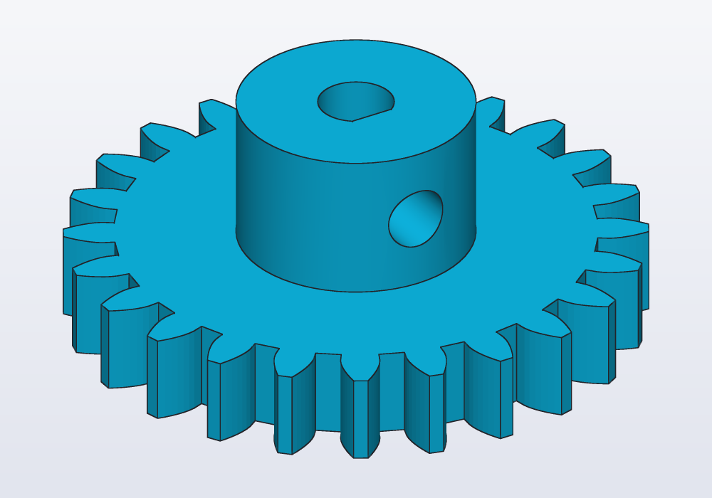
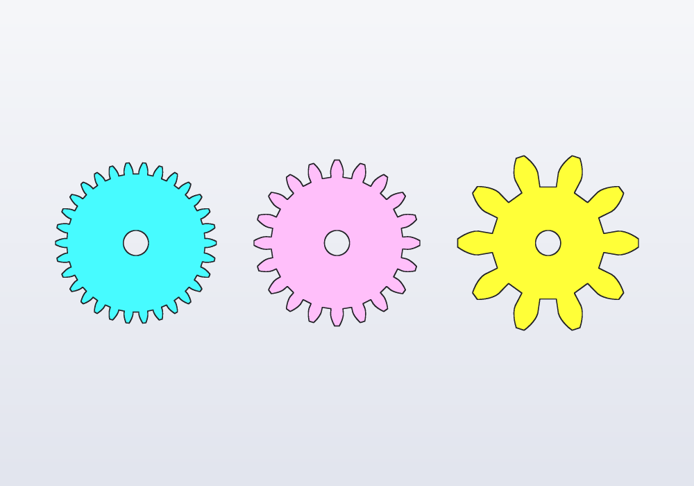
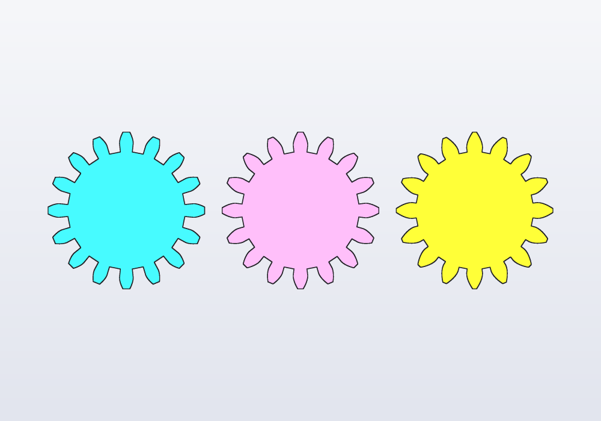
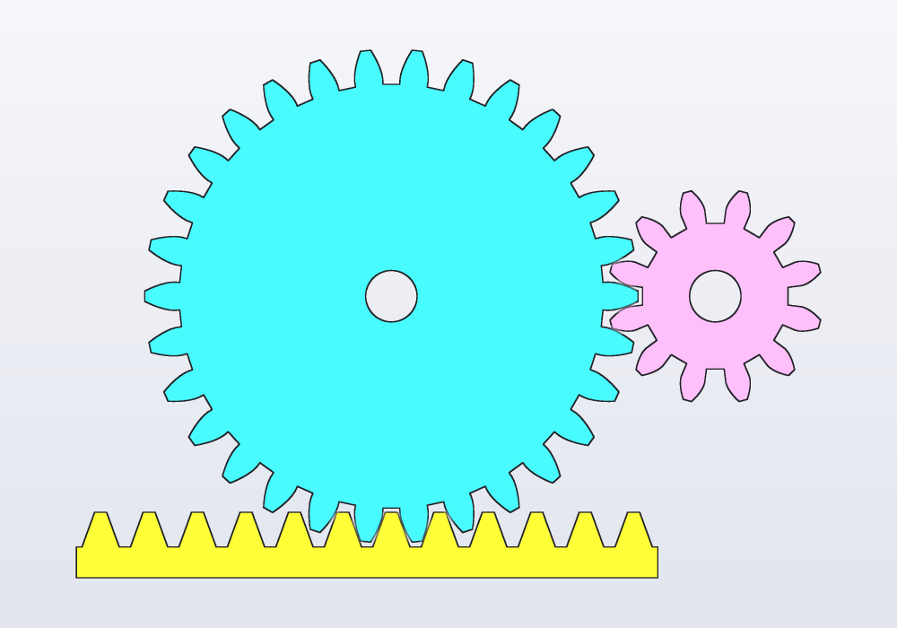
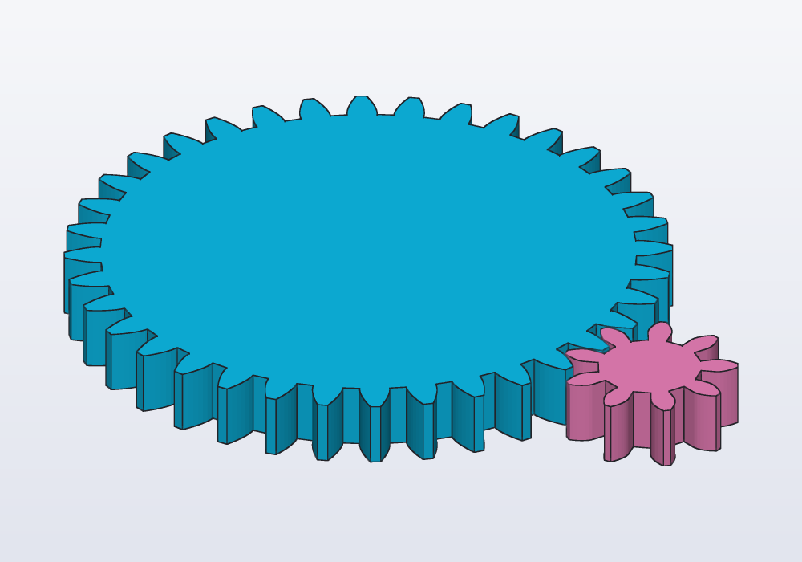
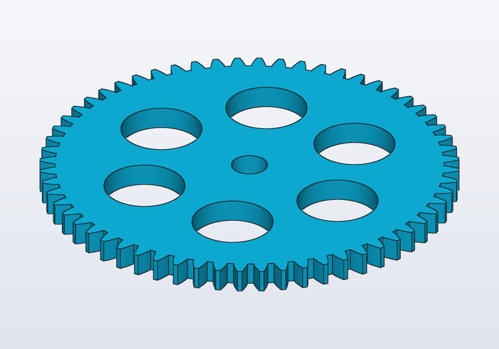

# Gears

Spur gears and racks from the `gears` library: module, number of teeth and pressure angle, placing two gears so that they mesh, checking the mesh in the model, and printing gears that turn (backlash, the module for a printer, hubs, bores and set screws).



## Module, teeth, pressure angle

A **spur gear** is a wheel with straight teeth round its edge, parallel to its axis. Two of them, meshing on parallel shafts, change a speed or a force: the small one turns faster, the large one with more force. A **rack** is a straight bar of teeth: with a gear on it, a rotation becomes a straight movement (a knob that moves a slide). The `gears` library makes both; it has no helical, bevel, worm or internal (ring) gears.

The teeth have **involute** flanks: the curve traced by the end of a string unwound from a circle. With it, two teeth roll on each other instead of rubbing, and the gears turn evenly.

Three numbers describe a spur gear:

- **The module** `m` is the size of the teeth: the pitch diameter divided by the number of teeth. A module 2 gear of 20 teeth is 40 mm across at its pitch circle. Two gears mesh only when they have the same module.
- **The number of teeth** sets the diameter (for a given module) and the ratio: a 30-tooth gear driving a 12-tooth one makes it turn 30 / 12 = 2.5 times faster, the other way.
- **The pressure angle** is how steep the flanks (the sides) of the teeth are. 20° is the standard and the default; 14.5° is found on old machinery, 25° gives stronger, more pointed teeth. Two gears mesh only when they have the same pressure angle too.

The same pitch diameter, 30 mm, with modules 1, 1.5 and 3: more, smaller teeth, or fewer, larger ones.

<!-- render: gears-modules --from top -->
```d
// one pitch diameter, 30 mm: modules 1, 1.5 and 3

import gears;

@part("Sky Pop")
Solid fine() => spurGear(1.mm, 30, 5.mm, bore: 5.mm);

@part("Pink Pop")
Solid medium() => spurGear(1.5.mm, 20, 5.mm, bore: 5.mm)
    .move(x: 40.mm);

@part("gold")
Solid coarse() => spurGear(3.mm, 10, 5.mm, bore: 5.mm)
    .move(x: 82.mm);
```



The pressure angle changes the flanks: at 14.5° they are nearly straight, at 25° the teeth are wider at the base and narrower at the tip.

<!-- render: gears-pressure --from top -->
```d
// 16 teeth of module 3 at 14.5°, 20° and 25°

import gears;

@part("Sky Pop")
Solid old() => spurGear(3.mm, 16, 5.mm, pressure: 14.5.deg);

@part("Pink Pop")
Solid standard() => spurGear(3.mm, 16, 5.mm)
    .move(x: 60.mm);

@part("gold")
Solid strong() => spurGear(3.mm, 16, 5.mm, pressure: 25.deg)
    .move(x: 120.mm);
```



The sizes of a gear of `z` teeth follow from the module:

| Function | Gives | Formula |
|---|---|---|
| `pitchDiameter(m, z)` | the pitch circle: the circle on which two gears roll on each other | `m · z` |
| `outsideDiameter(m, z)` | over the tips: the room the gear needs | `m · (z + 2)` |
| `rootDiameter(m, z)` | at the bottom of the gaps: keep bores and windows inside it | `m · (z − 2.5)` |
| `centerDistance(m, z1, z2)` | how far apart the centres of two meshing gears are | `m · (z1 + z2) / 2` |

`involute(rb, r)` is the angle of the involute of a base circle of radius `rb` at radius `r`, used to draw the teeth; you rarely need it.

## The library

`import gears;` gives:

| Function | What it makes |
|---|---|
| `spurGear(m, teeth, thickness, bore:, pressure:, backlash:)` | a spur gear standing on z = 0, centred on the origin, a tooth on +X |
| `gearProfile(m, teeth, pressure:, backlash:, steps:)` | its outline, a profile (a flat outline) on XY, the same way round |
| `rack(m, teeth, thickness, base:, pressure:, backlash:)` | a straight rack along +X from x = 0, teeth up, its pitch line on y = 0 |

Their parameters:

| Parameter | What it does | Default |
|---|---|---|
| `m` | the module: the size of the teeth | — |
| `teeth` | how many; at least 6 for a gear, 1 for a rack | — |
| `thickness` | how thick the gear or rack is, along Z | — |
| `bore:` | a round hole through the centre, that diameter; `0.mm` none | `0.mm` |
| `pressure:` | the pressure angle | `20.deg` |
| `backlash:` | the play between the teeth: thins each tooth by that much on the pitch circle (a rack's on its pitch line), so printed gears do not bind | `0.1.mm` |
| `steps:` | points on each flank of the outline (`gearProfile` and `spurGear`) | `6` |
| `base:` | the height of the rack's solid strip under the teeth' roots | `2 · m` |

The rack's teeth are thinned by its own `backlash:` too: with the gear's, the play is the two added.

A gear carries its axis, tagged `gears.axis`, and its bore's wall `gears.bore`; a rack its pitch line, `gears.pitch`. Turned and moved, the gear takes them along: `g.axis("gears.axis")` is where it turns now, to place a shaft on, and `faces.tagged("gears.bore")` the face for a set screw's hole. See [Selectors and features](features.md).

## Meshing two gears

Two gears **mesh** when the teeth of one go into the gaps of the other. That needs the same module and pressure angle, the centres `centerDistance(m, z1, z2)` apart, and a tooth of one facing a gap of the other. `spurGear` has a tooth on +X; put the second gear on +X of the first and turn it by `180.deg - 180.deg / z2`, which puts a gap where the first gear's tooth is, whether `z2` is odd or even. For a rack, its gaps are centred at `x = k · π · m` from its start, its teeth halfway between; a gear over it sits with its centre `pitchDiameter / 2` above the pitch line.

<!-- render: gears-pair --from top -->
```d
// a 30-tooth gear driving a 12-tooth pinion, and a rack

import gears;

@param("Module", min: 1.mm, max: 3.mm)
immutable m = 1.5.mm;

immutable z1 = 30;
immutable z2 = 12;

@part("Sky Pop")
Solid wheel() => spurGear(m, z1, 6.mm, bore: 5.mm);

// a gap of the pinion faces the wheel's tooth on +X
@part("Pink Pop")
Solid pinion() => spurGear(m, z2, 6.mm, bore: 5.mm)
    .rotate(z: 180.deg - 180.deg / z2)
    .move(x: centerDistance(m, z1, z2));

// pitch line on the pitch circle; a gap of the wheel
// points down (30 teeth), so a rack tooth goes under it
@part("gold")
Solid bar() => rack(m, 12, 6.mm)
    .move(x: -6.5 * PI * m)
    .move(y: -pitchDiameter(m, z1) / 2);

unittest
{
    assert((wheel() & pinion()).volume == 0.mm ^^ 3);
    assert((wheel() & bar()).volume == 0.mm ^^ 3);
}
```



### Checking the mesh

The `unittest` above is the check: `(a & b).volume` is the material two parts share, and it must be zero. `distance(a, b)` says how close they come: about 0.1 mm for two gears with the default backlash, 0 when they touch or overlap. A mesh that looks right on the screen can still collide when the gears turn, so check a few positions through one tooth of turning: the second gear turns the other way, `z1 / z2` times as much.

<!-- render: gears-ex1 -->
```d
// check a pair through one tooth of turning, not only
// where it was drawn

import gears;

immutable m = 1.mm;

@param("Teeth of the wheel", min: 20, max: 60)
immutable z1 = 36;

@param("Teeth of the pinion", min: 8, max: 20)
immutable z2 = 9;

Solid wheelAt(Angle a) => spurGear(m, z1, 4.mm).rotate(z: a);

// the pinion turns the other way, z1 / z2 times faster
Solid pinionAt(Angle a) => spurGear(m, z2, 4.mm)
    .rotate(z: 180.deg - 180.deg / z2 - a * z1 / z2)
    .move(x: centerDistance(m, z1, z2));

@part("Sky Pop")
Solid wheel() => wheelAt(0.deg);

@part("Pink Pop")
Solid pinion() => pinionAt(0.deg);

unittest
{
    foreach (i; 0 .. 6)
    {
        immutable a = 360.deg / z1 * i / 6;
        immutable v = (wheelAt(a) & pinionAt(a)).volume;
        assert(v == 0.mm ^^ 3, "the teeth collide at $(a)");
    }
}
```



Below 8 teeth the library's teeth are not undercut, and the tips of a large gear dig into the roots of the small one as they turn: this check finds it (a 6-tooth pinion against a 40-tooth wheel collides; 8 teeth or more do not).

## Your own shape: gearProfile

For a gear of your own shape (spokes, windows, a cam on it), start from `gearProfile`: the outline alone, to cut windows or spokes into before extruding it (pushing the flat outline up into a solid), or to combine with a sketch:

<!-- render: gears-ex2 -->
```d
// a big wheel made lighter by six windows

import gears;

@part("Sky Pop")
Solid wheel()
{
    auto p = gearProfile(1.5.mm, 60, backlash: 0.15.mm)
        - circle(d: 8.mm);
    foreach (k; 0 .. 6)
    {
        p -= circle(d: 18.mm)
            .move(x: 25.mm)
            .rotate(60.deg * k);
    }
    return p.extrude(5.mm);
}
```



Keep what you cut inside `rootDiameter`, with a few millimetres of rim under the teeth.

## Hubs, bores and set screws

`spurGear` has a round `bore:` (the hole for the shaft) only. A **hub** (a collar that makes the gear longer on its shaft), a shaft with a flat (a D shaft) and a **set screw** (a screw through the hub that presses on the shaft) are a few lines more, with the `hardware` library for the screw's hole:

<!-- render: gears-hub --from 1,-0.6,0.7 -->
```d
// a gear for a 5 mm motor shaft with a flat (a D shaft),
// held by an M3 set screw in a heat-set insert

import gears;
import hardware : M3, hole;

@param("Shaft diameter", min: 3.mm, max: 8.mm)
immutable shaft = 5.mm;

// 0.1 mm over the shaft: printed holes come out small
Profile dBore() => circle(d: shaft + 0.1.mm)
    - rect(center: vec(shaft, 0.mm), w: shaft, h: 2 * shaft)
        .move(x: -0.45.mm);

@part("Sky Pop")
Solid hubGear()
{
    auto g = spurGear(1.5.mm, 24, 6.mm)
        + cylinder(d: 16.mm, h: 10.mm).move(z: 6.mm);
    g -= dBore().extrude(30.mm).move(z: -1.mm);

    // the screw presses on the flat, through the hub's wall
    g -= hole(M3, 8.mm, "insert")
        .rotate(y: 90.deg)
        .move(x: 8.mm, z: 11.mm);
    return g;
}
```


A round bore on a round shaft slips under load: press-fit it (see the guide on [fits](fits.md)), use a D shaft, or a set screw. For screws and inserts, see the guide on [holes](holes.md).

## Printing gears

- **Module.** On an FDM printer (one that lays down melted plastic through a nozzle) with a 0.4 mm nozzle, module 1 is the smallest that prints cleanly; 1.5 to 2 is comfortable, and stronger. Under 1, print in resin.
- **Backlash.** The default 0.1 mm on each gear suits a well tuned printer. Raise it to 0.15–0.25 mm if the gears bind; a wider play is noisier but never jams. Print two small test gears before a big train.
- **Teeth.** 12 or more on the smallest gear turn smoothly; under 8 the teeth collide (see above). For a large ratio, use two stages rather than one tiny pinion.
- **Thickness.** About 5 to 10 times the module. Wider teeth carry more, but need the shafts truly parallel.
- **Orientation.** Print gears flat, the teeth standing: the teeth come out with their exact shape and their layers across the load. The first layer squashes out (elephant's foot) and can make the bottom of the teeth rub: compensate in the slicer, the program that turns the model into the printer's paths.
- **Material.** PLA is fine for toys and models; PETG or nylon for gears that run for hours. A gear and a pinion of different materials wear less.
- **Clearance on the shafts.** Shafts the gear turns on want a bore 0.2–0.3 mm larger; shafts that drive it want a tight bore, a flat or a set screw.

## Common errors

| Message or symptom | What to do |
|---|---|
| *a gear needs at least 6 teeth* | more teeth; for a smaller gear, a smaller module |
| *the backlash would thin the teeth to nothing: keep it below half the tooth (π·m/2)* | a backlash of tenths of a millimetre, not millimetres |
| *a rack needs at least 1 tooth* | `teeth` of 1 or more |
| *unknown argument 'hub' for spurGear(m, teeth, thickness, bore, pressure, backlash)* | the library has no hub: add a cylinder, as above |
| *spurGear: the bore must be smaller than the gear's root circle…* | a smaller bore: within `rootDiameter` less a module each side |
| the two gears overlap (`(a & b).volume` is not zero) | the same module and pressure angle on both; the second turned by `180.deg - 180.deg / z2`; centres `centerDistance` apart |

The first three messages point at the line of the library that checks them, not at your call: look for the `spurGear` or `rack` call in your model.

## In the application

There is no gear menu: gears are written in the code. The cheatsheet (**Cheatsheet** in the main menu, or F1) lists every function of the `gears` library with its arguments, and the editor completes them after `import gears;`. Make the module and the numbers of teeth `@param`s to change them from the **Parameters** panel and see the gears follow; the `unittest` with `(a & b).volume` reports a collision in the console when the tests run (F5).
