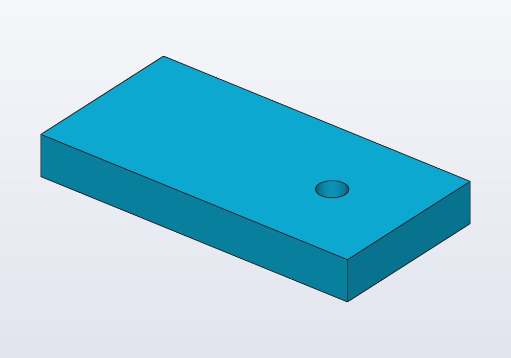
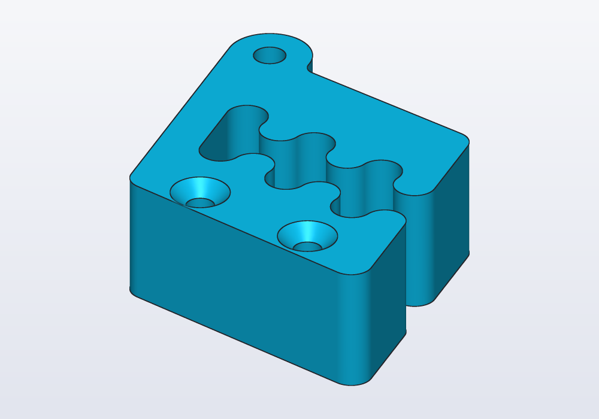
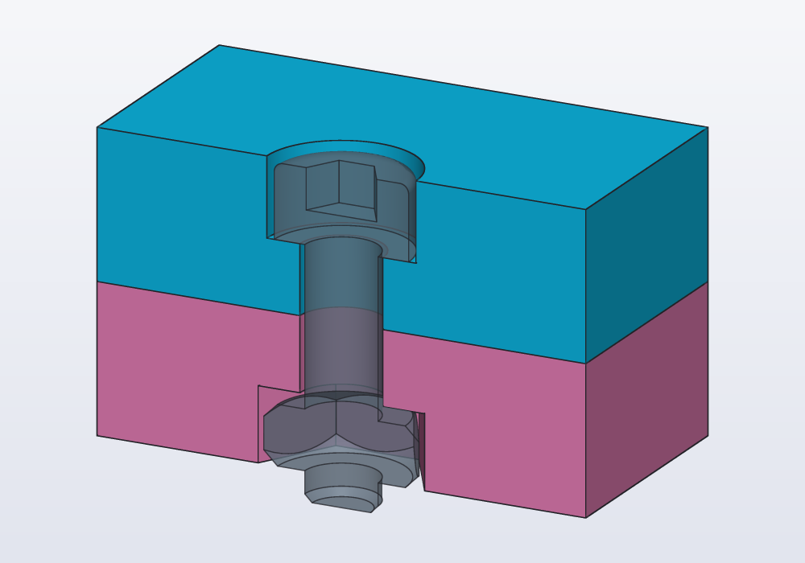
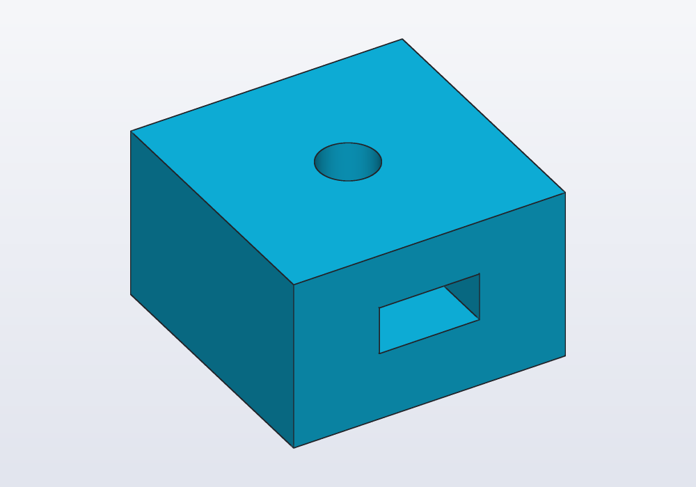
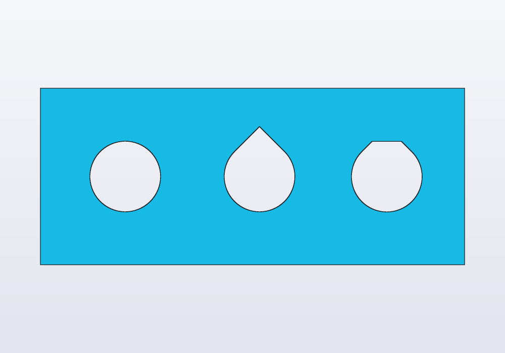
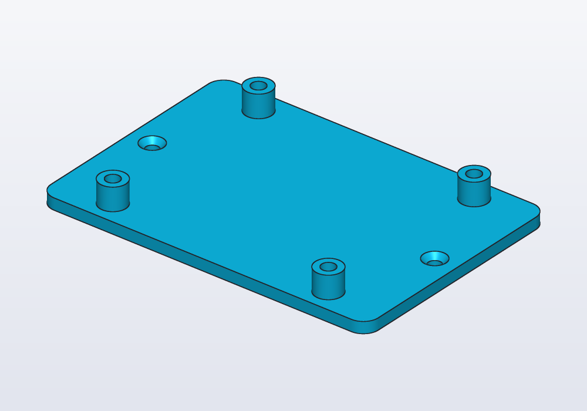
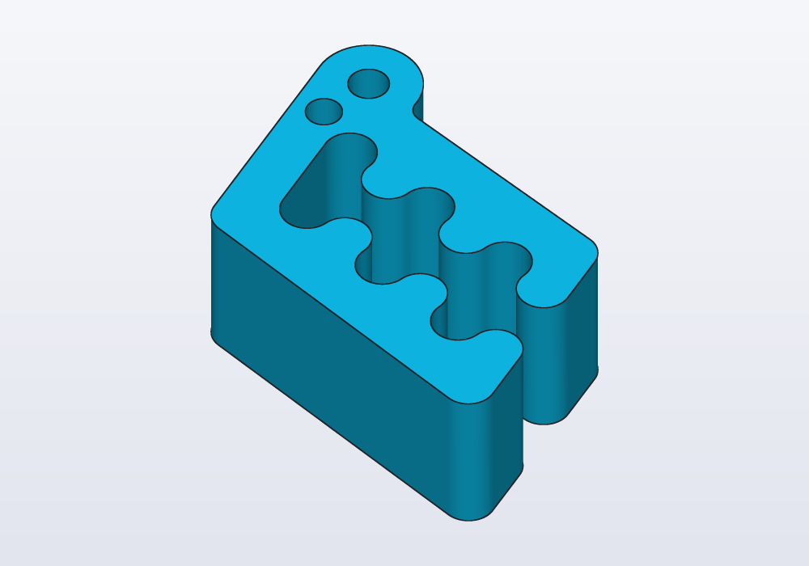
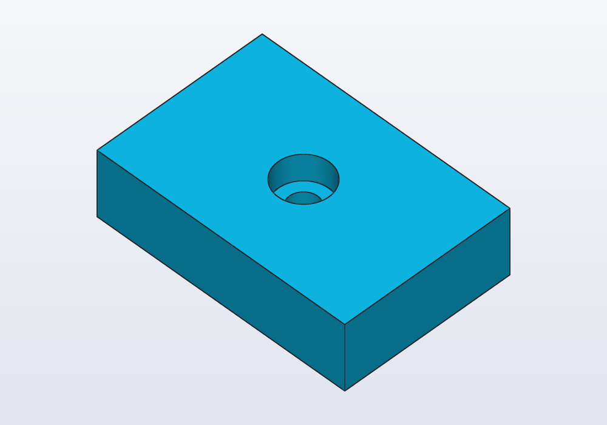

# Holes and hardware

Holes for metric screws from M2 to M8, from the `hardware` library: clearance, tapping, heat-set insert, counterbore and countersink holes with `hole()`, nut traps, the screws, nuts and washers themselves, teardrop holes that print sideways, and the Hole entry of the 3D view's right-click menu.

A printed part held by a screw needs a hole on each side of the joint: one the screw passes through, one it grips. The `hardware` library makes both, sized for each screw.

## The library

```d
import hardware : M3, hole, nutTrap, screw, nut, washer;
```

`M2`, `M2_5`, `M3`, `M4`, `M5`, `M6` and `M8` are `Screw` values: the sizes of an ISO 4762 socket head cap screw, its ISO 4032 nut and ISO 7089 washer, and the holes to print for them. Use them by name in your own geometry: `M3.clearance`, `M3.head`, `M3.nut`.

| Size | `clearance` | `tap` | `insert` × `insertDepth` | `head` × `headHeight` | `nut` × `nutHeight` |
|---|---|---|---|---|---|
| M2 | 2.4 | 1.6 | 3.2 × 4 | 3.8 × 2 | 4 × 1.6 |
| M2.5 | 2.9 | 2.05 | 3.6 × 5 | 4.5 × 2.5 | 5 × 2 |
| M3 | 3.4 | 2.5 | 4.2 × 5.7 | 5.5 × 3 | 5.5 × 2.4 |
| M4 | 4.5 | 3.3 | 5.6 × 8.1 | 7 × 4 | 7 × 3.2 |
| M5 | 5.5 | 4.2 | 6.4 × 9.5 | 8.5 × 5 | 8 × 4.7 |
| M6 | 6.6 | 5 | 8 × 12.7 | 10 × 6 | 10 × 5.2 |
| M8 | 9 | 6.8 | 9.7 × 12.7 | 13 × 8 | 13 × 6.8 |

All in millimetres; `nut` is across the flats (the spanner size). The other fields are `d` (nominal diameter), `pitch` (coarse), `key` (the hex key), `washer` (its outer diameter) and `name` (`"M3"`). Insert sizes vary between makers: check the one you bought, and write its hole as `cylinder(d: …)` if it differs.

## hole(): the five kinds

`hole(screw, depth, kind)` is a tool: a solid shaped like the hole, made to be subtracted from the part. Its top is at z = 0 and it goes down `depth`, so move it to the face it opens on:

<!-- render: holes-plate -->
```d
import hardware : M3, hole;

// an M3 clearance hole through a plate 5 mm thick
@part("Sky Pop")
Solid plate() => box(40.mm, 20.mm, 5.mm)
    - hole(M3, 5.mm).move(x: 10.mm, z: 5.mm);
```



<!-- render: holes-kinds --from front -->
```d
// the five kinds of hole() for an M4, cut in half
// to show them

import hardware : M4, hole;

immutable kinds = ["clearance", "tap", "insert",
    "counterbore", "countersink"];

@part("Sky Pop")
Solid block()
{
    auto b = box(70.mm, 14.mm, 12.mm);
    foreach (i, kind; kinds)
        b -= hole(M4, 10.mm, kind)
            .move(x: -28.mm + i * 14.mm, z: 12.mm);

    // keep the back half: the front view shows the
    // sections
    return b & box(70.mm, 7.mm, 12.mm).move(y: 3.5.mm);
}
```


| Kind | What it cuts | Default |
|---|---|---|
| `"clearance"` | a cylinder the screw passes through freely, `clearance` wide, `depth` deep | yes |
| `"tap"` | the pilot hole for a thread, `tap` wide: a self-tapping screw (or an ordinary one) cuts its own thread in it, or a real tap does | |
| `"insert"` | the hole of a heat-set insert (a brass sleeve threaded inside, pressed in with a soldering iron), `insert` wide and `insertDepth` deep, and below it a `tap` hole down to `depth` for the screw's tip | |
| `"counterbore"` | a wider step at the top, room for a socket head to sit below the surface (`head` + 0.6 mm wide, `headHeight` + 0.2 mm deep), then the clearance hole down to `depth` | |
| `"countersink"` | a cone at the top, for a flat (conical) head to sit flush: a 90° cone from `clearance` to 2.24 `d` + 0.3 mm across (an ISO 10642 flat head, 6.72 mm for M3, sits a little below the face), then the clearance hole | |

Any other kind is an error. The depth is always the whole depth from z = 0: a counterbore of `depth` 10 mm is 10 mm deep, the head's seat included. For a hole all the way through, give the thickness of the wall; `hole()` already reaches 0.01 mm past the top, so the cut is clean.

What grips the screw decides how strong the joint is and how often it can be undone. A self-tapping screw in a `tap` hole needs nothing but the screw, and wears the hole after a few dozen times in and out. A heat-set insert takes the most torque (twisting force) and hundreds of times. Under M5 a printed thread comes out too fine to hold; from M6 up, for a screw put in once, a printed thread works: see [the guide on threads](threads.md).

Carlo, the mascot clip, with a wider lower jaw (`jaw: 10.mm`) and two countersunk M3 holes down through it, to screw it under a shelf with flat-head screws:

<!-- render: holes-carlo -->
```d
// Carlo with a wider lower jaw and two countersunk
// M3 holes down through it, to screw it to a shelf

import carlo;
import hardware : M3, hole;

immutable height = 15.mm;

@part("Sky Pop")
Solid clip()
{
    auto c = carlo(height: height, jaw: 10.mm);
    foreach (x; [8.mm, 24.mm])
        c -= hole(M3, height, "countersink")
            .move(x: x, y: -13.mm, z: height);
    return c;
}
```



The depth is Carlo's whole height, so the holes go all the way through.

## Nut traps

`nutTrap(screw, depth, clearance: 0.2.mm)` is a *nut trap*: a hexagonal pocket (a hollow cut into the part) that holds a nut so it cannot turn, its top at z = 0 going down, flats parallel to X, `clearance` added on each side so a printed hexagon takes the nut. Cut it under the clearance hole, from the face the nut goes in by. To cut it from the bottom face, flip it with `.mirror(Z)` so it goes up:

<!-- render: holes-trap --from 0.5,-1,0.4 -->
```d
// two plates clamped by an M3: the head sunk in the top,
// the nut held in a trap underneath

import hardware : M3, hole, nutTrap, screw, nut;

immutable plate = 6.mm;

// the trap is cut from the bottom face, so it is flipped
// to go up from z = 0
Solid top() => box(20.mm, 20.mm, plate)
    - hole(M3, plate, "counterbore").move(z: plate);

Solid bottom() => box(20.mm, 20.mm, plate)
    - hole(M3, plate, "clearance").move(z: plate)
    - nutTrap(M3, 3.mm).mirror(Z);

// half of each, to see inside
Solid half(Solid s) => s
    & box(30.mm, 15.mm, 40.mm, center: true)
        .move(y: 7.5.mm);

@part("Sky Pop")
Solid upper() => half(top()).move(z: plate);

@part("Pink Pop")
Solid lower() => half(bottom());

@part("slategray", alpha: 0.6, export: false)
Solid hardware() => half(nut(M3)
    + screw(M3, 10.mm)
        .move(z: 2 * plate - M3.headHeight - 0.2.mm));
```



`screw(M3, 10.mm)` and `nut(M3)` are the hardware itself, as see-through reference parts: they show at once whether the screw is long enough to go through the nut. `screw()` has the underside of its head on z = 0 and the shank going down, so it drops into a hole the way `hole()` is placed; `threaded: true` models the thread (slower), `socket: false` leaves out the hex socket. `nut(M3, threaded: true)` and `washer(M3)` stand on z = 0.

A nut can also slide in from the side, into a pocket deep in the part: `nutTrap` for the hexagon, a `box` the width of the nut across the flats for the channel.

<!-- render: holes-side-trap --from 1,-0.6,0.8 -->
```d
// an M3 nut slid in from the side, 4 mm above the bottom

import hardware : M3, hole, nutTrap;

immutable slot = M3.nutHeight + 0.4.mm;

@part("Sky Pop")
Solid block() => box(16.mm, 16.mm, 10.mm)
    - hole(M3, 10.mm).move(z: 10.mm)
    - nutTrap(M3, slot).move(z: 4.mm + slot)

    // the channel the nut slides along, out of the
    // +X side
    - box(10.mm, M3.nut + 0.4.mm, slot)
        .move(x: 5.mm, z: 4.mm);
```



The roof of a trap is a bridge when the part prints: a layer laid across empty space, held only at its ends. A trap closed on every side, with no channel, needs a pause in the print at the layer above its roof, to drop the nut in.

## Teardrops: holes printed sideways

A round hole across a wall that prints standing has a flat-ish roof that sags: the top of the circle leans more than 45° from the vertical, and a printer cannot lay plastic on so little underneath (an *overhang*). `teardrop(d:)` is a circle with a 45° point towards +Y, which on a wall is up: it prints without supports. `flat: true` cuts the point at the circle's top, leaving a short bridge instead; `angle:` gives another point (3° to 90° from the vertical).

<!-- render: holes-teardrop --from front -->
```d
// a wall printed standing: a round hole, a teardrop,
// and a teardrop with its point cut flat

Solid wall() => box(60.mm, 6.mm, 25.mm);

@part("Sky Pop")
Solid holes() => wall()
    .cut(circle(vec(-18.mm, 0.mm), d: 10.mm),
        on: faces.front, through: true)
    .cut(teardrop(d: 10.mm),
        on: faces.front, through: true)
    .cut(teardrop(vec(18.mm, 0.mm), d: 10.mm, flat: true),
        on: faces.front, through: true);
```



`hcad check --printability` counts the overhangs: here 72 mm², the round hole's roof and the flat teardrop's short bridge; the plain teardrop adds none. Use a teardrop of `M3.clearance` for a screw across a wall. `hole()` itself is always round: for a sideways screw hole, cut `teardrop(d: M3.clearance)` (or `M3.tap`) on the face instead. In a sketch the same shape is `s.teardrop(c, d: 5.mm)`.

## A worked example: standoffs for a board

A base for a small board with M2.5 holes 58 × 49 mm apart: four posts with heat-set inserts, and two countersunk M3 holes to screw the base down.

<!-- render: holes-standoffs -->
```d
// a base for a small board: four standoffs with heat-set
// inserts for its M2.5 screws, and two countersunk M3
// holes to screw the base to a shelf

import hardware : M2_5, M3, hole;

@param("Hole spacing along X", min: 20.mm, max: 120.mm)
immutable spanX = 58.mm;

@param("Hole spacing along Y", min: 20.mm, max: 120.mm)
immutable spanY = 49.mm;

immutable base = 3.mm;
immutable post = 6.mm;

@part("Sky Pop")
Solid mount()
{
    auto s = rect(spanX + 30.mm, spanY + 12.mm,
            corner: 4.mm)
        .extrude(base);
    foreach (x; [-spanX / 2, spanX / 2])
        foreach (y; [-spanY / 2, spanY / 2])
        {
            immutable top = base + post;
            s += cylinder(d: 7.mm, h: post)
                .move(x: x, y: y, z: base);

            // the insert, then a pilot hole for the
            // screw's tip
            s -= hole(M2_5, post, "insert")
                .move(x: x, y: y, z: top);
        }

    // flat heads, sunk into the top of the base
    foreach (x; [-spanX / 2 - 9.mm, spanX / 2 + 9.mm])
        s -= hole(M3, base, "countersink")
            .move(x: x, z: base);
    return s;
}

unittest
{
    // the insert sits in the post, not in the base
    assert(M2_5.insertDepth <= post);
}
```



Each post is 7 mm across for a 3.6 mm insert: leave at least 1.5 mm of wall round an insert, or the heat splits the post.

## Printing holes

- Printed holes come out a little small, by 0.1 to 0.2 mm on an FDM printer (one that lays down a thread of melted plastic): the clearance sizes (ISO medium, 3.4 mm for M3) leave room for it. For a pin or a shaft, see [the guide on fits](fits.md).
- Self-tapping into a `tap` hole: three or more perimeters (walls) round the hole, so the thread has plastic to cut.
- Heat-set inserts: a straight `insert` hole is right for most; push the insert in square, with the iron at the plastic's printing temperature, and stop when it is flush.
- Vertical holes print round; horizontal ones want a teardrop; holes in a face that lies on the bed come out clean, those opening downwards in the air need a bridge or supports.

## Common errors

| Message or symptom | What to do |
|---|---|
| *hole kind must be clearance, tap, insert, counterbore or countersink, not through* | one of those five; for a through hole, a depth equal to the wall |
| *module 'hardware' has no public symbol 'M10'* | the sizes are M2, M2_5, M3, M4, M5, M6, M8; for others write a `cylinder` |
| *undefined identifier 'hole'* | add it to the import: `import hardware : M3, hole;` |
| *the point's angle is from the vertical: between 3° and 90°* | a teardrop's `angle:` out of range |
| the hole is missing, no error | `hole()` goes down from z = 0: it was not moved up to the face (`.move(z: thickness)`) |
| the nut trap is on the wrong side | `nutTrap` goes down from z = 0: flip it with `.mirror(Z)` to cut from the bottom |

## In the application

Right-click a face in the 3D view: **Hole at point** opens five groups, **Clearance**, **Tapping**, **Heat-set insert**, **Counterbore** and **Countersink**, each with the sizes M2 to M8 and the hole's diameter beside them. Clearance and tapping write a plain round hole 5 mm deep at the point clicked, with a comment naming it (any size can be typed over it):

<!-- render: holes-menu-clearance --from 1,-1,1.4 -->
```d
import carlo;

// what the menu writes on Carlo's top
@part("Sky Pop")
Solid clip() => carlo()

    // M3 clearance hole (through: true goes all the way)
    .cut(circle(d: 3.4.mm), on: faces.top,
        at: vec(-4.mm, 6.mm, 15.mm), depth: 5.mm);
```



The other three write a `hole()` of the hardware library, placed on the face, and add `import hardware : hole, M3;` at the top when the model lacks it:

<!-- render: holes-menu-counterbore --from 1,-1,1.4 -->
```d
import hardware : hole, M3;

// a counterbore on a block's top, as the menu writes it
@part("Sky Pop")
Solid block() => box(30.mm, 20.mm, 8.mm)
    .cut(hole(M3, 5.mm, "counterbore"), on: faces.top,
        at: vec(0.mm, 0.mm, 8.mm));
```



Change the depth there, or write `through: true` in its place. **Pocket at point…** and **Boss at point…** beside it cut a rectangle and raise a cylinder the same way. On a cylindrical hole, **Thread (in the hole)** lists the threads it is the tap drill of ([the guide on threads](threads.md)).

In the sketch view the shape bar has a **Teardrop** tool: its centre, then a point on its circle. The **Printability** check box of the display menu marks the overhangs a round hole across a wall leaves.
