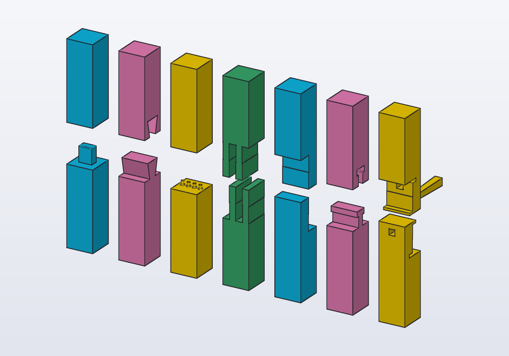
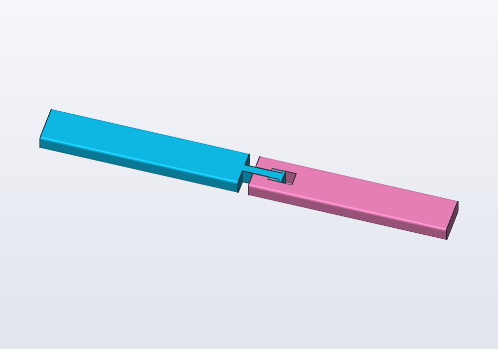
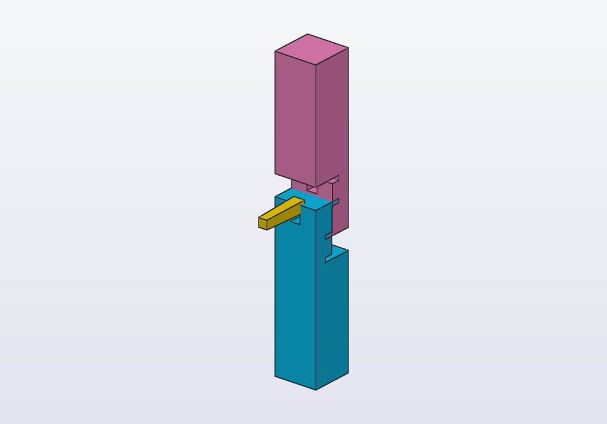
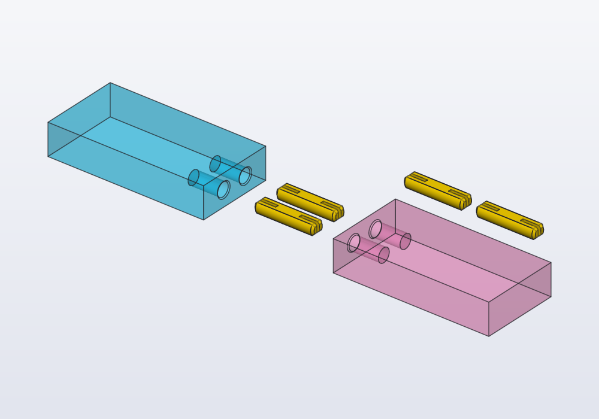
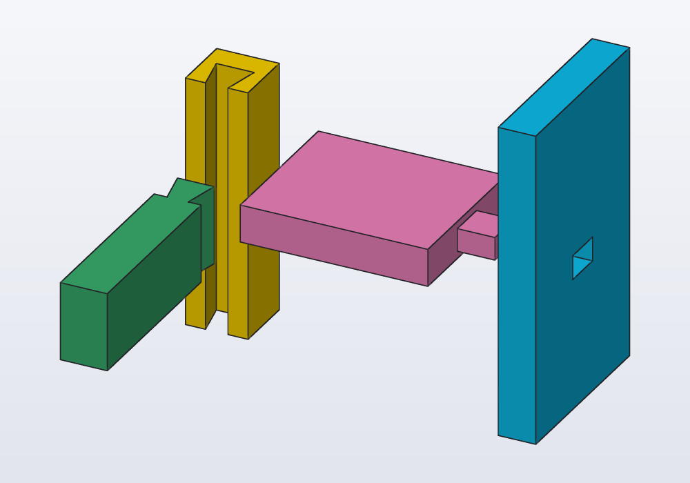
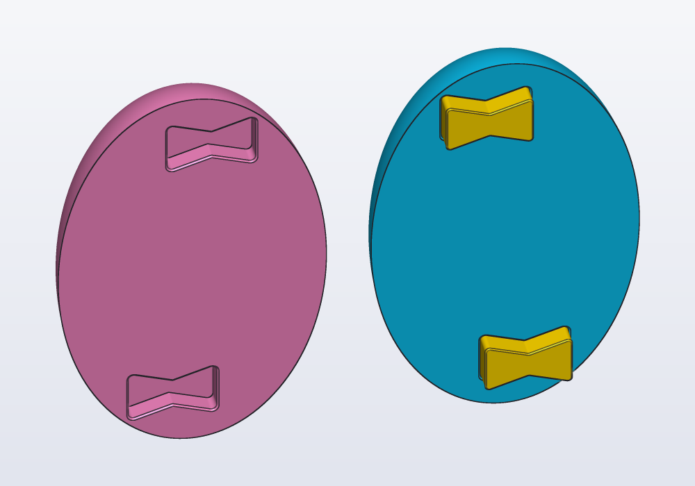
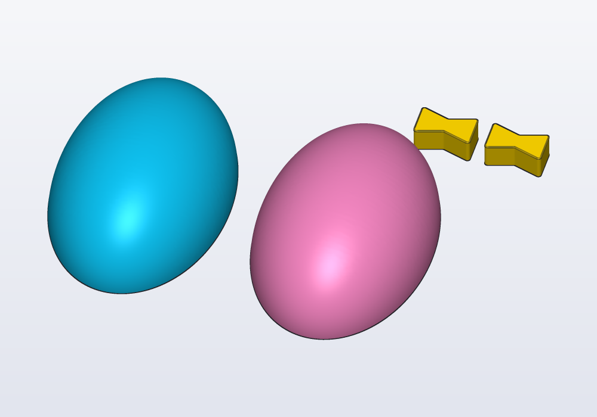

# Joints between parts

A part too long for the printer's bed cut in two pieces that lock together with no screws and no glue, or two parts joined where they meet, as joiners join timber: tenons, dovetails, pins, finger joints, half laps, the gooseneck, the wedged scarf and the seated dovetail of Japanese carpentry, a barbed tenon driven in for good, and printed dowels in plain holes. Or a part cut into two halves with flat faces, each printed lying on its cut face, joined by flat keys. The `joints` library cuts a solid along a plane and shapes both sides of the cut.

<!-- render: joints-kinds --from 0.6,-1,0.5 -->
```d
// a beam 20 mm square cut with each kind of joint, the
// two pieces pulled apart to show it

import std;

Solid shown(int i)
{
    auto beam = box(20.mm, 20.mm, 120.mm);
    auto middle = plane(origin: vec(0.mm, 0.mm, 60.mm),
        normal: Z);
    // four fingers; two pins, stouter than four would be
    auto kind = jointKinds[i];
    auto j = splitJoint(beam, middle, kind: kind,
        count: kind == "fingers" ? 4 : 2);
    auto s = j.a + j.b.move(z: 30.mm);
    foreach (l; j.loose)
        s += l.move(y: 30.mm, z: 15.mm);
    return s.move(x: i * 40.mm);
}

@part("Sky Pop")
Solid tenon() => shown(0);

@part("Pink Pop")
Solid dovetail() => shown(1);

@part("gold")
Solid pins() => shown(2);

@part("mediumseagreen")
Solid fingers() => shown(3);

@part("Sky Pop")
Solid lap() => shown(4);

@part("Pink Pop")
Solid kama() => shown(5);

@part("gold")
Solid kanawa() => shown(6);

@part("mediumseagreen")
Solid koshikake() => shown(7);

@part("Sky Pop")
Solid barbed() => shown(8);
```



## Cutting with a joint

`splitJoint(body, plane, kind:)` cuts `body` along the plane and gives a `Joint`:

- `.a`, the piece behind the plane (against its normal), with what pushes into the other;
- `.b`, the piece in front of it, with the hollow it fits in;
- `.loose`, the parts printed apart that lock it, where they go: the wedge of a `"kanawa"`, the dowels of `"dowels"`;
- `.print`, the same parts lying flat on z = 0 in a row beside the body, ready to print.

The joint sits in the middle of the cut. Its size follows the cut: by default it is the square root of the section's area, the width of a square beam, so the same call suits a thin rod and a thick post. The hollows are `clearance` larger all round (0.2 mm unless given), so the pieces go together without forcing: see [Fits and printing](fits.md) to choose it for your printer.

A hollow part, a tube, has nothing in the middle of its cut: there the pins and the dowels go on the material round it instead, as far apart as they can be and as thick as the wall has room for, and a tenon is an error. The fingers share the cut's width, across the part whatever way the plane leans.

| Kind | What it is | Goes together | Holds against |
|---|---|---|---|
| `"tenon"` | a rectangular tenon in a mortise (hozo) | pushed straight in | bending; glue or a pin for pulling |
| `"dovetail"` | a tail widening into the other piece (ari) | slid in from the side | pulling apart |
| `"pins"` | round pins in holes (`count:` of them), stout and flared at the foot, the holes flared at the mouth | pushed straight in | bending and twisting |
| `"fingers"` | a finger (box) joint, the fingers of each in turn (`count:`) | pushed straight in | bending; a wide gluing surface |
| `"lap"` | a half lap (ai-gaki): each piece keeps half the thickness | laid on each other | bending one way |
| `"kama"` | a gooseneck (kama tsugi): a neck and a wider head | dropped in from the side | pulling apart |
| `"kanawa"` | a half lap with a hook at each end, locked by a wedge (kanawa tsugi) | laid on, then the wedge driven through | pulling, bending and twisting |
| `"koshikake"` | a dovetail over a seat the other piece rests on (koshikake ari tsugi) | dropped in from the side | pulling apart, and bending: the seat carries the load |
| `"barbed"` | a tenon with barbs, split down its middle (the barbs close as it goes in) | driven in | pulling out: it does not come out again |
| `"dowels"` | loose printed dowels (`count:` of them), rods with two flats and split ends, in plain round holes of both pieces | the dowels pushed into one piece, then the other piece onto them | bending and twisting; pulling, by friction |

| Argument | What it does |
|---|---|
| `kind:` | one of the kinds above (`jointKinds` lists them) |
| `clearance:` | the play where the pieces meet, 0.2 mm unless given |
| `size:` | the joint's scale, instead of the square root of the section's area |
| `length:` | how far it reaches across the cut, 0.6 of the size unless given |
| `turn:` | turns it about the plane's normal (it lies along the cut's longer side unless turned): which way a dovetail or a gooseneck slides in |
| `count:` | the number of pins or dowels (thinner the more there are) or fingers; `keys:` is the same, as in `splitFlat` and `mold` |

## A rail longer than the bed

A rail 300 mm long does not fit a printer of 220 mm. Cut in the middle with a gooseneck it prints in two pieces, each lying on its flat side, and drops together from above:

<!-- render: joints-rail --from 0.3,-1,1.2 -->
```d
// a rail 300 mm long in two pieces joined by a
// gooseneck, shown a little apart

import std;

@param("Play in the joint", min: 0.1.mm, max: 0.5.mm)
immutable play = 0.2.mm;

Solid rail() => box(300.mm, 30.mm, 12.mm)
    .fillet(edges.parallel(X), r: 2.mm);

// the cut across the middle: the neck runs along X,
// and the pieces drop together from above
Joint pieces() => splitJoint(rail(),
    plane(origin: vec(0.mm, 0.mm, 6.mm), normal: X),
    kind: "kama", size: 24.mm, length: 30.mm,
    clearance: play);

@part("Sky Pop")
Solid left() => pieces().a;

@part("Pink Pop")
Solid right() => pieces().b.move(x: 8.mm);
```



`size:` and `length:` are given here: the rail is wide and flat, and the square root of its section would make a neck too wide for it. `turn: 90.deg` would stand the gooseneck the other way, to slide in from the side instead of from above: try it and look at the picture.

## The wedged scarf

The kanawa tsugi of Japanese carpentry joins two beams end to end in a half lap with a hook at each end; a wedge driven through the middle pushes the hooks against each other, and the joint becomes as stiff as the beam. The wedge is a loose part, printed apart, tapering 1 in 20: it goes in by hand and is tapped home, its narrow end flush with the post's side and its wide end standing out 3 mm, to tap it and to pull it out again.

<!-- render: joints-kanawa --from 0.8,-1,0.6 -->
```d
// a post joined end to end with a wedged scarf: the
// two halves and the wedge, a little apart

import std;

Solid post() => box(25.mm, 25.mm, 160.mm);

Joint scarf() => splitJoint(post(),
    plane(origin: vec(0.mm, 0.mm, 80.mm), normal: Z),
    kind: "kanawa");

@part("Sky Pop")
Solid lower() => scarf().a;

@part("Pink Pop")
Solid upper() => scarf().b.move(z: 12.mm);

@part("gold")
Solid wedge() => scarf().loose[0].move(y: -25.mm, z: 6.mm);
```



## Dowels, printed

Woodworkers join two pieces with round wooden dowels glued into holes. `"dowels"` makes printed ones: a rod with two flats, so it prints lying on one (a pin printed standing snaps along a layer), each end split down its middle and pointed, and a plain round hole for it in each piece. The rod is a little thicker than its hole across the split: pushed in, the two halves of each end close up and press on the hole's wall, and the friction of the printed wall holds them, with no glue. `count:` sets how many dowels, side by side along the cut's longer side.

<!-- render: joints-dowels -->
```d
// a bar cut in two, joined by two dowels:
// the pieces apart, the dowels between them, and
// the dowels again lying flat, as they print

import std;

Joint cut() => splitJoint(box(120.mm, 30.mm, 12.mm),
    plane(origin: vec(0.mm, 0.mm, 0.mm), normal: X),
    kind: "dowels", count: 2);

@part("Sky Pop", alpha: 0.4)
Solid left() => cut().a.move(x: -25.mm);

@part("Pink Pop", alpha: 0.4)
Solid right() => cut().b.move(x: 25.mm);

@part("gold")
Solid dowels() => fuse(cut().loose);

@part("gold")
Solid toPrint() => fuse(cut().print).move(x: -60.mm, y: 40.mm);
```



Push the dowels into one piece, then the other piece onto them. They hold by friction, so the pieces come apart again with a firm pull. Print a sample first: if the dowels go in too hard, a larger `clearance`; if they hold too little, a smaller one (the holes keep the play, the dowels stay 0.2 mm thicker than them).

## Two parts that meet

`joinParts(a, b, plane)` joins two separate parts where one ends on the other: a shelf on an upright, a rail on a post, the sides of a box. `b` is the part that ends on the plane (a face of `a`, the plane's normal pointing into `b`), and the joint goes from `b` into `a`, centred on `b`'s end and sized by it. A tenon longer than `a` is thick comes out flush on the far side, a through tenon, as the frames of Japanese cabinets (sashimono) show them. The kinds are those of `splitJoint` but the wedged scarf (a sliding dovetail's, a gooseneck's and a seated dovetail's housing runs out of `a` the way it slides in); `.a` comes back with the hollows, `.b` with what fits in them (with `"dowels"`, both with holes, and the dowels in `.loose` and `.print`).

<!-- render: joints-parts --from -0.5,1,0.6 -->
```d
// a shelf into an upright with a through tenon, a rail
// into a post with a sliding dovetail, pulled apart

import std;

Solid upright() => box(12.mm, 60.mm, 100.mm)
    .move(x: -6.mm);
Solid shelf() => box(60.mm, 50.mm, 12.mm)
    .move(x: 30.mm, z: 40.mm);

// the shelf ends on the upright's face x = 0
Joint shelved() => joinParts(upright(), shelf(),
    plane(origin: vec(0.mm, 0.mm, 46.mm), normal: X));

@part("Sky Pop")
Solid side() => shelved().a;

@part("Pink Pop")
Solid board() => shelved().b.move(x: 25.mm);

Solid post() => box(20.mm, 20.mm, 80.mm)
    .move(x: 100.mm);
Solid rail() => box(15.mm, 60.mm, 25.mm)
    .move(x: 100.mm, y: 40.mm, z: 30.mm);

// the rail ends on the post's face y = 10
Joint railed() => joinParts(post(), rail(),
    plane(origin: vec(100.mm, 10.mm, 42.5.mm), normal: Y),
    kind: "dovetail");

@part("gold")
Solid upright2() => railed().a;

@part("mediumseagreen")
Solid rail2() => railed().b.move(y: 25.mm);
```



The joint lies along the longer side of the end, as a tenon goes along a board's width and a dovetail slides along a rail's height; `turn: 90.deg` turns it across. The housing of a dovetail or a gooseneck runs on out of `a` the way it slides, so the rail goes in from the post's end.

## Two halves cut flat, joined by keys

A round or tall part often prints best in two halves, each lying on the face of the cut: no supports under the curves, and the nicest surface outside. Nothing may stand out of that face, or the half would not lie flat on the bed; so the halves are joined by **keys** printed apart: a pocket in each cut face, half of the key in each.

`splitFlat(body, plane)` does it all. It finds where the cut has room for the keys (away from its edges, as far apart as they can be), cuts the pockets, and gives the halves both where they are (`.a`, `.b`, with `.keys` in place) and laid for printing (`.aPrint`, `.bPrint` on their cut faces, `.print` the keys flat in a row).

<!-- render: joints-flat --from 0.2,1,0.7 -->
```d
// an egg 90 mm tall cut in two down the middle: one
// half with its keys in, the other turned round beside
// it to show its pockets

import std;

Solid egg() => sphere(30.mm)
    .scale(z: 1.5)
    .move(z: 45.mm);

FlatSplit halves() => splitFlat(egg(),
    plane(origin: vec(0.mm, 0.mm, 45.mm), normal: Y));

@part("Sky Pop")
Solid front() => halves().a;

@part("gold")
Solid keys() => fuse(halves().keys);

@part("Pink Pop")
Solid back() => halves().b
    .rotate(z: 180)
    .move(x: 70.mm);
```



The keys are **bowties** (butterflies, the chigiri of Japanese joinery): wide at the ends, narrow in the middle, they keep the halves from sliding apart in any direction along the cut and from turning, and they print lying flat, quickly and strongly, with their layers along the cut. Round pins do the same job worse: printed standing up they are weak and come out oval; printed lying down they come out flat on one side.

The holes need no teardrop: each half prints on its cut face, so the pockets stand upright on the bed and come out true. Their mouths, on the bed, open with a 0.4 mm chamfer, for the first layers that spread a little.

Laid out for printing, the same split:

<!-- render: joints-flat-print --from 0.3,-1,1.2 -->
```d
// the egg's halves on their cut faces and the keys
// lying flat: one bed

import std;

Solid egg() => sphere(30.mm)
    .scale(z: 1.5)
    .move(z: 45.mm);

FlatSplit halves() => splitFlat(egg(),
    plane(origin: vec(0.mm, 0.mm, 45.mm), normal: Y));

@part("Sky Pop")
Solid front() => halves().aPrint;

@part("Pink Pop")
Solid back() => halves().bPrint.move(x: 70.mm);

@part("gold")
Solid keys() => fuse(halves().print)
    .move(x: 40.mm, y: 50.mm);
```



| Argument | What it does |
|---|---|
| `keys:` | how many keys (2 unless given); one bowtie alone already holds |
| `kind:` | `"bowtie"`, or `"disc"`: round keys, which keep the halves from sliding but not from turning: two at least |
| `size:` | a key's length; from the section's size unless given, smaller until the keys find room |
| `depth:` | how deep a key goes into each half (a quarter of its length, 2 to 6 mm) |
| `clearance:` | the play round a key in its pocket, 0.15 mm unless given: tight enough to hold dry, or loose enough for glue (0.25 mm) |
| `wall:` | how much of the cut stays round each pocket, 1.6 mm unless given |

To choose the places yourself, `profile.spots(n, margin:)` gives the points `splitFlat` uses: up to `n` points inside a profile, at least `margin` from its edges, as far apart as they can be (in any plane: `body.section(plane).spots(3, margin: 6.mm)`).

## Printing joints

- Lay each piece so that what holds the joint lies along the layers, not across them: a tenon or a pin printed standing up snaps off along a layer. The rail above prints lying flat, its neck along the bed.
- A dovetail, a gooseneck and a scarf print flat on the side they slide on: their walls stand upright, with no overhang.
- Print a short sample of the joint first, both pieces, and adjust `clearance` (a `@param`): 0.1 to 0.15 mm on a well-tuned printer for a tight fit, 0.3 mm for one that goes together easily.
- The first layers spread a little (the *elephant's foot*): a hollow touching the bed comes out tight at its mouth. A 0.4 mm chamfer round it, or a slightly larger clearance, takes care of it.
- PLA joints hold well dry; tight ones in PETG creep less over months under load.

## Common errors

| Message | What to do |
|---|---|
| *the joint kind is one of tenon, dovetail, pins, fingers, lap, kama, kanawa, koshikake, barbed, dowels* | a kind from the list |
| one piece comes out in two bodies | the plane cuts through two separate parts of the solid (both jaws of a clip): cut where the section is one piece |
| the joint is too big for a flat part | the size follows the section's area: give `size:` (and `length:`) |
| the pieces do not go together | the joint slides the wrong way for how you want to assemble them: `turn: 90.deg` |
| *splitJoint: the part is hollow or narrow in the middle of the cut, where the tenon goes…* | a tube or a ring: `"pins"` or `"dowels"`, which go on its wall, or a smaller `size:` |
| *splitJoint: the part's walls are too thin at the cut for pins…* | `"lap"` or `"fingers"`, which take the wall's whole thickness |
| *splitFlat: the cut has no room for a key…* | the cut is too narrow for a key with `wall` round it: a smaller `size:` or `wall:`, or a cut elsewhere |
| *undefined identifier 'splitJoint'* | `import std;` at the top |

## In the application

- The parts of a joint are ordinary parts: make one of each piece with `@part`, and export them to print each in its own colour, or together on one bed.
- To see the fit, move one piece onto the other in the code (or drag it): the [section](planes.md) through the joint shows the play all round.
