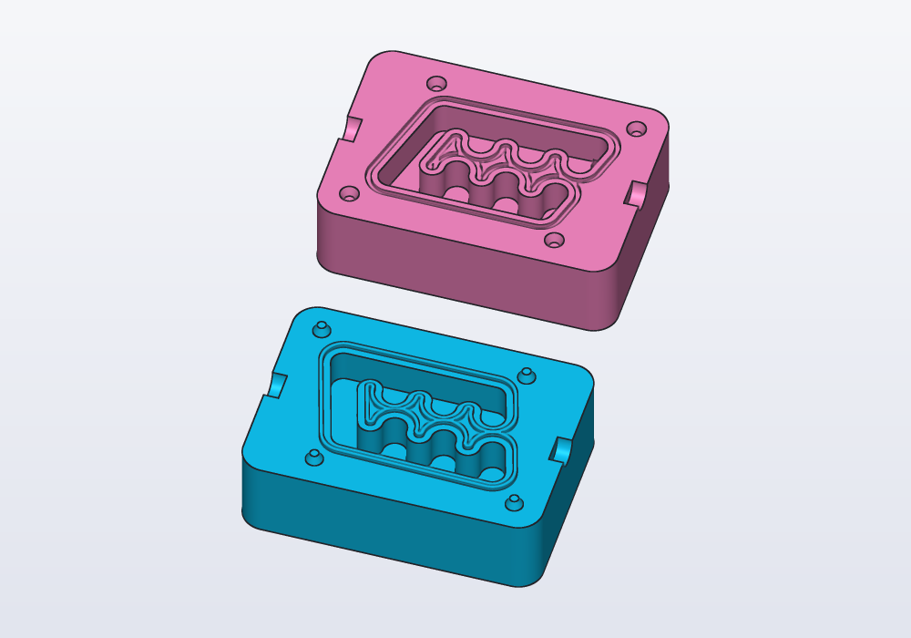
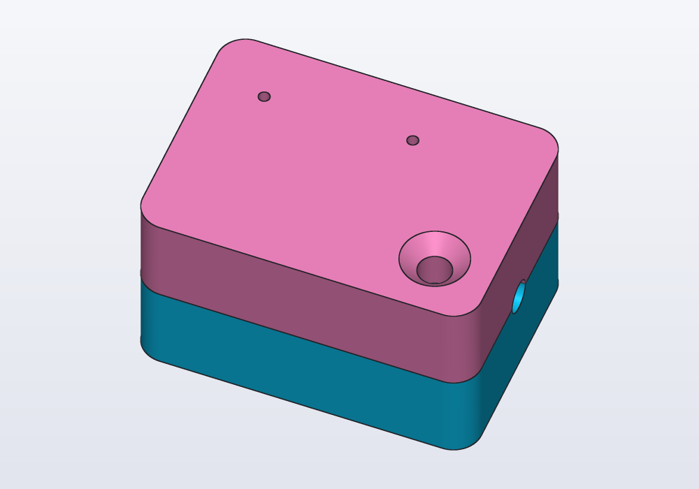
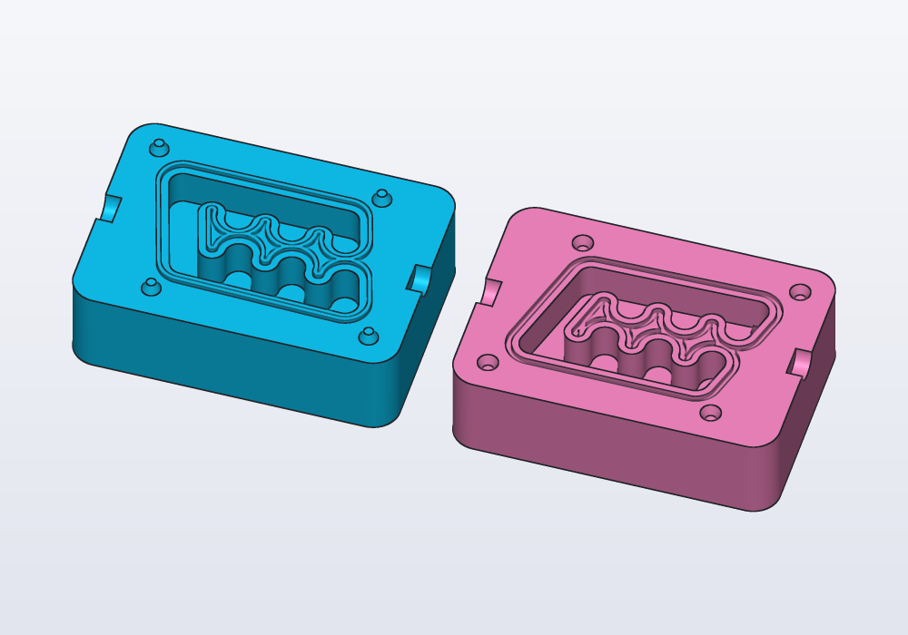

# Molds for casting

A two-part mold to cast copies of a part in silicone, resin or plaster: a block round the part, cut in two along a parting plane, the part's shape hollow inside, with keys that line the halves up, a seal round the cavity so the liquid stays in, and a pour hole with vents for the air. The `molds` library makes it from the part itself.

<!-- render: molds-open --from 0.3,-1,1.2 -->
```d
// a mold to cast Carlo in silicone (without its eye, a
// thin core that would tear the cast), open: the lower
// half with its keys and the seal, the upper turned over

import carlo;
import molds;

Mold carloMold() => mold(carlo(eye: false),
    plane(origin: vec(0.mm, 0.mm, 7.5.mm), normal: Z));

@part("Sky Pop")
Solid lower() => carloMold().a;

@part("Pink Pop")
Solid upper() => carloMold().b
    .rotate(x: 180)
    .move(y: 50.mm, z: 35.mm);
```



Closed, the mold shows the pour hole, its funnel and the two vents on top, and the notches to pry it open on the sides:

<!-- render: molds-closed --from 0.4,-1,1.3 -->
```d
// the same mold closed, as it stands to be poured: the
// funnel and the vents on top

import carlo;
import molds;

Mold carloMold() => mold(carlo(eye: false),
    plane(origin: vec(0.mm, 0.mm, 7.5.mm), normal: Z));

@part("Sky Pop")
Solid lower() => carloMold().a;

@part("Pink Pop")
Solid upper() => carloMold().b;
```



## The mold

`mold(part, plane)` gives a `Mold`: the halves where they go (`.a` behind the plane, `.b` in front of it) and laid for printing (`.aPrint`, `.bPrint`). The block is `wall` thick round the part (10 mm unless given) and rounded at its upright edges.

The **parting plane** decides whether the cast comes out: it must cross the part where it is widest, so that nothing of the part hides behind something else seen from either side. A part lying flat (Carlo) parts at half its height; an egg or a figure parts through its middle, along its length.

- **Keys** line the halves up: truncated cones on `a`'s parting face, their sockets in `b`'s, `clearance` larger (0.15 mm unless given), as many as `keys:` (4 unless given), placed where the face has room, as far apart as they can be.
- **The seal** keeps the liquid from creeping out between the halves: a ridge round the cavity on `a`, `seal` high (0.8 mm unless given), pressing into a groove in `b`. `seal: 0.mm` leaves it out.
- **Notches** across the parting line on two opposite sides take a flat screwdriver to open the mold without marring its faces; `pry: false` leaves them out.
- **The pour hole** goes up through `b` from just under the cavity's top, along the plane's normal, `sprue` wide (6 mm unless given) and opening into a funnel at the block's face; `vents:` thinner channels (2 unless given) let the air out from other high points. Pour with `b` on top.

Each half prints on its outer face, the parting face up: the keys and the seal stand up, the sockets, the groove and the cavity open upwards, and nothing needs supports.

<!-- render: molds-print --from 0.3,-1,1.2 -->
```d
// the same mold laid for printing: both halves on their
// outer faces, the parting faces up

import carlo;
import molds;

Mold carloMold() => mold(carlo(eye: false),
    plane(origin: vec(0.mm, 0.mm, 7.5.mm), normal: Z));

@part("Sky Pop")
Solid lower() => carloMold().aPrint;

@part("Pink Pop")
Solid upper() => carloMold().bPrint.move(x: 70.mm);
```



## Casting

- Print the halves with fine layers where the cavity is (they show on the cast) and 100% infill round it, or the block flexes under clamps.
- Smooth the cavity if the surface matters: layer lines print onto the cast. A coat of primer, sanded, or XTC-3D does it.
- Silicone does not stick to PLA or PETG, but platinum silicone cures badly against some resins and fresh prints: test a drop first, or seal the mold with a varnish. For resin or plaster casts, a mold release.
- Clamp the halves or tape them round, pour slowly into the funnel until the liquid shows in the vents, and tap the mold to bring up the bubbles.
- A paste that does not pour (oogoo, silicone sealant kneaded with corn starch; a putty) is pressed into both open halves, a little more than they hold, then the mold is closed and clamped: the pour hole and the vents let the extra out. Such pastes cure from the outside in, with the air's moisture: give a part 15 mm thick a night.
- Open it at the notches with a flat screwdriver.

## Common errors

| Message | What to do |
|---|---|
| *mold: no room for the keys on the parting face* | a thicker `wall:`, fewer `keys:`, or `seal: 0.mm` |
| the cast does not come out | the parting plane does not cross the part where it is widest: move it, or turn it |
| *undefined identifier 'mold'* | `import molds;` |

## In the application

- The halves are ordinary parts: export them together (one bed) or each on its own.
- A section through the mold shows the cavity, the seal and the keys at once: see [Planes](planes.md).
