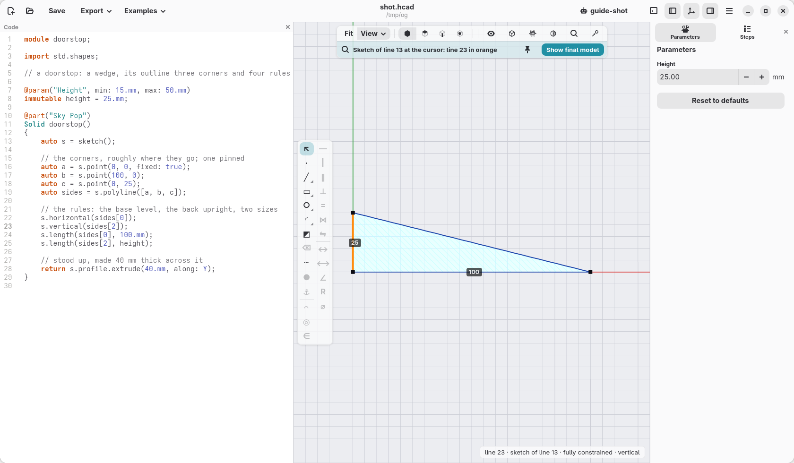
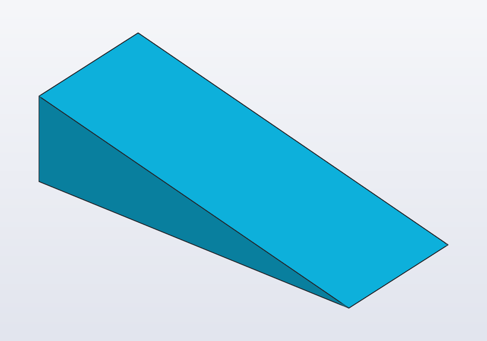
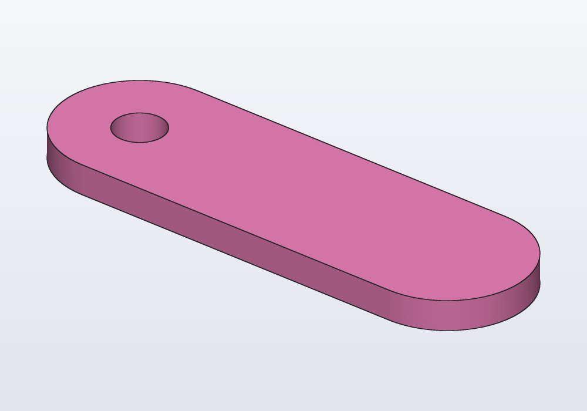

# Drawing an outline

Many parts are a flat outline made thick: a bracket, a wedge, a tag, a plate with holes. When the outline is more than a rectangle or a circle, you draw it: a few points joined by lines, and rules that hold them, "this side level", "these two corners 100 mm apart". Change a size later and the outline follows, keeping its rules. This guide shows how, on two small parts.



Every tool and rule is in [Sketches in depth](sketches.md), later, once solids, planes and faces are familiar.

## Points, lines and rules

A doorstop is a wedge: three corners, the bottom side level, the back upright, 100 mm long and 25 mm high.

<!-- render: outlines-doorstop -->
```d
// a doorstop: a wedge, its outline three corners and four rules

@param("Height", min: 15.mm, max: 50.mm)
immutable height = 25.mm;

@part("Sky Pop")
Solid doorstop()
{
    auto s = sketch();

    // the corners, roughly where they go; one pinned
    auto a = s.point(0, 0, fixed: true);
    auto b = s.point(100, 0);
    auto c = s.point(0, 25);
    auto sides = s.polyline([a, b, c]);

    // the rules: the base level, the back upright, two sizes
    s.horizontal(sides[0]);
    s.vertical(sides[2]);
    s.length(sides[0], 100.mm);
    s.length(sides[2], height);

    // stood up, made 40 mm thick across it
    return s.profile.extrude(40.mm, along: Y);
}
```



Read it as you would draw it on paper:

- `sketch()` starts the drawing, `s` for short.
- Each `s.point` is a corner, put roughly where it goes: the numbers are a first guess, the rules decide where it really ends up. One corner is pinned (`fixed: true`): without it the whole outline could slide anywhere.
- `s.polyline` joins the corners with lines, back to the first: `sides[0]` is the bottom, `sides[1]` the slope, `sides[2]` the back.
- The rules: `horizontal` and `vertical` keep a line level or upright, `length` gives its size.
- `s.profile` is the finished outline; `extrude(40.mm, along: Y)` stands it up and makes it 40 mm thick (without `along:` it would lie flat, made thick upwards, as the tag below).

## Change a size

The height is a parameter (`@param`): its box in the **Parameters** panel changes it, and the slope follows, since nothing ties it but the corners. In the code, change `100.mm` and the wedge gets longer.

In the window you can change a size where it is drawn, too. Put the cursor on a line of the drawing's code: the view shows the outline from above, each size as a label on it. Click a label, type the new value, Enter: the window writes it in the code.

## Draw it in the window

The bar down the left of the view, while an outline is shown, draws and adds rules for you, writing each line of code as you go:

- **the left column draws**: points, lines, smooth curves, rectangles, polygons, slots, circles, arcs, ellipses; ⌫ deletes what is selected;
- **the right column adds rules** to what is selected: level, upright, parallel, at right angles, the same length, touching, a size typed in.

To start a new outline: **View › New sketch…** in the view bar, then the plane to draw on; or right-click a flat face of a part, **Sketch on face…**, to draw on it. Hover a tool to see what it needs selected.

## Ready-made shapes

A rectangle, a circle, a slot (a long round-ended shape) come whole, their sizes given at once. A keyring tag is a slot with a hole at one end:

<!-- render: outlines-tag -->
```d
// a keyring tag: a slot, and a hole 17 mm from its middle

@part("Pink Pop")
Solid tag()
{
    auto s = sketch();
    auto middle = s.point(0, 0, fixed: true);
    s.slot(50.mm, 16.mm, center: middle);

    // the hole's centre: level with the middle, 17 mm to the left
    auto h = s.point(-17, 0);
    s.horizontal(middle, h);
    s.distance(middle, h, 17.mm);
    s.circle(h, d: 5.mm);

    return s.profile.extrude(3.mm);
}
```



A shape drawn inside another is a hole: the circle inside the slot. The hole is placed by two rules on its centre, "level with the middle" and "17 mm away", so if the tag gets longer you change the 17 and nothing else moves.

## The rules you use most

| Rule | Holds |
|---|---|
| `s.horizontal(line)`, `s.vertical(line)` | a line level, or upright |
| `s.length(line, 30.mm)` | a line that long |
| `s.distance(p, q, 20.mm)` | two points that far apart |
| `s.equal(a, b)` | two lines the same length, or two circles the same size |
| `s.parallel(a, b)`, `s.perpendicular(a, b)` | two lines side by side, or at a right angle |
| `s.tangent(line, arc)` | a line that touches a round edge without a corner |
| `s.radius(arc, 5.mm)`, `s.diameter(circle, 8.mm)` | a round part that size |
| `s.fillet(p, 4.mm)` | the corner at a point rounded |

## When the window warns

- **"under-constrained"**: some point can still move, so the outline is not decided. In the window those points are drawn in blue. Add the size or rule that is missing, or pin a point.
- **"constraints conflict"**: two rules ask the impossible, say a line both level and upright, or a size given twice. Remove one; the window shows them in red.

## From outline to solid

`s.profile` is an outline like any other: `extrude` makes it thick, `revolve` turns it round an axis (a knob, a vase), and it can be added to a face of a part or cut into it. [From profile to solid](profiles.md) shows all of them.

When an outline gets larger, with arcs touching lines, guide lines, curves or drawings on a part's face measured from its edges, go on with [Sketches in depth](sketches.md).
