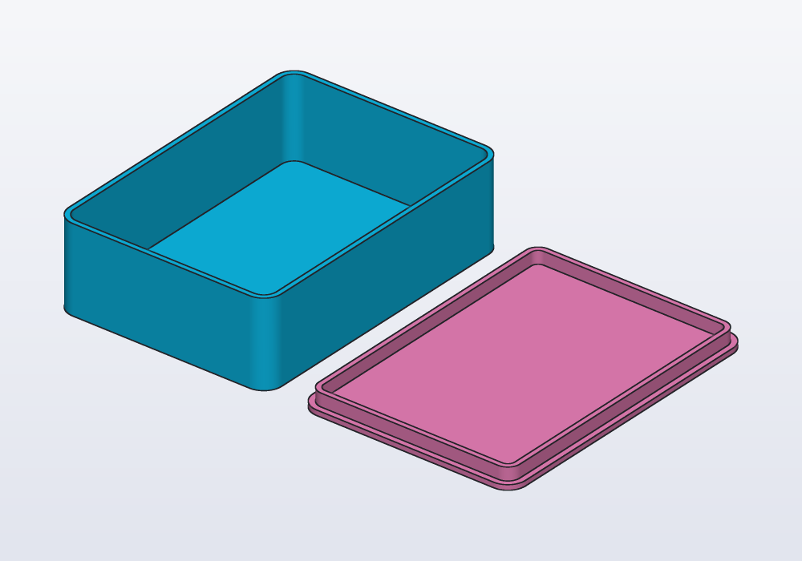
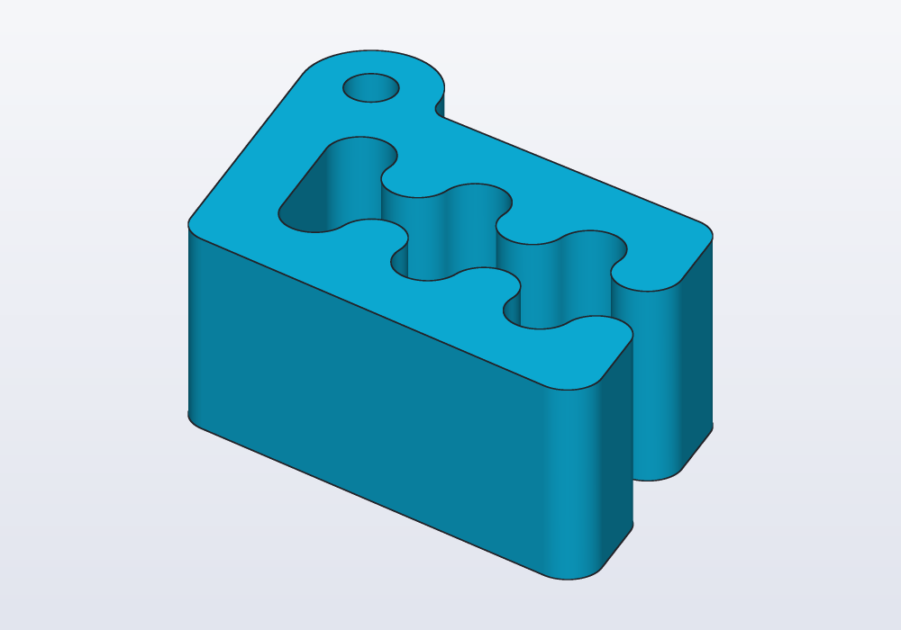

# Parameters, presets and checks

The sizes you may want to change, made parameters with `@param` (limits, steps, a list of choices) and grouped into named presets with `@preset`; units and the mistakes they catch, and the few they do not; design checks in `unittest` blocks with `assert`; measuring a model (its size, volume, weight, distances) and printing values with `writeln`; and changing parameters from the Parameters panel and the command line (`-D`, `--preset`).


## What makes a good parameter

A parameter is a named value in the model that you can change without touching the rest of the code: change it, and the part is rebuilt to fit. Make one of each size someone will change: the inside of a box, the diameter of the shaft a knob fits on, the play of a printed fit, how many holes. Not every number: a parameter for each fillet (a rounded edge) makes a panel nobody reads. Name the measures that decide whether the part works, give each a description that says what it is, and limits that keep the model valid.

| Kind of value | Write | The panel shows |
|---|---|---|
| a length | `immutable width = 60.mm;` | a number field in mm |
| an angle | `immutable tilt = 15.deg;` | a number field in degrees |
| a whole number | `immutable holes = 4;` | a number field without decimals |
| a number with decimals | `immutable ratio = 1.5;` | a number field |
| yes or no | `immutable lid = true;` | a switch |
| one of a few | `@param("…", choices: [4.mm, 5.mm, 6.mm])` | a drop-down list |
| a text | `immutable label = "BOX";` | a text field |

## A complete example

A box with a lid, sized for what goes in it. The inside sizes are parameters, with presets for two uses. The play of the lid (the small gap left round it so that it slides in) is a parameter too, because it depends on the printer. The checks at the end say what must hold whatever the values.

The tray is a rounded rectangle pushed up into a block (`extrude`), then hollowed out with walls of one thickness and the top left open (`shell`). The lid is a flat plate with a lip under it that goes inside the tray.

<!-- render: parameters-box -->
```d
// a box with a lid, sized for what goes in it

@param("Inside width", min: 20.mm, max: 150.mm)
@preset("cards", 64.mm) @preset("phone", 80.mm)
immutable width = 64.mm;

@param("Inside length", min: 20.mm, max: 200.mm)
@preset("cards", 90.mm) @preset("phone", 165.mm)
immutable length = 90.mm;

@param("Inside height", min: 10.mm, max: 100.mm)
@preset("cards", 25.mm) @preset("phone", 12.mm)
immutable height = 25.mm;

@param("Wall", choices: [1.2.mm, 1.6.mm, 2.mm])
immutable wall = 1.6.mm;

@param("Play of the lid, each side", min: 0.1.mm,
    max: 0.5.mm, step: 0.05.mm)
immutable play = 0.2.mm;

@param("Lid beside the box, to print it")
immutable printLayout = true;

immutable corner = 4.mm;

Profile footprint(Length grow) => rect(width + 2 * grow,
    length + 2 * grow, corner: corner + grow);

@part("Sky Pop")
Solid tray() => footprint(wall)
    .extrude(height + wall)
    .shell(open: faces.top, thickness: wall);

// the lid upside down: a plate, and a lip that goes in
Solid lid()
{
    auto lip = (footprint(-play) - footprint(-play - wall))
        .extrude(4.mm);
    return footprint(wall).extrude(wall)
        + lip.move(z: wall);
}

@part("Pink Pop")
Solid cover() => printLayout
    ? lid().move(x: width + 2 * wall + 10.mm)
    : lid().rotate(x: 180.deg).move(z: height + 2 * wall);

unittest
{
    immutable inside = width * length * height;
    writeln("holds $(inside / 1.cm ^^ 3) ml");
    writeln("tray: $(tray.mass(density: 1.24)) g of PLA");

    // the lid in place does not run into the walls
    auto onTop = lid().rotate(x: 180.deg)
        .move(z: height + 2 * wall);
    assert((tray() & onTop).volume < 0.01 * 1.mm ^^ 3,
        "the lid's lip runs into the walls");
}
```



## @param

`@param` goes on its own line above an `immutable` at the top level of the file; the value written there is the default.

| Argument | What it does | Default |
|---|---|---|
| description | the label in the panel: say what it is, and what to measure for a real object | the name |
| `min:`, `max:` | the limits; a value outside them is an error, from the panel or from `-D` | none |
| `step:` | how much the panel's arrows change it | 1 for whole numbers; 0.1 or 1 for others, from the range |
| `choices:` | the only values allowed, shown as a list | — |

The limits have the default's unit: `min: 10.mm` with a default of `40` is an error (*the limits of 'width' must be in number, like its value, not Length*). Give the default its unit: `40.mm`. A default without a unit is a plain number, not a length, and stays one: `-D width=100.mm` is then refused.

A parameter never changes while the model is evaluated. Its value is decided before: the default, then the preset's value, then a value set by hand.

## @preset

`@preset("name", value)` on a parameter gives its value in the preset of that name. A preset is every value declared under its name; parameters without one keep their default. It reads like a table: each parameter a column, each preset a row.

```d
@param("Inside width", min: 20.mm, max: 150.mm)
@preset("cards", 64.mm) @preset("phone", 80.mm)
immutable width = 64.mm;
```

Short annotations share a line; long ones get one each. Presets are for combinations that belong together (sizes for one phone, one card deck, one printer), not for single values.

Carlo, the mascot clip, made for two kinds of bag. A thin bag of crisps wants the usual gap between the jaws; a thick bag of coffee wants a wider gap and one more tooth to hold it. Each preset sets both at once:

<!-- render: parameters-carlo --preset coffee -->
```d
import std;

// Carlo for thin and thick bags: a preset sets the
// teeth and the gap between the jaws together

@param("Teeth on each jaw", min: 1, max: 6)
@preset("crisps", 3) @preset("coffee", 4)
immutable teeth = 3;

@param("Gap between the jaws", min: 1.5.mm, max: 5.mm)
@preset("crisps", 2.9.mm) @preset("coffee", 4.mm)
immutable gap = 2.9.mm;

@param("Height", min: 8.mm, max: 25.mm)
immutable height = 15.mm;

@part("Sky Pop")
Solid clip() => carlo(teeth: teeth, gap: gap,
    height: height);
```


`height` has no preset: both presets keep its default, 15 mm.

## Units, and the mistakes they catch

Every length carries its unit: `60.mm`, `2.5.cm`, `1.m`, `1.inch`; angles `30.deg` or `0.5.rad`. A length times a length is an area, cubed a volume, and mixing kinds is an error with a suggestion:

| Written | Message | Meant |
|---|---|---|
| `60.mm + 5` | *incompatible units: Length + number … write the bare number with its unit: 5.mm* | `60.mm + 5.mm` |
| `8.2mm` | *a number takes its unit after a dot: 8.2.mm, not 8.2mm* | `8.2.mm` |
| `body.volume < 1000` | *incompatible units: Volume < number* | `body.volume < 1000 * 1.mm ^^ 3` or `< 1.cm ^^ 3` |
| `body.area > 10.mm` | *incompatible units: Area > Length* | an area: `10 * 1.mm ^^ 2` |
| `vec(1, 2) + vec(1.mm, 2.mm)` | *incompatible units: number and Length vectors* | units on every number |

Some mistakes are valid code and give wrong numbers. The checks do not catch these:

- **`600.mm ^^ 2` is not 600 mm².** The power applies to the whole length: (600 mm)² = 360 000 mm². An area of 600 mm² is `600 * 1.mm ^^ 2`; a volume of 5 cm³ is `5 * 1.cm ^^ 3`, and `0.01.mm ^^ 3` is a millionth of what `0.01 * 1.mm ^^ 3` is.
- **Whole numbers divide whole**, as in D: `7 / 2` is 3. Write `7 / 2.0`, or `count / 2.0` with a whole-number parameter.
- **A value in another unit as a bare number**: `volume / 1.cm ^^ 3` is the number of cm³ (millilitres), `length / 1.inch` of inches; `d.to!double` is the number in the file's unit (mm, or inches under `@unit(inch) module name;`).
- **Angles in `sin` and `cos`**: `sin(30.deg)` is 0.5; `sin(30)` takes 30 radians, as in D.

## Checks: unittest and assert

`unittest { … }` blocks are the design's requirements, the things that must be true for the part to work, written so that they are checked every time: a size that must fit a drawer, a fit that must have play, a wall that must print. `assert(condition, "message")` fails with the message, and the problem is reported with its line; the parts are still built and shown.

```d
unittest
{
    assert(tray.bbox.size.z <= 40.mm,
        "must fit in the drawer");
    assert(tray.thinWalls == 0 * 1.mm ^^ 2,
        "a wall too thin to print");
}
```

An `assert` inside a part's function is different: when it fails, the evaluation stops and no part is shown. Use it there only for values the part cannot be built with; put the rest in a `unittest`.

`hcad check`, `hcad render` and the exports run the unittests every time. The application runs them on request and before an export, not at every change.

## Measuring

A model can measure itself. The **bounding box** is the smallest box, square to the axes, that holds the part: its size is the part's width, depth and height. Carlo, measured in a check:

<!-- render: parameters-ex1 -->
```d
import std;

// Carlo measured: his size, volume and weight

@part("Sky Pop")
Solid clip() => carlo();

unittest
{
    writeln("size: $(clip.bbox.size)");
    writeln("volume: $(clip.volume / 1.cm ^^ 3) cm³");
    immutable grams = clip.mass(density: 1.24);
    writeln("in PLA: $(grams) g");
    assert(grams < 15, "too heavy for a bag clip");
}
```



It prints *size: [41.5497 mm, 28.6709 mm, 15 mm]*, *volume: 9.0432 cm³* and *in PLA: 11.2136 g*: Carlo printed solid in PLA weighs about 11 g.

| What | Gives |
|---|---|
| `s.bbox.size`, `.min`, `.max`, `.center` | the bounding box: width, depth, height; its corners and centre |
| `s.volume`, `s.area` | volume (mm³) and surface area (mm²) |
| `s.mass(density: 1.24)` | grams, for a density in g/cm³: PLA 1.24, PETG 1.27, ABS 1.04, aluminium 2.70, steel 7.85 |
| `s.centroid` | the centre of mass, the point it balances on |
| `s.inertia(density: 1.24)` | the principal moments of inertia (how hard it is to set spinning round each axis), in g·mm² |
| `distance(a, b)` | how far apart two solids are, 0 when they touch or overlap; between two points, their distance |
| `(a & b).volume` | how much two parts overlap: 0 when they only touch |
| `s.overhangs(45.deg)`, `s.thinWalls(0.8.mm)` | the area that hangs over empty space and needs supports to print, and the area of walls too thin to print |

A fit is best measured against the object it fits: model that object as a reference part, drawn see-through and never exported, and measure the gap in a unittest. Here a knob goes on a motor's shaft; its top edge is rounded (`fillet`). Seen from the front, cut through the axis:

<!-- render: parameters-fit --from 0.25,-1,0.2 --cut --look-at 0,0,11 --size 26 -->
```d
// a knob on a 6 mm shaft, measured against the shaft

@param("Shaft diameter (measured)", min: 3.mm,
    max: 10.mm)
immutable shaft = 6.mm;

@param("Play round the shaft", min: 0.mm, max: 0.4.mm,
    step: 0.05.mm)
immutable play = 0.15.mm;

// the shaft the knob goes on: drawn, never exported
@part("slategray", alpha: 0.35, export: false)
Solid motorShaft() => cylinder(d: shaft, h: 16.mm);

@part("Sky Pop")
Solid knob() => (cylinder(d: 24.mm, h: 14.mm)
        - cylinder(d: shaft + 2 * play, h: 12.mm))
    .fillet(edges.of(faces.top), r: 2.mm)
    .move(z: 6.mm);

unittest
{
    immutable gap = distance(knob, motorShaft);
    writeln("gap round the shaft: $(gap)");
    assert(gap >= 0.1.mm, "the knob is too tight");
}
```


With `-D play=0.05.mm` the check fails: *the knob is too tight*, with its line.

## writeln

`writeln(…)` prints to the application's Console (and to the output of `hcad check`): its arguments one after the other, or a string with `$(…)` in it, which inserts the value of the expression. Values print with their units: `writeln("gap: $(gap)")` gives `gap: 0.15 mm`. It works in a `unittest` and in any function.

## Changing parameters

| Where | How |
|---|---|
| the application | the **Parameters** panel: a field for each `@param`, a **Preset** list when there are presets |
| the command line | `-D name=value`, as many as needed: `-D width=80.mm`, `-D width=80` (in the file's unit), `-D lid=false`, `-D label='"BOX"'`; `--preset name` |

`-D` and the panel apply on top of a preset: `--preset phone -D height=20.mm` is the phone box, 20 mm high. Values are checked as the code's are:

| Message | What to do |
|---|---|
| *parameter 'depth' = 400 mm is outside [80 mm, 300 mm]* | a value within the limits, or wider limits in the code |
| *parameter 'thickness' = 7 mm is not one of [4 mm, 5 mm, 6 mm]* | one of the choices |
| *parameter 'depth' expects Length, got Angle* | a value of the default's kind |
| *parameter 'screws' is a whole number, not 2.5* | a whole number; if it may have decimals, write its default with a dot (`2.0`) |
| *'widht' is not a @param of this model* | the name as written in the code |
| *unknown preset 'huge'* | a preset the code declares (`hcad check --json` lists them) |

## In the application

The **Parameters** panel, on the right, has a field for each parameter, with the description above it: a number field with its unit (mm or °), a switch for yes or no, a list for choices, a text field for strings. Hovering over a description shows the variable's name, and a click on it shows its line in the code. A value changed by hand is marked with a dot, and the arrow beside it takes it back to the default (or the preset's value); **Reset to defaults** takes them all back. With presets, the **Preset** list at the top switches between them; choosing one clears the values changed by hand.

The **Console** under the editor shows `writeln` output, failed checks and errors. The bug button over it runs the unittests (F5); its tooltip says how many passed or failed. The right-click menu's **Measure** group gives the size and volume of a part, the area of the selected faces, and the distance between two selected vertices, with a click to copy each value.
