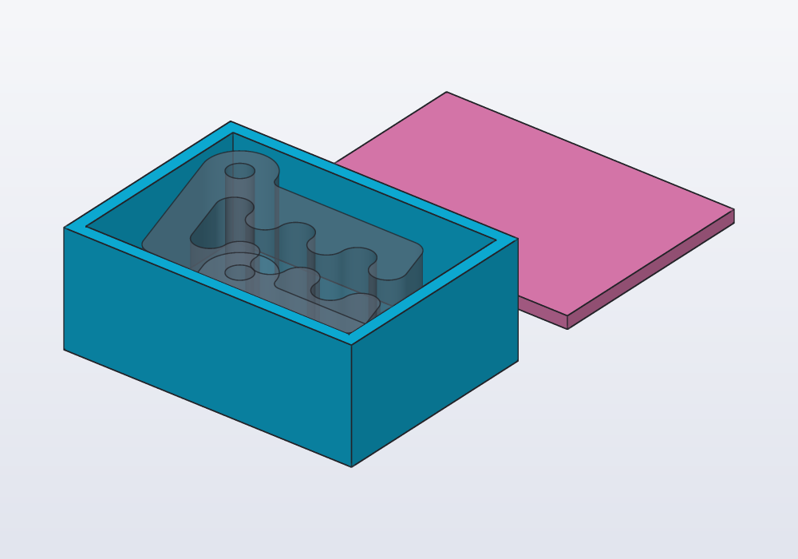
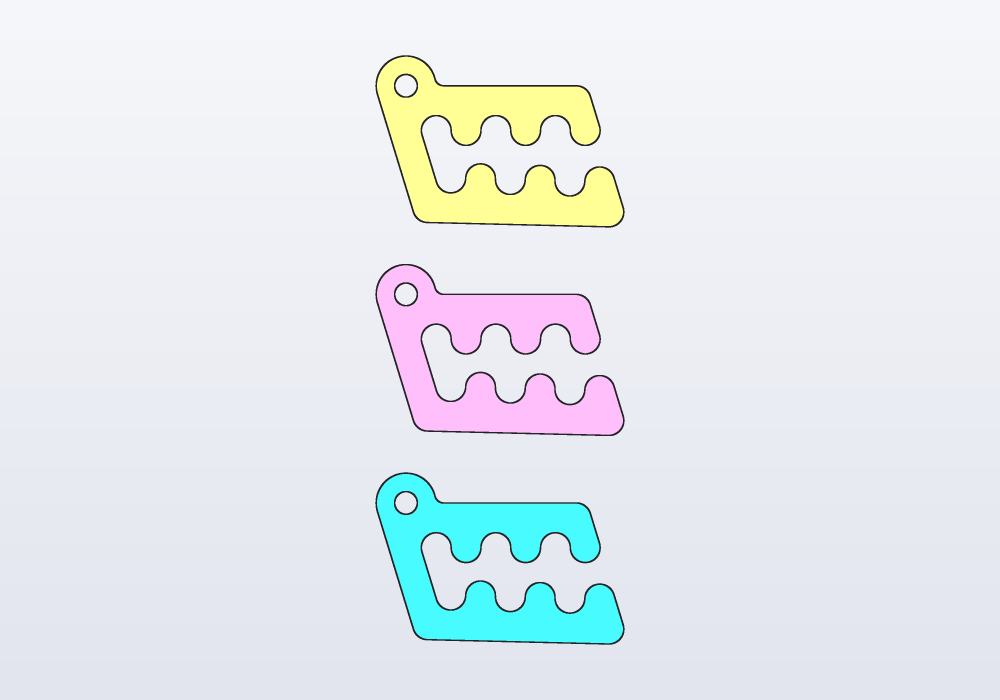
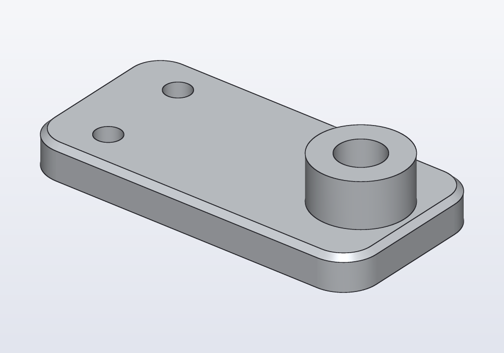
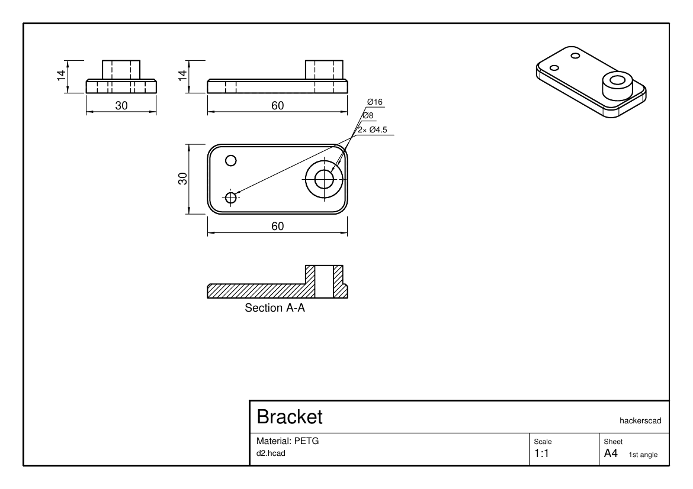

# Parts, export and drawings

What becomes a separate object when a model is exported: `@part` and its options (colour, see-through, reference parts, names), `@parts` for the pieces of a cut, colours, the export formats (3MF, STL, zip, STEP, PNG) and what each holds, technical drawings with `@drawing`, and the Export menu of the application.


## Parts in brief

A part is one object of the model: one body you print, or send to another program. A model shows and exports only what a function marked `@part` returns. Everything else is a helper.

| You want | Write |
|---|---|
| a body to print or export | `@part` above `Solid name() { … }` |
| it in a colour | `@part("Pink Pop")`, `@part("steelblue")`, `@part("#3b82f6")` |
| the thing it fits, shown but not exported | `@part("slategray", alpha: 0.35, export: false)` |
| another name in the exported files | `@part(name: "Tray")` |
| one part for each piece of a cut | `@parts` above a function returning a `Solid` or `Solid[]` |
| a drawing with views and dimensions | `@drawing` above a function returning `drawing(…)` |

The annotation goes on its own line, above the function. A `@part` function takes no arguments and returns a `Solid`: its sizes come from `@param`s (see [the guide on parameters](parameters.md)). A part is evaluated once per run, even when other parts use it.

## A model with several parts

A tray, its lid, and Carlo, the mascot clip, inside as a reference part: an object drawn so that you can see the fit, but never exported. The check at the end makes sure he fits:

<!-- render: parts-box -->
```d
import std;

// a box for Carlo: a tray, its lid beside it, and Carlo
// inside as a reference part, to check the fit

@param("Play around Carlo", min: 0.2.mm, max: 2.mm)
immutable play = 0.6.mm;

immutable wall = 2.mm;

// Carlo centred on the origin, on the tray's floor
Solid clip()
{
    auto c = carlo();
    return c.move(x: -c.bbox.center.x, y: -c.bbox.center.y,
        z: wall);
}

@part("Sky Pop", name: "Tray")
Solid tray()
{
    immutable size = clip().bbox.size;
    immutable x = size.x + 2 * play, y = size.y + 2 * play;
    return box(x + 2 * wall, y + 2 * wall, 18.mm)
        - box(x, y, 20.mm).move(z: wall);
}

@part("Pink Pop", name: "Lid")
Solid lid() => box(tray.bbox.size.x, tray.bbox.size.y, wall)
    .nextTo(tray, Y, gap: 10.mm);

@part("slategray", alpha: 0.5, export: false)
Solid carloInside() => clip();

unittest
{
    assert((carloInside & tray).volume == 0.mm ^^ 3,
        "Carlo must not touch the tray");
}
```



`hcad check` lists them, and says which are not exported:

```
part tray         46.7 × 33.9 × 18.0 mm   volume 8070.6 mm³   (exported as "Tray")
part lid          46.7 × 33.9 × 2.0 mm   volume 3166.9 mm³   (exported as "Lid")
part carloInside  41.5 × 28.7 × 15.0 mm   volume 9043.2 mm³   (reference, not exported)
```

## The options of @part

| Option | What it does | Default |
|---|---|---|
| colour (first, unnamed) | the part's colour in the view, in PNGs and in 3MF | `"Sky Pop"` (#0FC3F2) |
| `alpha:` | how opaque, 0 to 1: `0.35` is see-through | `1` |
| `export:` | `false` makes a reference part: drawn in the view and in PNGs, left out of STL, 3MF and STEP | `true` |
| `name:` | the name in exported files (3MF object, STEP body, STL file in a zip) instead of the function's | the function's name |

Two parts cannot share one exported name. On the command line, `--part` takes either name.

### Reference parts

The shaft a knob fits on, the board a case holds, the phone a stand carries, the mesh being remodelled: model it (or `load()` it), mark it `export: false`, and check the fit against it in a `unittest`, as above, or with `distance(a, b)`. It stays out of every export unless asked for by name (`--part carloInside`).

## Colours

- hackerscad's own colours, alike in brightness under the view's light, are the ones the right-click menu offers: `"Sky Pop"`, `"Blue Pop"`, `"Cyan Pop"`, `"Violet Pop"`, `"Pink Pop"`, `"Rose Pop"`, `"Red Pop"`, `"Orange Pop"`, `"Yellow Pop"`, `"White Pop"`, `"Gray Pop"`. With the space: `"Pink Pop"` is not the web's `"pink"`.
- Any CSS name (`"steelblue"`, `"slategray"`), `"#RRGGBB"`, `"#RRGGBBAA"` (the last byte the opacity), `rgb(255, 128, 0)`, `rgb(255, 128, 0, alpha: 0.5)`.
- Inside a function, `solid.color("orange", alpha: 0.5)` colours one solid: a piece of `@parts` coloured this way keeps its colour.

Three Carlos, each a part in its own colour:

<!-- render: parts-colours --from top -->
```d
import std;

// three Carlos side by side, a part each, each in its
// own colour: a 3MF keeps the colours

@part("Sky Pop")
Solid sky() => carlo();

@part("Pink Pop")
Solid pink() => carlo().move(y: 35.mm);

@part("Yellow Pop")
Solid yellow() => carlo().move(y: 70.mm);
```



3MF keeps the colours; STL and STEP do not. A slicer (the program that turns a model into the layers a 3D printer prints) shows them, and with `--one-object` (below) prints them in several filaments.

## Several bodies: @parts

A `@part` that returns several separate bodies is one part, one object in a 3MF. To make a part of each, use `@parts`: a part for each body of a `Solid`, or for each element of a `Solid[]`, named after the function with a number (`pieces1`, `pieces2`…), in the order of `.pieces` (along X, then Y, then Z). How many there are comes from the evaluation: a parameter can change it.

<!-- render: parts-pieces --from top -->
```d
import std;

// Carlo cut in two across its teeth, the halves pushed
// apart: each separate body is a part of its own

immutable cut = plane(origin: vec(14.mm, 0.mm, 0.mm),
    normal: X);

@parts(varied: true)
Solid[] pieces() => carlo()
    .split(cut)
    .push(from: cut, by: 4.mm);
```


`@parts` takes what `@part` takes, plus `varied: true`, which gives the pieces colours that tell them apart (the first in the part's colour). An empty `Solid[]` makes no part: a part chosen by a parameter, `@parts Solid[] lid() => withLid ? [makeLid()] : [];`.

## Export formats

| Format | What it holds | Choose it for |
|---|---|---|
| `.3mf` | one object per part, with colours and names | slicers: the default |
| `.3mf` with `--one-object` | the parts as pieces of one object | prints in several colours or materials |
| `.stl` | one part | a slicer or a service that wants STL |
| `.zip` | one STL per part, `Tray.stl`, `Lid.stl` | STL with several parts |
| `.step` (`.stp`) | one named body per part, exact surfaces (round holes stay round, not made of flat triangles) | other CAD programs, machining |
| `.png` | `name.png` the iso view (seen from a corner, above), `name-views.png` iso, front, top and right, `name-top.png` one view | a picture, a check |
| `.pdf`, `.svg`, `.dxf` | a `@drawing` | a sheet to print, to send, to cut |

```bash
hcad render box.hcad -o box.3mf -o box.step -o box-views.png
hcad render box.hcad -o lid.stl --part Lid
hcad render box.hcad -o box.3mf --one-object
hcad render box.hcad -o big.3mf -D play=1.mm
```

The names given to faces with `addTag` ([Selectors and features](features.md)) go into the files too: in a STEP file each face is named by its tags (`lid;seat`), and `load("part.step")` gives them back as tags, so a part made here, exported and loaded again, keeps its names. A 3MF holds them as named sets of the triangles of those faces (its *triangle sets* extension), and a part's own tags in the object's metadata; slicers that do not know them simply ignore them. Every file says it was made with hackerscad: 3MF and STEP in their fields for it, STL, zip, PNG, SVG, PDF and DXF in a comment.

STL and 3MF files hold flat triangles, not curves: a round hole becomes a many-sided one. The **mesh quality** says how far the triangles may stray from the true surface, at most:

| Quality | Largest distance | Choose it for |
|---|---|---|
| draft | 0.1 mm | small files, quick tries |
| normal | 0.02 mm | most prints: the default |
| fine | 0.005 mm | resin printers, small parts, smooth shiny surfaces |

The distance is the same on a large curve and a small one, so a large circle gets more sides than a small one; small holes always get enough sides to stay round. Finer files are larger and slower for the slicer, and below what the printer can draw they change nothing. `--quality fine` (or a number of mm, `--quality 0.01`) sets it; STEP files are exact and do not need it.

```bash
hcad render knob.hcad -o knob.3mf --quality fine
```

Every export runs the model's `unittest`s first. `-D name=value` and `--preset name` change parameters; `--part` (repeated for more) picks parts; without it, every part but the reference ones. `--printability` adds, per part, the overhangs that need supports and the walls too thin to print.

## Technical drawings

A technical drawing is the part on paper: flat views from the front, the top and the side, each size written beside the edge it measures (a dimension), and sections, the part drawn cut open with the cut faces hatched (striped). A function marked `@drawing` returns a sheet: `drawing(…)` filled with views, sections, dimensions and notes.

<!-- render: parts-ex1 -->
```d
import std;

// a bracket and its drawing: three views, an iso, and a
// section through the boss

@part("Gray Pop")
Solid bracket()
{
    auto b = rect(60.mm, 30.mm, corner: 6.mm)
        .extrude(6.mm)
        .chamfer(edges.of(faces.top), d: 1.mm);
    b = b.extrude(circle(d: 16.mm),
        on: b.frame(faces.top).at(x: 20.mm), depth: 8.mm);
    b = b.cut(circle(d: 8.mm), on: b.frame(faces.top),
        through: true);
    foreach (y; [-8.mm, 8.mm])
        b -= hole(M4, 6.mm, "clearance")
            .move(x: -20.mm, y: y, z: 6.mm);
    return b;
}

@drawing
Drawing sheet()
{
    auto d = drawing(title: "Bracket", material: "PETG");
    d.standardViews(bracket);
    d.section(bracket, XZ, label: "A");
    return d;
}
```



```bash
hcad render bracket.hcad -o bracket.pdf
```



| Call | What it adds | Options and defaults |
|---|---|---|
| `drawing(…)` | the sheet and its title block | `size: "A4"`, `title:`, `author:`, `material:`, `projection: "first"` (or `"third"`), `scale: 0` (fit), `landscape: true` |
| `d.standardViews(part)` | front, top, side and iso, laid out and scaled, with overall dimensions and hole callouts | `iso: true`, `dimensions: true` |
| `d.view(part, "top")` | one view: `"front"`, `"back"`, `"top"`, `"bottom"`, `"right"`, `"left"`, `"iso"`; returns it, for dimensions | `at: vec(x, y)` in paper mm from the bottom-left, `scale:` |
| `d.section(part, plane, label: "A")` | the part cut by the plane, seen from where the normal points, the cut faces hatched | — |
| `d.dimension(view, from:, to:)` | a dimension between two model points, on a view | `offset: 8.mm`, `text:` |
| `d.note("…", at: vec(x, y))` | a line of text on the sheet | `size: 3.5.mm` |

`.pdf`, `.svg` and `.dxf` export the first drawing; `--drawing name` another one.

## Common errors

| Message | What to do |
|---|---|
| *a @part function takes no arguments (use @param for its parameters)* | move the argument to a `@param`, or call the function from a part |
| *return value of 'a' must be a Solid, but this is a 2D profile: extrude it first* | `.extrude(h)` the profile |
| *@part 'halves' returns 2 solids: @parts makes a part of each* | write `@parts`, or join them into one `Solid` |
| *two parts would have the same name in exported files, 'Box': give one a name: of its own* | change one `name:` |
| *unknown color 'Pinc Pop'* | the message suggests the nearest name |
| *2 parts (Tray, Lid) do not fit one STL: export a .zip, one STL each, or a .3mf, or choose one part* | `-o box.zip`, or `--part Lid` |
| *nothing to export: every @part has export: false* | at least one part must be exported, or name the reference part with `--part` |
| *the model has no @drawing function: add one returning drawing(…)* | `.pdf`, `.svg` and `.dxf` need a `@drawing` |
| *no @drawing named 'nope'* | `--drawing` takes the function's name |

## In the application

- The **Export** button in the header bar opens a menu of the formats: **3MF** (one object per part, with colours), **3MF, one object** (the parts as its pieces, for prints in several colours), **STL** (a zip of one STL per part when there are more), **STEP**, **PNG** (a picture of the parts). Ctrl+E (⌘E on macOS) repeats the last format. The same menu is under **☰ › Export**.
- **Export › Mesh quality** chooses Draft, Normal or Fine for STL and 3MF files, or **Custom…** a distance in mm; the choice is kept for the next times. After an export, the line at the bottom says how many triangles the file holds and at which quality.
- Right-click a part › **Export *name*** › **3MF…**, **STL…**, **STEP…** exports that part alone.
- Right-click a part › **Colour** writes the colour into the code (the Pop colours, or **Other…** for any); **Hide *name***, **Show only *name***, **Show all parts** change only what the view shows.
- Exports use the parameters and preset set in the side panel, and run the `unittest`s first.
- The same menu's last section is the model's `@drawing`: **Show the drawing** opens it in a window of its own, as it prints (a list at the top when there are several; it follows the code as you change it), with **PDF…**, **SVG…** and **DXF…** to export it; **Drawing as PDF / SVG / DXF** export it at once.
