# Patterns, textures and noise

Many copies of one thing: a row, a ring, a grid, a mirror image; layouts the plain patterns cannot make, written as loops; surfaces with a texture, ribbed or bumpy, from `noise`, `loopNoise` and `loft` through rings of points; tilings, honeycombs, Voronoi cells or a tile of your own, for grilles, pockets and reliefs; how to keep them quick to evaluate, and when a pattern belongs in a library.

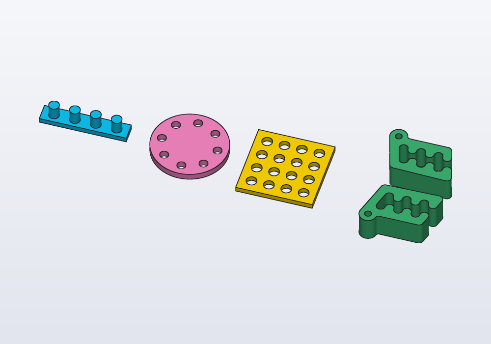

A *pattern* is one shape repeated: `linearPattern` copies it along a straight line at an even step, `circularPattern` round an axis at even angles, `mirror` reflects it across a plane. A grid is two `linearPattern`s, one along each side. Copies that change from one to the next, or skip some places, are a loop (below).

A pattern gives **one solid** with all the copies. Add it to a part to put pegs on it; subtract it to cut all the holes at once.

<!-- render: patterns-four --from 0.3,-1,1.2 -->
```d
// a row, a ring, a grid and a mirror

import carlo;

@part("Sky Pop")
Solid row() => box(50.mm, 10.mm, 3.mm)
    + cylinder(d: 6.mm, h: 8.mm)
        .linearPattern(4, step: vec(12.mm, 0.mm, 0.mm))
        .move(x: -18.mm, z: 3.mm);

@part("Pink Pop")
Solid ring() => (cylinder(d: 44.mm, h: 4.mm)
        - cylinder(d: 5.mm, h: 10.mm, center: true)
            .move(x: 16.mm)
            .circularPattern(8))
    .move(x: 60.mm);

@part("gold")
Solid grid() => (box(44.mm, 44.mm, 3.mm)
        - cylinder(d: 6.mm, h: 10.mm, center: true)
            .linearPattern(4, step: vec(10.mm, 0.mm, 0.mm))
            .linearPattern(4, step: vec(0.mm, 10.mm, 0.mm))
            .move(x: -15.mm, y: -15.mm))
    .move(x: 115.mm);

// Carlo and its mirror image across the plane y = 0
@part("mediumseagreen")
Solid pair() => (carlo().move(y: 18.mm)
        + carlo().move(y: 18.mm).mirror(Y))
    .move(x: 175.mm);
```


Mind the brackets: a chained call belongs to what stands right before it. In `plate - holes.circularPattern(8).move(x: 60.mm)` the last `move` moves the holes away from the plate, not the plate; bracket the subtraction first, as above.

## The parameters

| Call | Parameter | What it does | Default |
|---|---|---|---|
| `linearPattern` | `n` | how many copies, the first where the solid is | — |
| | `step:` | from one copy to the next: a vector with units | — |
| `circularPattern` | `n` | how many copies | — |
| | `axis:` | a direction through the origin (`Z`), or an `Axis` anywhere: `axis(origin: vec(…), direction: Z)`, `body.axis(edges…)` | `Z` |
| | `angle:` | a full turn spaces the copies evenly; less than a turn puts the first and the last at its two ends | `360.deg` |
| `mirror` | a direction | across the plane through the origin with that normal (the direction the plane faces) | — |
| | a plane | across any plane: `plane(origin: vec(20.mm, 0.mm, 0.mm), normal: X)` | — |

Profiles take the same calls (`circle(d: 4.mm).linearPattern(5, step: vec(6.mm, 0.mm))`), and `mirror` keeps only the image: `s + s.mirror(X)` keeps both.

## Loops: patterns with rules

When the copies change from one to the next, or only some places get one, write a loop. Collect the copies in a list and join them once at the end with `.sum` (or `fuse(list)`). Here each Carlo has one tooth more than the one before, so it is longer: its bounding box (the smallest box round it, `bbox`) says how long, and the next one starts 8 mm after it:

<!-- render: patterns-carlos --from 0.3,-1,1.2 -->
```d
// Carlos in a row, one more tooth each time, each
// placed 8 mm after the one before

import carlo;

@part("Sky Pop")
Solid row()
{
    Solid[] clips;
    auto x = 0.mm;
    foreach (i; 0 .. 4)
    {
        auto c = carlo(teeth: i + 1);
        clips ~= c.move(x: x - c.bbox.min.x);
        x += c.bbox.size.x + 8.mm;
    }
    return clips.sum;
}
```

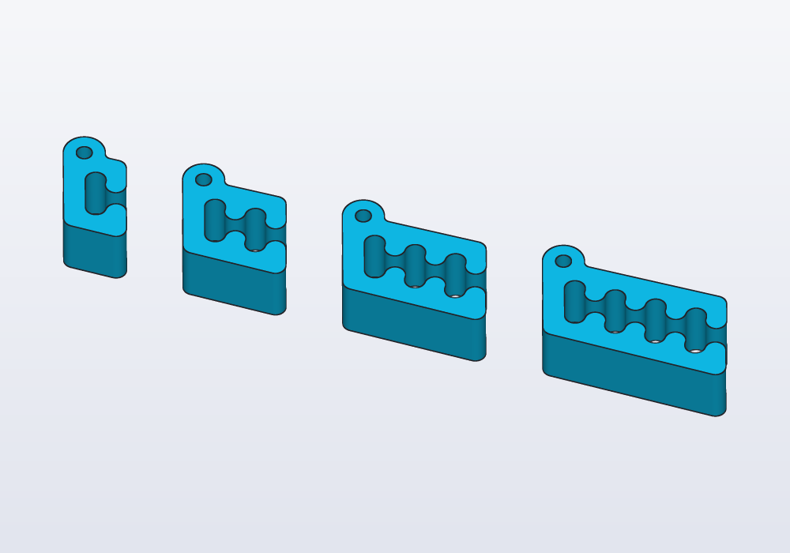

A loop also makes layouts no pattern gives. A round vent: hexagons in staggered rows, kept only where they fall wholly inside the circle:

<!-- render: patterns-vent --from top -->
```d
// a round vent: hexagons in staggered rows, only
// those wholly inside the circle

import std.math;

@param("Hexagon across the flats", min: 3.mm, max: 10.mm)
immutable cell = 5.mm;

@param("Bar between two cells", min: 0.8.mm, max: 3.mm)
immutable bar = 1.2.mm;

immutable radius = 30.mm;

@part
Solid vent()
{
    immutable pitch = cell + bar;
    immutable n = ceil(radius / pitch).to!int;
    Profile[] cells;
    foreach (j; -n .. n + 1)
        foreach (i; -n .. n + 1)
        {
            // every other row moves half a cell aside
            auto c = vec(pitch * (i + (j % 2) * 0.5),
                pitch * j * sqrt(3.0) / 2);

            // only the cells 3 mm or more from the rim
            if (c.length + cell / 2 < radius - 3.mm)
                cells ~= polygon(c, 6, d: cell,
                    fit: "sides", angle: 30.deg);
        }
    return (circle(r: radius) - cells.sum).extrude(2.mm);
}
```

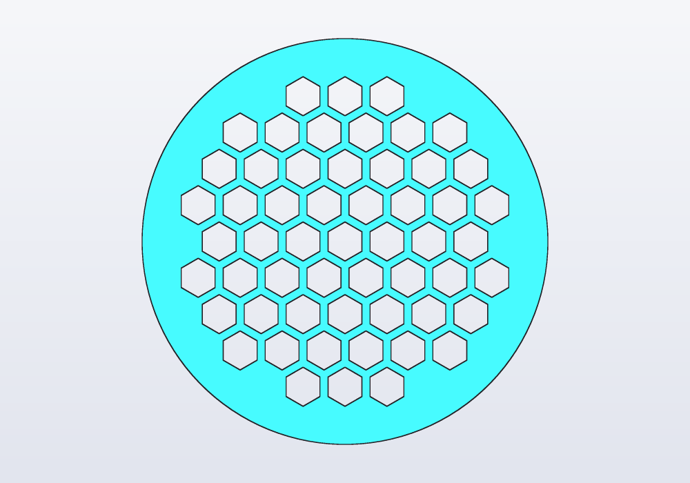

The loop works on profiles (flat outlines) and extrudes once (pushes the outline up into a solid, 2 mm here): flat cuts through a plate are quickest that way (below). Other rules a loop makes easy: sizes that grow along the row (`d: 3.mm + 0.5.mm * i`), a place left empty (`if (i == 2) continue;`), heights from `random(4.mm, 10.mm, seed: 2)` (the same numbers at every run; another seed, others).

## Textures and noise

A textured surface is a stack of rings of points, one above the other. Each point is pushed out along the outline's normal (the direction straight out of the outline at that point) by a function of where it is. Then one smooth surface is *lofted* through them all: stretched from ring to ring, like a skin over hoops.

The calls:

- `profile.outline(n)` gives `n` points evenly round a profile, each with `.at` (where it is), `.normal` (outwards) and `.around` (0 to 1 round the outline);
- `loft(rings)` takes the rings (`Vec3[][]`, the same number of points in each) and closes the ends flat; `loft(rings, inside: innerRings)` makes it hollow, with a floor;
- the push is any function: a sine for ribs, `loopNoise(around, along, bumps:)` for bumps round a loop with no seam where it closes, `noise(x, y, z)` for bumps that depend on the place in space (seamless on any shape).

<!-- render: patterns-skins --from 0.3,-1,0.5 -->
```d
// three skins on the same pot: twisted ribs,
// loopNoise and noise

immutable height = 40.mm;

// how far a point of the outline moves out: `around`
// 0…1 round it, `up` 0…1 up the pot, `p` where it is
Length push(int kind, double around, double up, Vec2 p)
{
    if (kind == 0)
        return 1.mm * sin((around * 12 + up) * 360.deg);
    if (kind == 1)
        return 1.5.mm * loopNoise(around, up * 3, bumps: 7);
    return 1.5.mm * noise(p.x / 10, p.y / 10,
        height * up / 10);
}

Solid pot(int kind)
{
    Vec3[][] rings;
    foreach (k; 0 .. 21)
    {
        immutable up = k / 20.0;
        Vec3[] pts;
        foreach (q; circle(r: 15.mm).outline(96))
        {
            auto p = q.at
                + q.normal * push(kind, q.around, up, q.at);
            pts ~= vec(p.x, p.y, height * up);
        }
        rings ~= [pts];
    }
    return loft(rings);
}

@part("Sky Pop")
Solid ribs() => pot(0);

@part("Pink Pop")
Solid looped() => pot(1).move(x: 40.mm);

@part("gold")
Solid spatial() => pot(2).move(x: 80.mm);
```

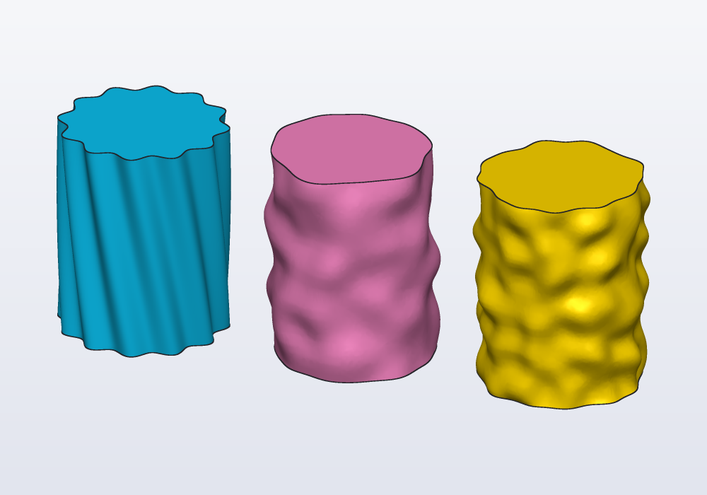

| Function | Gives | Notes |
|---|---|---|
| `noise(x, y, z, seed:)` | smooth noise, about −1 to 1 | features about one unit across; lengths count in millimetres, so `noise(p.x / 10, …)` has bumps about 10 mm apart |
| `loopNoise(around, along, bumps:, seed:)` | noise round a loop, about −1 to 1 | `around` 0 to 1 once round, no seam; `bumps` about how many round (4 unless given) |
| `kind: "cells"` (both) | 0 to 1 | cells: 0 at the point each grows from, about 1 farthest from it |
| `kind: "edges"` (both) | 0 to 1 | 0 on the borders between the cells: a Voronoi relief on any surface |
| `kind: "ridged"` (both) | 0 to 1 | 1 on sharp ridges, like veins or crumpled paper |
| `octaves: 3` (both) | the same range | finer and weaker layers on top, up to 8: rougher, more natural |
| `random(lo, hi, seed:)` | a number between `lo` and `hi` | the next of that seed's stream, the same at every run |

A hollow pot with a floor, its wall following the bumps on both sides:

<!-- render: patterns-pot -->
```d
// a pen pot with a bumpy skin

@param("Seed: another one, another skin", min: 0,
    max: 999)
immutable seed = 7;

@param("Depth of the bumps", min: 0.mm, max: 3.mm)
immutable depth = 1.5.mm;

immutable height = 60.mm;

// a ring at height `up` (0 at the foot, 1 at the top),
// `inset` inside the outer skin
Vec3[] ring(double up, Length inset)
{
    Vec3[] pts;
    foreach (q; circle(r: 25.mm - inset).outline(120))
    {
        immutable bump = depth * loopNoise(q.around,
            up * 4, bumps: 9, seed: seed);
        auto p = q.at + q.normal * bump;
        pts ~= vec(p.x, p.y, height * up);
    }
    return pts;
}

@part
Solid pot()
{
    Vec3[][] outside, inside;
    foreach (k; 0 .. 25)
    {
        immutable up = k / 24.0;
        outside ~= [ring(up, 0.mm)];

        // the inside starts 3 mm up, over the floor
        if (height * up >= 3.mm)
            inside ~= [ring(up, 2.5.mm)];
    }
    return loft(outside, inside: inside);
}
```

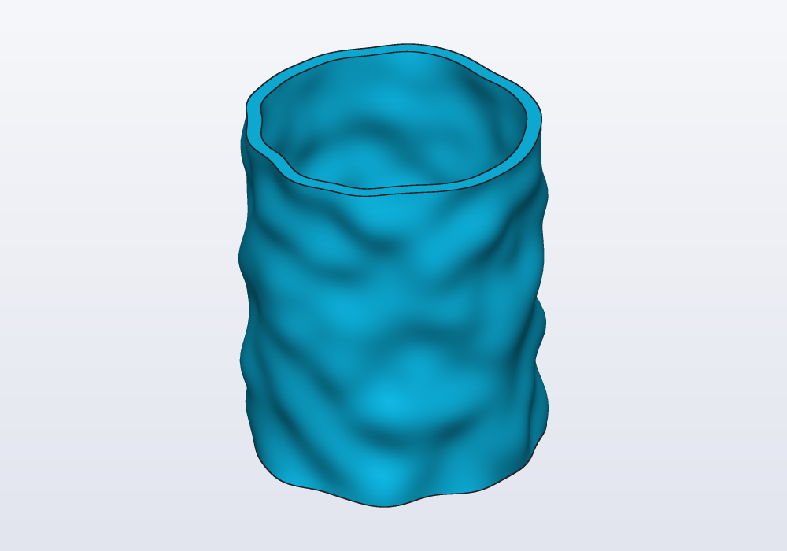

Along a curved spine, `path.frames(n)` gives `n` frames along it (each a point with directions to build on) to place the rings on: see `examples/03_randomvase.hcad`, a vase on a random spine with its lid.

### Cells, edges and ridges

The `kind:` of `noise` and `loopNoise` changes what the bumps look like. `"edges"` is 0 along the borders of cells about one unit across, and rises inside them: push the points in where it is near 0 and the surface gets the grooves of a Voronoi pattern, on any shape, curved or not.

<!-- render: patterns-cells --from 0.3,-1,0.4 -->
```d
// three kinds of noise on the same pot: the edges of
// cells as grooves, the cells as dents, and ridges

immutable height = 50.mm;

Length push(int kind, double around, double up)
{
    // grooves 1.2 mm deep where the edges are near 0
    if (kind == 0)
    {
        immutable e = loopNoise(around, up * 5, bumps: 10,
            kind: "edges");
        return -1.2.mm * clamp(1 - e * 4, 0, 1);
    }
    if (kind == 1)
        return 1.5.mm * loopNoise(around, up * 5,
            bumps: 10, kind: "cells");
    return 1.5.mm * loopNoise(around, up * 3, bumps: 5,
        kind: "ridged", octaves: 3);
}

Solid pot(int kind)
{
    Vec3[][] rings;
    foreach (k; 0 .. 61)
    {
        immutable up = k / 60.0;
        Vec3[] pts;
        foreach (q; circle(r: 18.mm).outline(160))
        {
            auto p = q.at
                + q.normal * push(kind, q.around, up);
            pts ~= vec(p.x, p.y, height * up);
        }
        rings ~= [pts];
    }
    return loft(rings);
}

@part("Sky Pop")
Solid edges() => pot(0);

@part("Pink Pop")
Solid cells() => pot(1).move(x: 45.mm);

@part("gold")
Solid ridged() => pot(2).move(x: 90.mm);
```

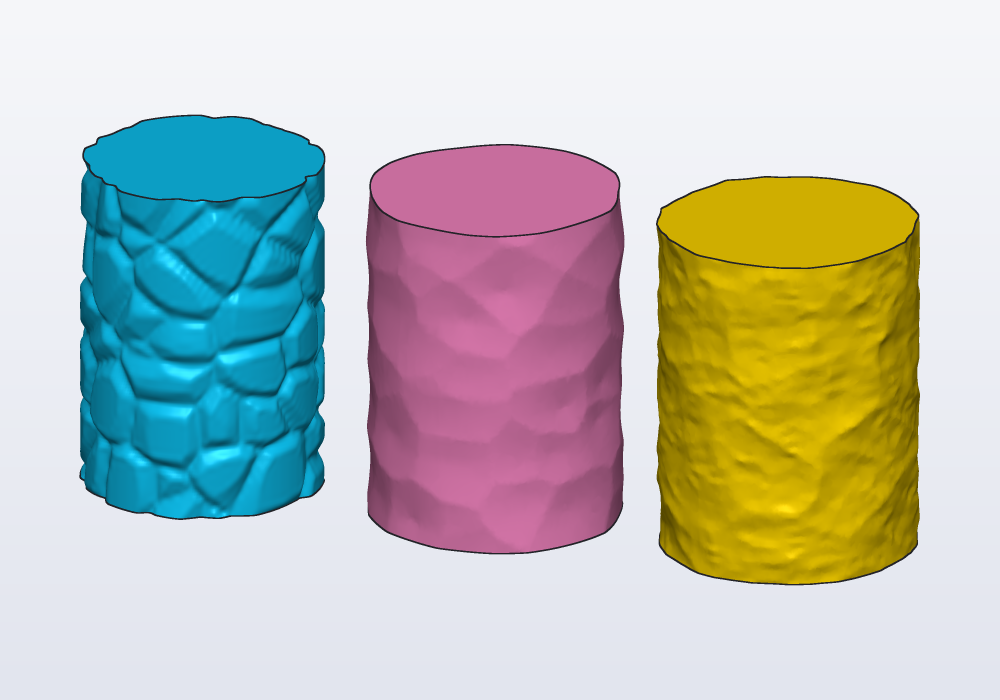

## Tilings

A *tiling* covers an area with cells that fit together, like the tiles of a floor, with a wall (`gap`) between them. `region.tiles(…)` gives the cells inside a profile, as one profile. What to do with them is up to you:

- subtract them from the region for a grille: `(outline - cells).extrude(3.mm)`;
- dig them into a face for pockets: `body.cut(cells, on: faces.top, depth: 1.mm)`;
- grow them from a face for reliefs: `body.extrude(cells, on: faces.top, depth: 1.mm)`, with `taper:` for slanted sides that print without supports.

<!-- render: patterns-tiles --from 0.3,-1,1.4 -->
```d
// three tilings: a honeycomb through a flat Carlo,
// Voronoi pockets in a coaster, studs with slanted
// sides on a tile

import carlo;

@part("Sky Pop")
Solid honeycomb()
{
    auto outline = carlo().projection;
    auto cells = outline.offset(-1.5.mm)
        .tiles(kind: "hex", size: 4.mm, gap: 1.mm);
    return (outline - cells).extrude(3.mm);
}

@part("Pink Pop")
Solid coaster()
{
    auto disc = cylinder(d: 50.mm, h: 4.mm);
    auto cells = circle(d: 44.mm)
        .tiles(kind: "voronoi", size: 6.mm, gap: 1.2.mm,
            round: 0.5.mm, relax: 2);
    return disc.cut(cells, on: faces.top, depth: 1.5.mm)
        .move(x: 60.mm);
}

@part("gold")
Solid studs()
{
    auto tile = box(44.mm, 44.mm, 3.mm, center: true);
    auto squares = rect(40.mm, 40.mm)
        .tiles(kind: "square", size: 6.mm, gap: 1.5.mm,
            angle: 45.deg, whole: true);
    return tile
        .extrude(squares, on: faces.top, depth: 1.5.mm,
            taper: 25.deg)
        .move(x: 120.mm);
}
```

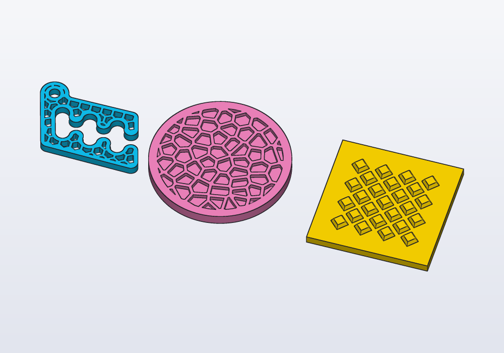

The kinds: `"square"`, `"hex"`, `"triangle"`, `"brick"`, `"octagon"` (octagons with small squares between them) and `"diamond"`, where `size` is the distance from one cell's centre to the next; and `"voronoi"`, cells grown round points scattered about `size` apart, each cell the part of the area nearer its point than any other.

| Argument | What it does |
|---|---|
| `gap:` | the wall between two cells (each is shrunk by half of it) |
| `round:` | rounds the corners of every cell |
| `angle:` | turns the whole tiling |
| `origin:` | where one cell sits; the region's centre unless given |
| `whole: true` | keeps only the cells wholly inside; otherwise those on the border are cut along it |
| `jitter:` | Voronoi only: 0 puts the points on a grid of hexagons, 1 (the default) scatters them fully |
| `relax:` | Voronoi only: passes that move each point to the middle of its cell, for evener cells (2 or 3 are plenty) |
| `seed:` | Voronoi only: another seed, other cells |
| `points:` | Voronoi round points of your own |
| `scale:` | a number, or a function of the cell's centre giving one: each cell scaled about its centre |
| `keep:` | a function of the cell's centre: true to keep the cell |

### A tile of your own

Any profile can be a tile: give it as `tile:` and say how it repeats with `step: [a, b]`, the two moves from one copy to its neighbours. Several profiles repeat together when given as a list, and a profile drawn in a sketch works as well as one built from shapes.

There is one requirement: the copies must not overlap, once shrunk by the gap. They need not cover everything (round holes on a grid are a tiling too), but if two copies overlap, the error says which two: the one next to it along `a`, along `b` or along both.

`scale:` and `keep:` work on any tiling. Here the holes grow towards the middle of the plate, a function of where each one is:

<!-- render: patterns-own-tile --from 0.2,-1,1.4 -->
```d
// plus signs, which fit together without gaps, and
// round holes larger towards the middle

immutable s = 6.mm;

// five squares in a cross: one step two across and
// one up, the other one back and two up
Profile plus() => rect(3 * s, s) + rect(s, 3 * s);

@part("Sky Pop")
Solid crosses()
{
    auto cells = rect(90.mm, 50.mm)
        .tiles(tile: plus(), step: [vec(2 * s, s),
                vec(-s, 2 * s)],
            gap: 1.mm, round: 0.4.mm);
    return (rect(100.mm, 60.mm) - cells).extrude(2.mm);
}

@part("Pink Pop")
Solid graded()
{
    auto holes = rect(94.mm, 54.mm)
        .tiles(tile: circle(d: 6.mm), step: [vec(7.mm, 0.mm),
                vec(3.5.mm, 6.06.mm)],
            scale: (Vec2 c) => 1.2 - c.length / 60.mm,
            whole: true);
    return (rect(100.mm, 60.mm) - holes)
        .extrude(2.mm)
        .move(y: 70.mm);
}
```

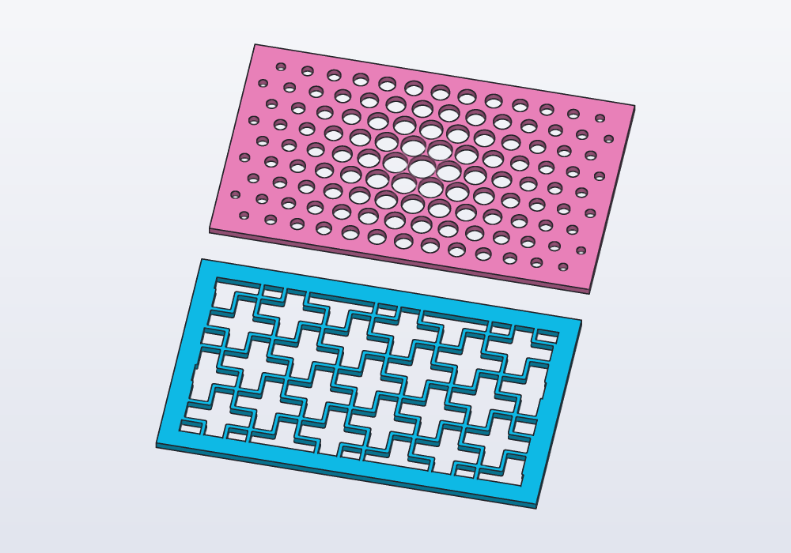

On a curved face, roll the tiling onto it with `wrap:` instead of `on:` (see [From profile to solid](profiles.md)): the cells keep their size round a cylinder or a cone.

<!-- render: patterns-wrapped --from 0.3,-1,0.5 -->
```d
// a honeycomb rolled round a cup, Voronoi cells round
// a cone

@part("Sky Pop")
Solid cup()
{
    auto body = cylinder(d: 40.mm, h: 50.mm);
    auto cells = rect(125.mm, 34.mm)
        .tiles(kind: "hex", size: 6.mm, gap: 1.2.mm,
            round: 0.4.mm);
    return body.cut(cells, wrap: faces.largest,
        depth: 1.mm);
}

@part("Pink Pop")
Solid cone()
{
    auto body = loft([circle(d: 44.mm),
        circle(d: 26.mm).move(z: 45.mm)]);
    auto cells = rect(80.mm, 32.mm)
        .tiles(kind: "voronoi", size: 6.mm, gap: 1.2.mm,
            round: 0.4.mm, relax: 2);
    return body.cut(cells, wrap: faces.largest,
            depth: 1.2.mm)
        .move(x: 55.mm);
}
```

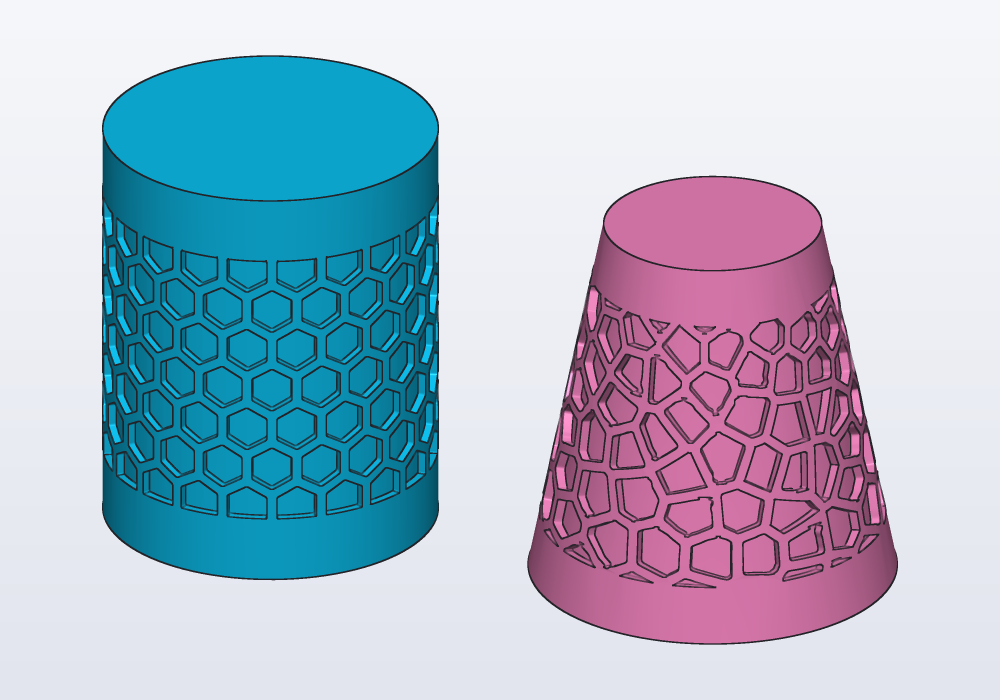

A region that is a ring of noise instead, on any surface: the grooves of `kind: "edges"` (above).

## Knurling

A knob or a handle grips better with a pattern raised on its side. `body.knurl(face)` raises one on a face: diamonds (the default), straight ridges along it, or ridges leaning across. Round a face that closes on itself, a cylinder or the side of a shape lofted through rings, the pitch is adjusted a little so that a whole number go round and the pattern closes on itself.

<!-- render: patterns-knurl --from 0.3,-1,0.6 -->
```d
// three knobs: diamond, straight and diagonal knurling

@part("Sky Pop")
Solid diamond() => cylinder(d: 30.mm, h: 20.mm)
    .knurl(faces.largest);

@part("Pink Pop")
Solid straight() => cylinder(d: 30.mm, h: 20.mm)
    .knurl(faces.largest, kind: "straight")
    .move(x: 40.mm);

@part("gold")
Solid diagonal() => cylinder(d: 30.mm, h: 20.mm)
    .knurl(faces.largest, kind: "diagonal")
    .move(x: 80.mm);
```

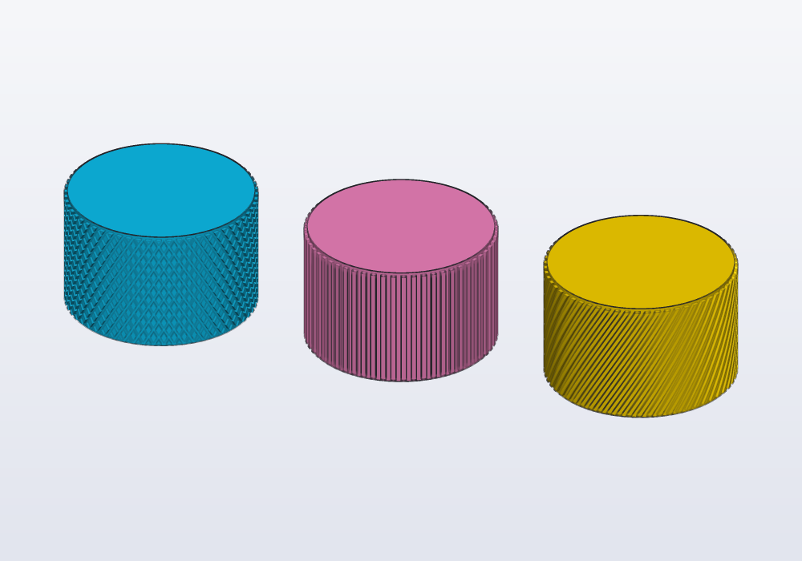

Any other face takes it too: a flat one inside its outline, a curved one as `wrap:` lays a profile on it. A grip pad on a slider, and the oval side of a handle lofted through rings:

<!-- render: patterns-knurl-any --from 0.4,-1,0.7 -->
```d
// a slider's flat pad, and an oval handle swelling in the middle

@part("Sky Pop")
Solid slider() => box(30.mm, 18.mm, 6.mm)
    .knurl(faces.top, margin: 2.mm);

/// The handle: oval rings, widest halfway up.
Solid oval()
{
    Vec3[][] rings;
    foreach (i; 0 .. 9)
    {
        immutable r = 9.mm + 3.mm * sin(i * 22.5.deg);
        Vec3[] ring;
        foreach (j; 0 .. 72)
            ring ~= vec(1.5 * r * cos(j * 5.deg), r * sin(j * 5.deg),
                i * 6.mm);
        rings ~= [ring];
    }
    return loft(rings);
}

@part("gold")
Solid handle() => oval()
    .knurl(faces.largest, kind: "diagonal", margin: 4.mm)
    .move(x: 50.mm);
```

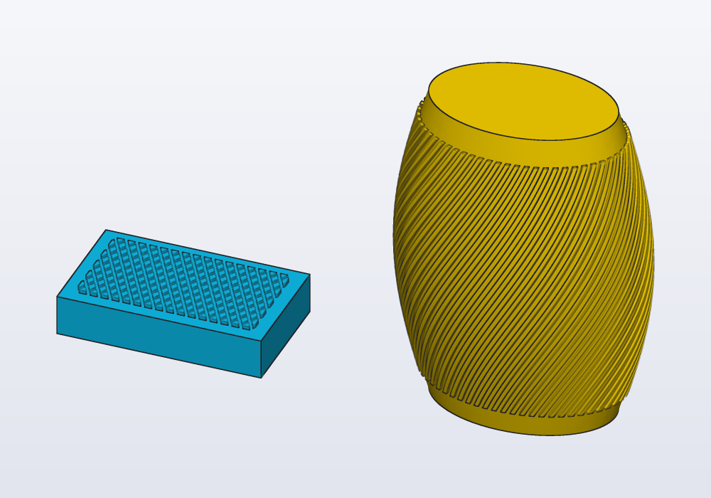

| Argument | What it does |
|---|---|
| `kind:` | `"diamond"`, `"straight"` or `"diagonal"` |
| `pitch:` | from one ridge to the next round the face, 1.6 mm unless given (adjusted to a whole number round) |
| `depth:` | how far the pattern stands out, 0.5 mm unless given |
| `angle:` | how far a diagonal ridge leans from the axis, and the diamonds' slant: 30° unless given |
| `margin:` | the plain band left along the face's edges (at each end round a cylinder), 0.5 mm unless given |

The pattern stands out of the face: the knob grows by `depth` all round. Printed standing, the ridges and diamonds come out crisp; a pitch under 1.2 mm blurs on a 0.4 mm nozzle.

## In the model or in a library

- A pattern used once, in this part: in the model, next to what it cuts.
- The same pattern in several models (a vent, a grille, a hole pattern of a fan or a board): a function in a module of your own, `parts/vents.hcad` beside the model, `import parts.vents;`, or in the personal library folder to use it everywhere. Give it `Length` parameters and return the tool to subtract, as `hole()` does.
- Before writing one, look in the built-in libraries: teeth (`gears`), knuckles (`hinges`), screw posts (`enclosures`), threads (`threads`, and `thread()` on a face) are patterns already made.

## Keeping it quick

Measured on a 200 × 200 mm plate with 400 holes:

| How | Time |
|---|---|
| `p -= hole…` inside the loop, one hole at a time | 16.6 s |
| `holes += hole…` inside the loop, then one subtraction | 12.2 s |
| the holes collected in a list, `fuse(holes)` or `holes.sum`, then one subtraction | 1.5 s |
| the holes collected in a list and taken away all at once, `p - holes` | 0.7 s |
| two `linearPattern`s, then one subtraction | 1.3 s |
| the same with profiles (`rect - circle….linearPattern…`), extruded once | 0.4 s |

- Never add or subtract inside a loop: collect, then join once. A solid less a list, `p - holes`, takes them all away in one go, the quickest. A pattern or `.sum` joins the copies in pairs, then pairs of pairs; a growing body joined one at a time gets slower with every copy.
- Through-cuts in a flat plate: draw them as profiles and extrude once.
- Textures: the time grows with rings × points. Make the bumps at least three or four rings and points apart (smaller ones are lost between the points anyway), and lower both while designing.
- `loft` through rings of points takes milliseconds where a loft through as many smooth profiles takes seconds.
- A pattern stops at 10 000 copies, a tiling at 20 000 cells.
- A tiling cuts only the cells on the region's border; those inside are kept as they are, so thousands of cells take about a second.

## Common errors

| Message | What to do |
|---|---|
| *'n' must be a whole number between 1 and 10000* | `n` counts copies: `round(x).to!int` when it is computed |
| *a step of zero puts every copy in the same place* | give `step:` a length |
| *an angle of 0 puts every copy in the same place* | `angle:` other than 0, or leave it out for a full turn |
| *cannot combine a Solid and a Profile: extrude the profile first* | a list mixing profiles and solids |
| *4.83871 is not an integer (use floor/round first)* | `x.to!int` of a fraction: `ceil(x).to!int`, `floor(…)` or `round(…)` |
| the holes are not there, the part is | a chained `.move` moved the tool, not the part: brackets |
| *the tiles overlap (by … mm² between one and the one 1·a + 0·b from it)* | your own tile is too large for its steps: a longer step, a smaller tile or a wider `gap` |
| *a gap of … leaves nothing of … cells* | the gap is wider than the cells: a larger `size` or a smaller `gap` |
| *round: … is too much for the tile* | a smaller `round:`: at most half the narrowest part of a cell, once shrunk by the gap |
| the cells on the border are slivers | `whole: true`, or a region shrunk with `.offset(-…)` so a wall runs round them |

## In the application

There is no pattern command in the menus: a pattern is a line of code. Write it in the editor and the view follows as you type; the copies are one solid, picked together. A count or a step made a `@param` gets a field in the Parameters panel, to try other counts with the mouse.
