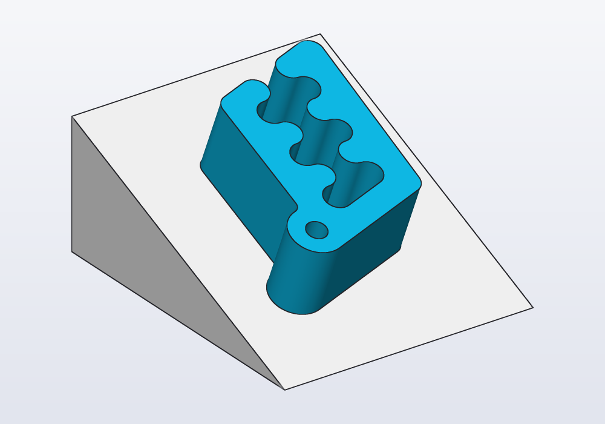
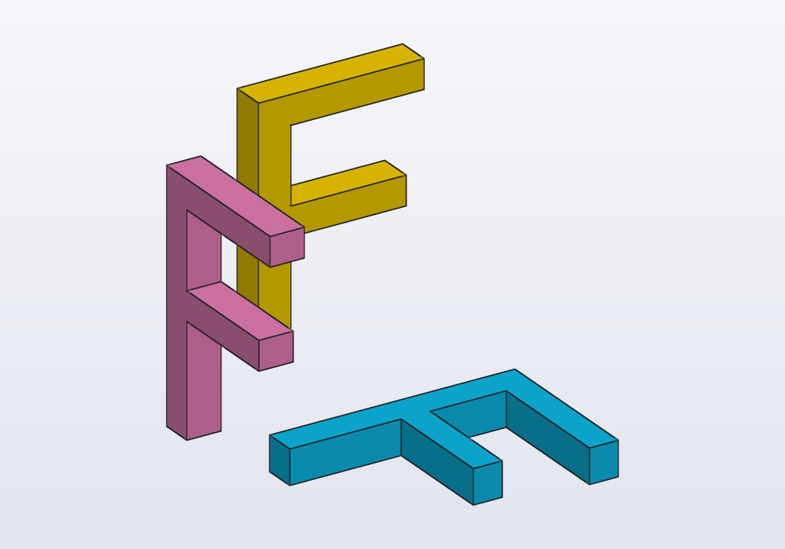
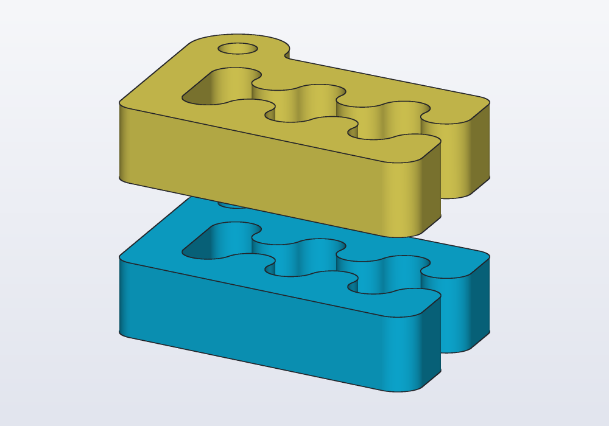
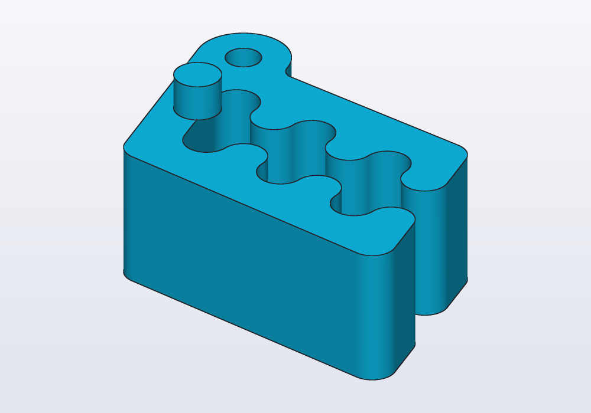
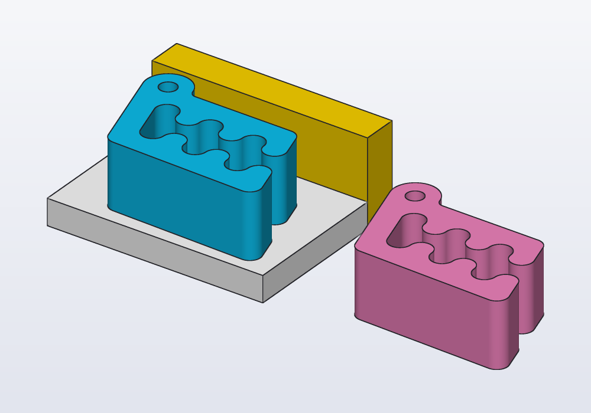
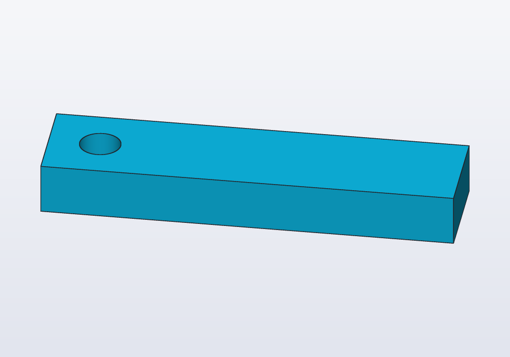
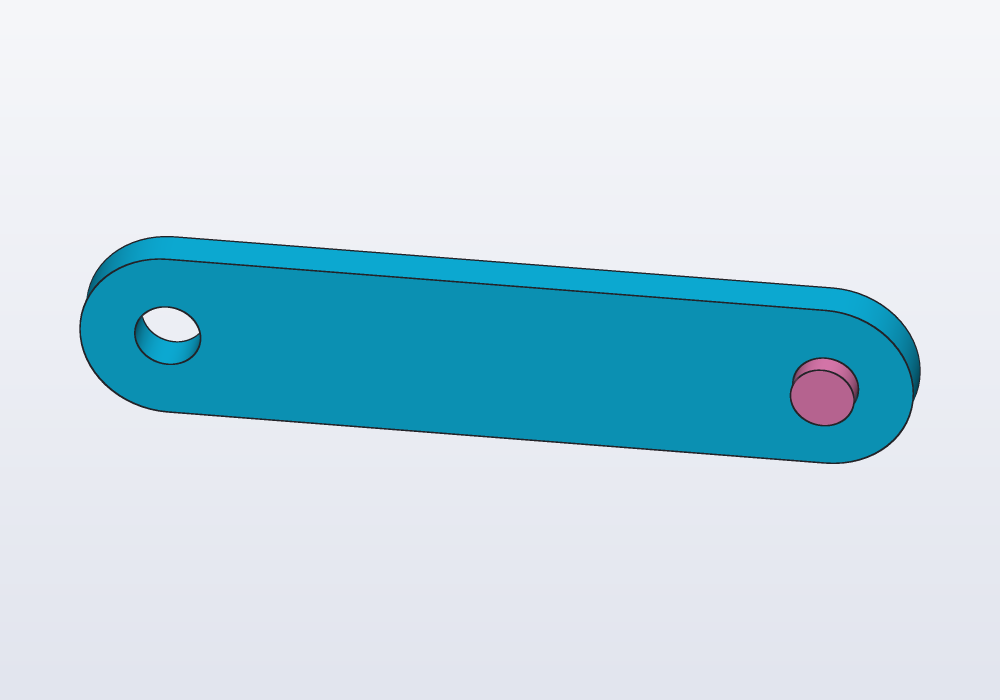
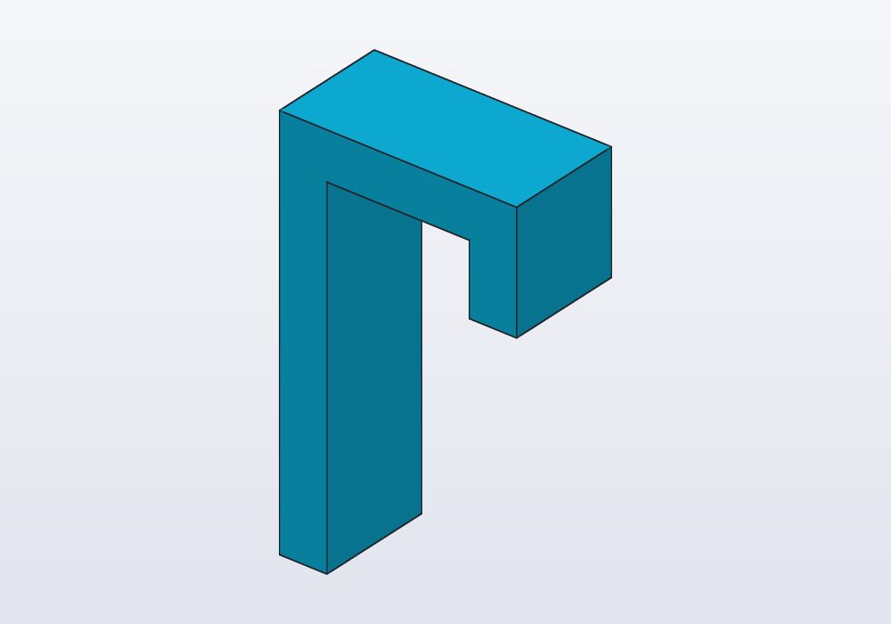

# Planes, frames and placement

Where things go. A plane is a flat surface without end, given by a point and the direction it faces; a frame is a place to build from, a point with its own three axes. This guide covers the three main planes XY, XZ and YZ (and which way each faces), planes of every other kind (through points, on a face, halfway between two faces, moved off another), frames to build on a face, placing parts on faces and next to each other, axes, sketching on a plane, and the planes shown in the 3D view with the menus that write them.



## The main planes

Everything in hackerscad is built on XY, Z up, round the origin (the point 0, 0, 0): a box stands on z = 0, a profile lies in XY. Planes and frames say where that XY is somewhere else. A plane's normal is the direction it faces, square to it.

| Plane | Normal | Faces | x and y of a sketch on it |
|---|---|---|---|
| `XY` | +Z | up: the Top view | x along X, y along Y |
| `XZ` | −Y | the front: the Front view | x along X, y up Z |
| `YZ` | +X | the right: the Right view | x along Y, y up Z |

Each faces the way its view looks at it, so a sketch or a profile on it reads as that view shows it: x to the right, y up. Note that XZ faces the front (−Y), not +Y: what is extruded from it with a positive height comes towards you in the Front view, with a negative height goes back.

<!-- render: planes-main --from 1.6,-1,0.9 -->
```d
// an F on each main plane, 2 mm thick along its normal:
// each reads as the Top, Front and Right views show it

Solid letter() => text("F", size: 20.mm)
    .move(x: 4.mm, y: 4.mm)
    .extrude(2.mm);

@part("Sky Pop")
Solid onXY() => letter().placeOn(XY);

@part("Pink Pop")
Solid onXZ() => letter().placeOn(XZ);

@part("gold")
Solid onYZ() => letter().placeOn(YZ);
```



## Making planes

Planes cut, split and mirror solids, and carry sketches.

| Form | The plane |
|---|---|
| `plane(origin: vec(0, 0, 10), normal: Z)` | through a point, square to a direction |
| `plane(p1, p2, p3)` | through three points; the normal by the right-hand rule, p1 → p2 → p3 |
| `plane(axis, point)` | containing a line and a point |
| `body.plane(faces.top)` | the plane of a flat face, its normal outwards |
| `body.plane(faces.top, faces.bottom)` | halfway between two parallel faces (the midplane), with the first one's normal |
| `p.offset(5.mm)` | moved along its normal (negative: the other way) |
| `p.flip` | the same plane, its normal reversed |

A plane has `origin` and `normal`. The midplane follows the part: when the part grows, the plane stays in the middle.

<!-- render: planes-midplane --from 1,-1.4,0.5 -->
```d
// Carlo cut halfway through its height, the halves
// pushed apart: a plane between two faces

import std.carlo;

immutable middle = carlo()
    .plane(faces.top, faces.bottom);

@parts(varied: true)
Solid[] halves() => carlo()
    .split(middle)
    .push(from: middle, by: 4.mm);

unittest
{
    assert(middle.origin.z == 7.5.mm);
    assert(middle.normal == Z);
}
```



What takes a plane: `split` and `halves` (cutting), `mirror(plane)`, `section(plane)` (the cut as a profile), `projection(plane)` (the shadow), `push(from: plane)`, `placeOn(plane)`, `sketch(plane)`, and `cut`/`extrude` with `on: plane`.

## Frames

A frame is an origin with three axes: where XY goes when you build somewhere else. `body.frame(face)` has its origin at the face's centre and Z along the outward normal. On a flat face looking up or down, X is the global X; on a wall (any face that is not level), X is horizontal and to the right seen from outside, and Y goes up, on every side: a text reads and a teardrop points up whichever wall it is on.

| Frame | What it is |
|---|---|
| `body.frame(faces.top)` | on a face; `origin: vec(…)` another point (projected on the face), `x: Y` another X |
| `plane.frame(origin: vec(…), x: …)` | on a plane; the origin defaults to the plane's |
| `World` | the global frame: the origin, X, Y, Z |
| `f.at(x: 10.mm, y: -5.mm)` | the origin moved, in the frame's own axes (`z:` too) |
| `f.turn(30.deg)` | X and Y turned round the frame's Z |
| `f.axis(X)` | one of its axes, as an `Axis` |

A frame has `origin`, `x`, `y`, `z`. Take a frame on the solid before a feature changes the face you want: `foot.frame(faces.top)` is still the foot's top after an upright is added on it, where `faces.top` of the whole would be the upright's.

## Placing parts

Placing parts relative to each other, rather than by coordinates worked out by hand, keeps them in place when a `@param` (a size that can be changed) changes.

`solid.placeOn(f)` moves a solid built on XY (Z up) onto a frame: its origin on the frame's origin, its X, Y, Z on the frame's. A plane works too: `placeOn(plane)`, with the axes a frame on a face would have.

<!-- render: planes-ex1 -->
```d
// a peg on Carlo's top, 12 mm left of the face's centre
import std.carlo;

@part
Solid pegged()
{
    auto top = carlo().frame(faces.top).at(x: -12.mm);
    return carlo()
        + cylinder(d: 5.mm, h: 4.mm).placeOn(top);
}
```



`placeOn(f, from: faces.bottom)` lays a face of the solid against the frame instead: that face's middle on the frame's origin, the two facing each other, X on X; `at: vec(…)` carries that point of the face instead of its middle. Turn it on the face with `f.turn(…)`.

<!-- render: planes-place-on --from 1,1.4,0.9 -->
```d
// Carlo laid on the slope of a stand, its bottom face
// against it, turned a quarter on the slope

import std.carlo;

@part("White Pop")
Solid stand() => polygon([vec(-30.mm, 0.mm),
        vec(30.mm, 0.mm), vec(-30.mm, 25.mm)])
    .extrude(50.mm, along: X)
    .move(x: -25.mm);

@part
Solid clip()
{
    auto slope = stand()
        .frame(faces.filter(f => f.normal.y > 0.1));
    return carlo().placeOn(slope.turn(90.deg),
        from: faces.bottom);
}
```


For parts side by side, the bounding boxes are enough:

| Call | Puts `a` |
|---|---|
| `a.on(b)` | on top of `b` (`gap:` above it) |
| `a.nextTo(b, X, gap: 10.mm)` | beside `b`, that way along X (`-X`, `Y`, `Z`… the other sides) |
| `a.align(b, x: "center", z: "min")` | its box lined up with `b`'s, per axis: `"min"`, `"center"` or `"max"` |

<!-- render: planes-next-to --from 1,-1.4,1 -->
```d
// parts placed by each other, not by coordinates

import std.carlo;

Solid base() => box(50, 34, 6);

@part("White Pop")
Solid plate() => base();

// on top of the plate
@part
Solid clip() => carlo().on(base());

// beside the plate along X, 10 mm away
@part("Pink Pop")
Solid spare() => carlo().nextTo(base(), X, gap: 10.mm);

// behind the plate, flush with its left end and bottom
@part("gold")
Solid behind() => box(50, 8, 20)
    .nextTo(base(), Y)
    .align(base(), x: "min", z: "min");
```



## Axes

An axis is a line in space, for turning and for patterns (copies of a part repeated round it):

| Form | The axis |
|---|---|
| `axis(origin: vec(10, 0, 0), direction: Z)` | through a point, along a direction |
| `axis(p1, p2)` | through two points |
| `body.axis(edges.…)` | the line of one straight edge, or the centre and normal of a circular one (a hole's rim) |
| `frame.axis(X)` | an axis of a frame |
| `X`, `Y`, `Z` | the directions through the origin, where an axis is taken |

<!-- render: planes-ex2 -->
```d
// a lever turned 30° about its hole's axis
@part
Solid turned()
{
    auto arm = box(40, 10, 5)
        - cylinder(d: 4.mm, h: 5.mm).move(x: -15.mm);
    auto hole = arm.axis(edges.of(faces.top)
        .filter(e => e.isCircle));
    return arm.rotate(30.deg, axis: hole);
}
```



`body.axis` needs exactly one edge: a hole has two rims, so pick one (`edges.of(faces.top)`).

## Points and axes that travel with a part

A point, an axis, a plane or a frame can be *tagged* on a part: given a name, and kept with it. Moved, turned, mirrored, cut or joined to others, the part takes it along, and `b.point("name")`, `b.axis("name")`, `b.plane("name")` or `b.frame("name")` give it back where it now is. No coordinates to work out again after every turn.

<!-- render: planes-tagged -->
```d
// a link stood up and turned; a pin goes in its hole wherever it went

@part("Sky Pop")
Solid link()
{
    auto s = sketch();
    auto a = s.point(0, 0, fixed: true);
    auto b = s.point(60, 0);
    s.horizontal(a, b);
    s.distance(a, b, 60.mm);
    s.slot(a, b, w: 16.mm);
    s.circle(a, d: 6.mm);

    // the hole the pin goes in: its circle tagged, an axis through it
    s.circle(b, d: 6.mm).addTag("pivot");

    return s.profile
        .extrude(4.mm)
        .rotate(x: 90)
        .rotate(z: 30.deg)
        .move(z: 20.mm);
}

@part("Pink Pop")
Solid pin()
{
    // on the hole's axis, however the link was turned
    return cylinder(d: 5.8.mm, h: 12.mm, center: true)
        .placeOn(link().frame("pivot"));
}
```



- On a solid: `b.addTag("pin", at: vec(15.mm, 10.mm, 8.mm))` tags a point; `at:` an `axis(…)`, a `plane(…)` or a frame tags those.
- In a sketch: a point, line, circle or arc tagged (`c.addTag("pivot")`) gives the profile, and the solid made from it, a reference of that name: a point where the point is, the axis through a circle's centre across the sketch, the axis along a line.
- `b.frame("pivot")` is a frame on whatever was tagged, its Z along the axis (its X as `plane(…).frame()` has it): what `placeOn` needs to put another part there.
- Cut in pieces (`split`, `halves`, a joint), each piece keeps the references that lie in it or on it; a point on the cut goes with both, and the pieces joined again have it once. Tagging the same name again moves it.

## Sketching on a plane

`sketch(plane)` and `sketch(frame)` draw on a plane or a frame instead of XY, with its x and y as the table above gives them and `s.origin` its origin (no edges: those are for sketches on faces, see [the guide on sketches](sketches.md)). The profile lies where it was drawn, and extrudes across its own plane, along the normal.

<!-- render: planes-ex3 -->
```d
// a hook drawn as the Front view shows it, on XZ, made
// 10 mm thick towards the back (XZ faces the front)

Profile side()
{
    auto s = sketch(XZ);
    auto o = s.point(0, 0, fixed: true);
    auto l = s.polyline([o, vec(4, 0), vec(4, 30),
        vec(16, 30), vec(16, 24), vec(20, 24),
        vec(20, 34), vec(0, 34)]);

    // the sides take turns: level, upright
    foreach (i, line; l)
        if (i % 2 == 0)
            s.horizontal(line);
        else
            s.vertical(line);
    s.length(l[0], 4.mm);
    s.length(l[1], 30.mm);
    s.length(l[2], 12.mm);
    s.length(l[3], 6.mm);
    s.length(l[4], 4.mm);
    s.length(l[7], 34.mm);
    return s.profile;
}

@part
Solid hook() => side().extrude(-10.mm);
```



A sketch on `XZ.offset(10.mm)` lies 10 mm in front of XZ; on `body.plane(faces.top, faces.bottom)`, in the middle of the part.

## Common errors

| Message | What to do |
|---|---|
| *'on' needs exactly one face, the selector matched 2* | the selector is ambiguous: `faces.farthest(…)`, `faces.from(tool)`, a filter, or a frame |
| *axis needs exactly one edge, the selector matched 4* | narrow it: `edges.of(faces.top).filter(e => e.isCircle)` |
| *at: is a point of the from: face* | `placeOn(f, at: …)` needs `from:` |
| *the two faces are not parallel: no plane lies halfway between them* (Plane between faces) | pick two faces that face each other |

## In the application

- **The planes in the view.** The view bar's planes button, or **View › Show planes**, shows XY, XZ, YZ and the planes the code keeps in variables (named after them, in violet). Click one to pick it; right-click it: **Sketch on plane…** writes an empty sketch on it into the part the cursor is in (or a new part that extrudes its profile), **Offset plane…** writes a plane moved 10 mm off it, the distance selected to type over, **Hide planes**.
- **New sketch…** (View menu) draws on the face or plane picked; with neither, it shows the planes and waits for a click on one, or on a flat face (Esc gives up).
- **Planes from faces.** Right-click one flat face: **Plane on face…** writes the plane of the face moved 5 mm off it, in a variable (`plane1`…) of the part, the distance selected to type over; with two faces selected, **Plane between faces** writes the midplane; with three vertices selected, **Plane through the 3 points**. The new plane shows at once, ready to sketch on.
- **Copy as code.** On a face: **Frame on face** (`.frame(…)`) and **Plane of face** (`.plane(…)`); on an edge: **Axis along edge** (`.axis(…)`).
- **Placing with the mouse.** Right-click a face of a part: **Place on…** carries a corner or the middle of that face onto a face of another part (or the ground), with a ring to spin it; when both faces are flat it writes `.placeOn(other().frame(faces…), from: faces…)`, which follows the other part when it changes. **Move…** and **Rotate…** write a `.move()` or `.rotate()`; **Rotate around its normal…**, **Rotate around its axis…** (a round face) and **Rotate around this edge…** turn the part about what is picked.
- **Section parallel to face** (right-click › View) cuts the view with a plane through that face, to look inside.
