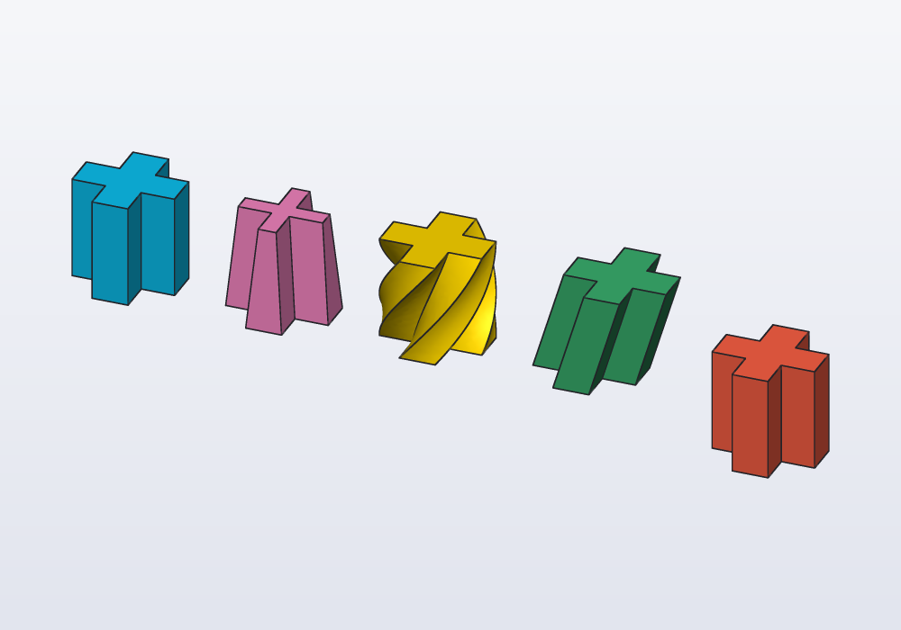
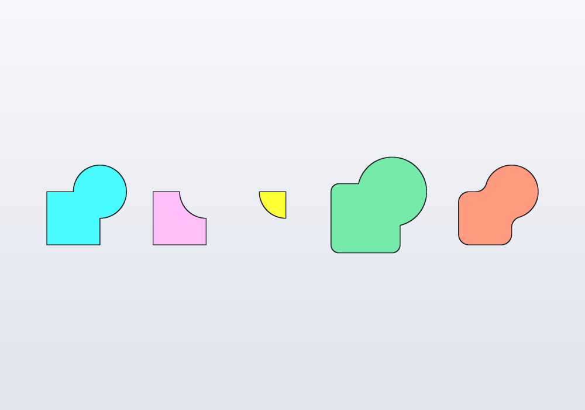
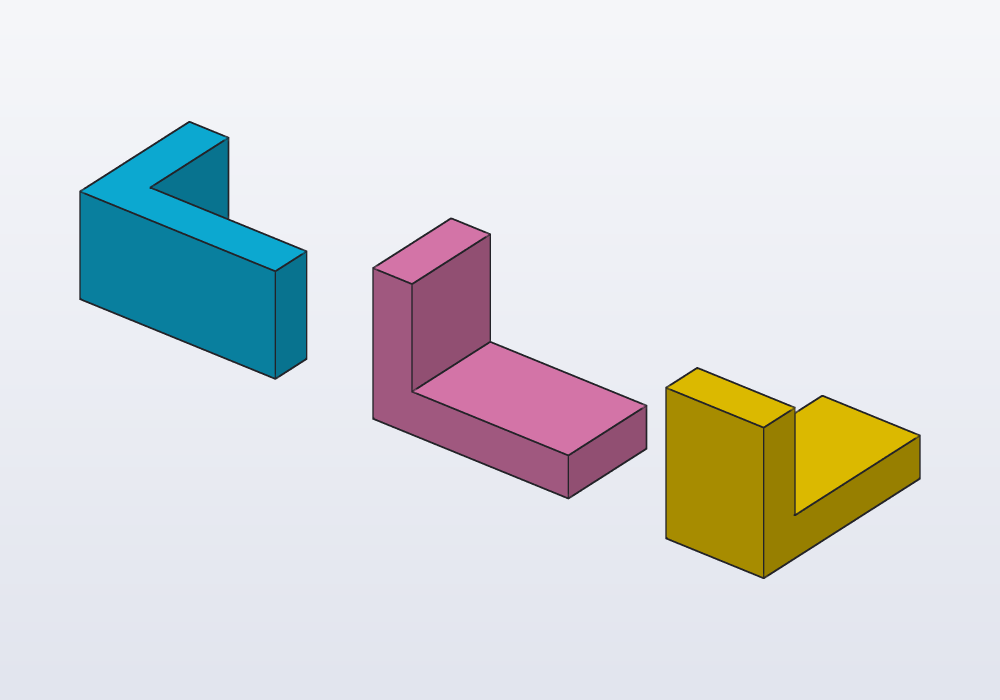
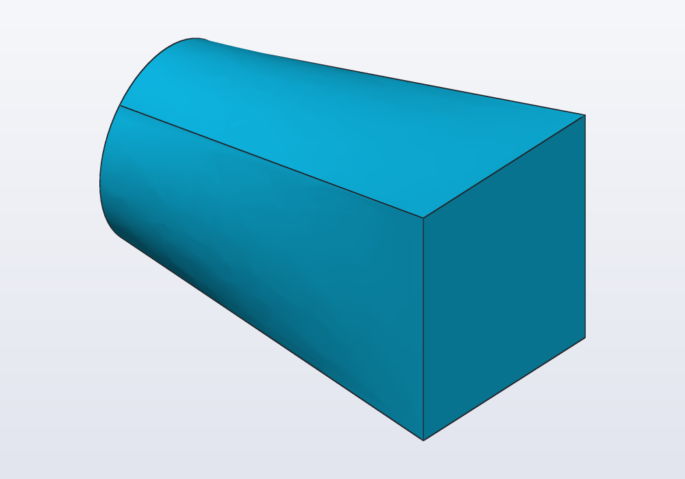
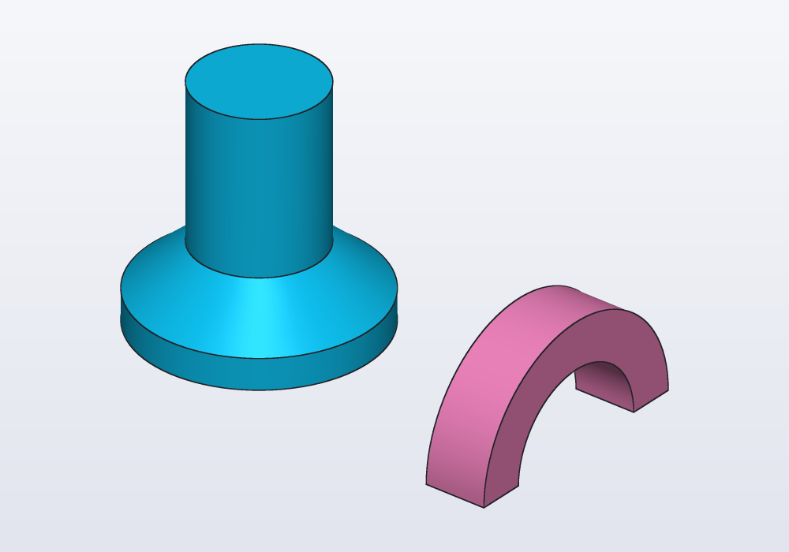
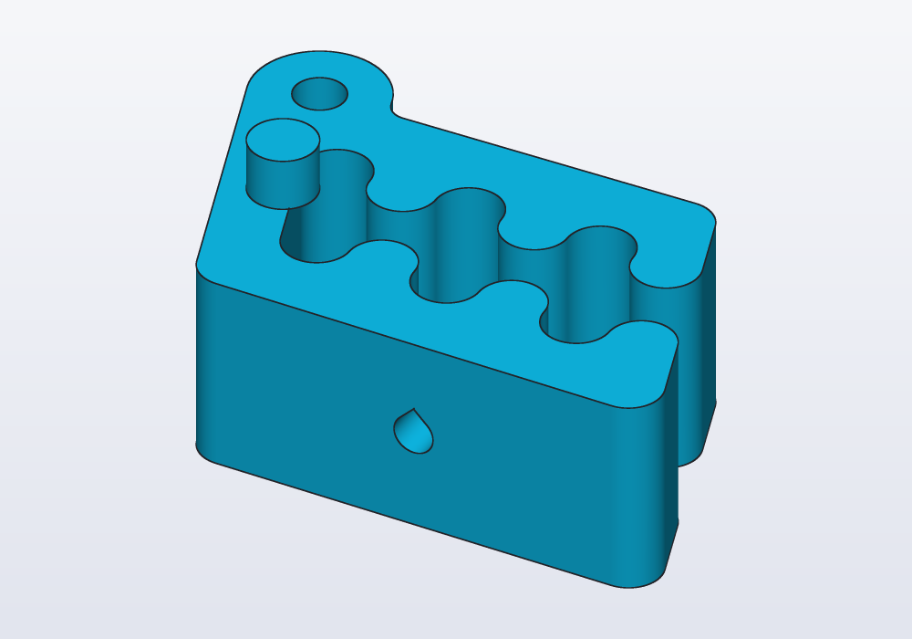
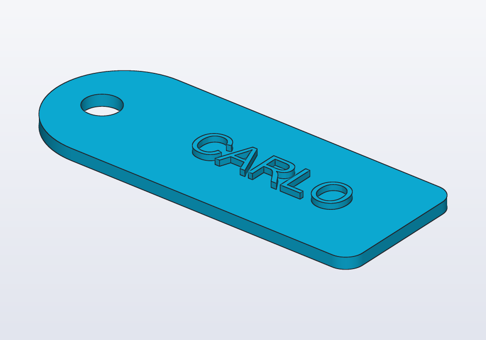
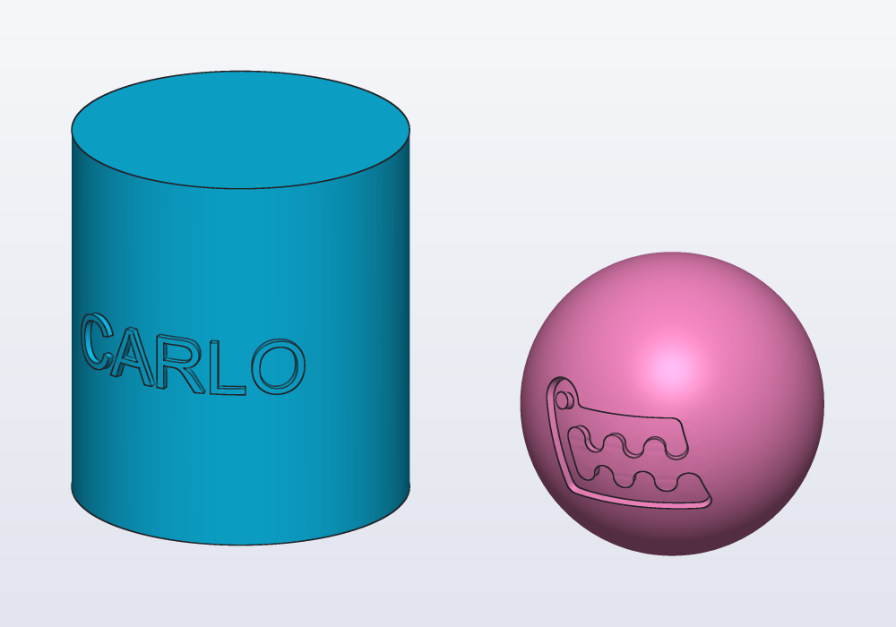
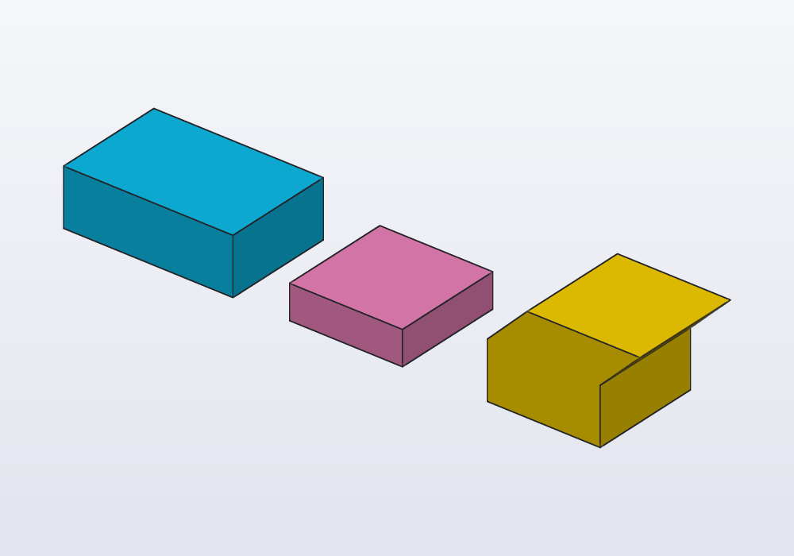

# From profile to solid

A profile is a flat outline; a solid is made from it by extruding it (pushing it up into a block of the same outline), revolving it (turning it round an axis, as on a lathe) or adding and cutting it on a face of another solid. This guide covers the profile shapes (rectangles, circles, polygons, slots, teardrops, text, SVG and DXF drawings), how they combine (`+ - &`, offset, round), extruding them (taper, twist, shear, along X or Y, symmetric), revolving them, standing them up with `across`, adding or cutting them on a face of a solid, and pushing or sinking the faces themselves.



## The profile shapes

Most printed parts are flat outlines made thick, turned round an axis, or cut into a block. Profiles lie on the XY plane. The shapes are those of a sketch, with the same names and arguments, centred on the origin unless given a point:

| Shape | Examples |
|---|---|
| rectangle | `rect(40.mm, 20.mm)`, `rect(20.mm)` (a square), `rect(p, q)` (two corners), `rect(p, w:, h:)` (from its lower left corner), `rect(center: c, w:, h:)`; `corner: 3.mm` rounds the corners, `angle: 30.deg` turns it |
| circle | `circle(d: 10.mm)`, `circle(r: 5.mm)`, `circle(c, d: 10.mm)` |
| ellipse | `ellipse(20.mm, 12.mm)`, `ellipse(c, rx:, ry:, angle:)` |
| regular polygon | `polygon(6, d: 13.mm)` (d through the corners), `fit: "sides"` (d across the flats: a nut's spanner size), `angle:` |
| polygon through points | `polygon([vec(0, 0), vec(30, 0), vec(0, 20)])`; `smooth: true` a smooth closed curve through them |
| slot | `slot(30.mm, 6.mm)` (end to end along X), `slot(p, q, w: 6.mm)` (round two centres) |
| teardrop | `teardrop(d: 5.mm)`, a round hole with a 45° point towards +Y, to print sideways; `flat: true` cuts the point |
| text | `text("LABEL", size: 8.mm, font: "Sans")`, starting at the origin on the baseline; `.centered` centres it; `weight: "light"` (thin … black, or 100 … 900), `bold: true`, `italic: true`, `spacing: 1.mm` between the letters, `lineSpacing: 1.5` between the lines |
| a drawing | `load("logo.svg")`, `load("plate.dxf")`: their closed outlines, sizes from the file |

```d
// a drawing from the project's folder, 1.5 mm thick
auto logo = load("logo.svg").centered.extrude(1.5.mm);
```

SVG takes its size from the drawing's width and height in mm, cm, in or pt; DXF from its units. Open lines, text and images in the file are left out. Fonts are those installed: a lettering to copy whose font is not there is traced as a sketch instead.

## Combining profiles

Profiles add, cut and overlap like solids: `a + b` joins them (a union), `a - b` cuts `b` out of `a` (a difference), `a & b` keeps only where they overlap (an intersection). They move, turn, scale and mirror like them too (`p.move(x: 10.mm)`, `p.rotate(30.deg)`, `p.scale(2)`, `p.mirror(X)`). `.offset(d)` grows the outline (shrinks it with `d` negative), round at the outside corners; `.round(r)` rounds every corner, inside and outside.

<!-- render: profiles-combine --from top -->
```d
// a square and a disc: joined, cut, overlapped, grown,
// and rounded

Profile sq() => rect(20.mm);
Profile disc() => circle(d: 20.mm)
    .move(x: 10.mm, y: 10.mm);

@part("Sky Pop")
Solid joined() => (sq() + disc()).extrude(2.mm);

@part("Pink Pop")
Solid cut() => (sq() - disc()).extrude(2.mm)
    .move(x: 40.mm);

@part("gold")
Solid common() => (sq() & disc()).extrude(2.mm)
    .move(x: 70.mm);

@part("mediumseagreen")
Solid grown() => (sq() + disc()).offset(3.mm)
    .extrude(2.mm)
    .move(x: 110.mm);

@part("tomato")
Solid rounded() => (sq() + disc()).round(4.mm)
    .extrude(2.mm)
    .move(x: 155.mm);
```



A profile can be read: `.area`, `.outer` (without its holes), `.holes`, `.pieces`, `p.contains(point)`. When the outline has more than three shapes, or sizes worked out by hand to make them meet, draw it as a sketch instead ([Drawing an outline](outlines.md)): it keeps its tangents when a size changes.

## Extruding

`profile.extrude(h)` makes a solid along +Z, from z = 0 to h (a negative h goes down). The options:

| Parameter | What it does | Default |
|---|---|---|
| `h` | the height along the axis | — |
| `taper:` | the sides lean in going away from the profile (the outline narrows, its holes widen); a negative angle the other way. For a mould, or to print without supports | `0.deg` |
| `twist:` | the profile turns round Z as it rises, evenly: `2 * 360.deg` two turns. A twisted column, a vase that turns | `0.deg` |
| `shear:` | `vec(dx, dy)`: the top moved that much sideways, the sides leaning straight. A leaning prism, a blade's bevel | none |
| `symmetric:` | half the height each side of the profile's plane: the profile is the middle of the solid (a taper narrows both ways from it, a twist turns half each way) | `false` |
| `along:` | `X` or `Y`: the profile stood up across that axis and pushed along it | Z |

<!-- render: profiles-extrude --from 0.4,-1,0.6 -->
```d
// one profile, five ways to extrude it

Profile plus() => rect(20.mm, 7.mm) + rect(7.mm, 20.mm);

@part("Sky Pop")
Solid straight() => plus().extrude(20.mm);

@part("Pink Pop")
Solid tapered() => plus().extrude(20.mm, taper: 5.deg)
    .move(x: 30.mm);

@part("gold")
Solid twisted() => plus().extrude(20.mm, twist: 90.deg)
    .move(x: 60.mm);

@part("mediumseagreen")
Solid sheared() => plus()
    .extrude(20.mm, shear: vec(6.mm, 0.mm))
    .move(x: 90.mm);

// half below z = 0, half above
@part("tomato")
Solid both() => plus().extrude(20.mm, symmetric: true)
    .move(x: 125.mm);
```


A taper keeps flat sides that meet at sharp edges, so a thin arm or a small rounded corner closes up before the top: at most `atan(r / h)` for a corner of radius r. Twist and taper do not go together. A shape whose outline changes along its length (round at one end, square at the other) is a loft or a sweep instead: see [the guide on sweeps](sweeps.md).

### Along X or Y

A profile drawn in XY, extruded `along: Y`, stands up with its x along X and its y up Z, and goes towards +Y; `along: X`, its x along Y, towards +X. A negative height goes the other way. Use it instead of extruding up and then rotating: the profile's sizes stay where you drew them.

<!-- render: profiles-along -->
```d
// the same L profile pushed along Z, Y and X

Profile ell() => rect(vec(0.mm, 0.mm), vec(20.mm, 4.mm))
    + rect(vec(0.mm, 0.mm), vec(4.mm, 14.mm));

@part("Sky Pop")
Solid up() => ell().extrude(10.mm);

@part("Pink Pop")
Solid back() => ell().extrude(10.mm, along: Y)
    .move(x: 30.mm);

@part("gold")
Solid right() => ell().extrude(10.mm, along: X)
    .move(x: 60.mm);
```



`p.across(X)` and `p.across(Y)` stand a profile up the same way without extruding it: what a loft along X or Y needs.

<!-- render: profiles-ex1 -->
```d
// from a round end to a square one, along X
@part
Solid adapter() => loft([circle(d: 10.mm).across(X),
    rect(12.mm).across(X).move(x: 20.mm)]);
```



A profile that lies in another plane (a sketch on a face or a plane, a section of a solid, one turned or moved out of XY) is extruded across its own plane, along its normal, from where it lies: no `along:` needed. See [the guide on planes](planes.md).

## Revolving

Revolving makes round parts: a knob, a bottle, a pulley. `profile.revolve()` turns the profile round Z, standing it up: its x is the radius, its y the height. Draw half the outline of a knob, a bottle, a pulley, and turn it. `revolve(axis: X, angle: 180.deg)` turns it round an axis in its own plane (a direction through the origin, or an `Axis` anywhere) without standing it up, and less than all the way. The profile must lie on one side of the axis; touching it is fine. A profile drawn on a plane or a face turns where it lies, round a world axis in that plane: the half outline of a knob drawn with `sketch(XZ)`, as the Front view shows it, turns round Z with `revolve(axis: Z)` or just `revolve()`.

<!-- render: profiles-revolve -->
```d
// a profile turned round an axis: a whole turn, a half

// x is the radius, y the height
Profile wall() => polygon([vec(0.mm, 0.mm),
    vec(15.mm, 0.mm), vec(15.mm, 4.mm),
    vec(8.mm, 10.mm), vec(8.mm, 30.mm),
    vec(0.mm, 30.mm)]);

@part("Sky Pop")
Solid peg() => wall().revolve();

// round X, in the profile's plane, half way
@part("Pink Pop")
Solid arch() => rect(center: vec(0.mm, 13.mm),
        w: 8.mm, h: 6.mm)
    .revolve(axis: X, angle: 180.deg)
    .move(x: 40.mm);
```



## Adding and cutting on a face

A boss (a raised stud), a rib (a thin wall that stiffens), a pocket (a hollow that does not go through) or a hole of one shape goes on a face of the solid in one step:

- `body.extrude(profile, on: …, depth:)` grows the profile outwards from the face;
- `body.cut(profile, on: …, depth:)` digs it in; `through: true` cuts all the way.

The depth is always positive: which way it goes is the call's, extrude out of the face, cut into it.

`on:` takes a frame (`body.frame(faces.top)`, moved with `.at(x:, y:)`), a face selector of the same solid (`on: faces.top`, which must pick one face), or a plane. The profile is drawn as on XY round the origin, and lands with its origin on the frame's origin, its x and y along the frame's: on a wall, x is horizontal and to the right seen from outside, and y goes up, so a teardrop points up and a text reads on every side. `at: vec(…)` puts the origin at that point of the face instead of its centre. Both take `taper:`.

<!-- render: profiles-on-face --from 0.5,-1,0.8 -->
```d
// on Carlo's faces: a peg grown from the top, a hole
// through the front that prints standing, point up

import std;

@part
Solid clip()
{
    auto body = carlo();

    // the frame's origin is the face's centre: moved
    auto top = body.frame(faces.top).at(x: -12.mm);
    body = body.extrude(circle(d: 5.mm), on: top,
        depth: 4.mm);

    // the lowest wall: its frame has x along, y up
    return body.cut(teardrop(d: 3.mm),
        on: faces.farthest(-Y), through: true);
}
```



A lettering standing on a tag, placed by the face's frame:

<!-- render: profiles-ex2 -->
```d
// a luggage tag: a rounded outline, a hole for the
// strap, and a name standing on its face

Profile outline() => (rect(50.mm, 24.mm)
        + circle(d: 24.mm).move(x: -25.mm))
    .round(3.mm)
    - circle(d: 6.mm).move(x: -29.mm);

@part("Sky Pop")
Solid tag()
{
    auto plate = outline().extrude(2.mm);
    auto label = text("CARLO", size: 8.mm).centered;
    return plate.extrude(label,
        on: plate.frame(faces.top).at(x: 6.mm),
        depth: 1.mm);
}
```



A profile drawn in a sketch on the face (`body.sketch(faces.top)`, see [Sketches in depth](sketches.md)) already knows where it is: `body.cut(s.profile, depth:)`, no `on:`. Use a sketch when the feature has several shapes or relations, or is measured from the face's edges; a plain profile when it is one shape at a place you know.

## On a curved face

`on:` needs a flat face. On a curved one (the side of a cup, a cone, a ball) the profile is laid on the face itself:

- `wrap: faces.…` rolls it onto the face like a label onto a bottle: its lengths stay the same along the face, so a 10 mm letter is 10 mm round a cup too;
- `project: faces.…` casts it onto the face along a direction, as a light through a stencil would (`along:`, else straight at the face): simpler to picture, but stretched where the face turns away, so keep it to the part that faces the light.

The profile's origin lands on the front of the face (the side facing −Y, halfway up), or on `at:`, a point over the face. Its x runs round the face and its y along it, read from outside. `depth:` digs in or grows along the face.

<!-- render: profiles-curved --from 0.4,-1,0.4 -->
```d
// a name round a mug, Carlo stamped on a ball

import std;

@part("Sky Pop")
Solid mug()
{
    auto body = cylinder(d: 40.mm, h: 45.mm);
    auto name = text("CARLO", size: 9.mm).centered;
    return body.extrude(name, wrap: faces.largest,
        depth: 0.8.mm);
}

@part("Pink Pop")
Solid ball()
{
    auto body = sphere(18.mm).move(x: 55.mm, z: 18.mm);
    auto badge = carlo().projection.scale(0.5).centered;
    return body.cut(badge, project: faces.largest,
        along: Y, depth: 1.mm);
}
```



Wrapping is exact on faces that unroll flat (cylinders, cones, extruded outlines); on lofted and turned shapes it is close, and on a sphere the profile stretches, more the larger it is. A tiling (see [Patterns](patterns.md)) wraps the same way.

## Extruding and cutting faces

A face is one of the surfaces that bound a solid: a box has six. Instead of a profile, the faces of the solid themselves can move: `body.extrude(faces.right, depth: 10.mm)` sweeps the flat faces outwards along their normals and adds the material; `body.cut(faces.top, depth: 4.mm)` sinks them (as does a negative depth to extrude). `along: vec(1, 0, 1)` sweeps them in another direction, with slanted sides: material is added where the direction leaves the face, removed where it enters.

<!-- render: profiles-ex3 -->
```d
// faces moved instead of profiles: one grown, one sunk,
// one swept aslant

@part("Sky Pop")
Solid grown() => box(20, 20, 10)
    .extrude(faces.right, depth: 10.mm);

@part("Pink Pop")
Solid sunk() => box(20, 20, 10)
    .cut(faces.top, depth: 4.mm)
    .move(x: 40.mm);

@part("gold")
Solid slanted() => box(20, 20, 10)
    .extrude(faces.top, depth: 10.mm,
        along: vec(1, 0, 1))
    .move(x: 75.mm);
```



Use it to change a part as it is (a wall thicker, a loaded STL made taller); for new features, a profile on the face says more.

## Common errors

| Message | What to do |
|---|---|
| *wrap: the profile runs off the face's surface* | the profile is longer than the face (round a cylinder, more than its circumference): make it smaller, or move it with `at:` |
| *project: part of the profile, projected, misses the face's surface* | the profile is wider than the face seen from that direction: smaller, or `wrap:` |
| *tapered extrusion failed: an edge or a hole of the profile closes up before the top…* | a smaller taper or a lower height: a corner of radius r lasts while h × tan(taper) ≤ r |
| *an extrusion is either twisted or tapered, not both* | choose one; for both, loft through turned and scaled profiles |
| *revolve failed: the profile crosses the axis…* | move the profile to one side of the axis (x ≥ 0 for `revolve()`) |
| *'on' needs exactly one face, the selector matched 2* | the selector is ambiguous: `faces.farthest(-Y)`, `faces.from(tool)`, or a frame |
| *this profile was drawn on a face (its sketch's): it is already where it goes, leave on: out* | a sketch's profile knows its face: drop `on:` |
| *missing argument 'depth' for cut(…)* | give `depth:`, or `through: true` to cut all the way |
| *depth must be greater than 0: cut digs the profile into the face; to raise it, use extrude* | a negative depth does not turn a cut into an extrude: call the other one |
| *file not found: logo.svg* | the drawing must be in the project's folder, the path relative to the model |

## In the application

Right-click a flat face in the 3D view: **Extrude face…** and **Cut face…** write `.extrude(faces…, depth:)` and `.cut(faces…, depth:)` with the face's selector and a depth to change; **Pocket at point…** and **Boss at point…** cut a rectangle into the face or stand a cylinder on it where you clicked; **Sketch on face…** starts a sketch there for an outline with several shapes. **Copy as code › Frame on face** copies the `.frame(…)` of the face to use with `on:`. Clicking a face jumps to the line that made it; the Steps panel shows each extrusion and cut in turn.
