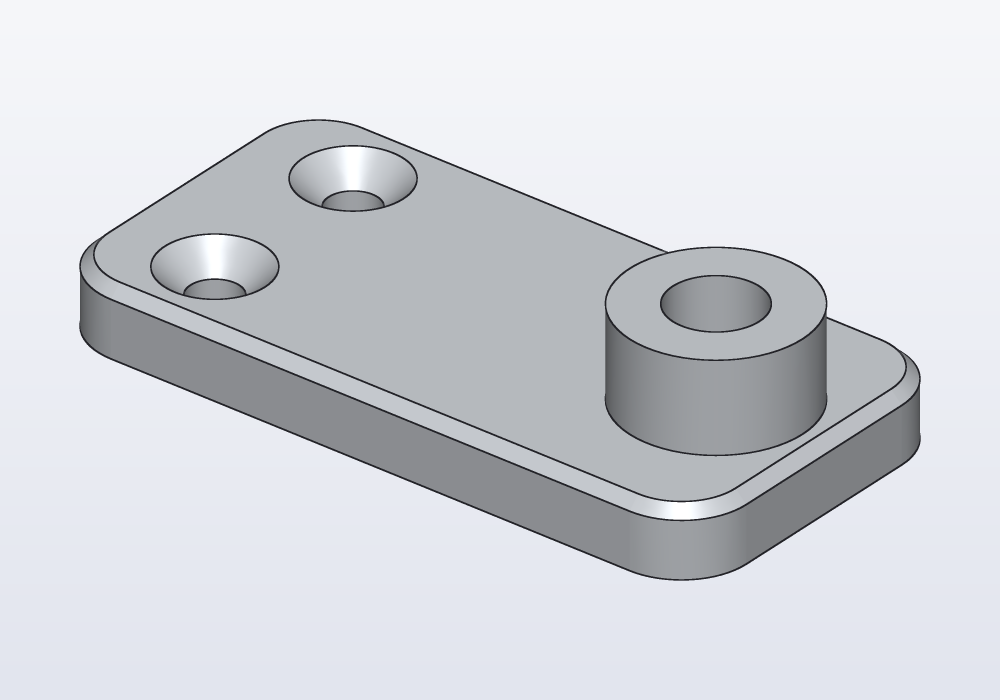
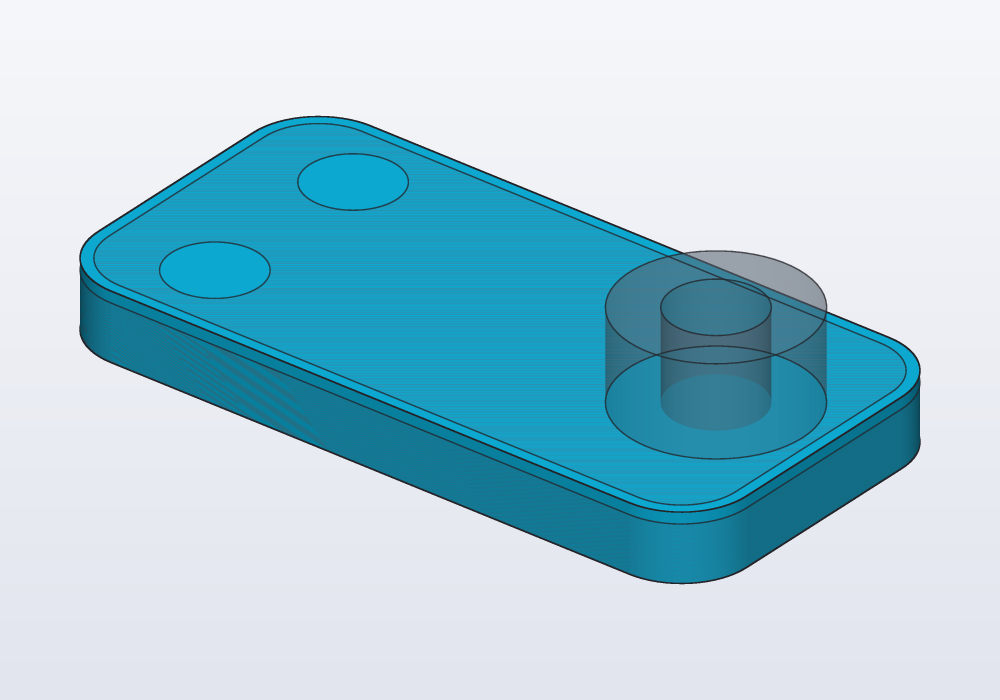
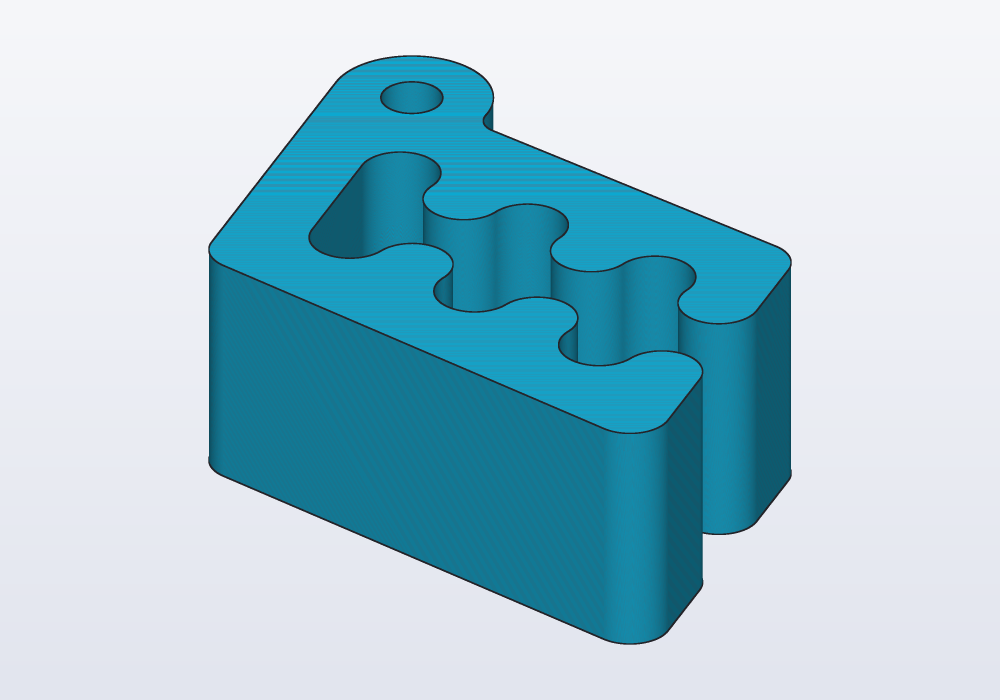
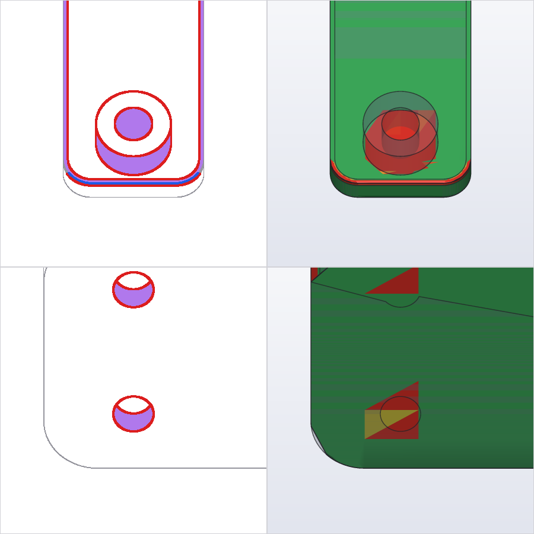
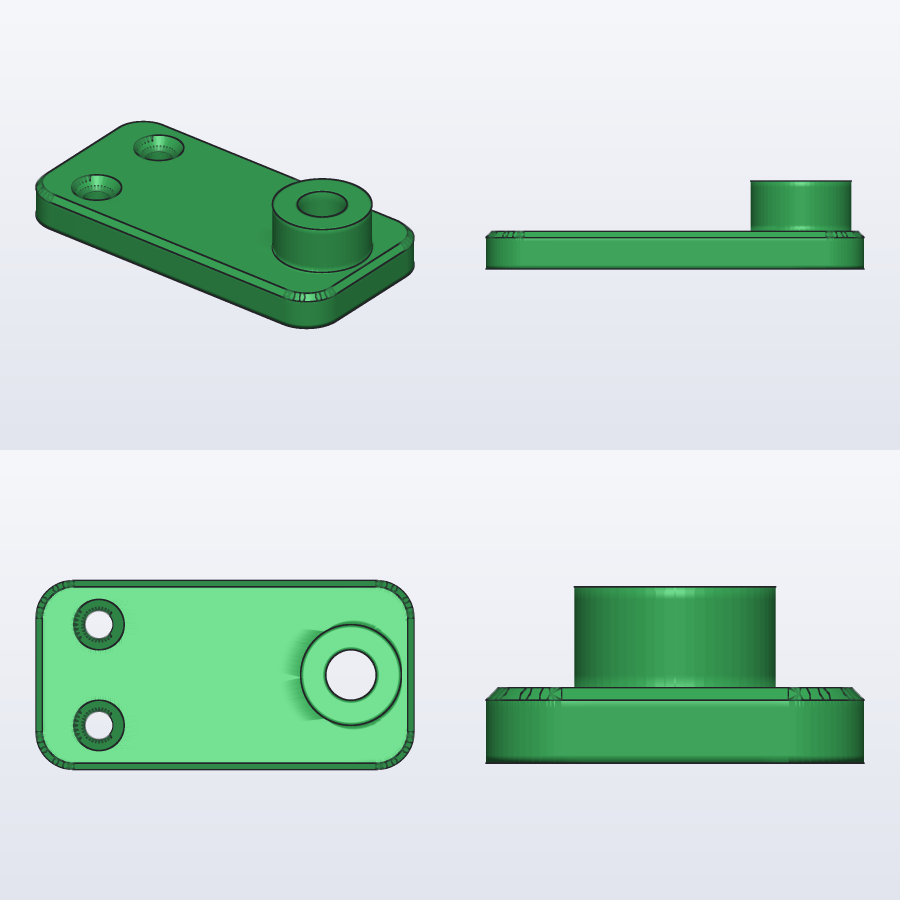

# Remodelling a mesh or STEP

Turning an STL, OBJ, 3MF or STEP file into a hackerscad model that matches it and whose sizes you can change: loading it as a see-through reference, reading its features, sections and holes, building the copy from the largest shape to the smallest, then the review round that says what still differs, the pictures that show it, and when the copy is done.

## An original to practise on

The examples in this guide copy a small bracket: a flat plate with a round post on it (a boss), a hole down the post (a bore), and two holes for screws whose heads sink into the plate (countersunk holes). The plate's top edges are bevelled (a chamfer). To follow along, save this model as `bracket.hcad` and make an STL of it; it stands for a file you downloaded.

<!-- render: remodel-original -->
```d
import hardware : M4, hole;

// the original: a plate with a boss, a bore and two
// countersunk holes, built here from plain shapes

@part("Gray Pop")
Solid bracket()
{
    auto b = rect(60.mm, 30.mm, corner: 6.mm)
        .extrude(6.mm)
        .chamfer(edges.of(faces.top), d: 1.mm);
    b += cylinder(d: 16.mm, h: 14.mm).move(x: 20.mm);
    b -= cylinder(d: 8.mm, h: 40.mm, center: true)
        .move(x: 20.mm);
    foreach (y; [-8.mm, 8.mm])
        b -= hole(M4, 6.mm, "countersink")
            .move(x: -20.mm, y: y, z: 6.mm);
    return b;
}
```



```bash
hcad render bracket.hcad -o bracket.stl
```

## 1. Load it as a reference

An STL, OBJ or 3MF file is a mesh: the surface of the part as thousands of small flat triangles, with no sizes or steps written in it. A STEP file, made by other CAD programs, has exact surfaces but no parameters either. `load("part.stl")` already gives a solid you can cut, drill and measure: a hole a little bigger, a tab cut off, need no copy. Remodelling is for when you want to change its sizes (the same part 10 mm longer, or for another screw): the copy is built from shapes and sizes you can read and change. To build onto a supplier's part rather than copy it, load it as a reference part and model only your own (see [the guide on parts](parts.md)). A real object or a photo has no file to read: measure it (see [the guide on sketches](sketches.md)).

The file has every size in it: the tools below read them, and the review measures how far the copy is. In a new model next to the file, the original is a part like any other, drawn see-through and left out of the exports. A part of your own grows beside it:

```
@part("slategray", alpha: 0.35, export: false)
Solid original() => load("bracket.stl");

@part
Solid copy() => rect(60.mm, 30.mm, corner: 6.mm)
    .extrude(6.mm);
```

(Shown without its `d` tag: a model that loads a file next to it cannot be checked inside this page.)

- `load()` reads `.stl`, `.obj`, `.3mf` and `.step` (`.stp`); STL and OBJ are in millimetres, `scale:` changes it (`scale: 25.4` for a file in inches).
- The file must be in the model's folder or below it.
- A mesh that came tilted or off-centre: `load("part.stl").aligned` lays it on its largest flat face, its longest side along X. Do it first, so that the faces of the copy are level and the sections cut it square.
- A STEP file keeps its exact surfaces; a mesh is triangles, merged into flat faces where they lie in one plane. Both compare the same way.



## 2. Read it

Three commands read what the part is made of. A section, here and in all of hackerscad, is a cut through the part: the flat outline you would see if you sawed it across at that level.

```bash
hcad features bracket.stl
hcad scan bracket.stl --axis z
hcad section bracket.stl --plane xy --at 3
```

- **features** lists the surfaces as operations, with plausible sizes: *shaft ⌀16 … from (20, 0, 6)*, *hole ⌀8 … 14 long*, *hole ⌀4.5 = M4 clearance*, *chamfer 1 mm*, *rounding ⌀12*, *pattern: 2× hole ⌀4.5 in a row along (0, 1, 0), 16 mm apart*. When a hole matches a screw size it says which.
- **scan** cuts all along an axis and says where the outside changes and which holes and pockets it meets: *0 to 5.02: 60 × 30*, *6 to 14: 16 × 16, centre (20, 0)*, *0 to 4.03 (4.03 deep): circle ⌀4.5*. Scan along x, y and z: the levels it names are where to cut sections.
- **section** cuts at one level and gives the outline as lines, arcs and circles with their sizes, then the same as a sketch ready to paste (`Profile section() { auto s = sketch(); … }`). `--region U0,V0,U1,V1` keeps only the outlines inside a rectangle of the plane (one pocket, a lettering).

## 3. Build from the largest to the smallest

Copy the part the way it was made, one operation at a time, so that every step is a line you can read and a size you can change. Most steps take a flat outline (a profile) and extrude it: push it up into a solid.

1. **The outside**: one outline per stretch the scan names, the sketch the section gives pasted and extruded (here the plate, 0 to 6 mm, and the boss, 6 to 14 mm).
2. **Features on its faces**, in steps, as on a machine (see [the guide on features](features.md)): a boss, a pocket (a hollow cut into a face, not through it), a step. One of one shape is a profile with the sizes features and scan give; one whose outline has several shapes is a section of the original just inside that face, its sketch pasted and extruded from the face.
3. **The chamfers and roundings of the outside**, before anything is cut into the faces they touch.
4. **Holes, pockets and traps** (a trap is a pocket shaped to hold a nut): `hole()` when features names a screw size (see [the guide on holes](holes.md)).
5. **Last, the small things**: small chamfers, notches, lettering. Lettering (regular grooves about 0.5 mm deep) is a section 0.25 mm inside the face with `--region` round the letters, its sketch extruded 0.5 mm into the face: never traced by hand.

The bracket, copied in those steps:

```
import hardware : M4, hole;

@part("slategray", alpha: 0.35, export: false)
Solid original() => load("bracket.stl");

@part
Solid copy()
{
    // the outside: the section at z = 3, extruded,
    // its top edges chamfered before anything is cut
    auto b = rect(60.mm, 30.mm, corner: 6.mm)
        .extrude(6.mm)
        .chamfer(edges.of(faces.top), d: 1.mm);

    // the boss grows from the top face
    b = b.extrude(circle(d: 16.mm),
        on: b.frame(faces.top).at(x: 20.mm), depth: 8.mm);

    // the bore, from the boss's top (its centre), and
    // the two M4 holes features named
    b = b.cut(circle(d: 8.mm), on: b.frame(faces.top),
        through: true);
    foreach (y; [-8.mm, 8.mm])
        b -= hole(M4, 6.mm, "countersink")
            .move(x: -20.mm, y: y, z: 6.mm);
    return b;
}
```

A part that is one outline pushed up needs a single section. Carlo, the mascot clip, is one: cut halfway up, his outline extruded as high as he is gives him back. Here `carlo()` stands in for the loaded file:

<!-- render: remodel-carlo -->
```d
import carlo;

// the original, see-through, and the copy: its section
// halfway up, pushed up as high as the original

@part("slategray", alpha: 0.35, export: false)
Solid original() => carlo();

@part("Sky Pop")
Solid copy() => original
    .section(XY.offset(7.5.mm))
    .extrude(15.mm)
    .move(z: -7.5.mm);

unittest
{
    assert(copy.deviation(original) < 0.1.mm,
        "the copy follows the original");
}
```



The section sits at the height it was cut, 7.5 mm, so the copy is moved down by as much. With a file, `hcad section carlo.stl --plane xy --at 7.5` gives the same outline as a sketch to paste, its arcs and lines with their sizes, ready to change.

## 4. The review round

After every change, one command compares the copy with the original and says what to do next:

```bash
hcad review copy.hcad --a copy --b original -o review.png
```

It runs, in one go:

| Report | What it tells | Alone |
|---|---|---|
| distances | how far each surface is from the other, both ways: the share within 0.1 mm, the mean, the largest, and the patches one does not follow | `hcad compare` |
| material | the pieces of material to add or cut, numbered, with their boxes and volumes, and the section that shows each | `hcad diff` |
| drawings | both drawn as lines from 62 directions: the lines only one has (a missing chamfer, a countersink, a lettering) | `hcad lines` |
| drawings of the voids | the same with the holes and pockets made solid | `hcad lines --voids` |
| close-ups | the first two entries of each report, framed where they are in sight | `--focus N` on each |

It ends with *next: fix what the close-ups show, then review again*, or, when it is close, with what to do last. It is a summary, three entries of each report; `--detail` gives them all. Entry numbers change from one round to the next; to look at one place again, give its point: `--look 20,0,7`.

After the first step (the plate alone) the close-ups show the boss and the M4 holes missing:



The single tools go deeper on one question:

- `hcad section bracket.stl --plane xz --at 0` again, or `hcad section copy.hcad --part copy --plane yz --at 20 --compare original -o cut.png`: both sections drawn on each other, to read a shape the numbers do not explain.
- `hcad match copy.hcad --a copy --b original`: the operations matched one by one, a hexagon where the copy has a circle, a nut trap cut in steps.
- `hcad lines … --depth 2` once the outside and the voids match: both peeled 2 mm, to compare what is inside.
- `hcad fit copy.hcad --a copy --b original --param corner`: tunes `@param` lengths until the two match (*corner: 6.000 mm (was 4.500)*). Use it only when the shape is right and a size is off; when it gains little, the shape differs: cut more sections, off the axis too.
- `hcad render copy.hcad --from right --look-at 20,0,13 --size 14 --opaque -o detail.png`: a picture from anywhere, close on a detail, the original drawn solid.

## Looking at it: overlapping edges

Numbers miss what the eye sees first. Every picture of the round draws both parts on each other:

- **in the drawings**, grey lines are in both, **red** only in the original, **blue** only in the copy; **violet** surface faces another way (tilted, twisted, curved where the other is flat). A red ring round a hole is a countersink the copy lacks; a red line along an edge, a chamfer.
- **in the distance map**, the copy is green within 0.05 mm, yellow at 0.1, red from 0.2, with the original see-through around it.

Where red and blue run side by side, the same edge is in a slightly different place: a size to correct. Where only red shows, an operation is missing.

## When it is done

- The review says both surfaces are 95% or more within 0.1 mm, and its close-ups show nothing worth fixing. A mesh is made of flat triangles: a few tenths of a millimetre on curves, and short lines on rounded corners, are the mesh, not the copy.



- Then name the measures that matter. `hcad literals copy.hcad --original original` lists the numbers written more than once and what they are on the original (*8, 3 times: the radius of a shaft ⌀16; the diameter of a hole ⌀8*). Make those `@param`s or named constants (see [the guide on parameters](parameters.md)), use the names, and put the relations in a `unittest`:

```d
unittest
{
    assert(copy.deviation(original) < 0.1.mm,
        "the copy follows the original");
}
```

## Habits of shared parts

Parts printed and shared online have details made for printing. Look for them in the sections and the drawings:

- a notch on top of a sideways hole, or a hole drawn as a teardrop (round with a point on top, so that it prints without support) with its point cut flat at an angle that is not 45° (read it from the section);
- a layer that closes a hole for a millimetre, printed over and drilled after;
- nut traps wider at the mouth, 0.5 mm chamfers where holes open.

## Common errors

| Message | What to do |
|---|---|
| *file not found: bracket.stl* | the path is relative to the model: put the file next to it, or write the folder |
| *load can only read files inside the project directory* | copy the file into the model's folder |
| *no @part named 'original'* | `--a` and `--b` take part names: the function's name, or its `name:` |
| *the plane xy at 30 mm does not cut the part* | a level inside its box: `hcad features` prints the size and where it starts |
| *the axis is x, y or z* | `--axis` takes one of the three |

## In the application

- **☰ › Open…** on an `.stl`, `.obj`, `.3mf`, `.step`, `.svg` or `.dxf` file starts a new model, not saved yet, with that file in a `load()` line (its own file goes next to it when saved): the start of a remodel.
- **Section view** in the view bar cuts the model with a plane you slide; right-click a face › **Section parallel to face** cuts parallel to it: the place to compare the inside of the copy with the see-through original.
- Right-click the original › **Hide original** and **Show only copy** to look at one at a time; **Measure** for a distance or a diameter, **Copy as code** for a face selector or a frame to paste.
