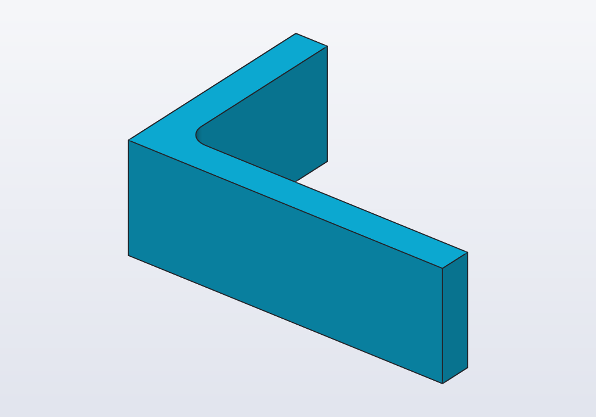
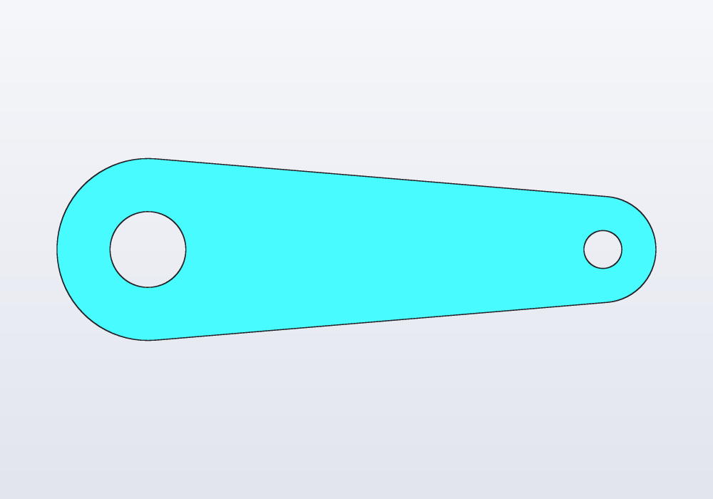
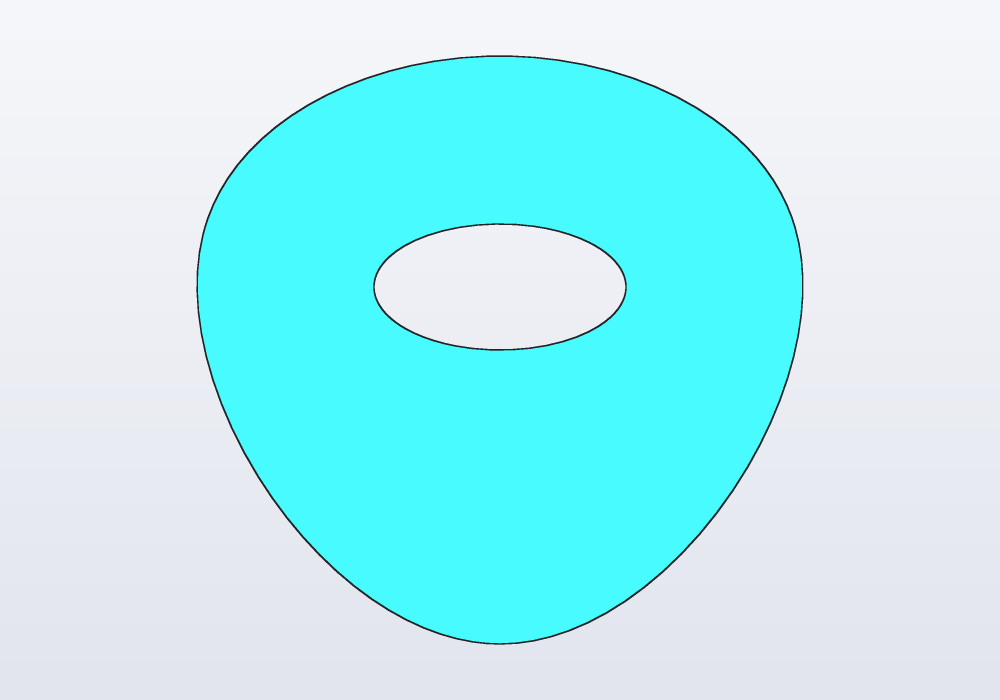
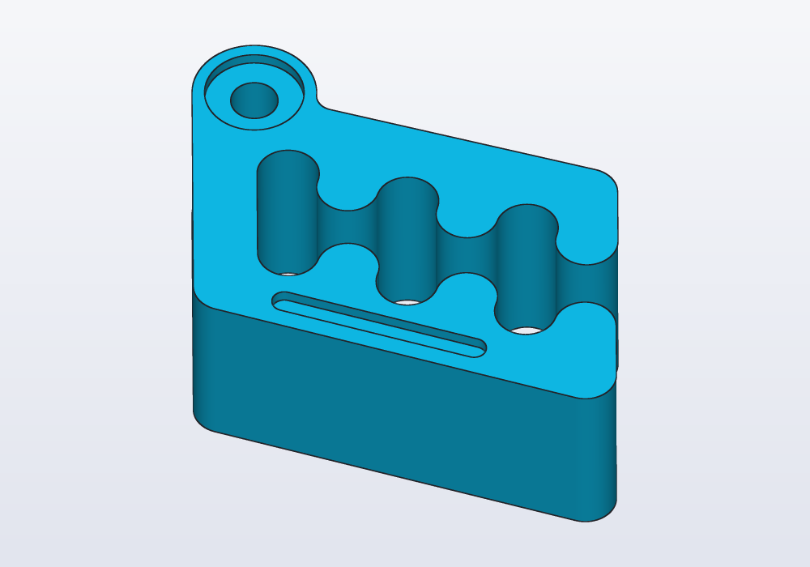

# Constrained sketches

A flat outline drawn as points, lines, arcs, circles, ellipses, splines and ready-made shapes, held in place by constraints and dimensions, then extruded, revolved or cut: `sketch()`, every constraint, construction geometry, degrees of freedom and their warning, reading the solved sketch back, sketches on the faces of a solid, when a sketch beats unions of shapes, and the sketch bar of the application.

## When to use one

A sketch is an outline told by its sizes and its relations: this side horizontal, that arc tangent to this line, the hole 5 mm from that edge. hackerscad solves the constraints and gives the outline as a `Profile`, which extrudes, revolves and cuts like any other. When a `@param` changes, the outline is solved again: tangents stay tangent, holes stay where they were measured from.

| The outline is | Use |
|---|---|
| one shape: a rectangle with round corners, a circle, a slot | a profile in one line: `rect(40.mm, 20.mm, corner: 3.mm)` (see [the guide on profiles](profiles.md)) |
| several shapes overlapping, an offset of another, text, an SVG | profile operations: `+ - &`, `.offset`, `text()`, `load()` |
| a prismatic part from a drawing: a bracket, a plate, a lever, a cam, a gasket, a clip | **a sketch**, each size of the drawing a constraint |
| a feature on a face of a solid, measured from that face's edges | **a sketch on the face**: `body.sketch(faces.top)` |
| a sculpted shape: a figurine, a vase with a texture | not a sketch: lofts, sweeps, noise (see [the guide on sweeps](sweeps.md)) |

A profile made of more than three shapes, moved by sizes worked out by hand, or rounded with `.offset(r).offset(-r)`, is an outline that wants a sketch: it reads as its dimensions, keeps its tangents when a size changes, and its edges take fillets. The two mix: `s.profile - circle(d: 5.mm)` is a profile too.

## A first sketch

An L bracket. Each point is drawn roughly where it goes; the constraints then say what is exact.

<!-- render: sketches-bracket -->
```d
// an L bracket: each size of the drawing a dimension

@param("Height", min: 20.mm, max: 80.mm)
immutable height = 40.mm;

Profile outline()
{
    auto s = sketch();

    // one point pinned, or the whole outline floats
    auto o = s.point(0, 0, fixed: true);
    auto a = s.point(60, 0);
    auto b = s.point(60, 6);
    auto c = s.point(6, 6);
    auto d = s.point(6, 40);
    auto e = s.point(0, 40);
    auto l = s.polyline([o, a, b, c, d, e]);
    s.horizontal(l[0]);
    s.vertical(l[1]);
    s.horizontal(l[2]);
    s.vertical(l[3]);
    s.horizontal(l[4]);
    s.vertical(l[5]);
    s.length(l[0], 60.mm);
    s.length(l[5], height);
    s.length(l[1], 6.mm);
    s.length(l[4], 6.mm);

    // the inside corner rounded, against cracking
    s.fillet(c, 4.mm);
    return s.profile;
}

@part
Solid bracket() => outline().extrude(20.mm);
```



The steps are always the same: `sketch()`, the geometry, the constraints, `s.profile`. `s.dof` is 0 here: every point is decided. Then the solid takes the 3D features (holes, fillets, shells) that are not part of the outline.

## The geometry

| Call | Draws | Notes |
|---|---|---|
| `s.point(x, y)` | a point | where the solver starts from; `fixed: true` pins it |
| `s.line(p, q)` | a line between two points | points, not vectors |
| `s.polyline([p, q, vec(…)], closed: true)` | joined lines, returned as an array | vectors become new points; closes unless `closed: false` |
| `s.arc(center, start, end)` | an arc, counter-clockwise | |
| `s.circle(center, r: \| d:)` | a circle | without `r`/`d` the radius is left to the constraints |
| `s.ellipse(center, rx:, ry:, angle:)` | an ellipse | what is not given is left free, the turn too |
| `s.spline([p, q, r], closed: false)` | a smooth curve through the points | it bends evenly, like a thin strip; its points move it |

The ready-made shapes have the names and arguments of the profiles. They return their lines (and arcs), with their own constraints already in:

| Shape | Returns | Degrees of freedom left |
|---|---|---|
| `s.rect(p, q)`, `s.rect(p, w:, h:)`, `s.rect(center: c, w:, h:)` | bottom, right, top, left | 0 with `w`, `h` and a fixed corner or centre |
| `s.rect(…, angle: 30.deg)` / `angle: "free"` / `corner: 3.mm` | turned / turn left to constraints / rounded | |
| `s.polygon(c, 6, d: 13.mm, fit: "sides")` | its n sides | 1 (the turn) unless `angle:` or a constraint takes it |
| `s.polygon([p, q, vec(0, 20)])` | a closed polyline | |
| `s.slot(p, q, w:)`, `s.slot(30.mm, 6.mm, center: c)` | line, arc round q, line, arc round p | 0 with p, q fixed and `w` given |
| `s.teardrop(c, d:, angle:, flat:)` | arc, line, line (flat: one more) | 0 with c fixed |

Without a centre, `s.circle(d: 10.mm)`, `s.rect(40.mm, 20.mm)` and the others start from a new point at the origin, free to move. Sizes given to a shape (`w`, `h`, `r`, `d`, `corner`…) are dimensions: in the window they show on the sketch and change with a click.

## The constraints

| Constraint | What it holds |
|---|---|
| `s.coincident(p, q)` | two points in one place |
| `s.fix(p)` | a point pinned where it is (as `fixed: true`) |
| `s.horizontal(line)`, `s.horizontal(p, q)` | a level line, or two points at one height (an ellipse: its x axis along X) |
| `s.vertical(line)`, `s.vertical(p, q)` | an upright line, or one point above the other |
| `s.length(line, v)` | a line that long |
| `s.distance(p, q, v)` | two points that far apart; `along: X` or `along: Y` only across or up |
| `s.distance(p, line, v)` | a point that far from a line |
| `s.on(p, curve)` | a point on a line, circle, arc or ellipse; a shape's lines: every corner on the circle |
| `s.parallel(a, b)`, `s.perpendicular(a, b)` | two lines |
| `s.angle(a, b, v)`, `s.angle(line, v)` | between two lines (start → end), or of one from X |
| `s.equal(a, b)` | lengths or radii; `s.equal(e)` makes an ellipse round |
| `s.radius(c, v)`, `s.diameter(c, v)` | a circle or arc that size; `s.radius(e, rx:, ry:)` an ellipse |
| `s.tangent(a, b)` | a line touching a circle, arc or ellipse, or two circles; a shape's lines: every side touching |
| `s.concentric(a, b)` | circles, arcs, ellipses or a point round one centre |
| `s.midpoint(p, line)` | a point in the middle of a line |
| `s.symmetric(p, q, line)` | two points mirrored across a line |
| `s.fillet(p, r)` | not a constraint: the corner where two lines meet at p, rounded |

A distance is never negative: which side a point lies on comes from where it is drawn. Draw the points roughly where they go, and the solver keeps them on that side.

## Where a sketch beats unions

A lever: two round ends joined by sides tangent to both. As unions of circles and boxes, every size of the sides would be worked out by hand, and wrong as soon as the span changes. As a sketch it is its dimensions:

<!-- render: sketches-lever --from top -->
```d
// a lever: two round ends joined by tangent sides

@param("Between the holes", min: 30.mm, max: 120.mm)
immutable span = 60.mm;

Profile lever()
{
    auto s = sketch();
    auto a = s.point(0, 0, fixed: true);
    auto b = s.point(60, 0);

    // each side runs from one end's arc to the other's
    auto p1 = s.point(0, -12);
    auto p2 = s.point(60, -7);
    auto p3 = s.point(60, 7);
    auto p4 = s.point(0, 12);
    auto low = s.line(p1, p2);
    auto right = s.arc(b, p2, p3);
    auto high = s.line(p3, p4);
    auto left = s.arc(a, p4, p1);

    s.horizontal(a, b);
    s.distance(a, b, span);
    s.radius(left, 12.mm);
    s.radius(right, 7.mm);
    s.tangent(low, left);
    s.tangent(low, right);
    s.tangent(high, left);
    s.tangent(high, right);

    // the holes, round the same centres
    s.circle(a, d: 10.mm);
    s.circle(b, d: 5.mm);
    return s.profile;
}

@part
Solid arm() => lever().extrude(5.mm);
```



The profile fills what lies inside an odd number of loops: the circles inside the outline are holes. `s.fill(at)` makes the area holding a point full whatever the loops say, `s.fill(at, full: false)` empty.

## Construction geometry

`construction: true` on any geometry or shape draws a guide: something to constrain to, drawn dashed in the window, never part of the profile. A bolt circle is the classic one: the holes sit on it, and the circle itself is not cut.

<!-- render: sketches-flange --from top -->
```d
// a flange: four holes on a bolt circle, a hexagon
// for a nut

Profile flange()
{
    auto s = sketch();
    auto c = s.point(0, 0, fixed: true);
    s.circle(c, d: 50.mm);

    // the bolt circle is a guide: not cut, not extruded
    auto bolts = s.circle(c, d: 36.mm,
        construction: true);
    auto sq = s.rect(center: c, construction: true);
    s.equal(sq[0], sq[1]);
    s.on(sq, bolts);
    foreach (side; sq)
        s.circle(side.start, d: 4.mm);

    // across the flats, as a spanner measures a nut
    auto nut = s.polygon(c, 6, d: 13.mm, fit: "sides");
    s.horizontal(nut[0]);
    return s.profile;
}

@part
Solid plate() => flange().extrude(4.mm);
```


Other guides that come up often: a construction diagonal of a rectangle, whose midpoint is its centre; a construction line joining two centres; a construction circle a polygon is inscribed in (`s.on(s.polygon(c, 6), circle)`) or drawn round (`s.tangent(…)`).

## Curves: ellipses and splines

`s.ellipse(c, rx:, ry:, angle:)` has its rx along its own x axis, turned `angle` from X. `s.spline([…])` is a smooth curve through the points, in order; `closed: true` goes round back to the first, a loop of its own. An open spline's ends join lines and arcs as theirs do. The points move the curve, so constrain them like any other.

<!-- render: sketches-pick --from top -->
```d
// a guitar pick: a smooth loop through four points,
// with an oval window for the thumb

Profile pick()
{
    auto s = sketch();
    auto tip = s.point(0, 0, fixed: true);
    auto right = s.point(14, 20, fixed: true);
    auto top = s.point(0, 28, fixed: true);
    auto left = s.point(-14, 20, fixed: true);
    s.spline([tip, right, top, left], closed: true);

    auto c = s.point(0, 17, fixed: true);
    s.ellipse(c, rx: 6.mm, ry: 3.mm, angle: 0.deg);
    return s.profile;
}

@part
Solid plectrum() => pick().extrude(1.mm);
```



## Degrees of freedom

Each point has two degrees of freedom (it can move across and up), a circle's radius one, and each constraint takes some away. `s.dof` is what is left. Aim for 0: an outline with freedom left still works, but the solver chooses where the free points go, and a change of a `@param` can move them in ways you did not mean. hackerscad says so, with the lines of the free points:

```
warning[E0420]: the sketch is under-constrained: 1 degree of freedom left (free points at lines 12, 13)
```

The usual causes: no point pinned (the whole outline can slide: 2 degrees, plus one if it can turn), a size not given, a shape's turn left free (`s.polygon` without `angle:`). Constraints that ask for two things that cannot both hold are an error that points at them all:

```
error[E0420]: the sketch constraints conflict: check the constraints at lines 17, 24, 26
```

## Reading back

Once solved, the sketch can be read: `p.x`, `p.y`, `p.pos`, `line.start`, `line.end`, `line.length`, `line.mid`, `c.center`, `c.radius`, `e.center`, `e.rx`, `e.ry`, `e.angle`, a spline's `.points` and `.length`, and `s.dof`, `s.solved`. Use them to place what comes after (a boss on a point the sketch decided), or in a `unittest`:

```d
assert(s.dof == 0, "every size given");
```

Beyond `s.profile`, a sketch gives what it draws as a path to sweep along: `s.path` (one chain, open or closed), `s.paths` (several). See [the guide on sweeps](sweeps.md).

## Sketches on faces

`body.sketch(face)` draws on a flat face of a solid, with the axes of `body.frame(face)`: the origin at the face's centre; on a wall, x to the right and y up seen from outside. The face's edges are in the sketch from the start as references (fixed construction geometry, no degrees of freedom):

- `s.edges` lists them, each loop from its lowest edge counter-clockwise, like a rectangle's sides (bottom, right, top, left on a rectangular face), the outside loop first;
- `s.origin` is the origin as a fixed point;
- `s.project(edges.…)` flattens other edges of the solid onto the face as references: a hole's rim below it (a circle seen aslant becomes an ellipse).

The profile knows its face: `body.cut(s.profile, depth:)` and `body.extrude(s.profile, depth:)` need no `on:`.

<!-- render: sketches-on-face --from 0.3,-1,1.2 -->
```d
// on Carlo's top face: a groove along its lower edge,
// and a recess round its eye, both placed from the face

import carlo;

@part
Solid marked()
{
    auto body = carlo();
    auto s = body.sketch(faces.top);

    // the lowest edge first; the eye's rim last
    auto bottom = s.edges[0];
    auto eye = s.edges[$ - 1];

    auto a = s.point(-6, -10);
    auto b = s.point(10, -10);
    auto groove = s.slot(a, b, w: 2.mm);
    s.parallel(groove[0], bottom);
    s.distance(a, bottom, 2.5.mm);
    s.distance(a, b, 16.mm);
    s.distance(a, s.origin, 6.mm, along: X);

    s.circle(eye.center, d: 8.mm);
    return body.cut(s.profile, depth: 1.mm);
}
```



A rim under the face, made concentric with a boss on top:

```d
@part
Solid block()
{
    auto body = box(30, 20, 10)
        - cylinder(d: 6.mm, h: 5.mm).move(x: 6.mm);
    auto s = body.sketch(faces.top);

    // the blind hole under the top face: its rim
    auto rim = s
        .project(edges.filter(e => e.isCircle))[0];
    auto c = s.circle(vec(6, 0), d: 10.mm);
    s.concentric(c, rim);
    return body.extrude(s.profile, depth: 2.mm);
}
```

`sketch(frame)` and `sketch(plane)` draw on a frame or a plane instead (`sketch(XZ)`: seen from the front), with `s.origin` and no edges: see [the guide on planes](planes.md). A sketch's profile stays where it was drawn: moved or combined with a profile of no place, it stays in its plane; two profiles drawn on different faces do not combine.

## Common errors

| Message | What to do |
|---|---|
| *the sketch is under-constrained: N degrees of freedom left (free points at lines …)* | add the sizes missing, or pin a point with `fixed: true` |
| *the sketch constraints conflict: check the constraints at lines …* | two of them ask the impossible (a line both horizontal and vertical, a size given twice): remove one |
| *a distance is not negative: the side comes from where the points are drawn* | give the size positive, and draw the point on the side it belongs |
| *open: what line N draws has a free end, and stays out of the profile* | join its ends to the rest, or make it `construction: true` if it is a guide |
| *expected a sketch point, line, arc, circle or ellipse, not Vec2* | `s.line` takes points: `s.line(p, s.point(30, 20))`; `s.polyline` takes vectors too |

## In the application

- **The sketch at the cursor.** With the cursor in a sketch's code, the view shows that sketch from above, its dimensions on it and what the cursor's line makes in orange; out of it, the model again. The display menu's *Show the sketch at the cursor* turns this off; the pin in the mode bar keeps the sketch shown when the cursor leaves its code; Esc closes it.
- **Dimensions.** Each size the code gives is a label on the sketch: click it, type the new value, Enter writes it in the code. Points that can still move are drawn in blue; conflicting dimensions in red.
- **Opening a sketch.** The view bar's **View › Sketches** lists the model's sketches (line, dimensions, whether fully constrained); right-click a face made from a sketch: **Edit sketch…**.
- **New sketches.** Right-click a flat face: **Sketch on face…** keeps the part's solid in a variable and starts an empty sketch on it, its edges as references. **View › New sketch…** draws on the face or plane picked, or shows the planes and waits for a click on one.
- **The sketch bar.** While a sketch is shown and its code can be written to (kept in a variable, in the open file, not in a loop), a bar of tools runs down the left of the view. The left column draws: select (↖), point, lines, smooth curve, rectangle (by corners, from its centre, turned), regular polygon, slot, circle, ellipse, teardrop, arc (by centre or through 3 points), fill (◩, an area full or empty); ⌫ deletes what is selected with what is drawn on it and its constraints; ┄ turns it into construction geometry (with nothing selected, what you draw next). The other column constrains what is selected: coincident, fix, horizontal, vertical, parallel, perpendicular, equal, midpoint, symmetric, tangent, concentric, on, and, asking for a value, length, distance, angle, radius, diameter. Each button writes the line into the code; the tooltips say what each needs selected.

## With an AI agent

An agent reads this guide with `hcad_docs` (format `guide`, topic `sketches`), or `hcad docs --guide sketches` from the command line. It follows these rules:

- For an outline given by its dimensions it prefers a sketch to unions of shapes: each size a constraint, `s.dof == 0`, sizes it estimated made `@param`s.
- Before starting, it asks for the sizes it cannot read from the request (and which are critical, which can be rough), not afterwards.
- It treats the under-constrained warning as a fault to fix, not as done.
- In the window it uses `hcad_gui_feature` with action `sketch` (on a face, or `plane:` for XY, XZ, YZ or a plane of the code) to start a sketch, `hcad_gui_sketch` to show one, select its entities, draw (`draw:`) and constrain (`constrain:`) as the sketch bar does, and `hcad_gui_dimension` to change a dimension; the code itself it edits with `hcad_gui_edit`.
- It checks the result: `hcad_check` with no errors and no warnings, `hcad_gui_sketch`'s reply (degrees_of_freedom, free_points) or `s.dof` in a `unittest`, and the pictures of `hcad_render` looked at.
