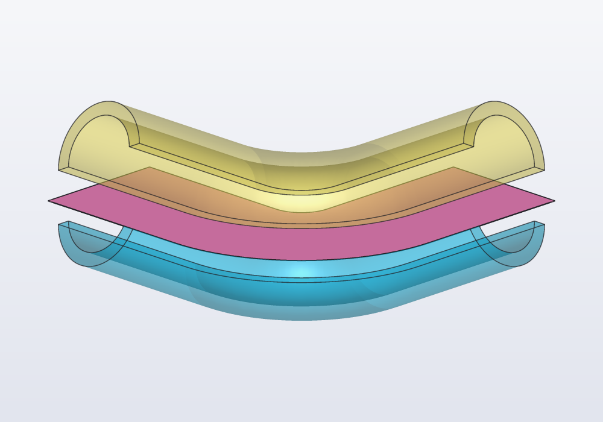
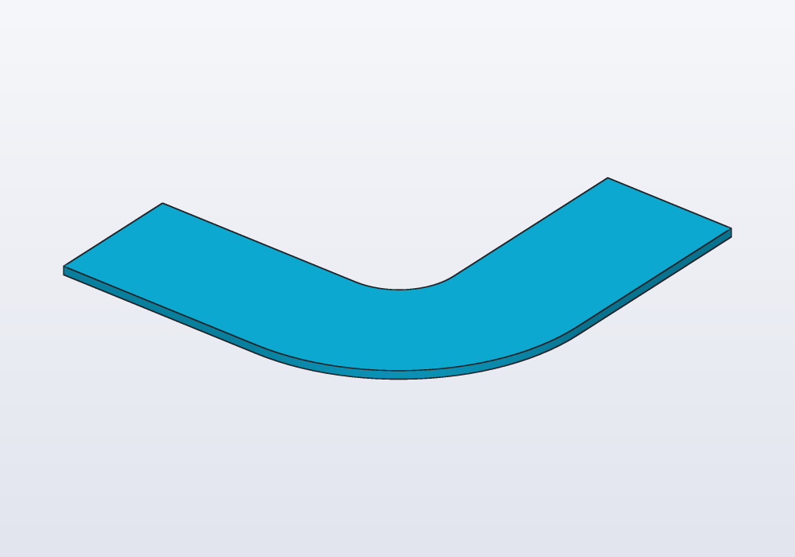
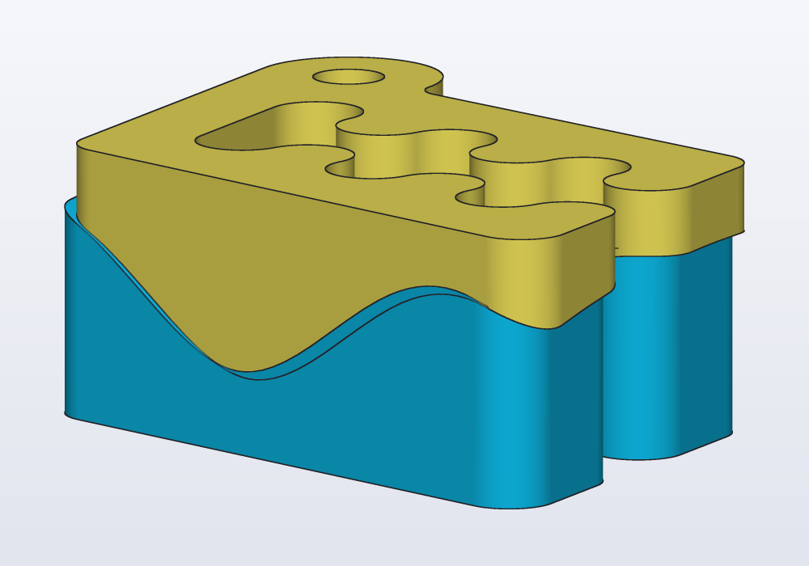
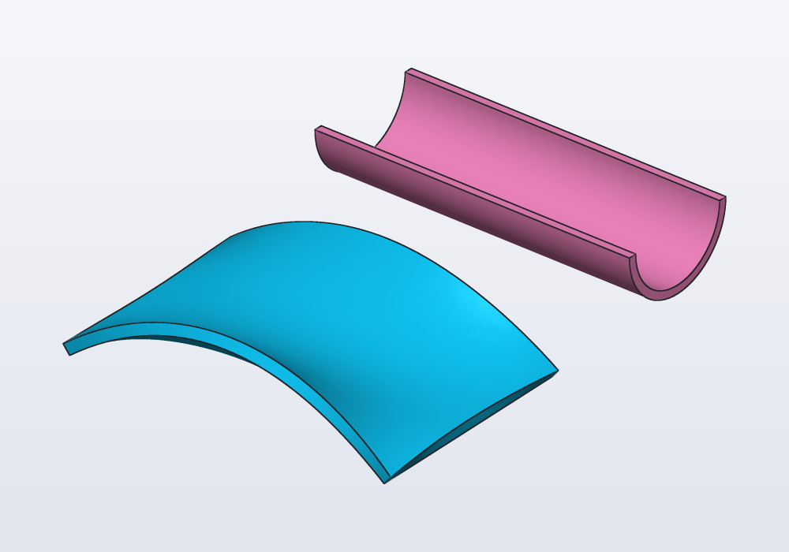
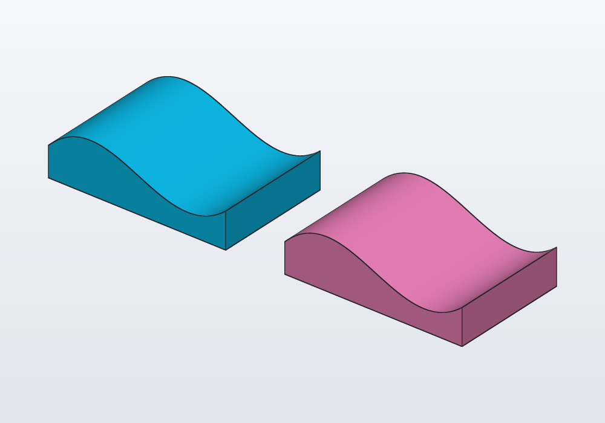

# Surfaces

Open sheets with no inside: how to make one (an open curve swept along a path, a loft through paths), and what to do with it: split a solid along a curved cut, thicken it into a shell, sew several into a closed solid, push the pieces apart. Typical workflows, the limits, and the errors.



## What a surface is

A `Surface` is a sheet, as thin as paper and with no thickness at all: faces with an edge left open, so it has no inside. A solid is closed all round and has an inside that can be printed; a surface does not. It is a tool, never a part. You use it in one of four ways:

| You want | Use |
|---|---|
| to cut a solid along a curve instead of a plane | `body.split(surface)` |
| a thin curved shell, a panel, a gutter | `surface.thicken(2.mm)` |
| a closed solid whose sides you made one by one | `sew([sides…])` |
| the pieces of a cut apart, an exploded view (the pieces drawn a little apart, to show how they fit) | `pieces.push(from: surface, by: 3.mm)` |

If a flat cut will do, cut with a plane: `body.split(plane)` is simpler (see [the guide on planes](planes.md)). If the shape is a closed solid you can sweep, loft, extrude or revolve, make it that way (see [the guide on sweeps](sweeps.md)): surfaces are for what those cannot do.

## Making one

**Sweep an open curve.** A `Path` is a curve; a *sweep* moves a shape along a route. A `Path` swept along another path gives a surface, the same way a profile swept gives a solid: the curve is drawn on XY around the origin and placed across the route, its +Y towards world +Z, its x to the right seen from further along the route looking back (a route along +X takes x to +Y, one along +Y takes x to -X). `up:`, `guide:`, `twist:` and `frenet:` work as for a profile.

<!-- render: surfaces-ex1 -->
```d
// a ribbon 16 mm wide along a bent route, made 1 mm thick

immutable route = path([vec(0, 0, 0), vec(40, 0, 0),
    vec(40, 40, 0)], bend: 15.mm);

@part("Sky Pop")
Solid strap() => path([vec(-8.mm, 0), vec(8.mm, 0)])
    .sweep(route)
    .thicken(1.mm);
```



**Loft through paths.** A *loft* stretches a skin across several curves or outlines placed one after the other. `loft([path1, path2, …])` through paths instead of profiles gives the smooth sheet through them, in order; `ruled: true` joins them with flat strips. Every element must be a path: a profile among them is an error. Two closed paths give a tube open at both ends.

The curve can come from anywhere a path comes from: `path`, `spline`, `helix`, a sketch's `s.path`, a solid's edges `body.path(…)`, two views `path(top, front)` (all in [the guide on sweeps](sweeps.md)).

## Splitting a solid along a surface

`body.split(surface)` gives the pieces the surface cuts the solid into, sorted as `split(plane)` sorts them (along X, then Y, then Z), so `.bottom`, `.top`, `.largest`, `[0]` pick one, and `@parts` makes a part of each. The surface must reach across the solid, past its edges on every side. `push(from: surface, by:)` moves each piece away from the surface, across it where it is nearest: an exploded view, or two halves laid apart to print.

A wavy cut through Carlo: a curve drawn across X, swept along Y at mid-height:

<!-- render: surfaces-wavy-cut --from 1,-1,0.3 -->
```d
import carlo;

// the wave runs along -Y, so the curve's x lands on +X;
// it reaches past Carlo on every side
Surface wave() => spline([vec(-12, 0), vec(0, 3),
        vec(12, -3), vec(24, 3), vec(36, 0)])
    .sweep(path([vec(0, 20, 7.5), vec(0, -15, 7.5)]));

@parts(varied: true)
Solid[] halves() => carlo()
    .split(wave())
    .push(from: wave(), by: 4.mm);
```



A bent tube cut lengthwise is the same idea with the route reused: a straight line across the tube's profile, as wide as the tube, swept along the tube's own path, runs through its middle all the way. The two halves print flat, each on its cut face:

<!-- render: surfaces-tube-halves --from 1,-1,0.5 -->
```d
// a bent tube cut lengthwise into two halves

immutable route = path([vec(0, 0, 0), vec(40, 0, 0),
    vec(40, 40, 0)], bend: 15.mm);

Solid tube() => (circle(d: 16.mm) - circle(d: 12.mm))
    .sweep(route);

// a line across the profile, wider than the tube,
// swept along the same route: it runs through the middle
Surface ribbon() => path([vec(-10, 0), vec(10, 0)])
    .sweep(route);

@parts(varied: true)
Solid[] halves() => tube()
    .split(ribbon())
    .push(from: ribbon(), by: 4.mm);
```


## Thickening

`surface.thicken(t)` makes a solid `t` thick from the sheet, on the side its normals point (a face's *normal* is the direction it looks towards, straight out of it); a negative `t` goes the other side. Which side that is depends on the direction of the curves, so check it: look at the picture, or at the solid's `bbox`, and change the sign if it went the wrong way.

<!-- render: surfaces-thicken -->
```d
// two sheets made solid: a saddle lofted through three
// curves, and a half circle swept along a line

Path edge(Length y, Length rise) => spline([
    vec(0, y, 0), vec(30, y, rise), vec(60, y, 0)]);

@part("Sky Pop")
Solid saddle() => loft([edge(0.mm, 12.mm),
        edge(20.mm, 2.mm), edge(40.mm, 12.mm)])
    .thicken(2.mm);

// the lower half of a circle, drawn in a sketch
// (an arc goes counter-clockwise, start to end)
Path halfCircle()
{
    auto s = sketch();
    auto c = s.point(0, 0, fixed: true);
    s.arc(c, s.point(-10, 0, fixed: true),
        s.point(10, 0, fixed: true));
    return s.path;
}

@part("Pink Pop")
Solid gutter() => halfCircle()
    .sweep(path([vec(0, 0, 0), vec(60, 0, 0)]))
    .thicken(1.5.mm)
    .move(y: 70.mm, z: 12.mm);
```



A thickened sheet is an ordinary solid: fillet it, cut holes in it, add it to other parts.

## Sewing

`sew([…])` joins surfaces that close round a space into one solid, as the panels of a ball sewn together. Flat ends can be given as profiles placed where they go (`rect(…)`, `circle(…).move(z: …)`). The pieces must meet edge to edge all round; where they leave a gap the error says how many edges stay open.

Often the same solid is easier to make by splitting: a box cut by its top surface. Both are below, with the same volume:

<!-- render: surfaces-sew -->
```d
// one wavy-topped block made twice: sewn from its six
// sides, and cut from a box by the top surface

Path wave(Length y) => spline([vec(0, y, 10),
    vec(20, y, 16), vec(40, y, 8), vec(60, y, 12)]);

Path floor(Length y) =>
    path([vec(0, y, 0), vec(60, y, 0)]);

Path post(Length x, Length y, Length h) =>
    path([vec(x, y, 0), vec(x, y, h)]);

Surface top() => loft([wave(0.mm), wave(40.mm)]);

@part("Sky Pop")
Solid sewn() => sew([
    top(),
    loft([floor(0.mm), wave(0.mm)]),
    loft([floor(40.mm), wave(40.mm)]),
    loft([post(0.mm, 0.mm, 10.mm),
        post(0.mm, 40.mm, 10.mm)]),
    loft([post(60.mm, 0.mm, 12.mm),
        post(60.mm, 40.mm, 12.mm)]),
    rect(vec(0, 0), w: 60.mm, h: 40.mm)]);

@part("Pink Pop")
Solid cut() => box(60.mm, 40.mm, 20.mm)
    .move(x: 30.mm, y: 20.mm)
    .split(top())
    .bottom
    .move(x: 80.mm);
```



Sew when you have every side anyway (they were lofted between curves you were given); split when one surface is the only special thing about the shape.

## Workflows

- **A curved cut**, to split a part in two along a curve (a lid that follows a wave, two halves that interlock): draw the curve, sweep it along a straight route longer than the part, `split`, take the pieces as `@parts`.
- **A part cut lengthwise** (a tube, a handle, a duct, to print in halves): sweep a line across the profile along the part's own route, `split`, `push` apart.
- **A shell from a sheet** (a curved panel, a cover, a gutter, a visor): loft through curves or sweep a curve, then `thicken`.
- **A solid from given edges** (a part whose outlines on four sides are known): loft each side between its edges, close the ends with profiles, `sew`.

## The parameters

| Call | Parameter | What it does | Default |
|---|---|---|---|
| `curve.sweep(path, …)` | as a profile's sweep | the curve across the route | as little roll as it can |
| `loft(paths)` | `ruled:` | flat strips between the paths | `false`, smooth |
| `body.split(surface)` | the surface | the pieces, sorted along X, Y, Z | — |
| `pieces.push(from: surface, by:)` | `by:` | how far each piece moves away from the surface | — |
| `surface.thicken(t)` | `t` | the thickness; negative: the other side | — |
| `sew(list)` | surfaces and flat profiles | joined into one closed solid | — |

## Limits

- A surface is not a part: a `@part` returning one is an error. Thicken it, sew it, or split a solid with it.
- Surfaces do not combine with `+ - &`, and paths and profiles do not mix in one loft.
- A split needs a surface that reaches across the solid on every side: make it generously larger than the part. One that misses the solid, or ends inside it, is an error (*it must reach across it, from one side out to the other*).
- A surface lofted through closed paths whose sharp corners meet smooth curves (a square to a circle) is thickened from its paths: each offset in its own plane, outwards for a positive thickness, so the wall is that thick across the paths' planes, a little thinner where it leans.
- Only one surface per split: to cut with two, split, then split the pieces.
- In the window, **Split…** cuts with a plane only: a surface split is written in the code.

## Common errors

| Message | What to do |
|---|---|
| *return value of 'x' must be a Solid, but this is a Surface, which has no inside: thicken it, sew surfaces into a solid, or split a solid with it* | a part cannot be a sheet |
| *cannot combine a Surface with '+': split a solid with it (s.split(surface)), or thicken it into a solid first* | use `split` or `thicken`, not `+ - &` |
| *sew failed: the surfaces do not close: 4 edges are open on one side* | a side is missing, or two sides do not meet exactly: build neighbouring sides from the same paths |
| *thicken by 0 leaves no solid* | give a thickness |
| *could not thicken the surface cleanly where its sharp edges meet smooth ones…* | a sheet other than a loft through closed paths, with sharp and smooth edges meeting: round its corners, or build the solid and `shell` it |
| *a surface through paths takes paths only, not Profile* | loft profiles (a solid) or paths (a surface), not both |
| *loft needs an array of at least 2 profiles* | a loft goes through two paths at least |

## In the application

Surfaces are made and used in the code; there is no menu entry for them. **Inspect** (Ctrl+I, Cmd+I on a Mac; or Ctrl+click a line of code) shows in orange what a line makes, so click the line that makes the surface to see where it lies before splitting with it. The right-click menu's **Split…** cuts a part with a plane (the XY, XZ, YZ planes or the clicked face's): for a curved cut, write `split(surface)` in the code.
