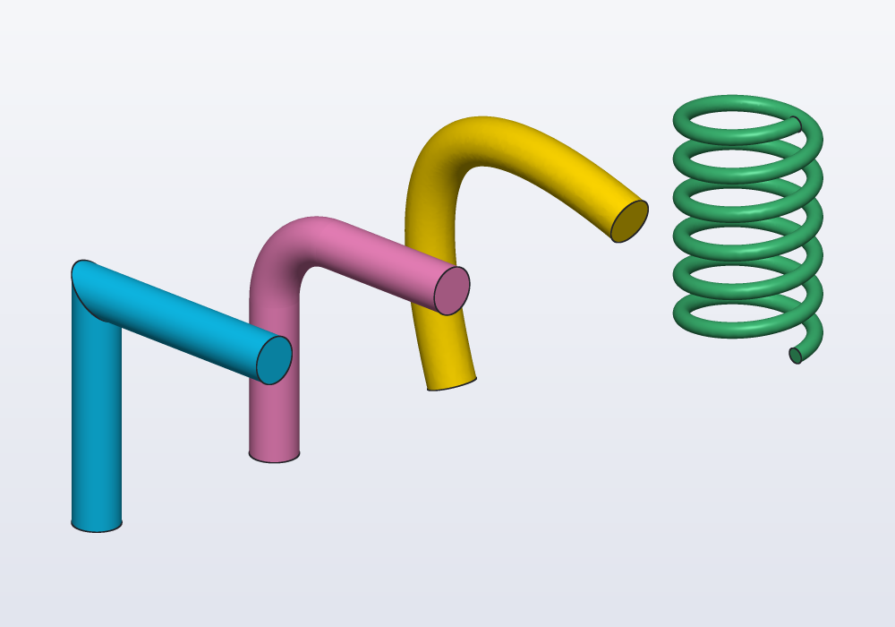
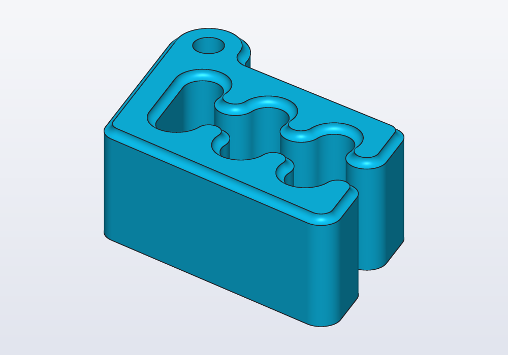
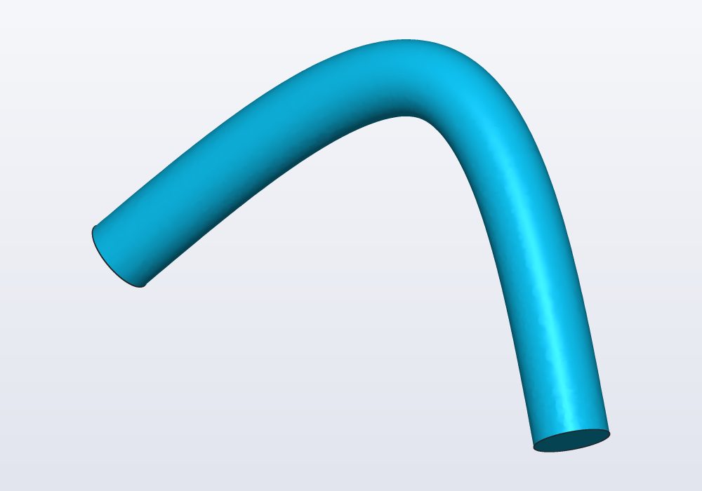
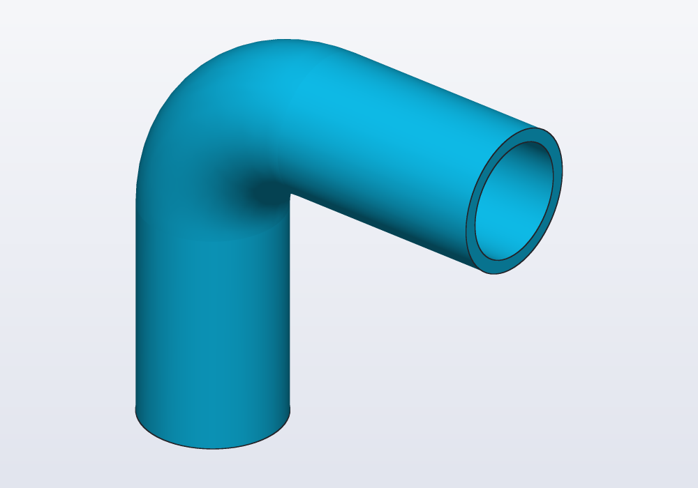
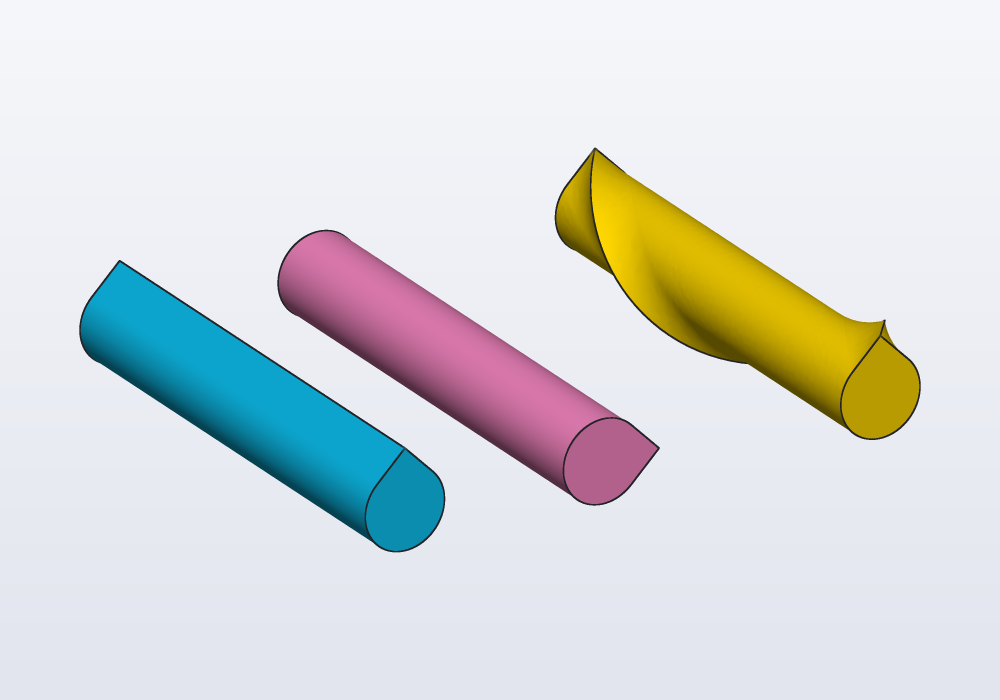
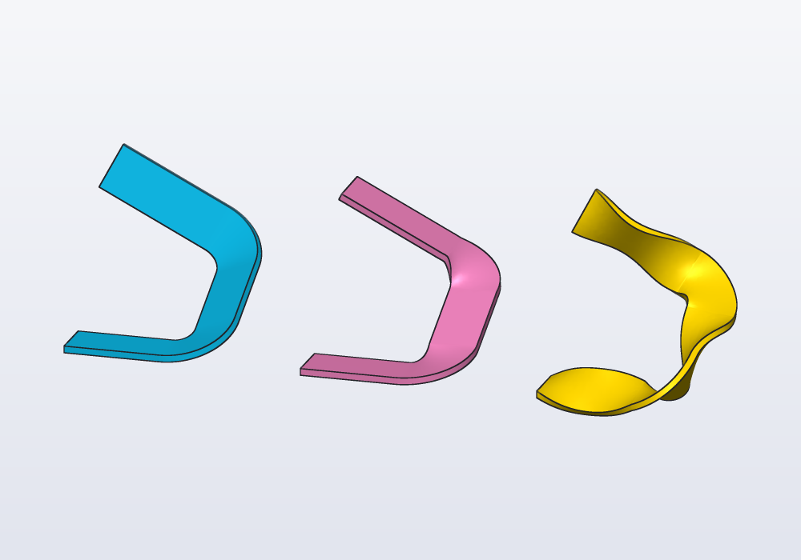
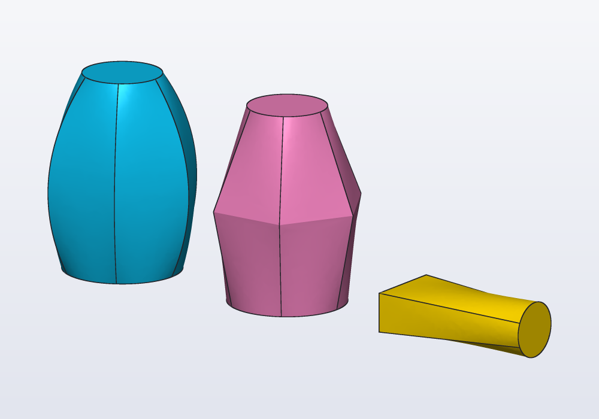
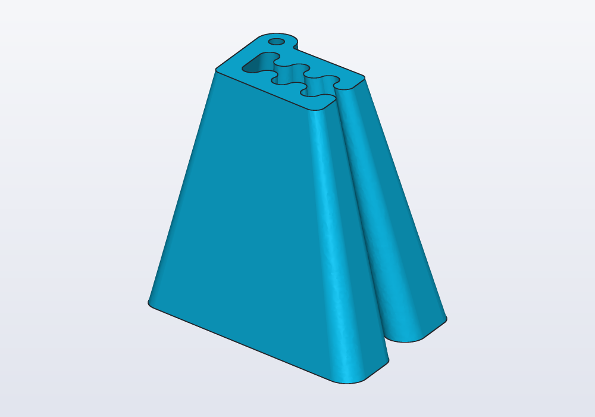
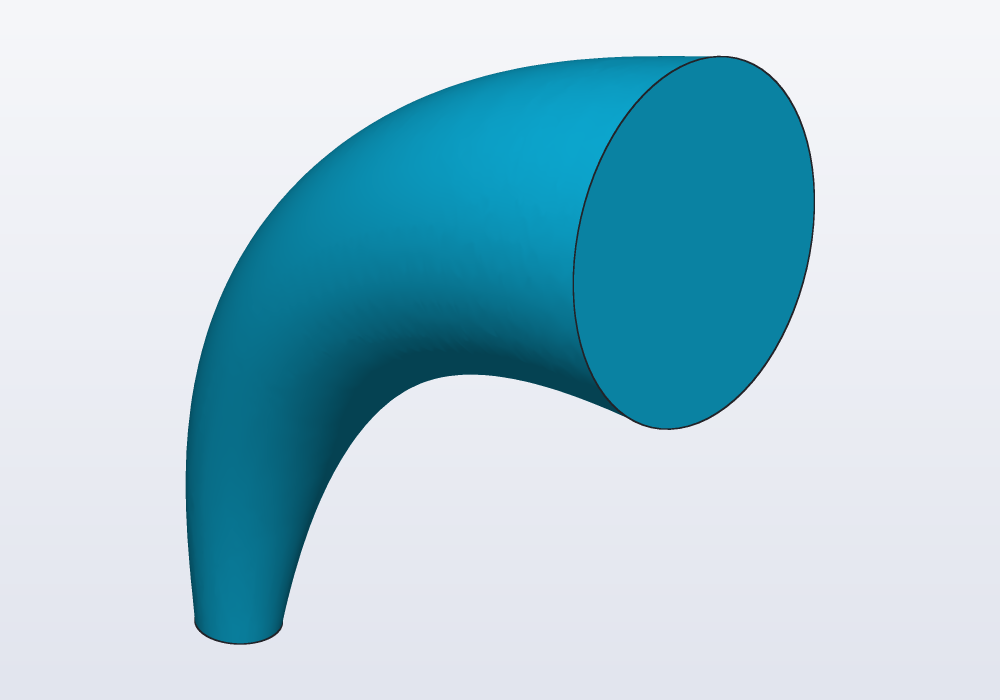
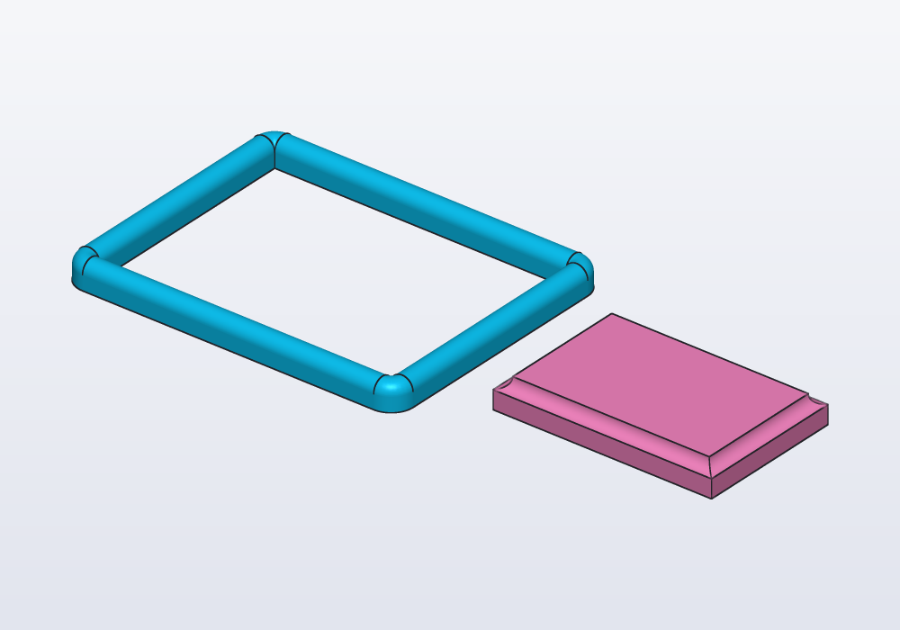

# Paths, sweeps and lofts

Shapes that follow a curve or change along their length: paths (straight, bent, splines, helices, from a sketch, from a solid's edges, from two views), sweeping a profile along a path and deciding how it rolls on the way (`up:`, `guide:`, `twist:`, `frenet:`), and lofting between profiles.



A *profile* is a flat outline, such as a circle or a rectangle. A *sweep* moves a profile along a curve and keeps the solid it passes through: a wire, a tube, a handle. A *loft* joins several profiles placed one after the other with a smooth skin: a vase that starts round and ends square.

## Paths

A `Path` is a curve in space, the route a sweep follows. It is not a part: it has no inside and does not combine with `+ - &`; you sweep along it, loft through it, or take frames on it.

| Path | What it makes |
|---|---|
| `path([p1, p2, p3])` | straight segments through the points, mitred corners (cut at an angle and joined, like a picture frame) |
| `path([...], closed: true)` | the same, back to the first point |
| `path([...], bend: 5.mm)` | every corner rounded by an arc of that radius: a bent tube or wire |
| `spline([...])` | a smooth curve through the points (a *spline*), curved all along (`closed: true` a loop) |
| `helix(d: 16.mm, pitch: 5.mm, height: 30.mm)` | a helix (the curve of a spring) round +Z, the pitch how far it rises in one turn, starting at (r, 0, 0); `left: true` left-handed |
| `s.path`, `s.paths` | what a sketch draws (below) |
| `body.path(edges.…)` | edges of a solid joined end to end (below) |
| `path(top, front)` | a curve in space from two views (below) |

Paths move, rotate and mirror like solids. The same three points, swept three ways, and a spring:

<!-- render: sweeps-paths --from 1,-1,0.6 -->
```d
// the same three points: mitred, bent round and
// a spline; then a spring along a helix

immutable pts = [vec(0, 0, 0), vec(0, 0, 30),
    vec(30, 0, 30)];

Profile wire() => circle(d: 6.mm);

@part("Sky Pop")
Solid mitred() => wire().sweep(path(pts));

@part("Pink Pop")
Solid bent() => wire().sweep(path(pts, bend: 10.mm))
    .move(y: 30.mm);

@part("gold")
Solid smooth() => wire().sweep(spline(pts))
    .move(y: 60.mm);

@part("mediumseagreen")
Solid spring() => circle(d: 2.mm)
    .sweep(helix(d: 16.mm, pitch: 5.mm, height: 30.mm),
        frenet: true)
    .move(x: 15.mm, y: 95.mm);
```


A `bend:` path is straight stretches and arcs of a radius you know, as a tube bender makes them: the right choice for pipes, rods and wires. A spline passes through its points but bulges past them (the gold one is 37.7 mm tall, not 30): use it for free, organic curves, and give it more points where it must stay close.

### From a sketch

A *sketch* is a flat drawing made of points, lines and arcs held in place by dimensions and relations (this line horizontal, that arc touching it). `s.path` is what a sketch draws, its lines, arcs, splines and circles (not construction ones), as one path, where the sketch lies. It follows the sketch's constraints, so a route drawn with its dimensions stays right when a `@param` changes. Draw it on the plane it belongs to: `sketch(XZ)` for a curve seen from the front. Mind that `s.polyline` closes unless `closed: false`. A sketch drawing several separate chains gives them in `s.paths`, in the order they are drawn.

### From a solid's edges

`body.path(edges.loop(faces.top))` joins the selected edges end to end: a bead along a rim, a groove round a lid, a gasket in its seat. The edges must make one chain.

<!-- render: sweeps-groove -->
```d
import std;

// a groove all round Carlo's top rim, slot included
Solid body() => carlo();

@part("Sky Pop")
Solid grooved() => body()
    - circle(d: 2.mm)
        .sweep(body().path(edges.loop(faces.top)));
```



### From two views

A handle or a bent rod is easy to draw from above and from the front, hard to write as points in space. `path(top, front)` is the curve that, seen across the first path's plane, is the first, and across the second's, the second. Both must cover the same stretch along the line they share (here X, from 0 to 60):

<!-- render: sweeps-ex1 -->
```d
// a handle drawn from above and from the front

Path topView()
{
    auto s = sketch(XY);
    s.spline([vec(0, 0), vec(30, 15), vec(60, 0)]);
    return s.path;
}

Path frontView()
{
    auto s = sketch(XZ);
    s.spline([vec(0, 0), vec(30, 25), vec(60, 0)]);
    return s.path;
}

@part("Sky Pop")
Solid handle() => circle(d: 8.mm)
    .sweep(path(topView(), frontView()));
```



## Sweeping

`profile.sweep(path)` moves a profile along a path. It is the way to make the same outline along a curve: a tube, a wire, a handle, a rail, a spring, a groove round a rim. Where the curve is a straight line, `extrude` does the same, faster and with simpler faces (to *extrude* is to push a flat outline straight up into a solid); where it is a circle, `revolve` does (it turns the outline round an axis: a pot, a knob, a ring). Draw the profile on XY around the origin: the origin rides on the path, and the profile starts at the beginning of the path, across it. Its +Y is kept towards world +Z (towards +Y when the path starts vertically); looking back at it from further along the path, it reads as drawn, x to the right, y up. Holes in the profile give tubes:

<!-- render: sweeps-ex2 -->
```d
// a bent tube, 16 mm outside, 1.5 mm wall

@part("Sky Pop")
Solid pipe() => (circle(d: 16.mm) - circle(d: 13.mm))
    .sweep(path([vec(0, 0, 0), vec(0, 0, 40),
        vec(40, 0, 40)], bend: 15.mm));
```



### How the profile rolls along the path

The profile always stays across the path; what can change is how it turns about it, its roll. A round wire does not care. A teardrop, a rail, a strip or a key profile does. By default it rolls as little as it can, which on a flat path keeps it as placed, but after bends in space leaves its +Y wherever it ends up. To decide the roll, give one of:

| Argument | What it does | Use it for |
|---|---|---|
| (none) | turns as little as it can | tubes, wires, anything round; flat paths |
| `up: Z` | its +Y as close to that way as it can be, all along | a road, a rail, a shelf edge that must not bank |
| `guide: rail` | its +Y towards the point as far along another path (halfway along the path: halfway along the rail) | paths going up and over, where `up:` cannot work; a roll you draw |
| `twist: 360.deg` | turns that much about the path, evenly | twisted ribbons, ropes, spiral flutes |
| `twist: t => …` | turned by the function's angle at `t`, 0 at the start, 1 at the end | a roll that swings or speeds up |
| `frenet: true` | follows the curvature | helices: springs, coils, threads |

Give one only: two of them are an error. On a straight line, the teardrop as placed, turned with `up: Y` to point sideways, and following a rail that winds once round the line:

<!-- render: sweeps-roll-line --from 1,-0.6,0.5 -->
```d
// one teardrop, one line, three ways to roll it

immutable line = path([vec(0, 0, 0), vec(60, 0, 0)]);

// a rail winding once round the line, from above it
immutable spiral = helix(r: 10.mm, pitch: 60.mm,
        height: 60.mm)
    .rotate(y: 90.deg)
    .rotate(x: 180.deg);

@part("Sky Pop")
Solid plain() => teardrop(d: 10.mm).sweep(line);

@part("Pink Pop")
Solid sideways() => teardrop(d: 10.mm).sweep(line, up: Y)
    .move(y: 25.mm);

@part("gold")
Solid guided() => teardrop(d: 10.mm)
    .sweep(line, guide: spiral)
    .move(y: 60.mm);
```



On a ramp that climbs and turns, the difference shows on a flat strip: by itself it banks on the last stretch, `up: Z` keeps it level, and a twist function swings it twice to each side and back:

<!-- render: sweeps-roll-ramp --from 0.3,-1,0.35 -->
```d
// a ramp that climbs and turns, three ways to roll
// a strip along it

immutable ramp = path([vec(0, 0, 0), vec(40, 0, 0),
    vec(40, 40, 20), vec(0, 40, 40)], bend: 12.mm);

Profile strip() => rect(14.mm, 2.mm);

@part("Sky Pop")
Solid least() => strip().sweep(ramp);

@part("Pink Pop")
Solid level() => strip().sweep(ramp, up: Z)
    .move(x: 70.mm);

@part("gold")
Solid swinging() => strip()
    .sweep(ramp, twist: t => 45.deg * sin(t * 720.deg))
    .move(x: 140.mm);
```



`up: Z` cannot work where the path itself runs up or down: there the profile's +Y has nowhere to point. That is an error that says where; give a `guide:` instead, a second path running beside the first (a copy of it moved sideways or up is often enough). A twist function counts from the start: at `t = 0` it should give `0.deg`, the profile as placed.

### Sweeping open curves

Sweep a curve instead of a profile, `path([vec(-8.mm, 0), vec(8.mm, 0)]).sweep(route)`, and the result is a `Surface`, an open sheet: a ribbon through the middle of anything swept along the same route. It is not a part; it splits solids, thickens into one, or sews with others. See [the guide on surfaces](surfaces.md).

## Lofting

A loft is for an outline that changes on the way: a vase, a nozzle, a square duct ending round. `loft([a, b, c])` makes a smooth solid through profiles placed in space, in order. `ruled: true` joins them with flat sides instead. Profiles with holes loft as tubes when every profile has the same number of holes. Stand a profile up with `across(X)` or `across(Y)` (as `extrude(along:)` stands it), not with `rotate`, to loft sideways:

<!-- render: sweeps-loft --from 1,-1.4,0.5 -->
```d
// the same three sections, lofted smooth and ruled,
// and a loft lying along X

Profile[] sections() => [
    circle(d: 30.mm),
    polygon(6, d: 40.mm).move(z: 25.mm),
    circle(d: 20.mm).move(z: 50.mm)];

@part("Sky Pop")
Solid smooth() => loft(sections());

@part("Pink Pop")
Solid ruled() => loft(sections(), ruled: true)
    .move(x: 50.mm);

@part("gold")
Solid lying() => loft([
        rect(20.mm, 10.mm).across(X),
        circle(d: 14.mm).across(X).move(x: 40.mm)])
    .move(x: 85.mm, z: 5.mm);
```



Any profile can be a section of a loft, a solid's outline too. `carlo().projection` is Carlo seen from above, as a flat outline (Carlo is hackerscad's mascot, a bag clip about 41 x 29 mm, lying flat): lofted up into a copy half its size, it rises into a tower with the slot and the keyring hole all the way up:

<!-- render: sweeps-carlo-loft --from 1,-1,0.6 -->
```d
import std;

// Carlo's outline seen from above, lofted up into a
// smaller copy of itself
Profile outline() => carlo().projection;

@part("Sky Pop")
Solid tower() => loft([outline(),
    outline().scale(0.5).move(x: 5.mm, z: 30.mm)]);
```



Profiles drawn in sketches on different planes or faces loft from where they lie. For a hollow loft, loft the same sections shrunk with `.offset(-wall)` and subtract it (see `examples/dev/sweep.hcad`).

Lofting through paths instead of profiles, `loft([path1, path2])`, gives a `Surface` (see [the guide on surfaces](surfaces.md)).

### Along a curve: frames

A sweep keeps its profile the same size. For an outline that grows or changes along a curve, place profiles on `path.frames(n)`. A *frame* is a place with its own directions, as a small set of X, Y and Z axes standing somewhere in space; a profile placed on one lies across its Z. `frames(n)` gives n frames evenly along the path, from its start to its end (round a closed one, the start not repeated), Z along it and turning as little as they can, so the profiles placed on them do not twist. Then loft:

<!-- render: sweeps-ex3 -->
```d
// a horn: circles on frames along a curve, growing

immutable curve = spline([vec(0, 0, 0), vec(10, 0, 30),
    vec(40, 0, 45)]);

@part("Sky Pop")
Solid horn()
{
    Profile[] rings;
    foreach (i, f; curve.frames(6))
        rings ~= circle(d: 6.mm + 4.mm * i).placeOn(f);
    return loft(rings);
}
```



With `along: curve` the profiles are blended along the curve itself, its centreline, rather than straight from one to the next: the loft follows the curve between them even where they are few (two or three rings on a bend).

### How it leaves and arrives: start and end

A loft from one profile to the next goes the shortest way. `start:` and `end:` give the direction it leaves the first profile and reaches the last: a spout that rises straight out of a body before it bends, a duct that meets its flange square. `weight:` says how strongly the direction holds (1 by default; 2 holds it about twice as far).

```d
// a duct between two openings 30 mm apart, leaving and arriving upright

@part("Sky Pop")
Solid duct() => loft([circle(r: 5.mm), circle(r: 5.mm).move(x: 30.mm, z: 40.mm)],
    start: Z, end: Z);
```

For textured shapes with many rings, `loft` also takes rings of points (`Vec3[][]`), much faster: see *Textures and noise* in the [language reference](../LANGUAGE.md) and `examples/03_randomvase.hcad`.

## Moldings

A *molding* is a profile run round an outline that closes: the frame of a picture, the rim of a tray, the decorated edge of a table. `molding(outline, profile)` builds it. The profile is drawn as if you cut through the molding: its x is how far from the outline (outwards), its y how high above the outline's plane. Round the outline's corners it turns about the corner itself, as a router does going round the edge of a board; with `inward: true` it runs inside the outline instead, its corners meeting in a mitre, as the pieces of a frame do.

The same idea shapes a part's edge: take off the shape a router bit would, and the edge is left with its profile. A quarter circle taken off the top edge of a plate leaves a cove (a hollow round edge) all round:

<!-- render: sweeps-molding -->
```d
// a frame round a picture, and a plate whose top
// edge was routed into a cove

// the frame's cut: a flat strip with a round bead on it
immutable bead = rect(vec(0.mm, 0.mm), vec(6.mm, 4.mm))
    + circle(vec(3.mm, 4.mm), r: 3.mm);

@part("Sky Pop")
Solid frame() => molding(rect(80.mm, 60.mm), bead);

// a quarter of a circle, inside the edge, below its top
immutable cove = rect(vec(0.mm, -3.mm), vec(3.mm, 0.mm))
    & circle(r: 3.mm);

@part("Pink Pop")
Solid plate() => (box(60.mm, 40.mm, 8.mm)
        - molding(rect(60.mm, 40.mm).move(z: 8.mm), cove,
            inward: true))
    .move(x: 90.mm);
```



The outline is a closed path, or a profile (its outer edge); it must be flat. The profile is one piece: a molding whose cut has two separate parts is two moldings.

## The parameters

| Call | Parameter | What it does | Default |
|---|---|---|---|
| `path` | `points` | the corners, `vec(x, y, z)` | — |
| | `closed:` | back to the first point | `false` |
| | `bend:` | the radius of the arc at every corner | sharp, mitred |
| `spline` | `points`, `closed:` | a smooth curve through them | open |
| `helix` | `r:` or `d:`, `pitch:`, `height:` | round +Z, from (r, 0, 0) | — |
| | `left:` | left-handed | `false` |
| `sweep` | `path` | where the profile goes | — |
| | `up:` | the direction its +Y keeps to | world +Z, as little roll as it can |
| | `guide:` | a path its +Y points at | — |
| | `twist:` | an angle, or `t => angle` for 0…1 along | `0.deg` |
| | `frenet:` | follow the curvature | `false` |
| `loft` | `profiles` | profiles (a solid) or paths (a surface), at least 2 | — |
| | `ruled:` | flat sides between the sections | `false` |
| | `along:` | a path, its centreline: the profiles blended along it, each where it lies across it | straight between them |
| | `start:`, `end:` | the directions it leaves the first profile and reaches the last | free |
| | `weight:` | how strongly `start:` and `end:` hold, 0 to 4 | `1` |
| `frames` | `n` | how many frames, ends included | — |
| `molding` | `outline`, `profile` | the profile (x away from the outline, y up) run round the closed outline | — |
| | `inward:` | inside the outline, its corners mitred | `false`: outside, its corners round |

## Common errors

| Message | What to do |
|---|---|
| *at 35% of its way the path runs along up: there the profile's +Y cannot point up; give a guide instead* | the path goes straight up somewhere: use `guide:` |
| *the path starts along up* | the same, at the start |
| *frenet and twist both decide how the profile turns about the path: give one* | one of `up:`, `guide:`, `twist:`, `frenet:` only |
| *bend 8 mm does not fit between points 1 and 2: the side is 5 mm, its corners' arcs need 8 mm* | a smaller bend, or the points further apart |
| *the guide starts straight ahead of the path: it must run beside it* | the guide must keep away from the path, to one side |
| *path failed: invalid path (repeated points?)* | two points in a row are the same |
| *the sketch draws 2 separate chains: s.paths[i] takes one* | join them end to end, make the others construction, or use `s.paths` |
| *the edges make 24 separate pieces: a path is one chain, end to end* | select edges that join: `edges.loop(…)`, `edges.chain(…)` |
| *cannot combine a Path with '+': sweep a profile along it first* | a path is not a part |
| *every profile of a loft with holes needs the same number of holes* | add or remove holes so the counts match |
| *molding failed: a molding runs round a closed outline* | close the path (`closed: true`), or give a profile's outline |
| *the profile is several separate pieces* | one molding per piece of its cut |
| *not a valid closed solid (… overlapping sweep or fold?)* (warning) | the profile is wider than a bend is tight: a bigger `bend:`, a smaller profile, a smoother spline |

## In the application

There is no menu entry for a sweep or a loft: they are written in the code. The application helps with what they are made of:

- **Paths from a sketch:** in the sketch toolbar, the line tool and **Smooth curve** (∿) draw open chains; the code they write gives `s.path`. Right-click a flat face, **Sketch on face…**, to draw a route on it.
- **Paths from edges:** click an edge, right-click, **Select the chain** to take every edge running on from it without a corner (on a face: **Edges › Select its outer edges**); then **Copy as code → Edge selector** gives the selector for `body.path(…)`.
- **Seeing a path:** **Inspect** (Ctrl+I, Cmd+I on a Mac; or Ctrl+click a line of code) shows in orange what a line makes, paths included; in the **Steps** panel a function returning a path says *returns a path*.
