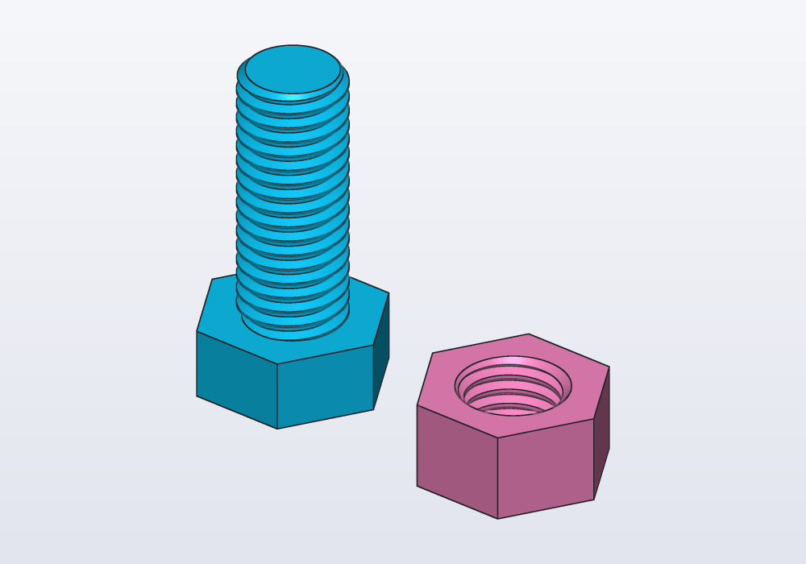
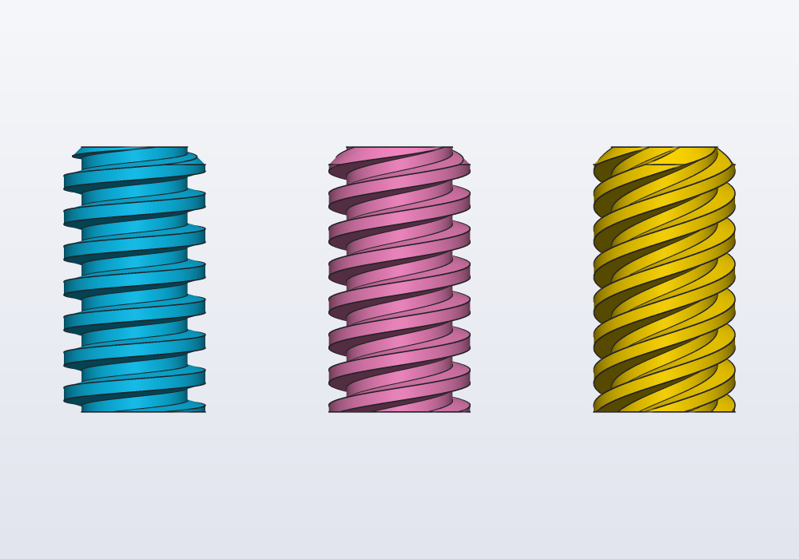
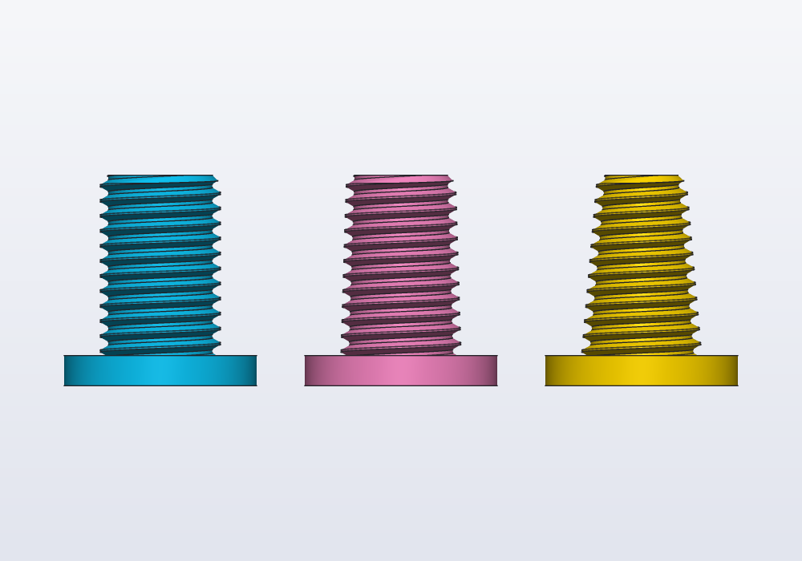

# Threads

A real helical thread on a shaft or in a hole: ISO metric, inch, trapezoidal and ACME, buttress, pipe threads, lamp bases, bottle necks. Which one to choose, how to recognise one on a real object, every parameter, and how to print it.

## When to use one

A printed thread is right when the part must screw onto something that already has one (a tap, a hose, a bottle, a camera, a pipe), or when screwing is the point (a lid, a lead screw, a knob that tightens). To hold printed parts together with ordinary screws, a thread is often the wrong answer:

| You want | Use |
|---|---|
| an M2–M4 screw into plastic | a hole for a heat-set insert or a self-tapping screw (`hole()`, see the guide *Holes and hardware*) |
| an M5–M12 screw into plastic that is screwed in once | a printed thread works; an insert is stronger |
| a lid, a cap, a knob that turns often | a printed thread, coarse, often with more starts |
| a part that screws onto a real thing | the thread of that thing: never guess it, measure it (below) |

## Choosing a thread

By what it does:

| Thread | Use it for | Found on |
|---|---|---|
| ISO metric coarse `"M8"` | holding parts together: the default | most things in Europe |
| ISO metric fine `"M8x1"` | fine adjustment, thin walls | lens rings, bicycles |
| Unified inch `"1/4-20 UNC"`, `"1/4 UNF"`, `"#10-32"` | meeting American things | cameras and tripods (1/4-20, 3/8-16) |
| Trapezoidal `"Tr12x3"`, ACME `"1/2-10 ACME"` | moving a load | vices, lathes, 3D printers' Z axis |
| Buttress `"S20x4"` | a load one way only | presses, big caps |
| BSP parallel `"G1/2"` | pipes sealed by a gasket on a face | taps, hoses, showers, filters |
| BSP tapered `"R1/2"`, `"1/2 NPT"` | pipes sealed by the thread | plumbing, gas, compressed air |
| Edison `"E27"`, `"E14"` | lamp bases and sockets | bulbs |
| Necks `"28-400"`, `"PCO 1881"` | caps for bottles and jars | cosmetics, lab bottles, soft drinks |
| Garden hose `"3/4 GHT"` | American hoses | US taps (in Europe: G3/4) |

The rule of thumb: water or air goes through it, a pipe thread (G, R, NPT); it holds parts together, ISO metric. G1/2 (⌀20.96) and M20 look alike and do not mix.

The tooth profiles differ; side by side, the same 20 mm shaft cut with five of them:

<!-- render: threads-profiles --from front -->
```d
// one shaft per family, each with the thread's own profile

Solid shaft(Length d) => cylinder(d: d * 1.5, h: 4.mm)
    + cylinder(d: d, h: 20.mm).move(z: 4.mm);

@part("Sky Pop")
Solid iso() => shaft(20.mm).thread(faces.largest, "M20");

@part("Pink Pop")
Solid trapezoid() => shaft(20.mm).thread(faces.largest, "Tr20x4")
    .move(x: 40.mm);

@part("gold")
Solid buttress() => shaft(20.mm).thread(faces.largest, "S20x4")
    .move(x: 80.mm);

@part("mediumseagreen")
Solid pipe() => shaft(20.955.mm).thread(faces.largest, "G1/2")
    .move(x: 120.mm);

@part("tomato")
Solid edison() => shaft(26.45.mm).thread(faces.largest, "E27")
    .move(x: 165.mm);
```


## Recognising a thread on a real object

To screw something onto a real part, measure it:

1. The outer diameter of the male thread, over the crests, with calipers. From a female one: its inner diameter plus about twice the tooth's depth, or try a known screw in it.
2. The pitch: count the crests over 10 mm (pitch = 10 / count), or over an inch, 25.4 mm (threads per inch). A thread gauge gives it at once.
3. A taper: a diameter different near the tip and near the base means R or NPT.
4. How it seals: a gasket or an O-ring on a flat face, G; PTFE tape on the threads, tapered.
5. Match the table:

| Outer diameter | Pitch | Thread |
|---|---|---|
| 6.35 mm | 1.27 mm (20/inch) | 1/4-20 UNC (cameras) |
| 9.53 mm | 1.59 mm (16/inch) | 3/8-16 UNC (tripod heads) |
| 13.16 mm | 1.34 mm (19/inch) | G1/4, R1/4 |
| 20.96 mm | 1.81 mm (14/inch) | G1/2, R1/2 (taps, showers) |
| 21.34 mm | 1.81 mm (14/inch) | 1/2 NPT |
| 26.44 mm | 1.81 mm (14/inch) | G3/4 (garden taps, washing machines) |
| 26.45 mm | 3.63 mm, round | E27 (bulbs) |
| 27.43 mm | 2.7 mm | PCO 1881 (PET bottles) |
| 27.38 mm | 4.23 mm (6/inch) | 28-400 (bottles) |
| M sizes | 0.5 (M3), 0.7 (M4), 0.8 (M5), 1 (M6), 1.25 (M8), 1.5 (M10), 1.75 (M12), 2 (M16) mm | ISO metric coarse |

The full list of the sizes known is under *Threads: choosing one, recognising one* in the [language reference](../LANGUAGE.md).

## Cutting a thread on a face

`body.thread(face, size)` threads a cylindrical face of a solid. Make the cylinder first, at the right size:

- **a shaft** at the thread's nominal (major) diameter: ⌀8 for M8;
- **a hole** at the tap drill, about the nominal diameter less one pitch: ⌀6.8 for M8, ⌀17.5 for M20.

A cylinder far from the thread's size is an error that says what it wants. The thread starts from the **free end**: the tip of the shaft, the opening of the hole.

<!-- render: threads-bolt-nut -->
```d
// a printed M12 bolt and its nut

@param("Play of the nut (each side)", min: 0.1.mm, max: 0.5.mm)
immutable play = 0.2.mm;

@part("Sky Pop")
Solid bolt() => (polygon(6, d: 19.mm, fit: "sides").extrude(8.mm)
        + cylinder(d: 12.mm, h: 30.mm).move(z: 8.mm))
    .thread(faces.largest, "M12");

@part("Pink Pop")
Solid nut() => (polygon(6, d: 19.mm, fit: "sides").extrude(10.mm)
        - cylinder(d: 10.3.mm, h: 30.mm, center: true))
    .thread(faces.largest, "M12", clearance: play)
    .move(x: 30.mm);
```



Picking the face: here the threaded cylinder is the largest face of each part; when it is not, `faces.filter(f => f.area > …)` or a face picked in the 3D view (right-click it, below).

## The parameters

| Parameter | What it does | Default |
|---|---|---|
| `size` | the standard, by name: `"M8"`, `"M8x1"`, `"1/4-20 UNC"`, `"Tr12x3"`, `"G1/2"`, `"28-400"`… | — |
| `pitch:` | alone: an ISO 60° thread of that pitch on the cylinder's own diameter; with a size, overrides its pitch | the size's |
| `length:` | how much of the face is threaded, from the free end | the whole face |
| `turns:` | the same, in turns (`turns: 1.5` for a 410 bottle neck) | — |
| `flip:` | start from the other end | `false` |
| `starts:` | multi-start: that many threads side by side, the lead `starts × pitch` | `1` |
| `left:` | left-handed | `false` |
| `clearance:` | play each side, for printed parts | `0.15.mm` in holes, `0` on shafts |
| `chamfer:` | the 45° bevel at the free end, to start the screw | `true` |
| `taper:` | the angle each side leans from the axis: a conical thread | R and NPT 1.79°, others 0 |

### Starts

A lead screw that moves fast, or a lid that closes in a quarter turn, has more threads side by side: with `starts: 2` each turn advances two pitches. The teeth stay the same size.

<!-- render: threads-starts --from front -->
```d
// one, two and four starts: the same tooth, the lead 1, 2 and 4 times the pitch

Solid rod() => cylinder(d: 16.mm, h: 30.mm);

@part("Sky Pop")
Solid one() => rod().thread(faces.largest, "Tr16x4");

@part("Pink Pop")
Solid two() => rod().thread(faces.largest, "Tr16x4", starts: 2)
    .move(x: 30.mm);

@part("gold")
Solid four() => rod().thread(faces.largest, "Tr16x4", starts: 4)
    .move(x: 60.mm);
```



### Tapered threads

R and NPT pipe threads narrow by 1 in 16 on the diameter (1.79° each side): screwed in, they wedge tight and seal. `taper:` makes any thread conical; `taper: 0.deg` makes R or NPT parallel. The nominal size stays at the fixed end, and the thread narrows towards the tip of a shaft or deeper into a hole.

<!-- render: threads-taper --from front -->
```d
// an M20, parallel, tapered like a pipe thread, and steeply tapered

Solid shaft() => cylinder(d: 32.mm, h: 5.mm)
    + cylinder(d: 20.mm, h: 30.mm).move(z: 5.mm);

@part("Sky Pop")
Solid parallel() => shaft().thread(faces.largest, "M20");

@part("Pink Pop")
Solid pipeLike() => shaft().thread(faces.largest, "M20", taper: 1.79.deg)
    .move(x: 40.mm);

@part("gold")
Solid steep() => shaft().thread(faces.largest, "M20", taper: 5.deg)
    .move(x: 80.mm);
```



## Two threads on one bolt

Every thread is at the same angle at its free end, so a shaft and a hole threaded from the same free end mesh, whatever their lengths. That is how to make a nut that runs on a bolt: thread a tube over the bolt's whole length, from the same tip, and take the nut out of it where it should be. The Examples menu's **Dual-thread bolt** (`examples/11_dualthread.hcad`) goes further: its shank carries an M24 right-handed and a Tr24x5 left-handed thread at once (the shank cut by both, `threaded("M24", false) & threaded("Tr24x5", true)`), and two nuts, one on each thread, screw down it turning opposite ways. Tightened against each other they lock: what would loosen one tightens the other. Its `unittest` checks that both nuts run free, at any turn of the "Turn the nuts" parameter.

## Loose threads: the threads library

`thread()` cuts a face that is already there. The `threads` library makes a loose threaded rod, or a tool to subtract:

```d
import threads;

// an M8 rod 40 mm long, and an M8 thread cut 12 mm into a block
@part Solid rod() => threadedRod(8.mm, 1.25.mm, 40.mm);
@part Solid block() => box(20, 20, 15) - tappedHole(8.mm, 1.25.mm, 12.mm).move(x: 10.mm, y: 10.mm, z: 15.mm);
```

`isoThread(d:, pitch:, length:, chamfer:)` is the builtin underneath, an exact ISO thread. For anything that is not an ISO metric thread, or for starts and tapers, use `thread()` on a cylinder.

## Printing threads

- Under M5 they print badly: use a heat-set insert or a self-tapping screw.
- M6 to M12 print well standing up, with 0.15 to 0.3 mm of play (`clearance:`). Print a short test piece first: printers differ.
- A lid that opens often wants a coarse pitch (2 to 4 mm), and more starts for less turning.
- Caps for bottles: 0.3 to 0.5 mm of play, in PETG (it flexes onto the neck's seal, where PLA cracks). A 400 neck has about one turn of thread, 410 one and a half, 415 two: `turns:`.
- Lying on its side a thread comes out rough on its underside: print threaded parts standing whenever you can.

## Common errors

| Message | What to do |
|---|---|
| *the shaft is ⌀7 mm: a M8 thread wants ⌀8 mm* | make the shaft at the nominal diameter |
| *the hole is ⌀8 mm: a M8 thread wants a hole of about ⌀6.9 mm (the tap drill)* | make the hole at the tap drill, not at the nominal size |
| *the size names a thread…* | the name is not known: the message lists the forms that are |
| *the face is only part of a cylinder* | a thread needs the whole circle: thread before cutting a flat or a slot |
| *the faces are not one cylinder* | the selector caught two cylinders: filter them apart |
| *a taper of …° narrows the thread to nothing* | a smaller angle or a shorter length |

## In the application

Right-click a cylindrical face in the 3D view: **Thread (outside)** on a shaft, **Thread (in the hole)** in a hole, lists the sizes that fit that diameter. Choosing one writes the `.thread(…)` line in the code, where you add `starts:`, `clearance:` and the rest.

## With an AI agent

An agent reads this guide with `hcad_docs` (format `guide`, topic `threads`), or `hcad docs --guide threads` from the command line. It follows these rules:

- When the part screws onto something that exists, it never guesses the thread: it asks which one it is, or tells you how to find out (outer diameter, pitch, taper, how it seals), as above.
- When the design is free to choose, it proposes one and says why: ISO metric coarse to hold parts together, G where water or air flows, Tr or ACME to move a load, a coarse multi-start thread for a lid. Under M5 it proposes an insert.
- In the application it uses `hcad_gui_feature` with action `thread` and a size, which does what the right-click menu does.
- It checks the result: the model must check, and a bolt and nut can be tested by a `unittest` (their volumes, the play) before printing.
