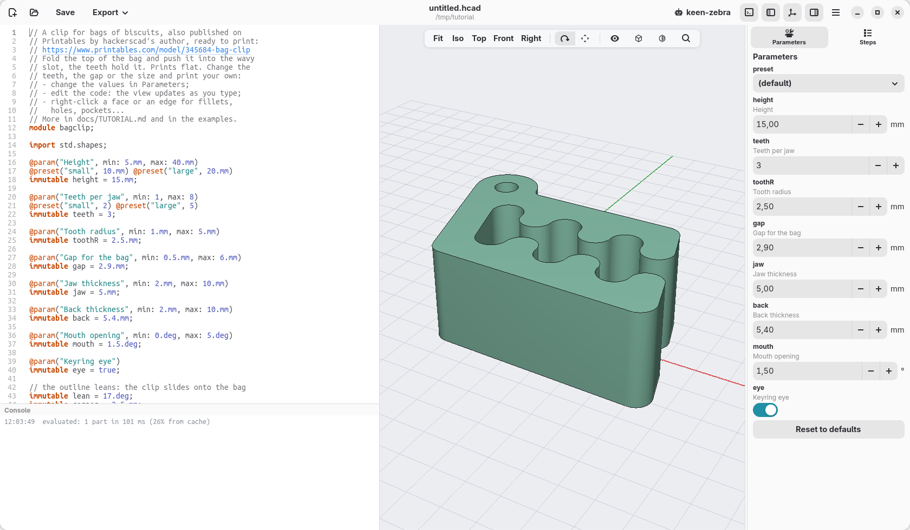

[Contents](../TUTORIAL.md) · [The window →](02-the-window.md)

# 1. Install and first start

On this page you install hackerscad and open it for the first time.

## Install

Download the package for your system from the
[releases](https://github.com/trikko/hackerscad/releases).

- **Linux:** the file is `hackerscad-<version>-x86_64.AppImage`. Make it
  executable and run it:

  ```sh
  chmod +x hackerscad-*-x86_64.AppImage
  ./hackerscad-*-x86_64.AppImage
  ```

- **Windows:** unzip `hackerscad-<version>-windows-x86_64.zip` anywhere and
  run `hackerscad.exe` in the `hackerscad` folder. The program is not signed:
  if Windows stops it ("Windows protected your PC"), choose **More info**,
  then **Run anyway**. On computers without a recent enough graphics card,
  such as virtual machines, it draws the 3D view with the software it ships
  with.
- **macOS** (Apple Silicon): unzip `hackerscad-<version>-macos-arm64.zip` and
  move `hackerscad.app` to Applications. The app is not signed by an Apple
  developer, so macOS says it is damaged unless you clear the marks it puts on
  downloaded files. In the Terminal:

  ```sh
  xattr -cr /Applications/hackerscad.app
  ```

  then open it as any other app.

Building it from the source code is explained in the
[README](../../README.md#building).

## The first start

Open hackerscad. A window opens on an example: a clip that keeps bags of
biscuits closed, something to play with.



Move around the model with the mouse, in the big area in the middle:

- **drag with the right button** to turn it;
- **drag with the middle button** (or Ctrl and the right button) to move it;
- **turn the wheel** to zoom in and out, towards the pointer;
- **Fit**, in the bar over the view, frames the whole model again; **Iso**,
  **Top**, **Front** and **Right** look at it from those sides.

The left button is for clicking things, as you will see. If you prefer to
turn the view with it, the two buttons with the arrows in the bar choose what
a left drag does.

## Check

You see the clip, and you can turn it, zoom and frame it again. If the 3D
view stays empty or shows a message instead, the graphics of the computer are
the problem: the message says what to do.

[Contents](../TUTORIAL.md) · [The window →](02-the-window.md)
