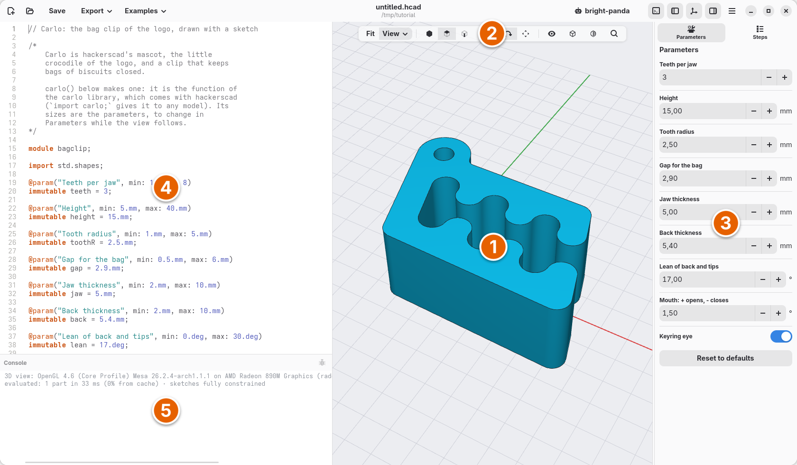
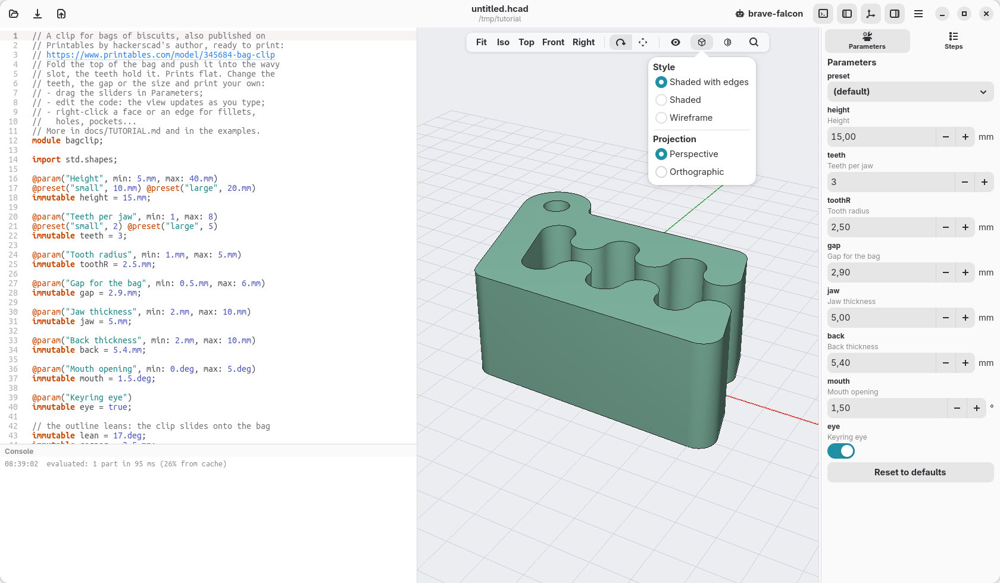
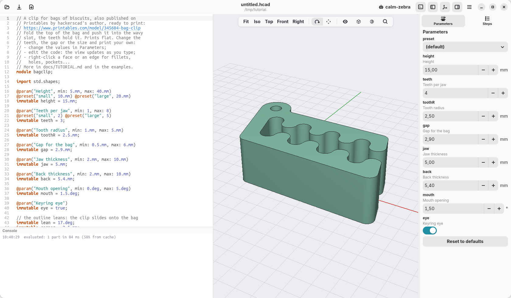

[← Install](01-install.md) · [Contents](../TUTORIAL.md) · [The first block →](03-the-first-block.md)

# 2. The window

Before building anything, a tour of the window: what each part is for. The
bag clip is still open; we use it to try things.

1. **The view.** The model as the code describes it. Drag with the right
   button to turn it, with the middle one to move it, and use the wheel to
   zoom. Clicking a face selects it and highlights the line of code that made
   it; right-clicking opens the things you can do there, among them
   **Move…** and **Rotate…**: drag the X, Y and Z arrows (or the frame
   under the part, across), or the knobs of the three rings round it, one
   after the other; the bar reads how far, and the ✓ next to the part
   writes one `.move()` or one `.rotate()` into the code (the X leaves it
   as it was). With a face picked, **Rotate around its normal…** (its axis,
   for a round face) gives one ring around it; with an edge, **Rotate around
   this edge…** turns the part on it as on a hinge. **Split…** puts a plane as big as the part on it, moved like
   the section's: its ✓ cuts the part there into a part per piece
   (more than two when the plane crosses a slot), each in its colour. **Colour** offers
   hackerscad's own bright colours (Sky Pop, Pink Pop…), and writes the
   name of the one you pick into the part's `@part`; **Other…** opens a
   wheel where every hue is as bright as those, the part showing each one
   until you Apply it (or Cancel).
2. **The view bar.** Fit, and the views in the **View** menu (Iso, Top,
   Front, Right); four buttons for what a click picks, **whole parts, faces,
   edges or vertices** (Alt+1 to Alt+4; the choice is kept): the right-click
   menu offers what fits it, picked faces are striped, a picked part dotted;
   how a left drag moves the view; the eye, to hide or show the parts, the ground grid and
   the axes; the cube, to choose how the parts are drawn; the section, to cut
   the model and look inside (parallel to the face you picked, if any; drag
   the squares at the plane's corners to move it, the X past them closes it); the magnifying glass, to see what a line
   of code makes.
3. **Parameters and Steps.** Two tabs. *Parameters* has the sizes the model
   lets you change, without touching the code; *Steps* shows how the model is
   built, one step at a time.
4. **The code.** A model in hackerscad is a short text, written in a small
   language. You will rarely start from an empty page: the mouse writes most
   of it for you, and the few lines to type are given in this tutorial, ready
   to copy. Every change shows in the view while you type.
5. **The console.** What the model writes, its checks, and the messages of
   hackerscad itself (evaluated, saved, exported).

The buttons at the top left start a new model, open one, save it and export
it (Ctrl+N, Ctrl+O, Ctrl+S, Ctrl+E; on macOS, Cmd in place of Ctrl, here and
in the rest of this tutorial). **Examples** opens ready models to try: the
bag clip, the espresso cup of the README, the planter this tutorial builds, a tour
of the language that shows `if`, `for`, `while`, `switch`, functions and
structs, each with what it makes appear, and more complete models. The buttons at the top right show or hide
the console, the code, the view and the parameters (Ctrl+J, F7, F8, F9). The
menu (☰) has New, Open, Save As,
Export, the Cheatsheet, this tutorial, and the style: light, dark, or as the
system is set.

## Change a size

In **Parameters**, find **teeth** ("Teeth per jaw") and click **+**: the clip
gets one more tooth on each jaw. The code does not change: parameters are
values you try on the model. **Reset to defaults** brings back the ones in the
code, and the **preset** menu at the top chooses ready-made sets of values
(here *small* and *large*).

## How the parts are drawn

The cube in the view bar opens a small menu:

- **Shaded with edges**, the usual way; **Shaded**, without the edges;
  **Wireframe**, only the edges, the hidden ones fainter: useful to see
  inside.
- **Printability**, a check box over any of these styles, for 3D printing:
  what overhangs more than 45° and needs supports is striped red, walls
  thinner than 0.8 mm are cross-hatched violet; the two fields under it
  change the limits, and the status line gives the areas. On a part of a
  near colour these marks turn darker, and what marks a picked face turns
  blue on a yellow or orange part, so that they always show.
- **Perspective**, as a photo; **Orthographic**, where sizes do not change
  with the distance: the Front, Top and Right views become true drawings.
- **Shine**: **None**, matte, each flat face one even tone; **Normal**, a
  small highlight on curves; **High**, a shiny material with soft highlights
  on every curve. The choice is kept.

## The cheatsheet

Press F1: a window lists everything the language has, one line each, with
recipes for common tasks ("hole", "copy", "round"). Type in its search field to
filter it. You will not need it in this tutorial, but it is there when you
want to write a model of your own.

## Check

The clip has four teeth per jaw.

[← Install](01-install.md) · [Contents](../TUTORIAL.md) · [The first block →](03-the-first-block.md)
