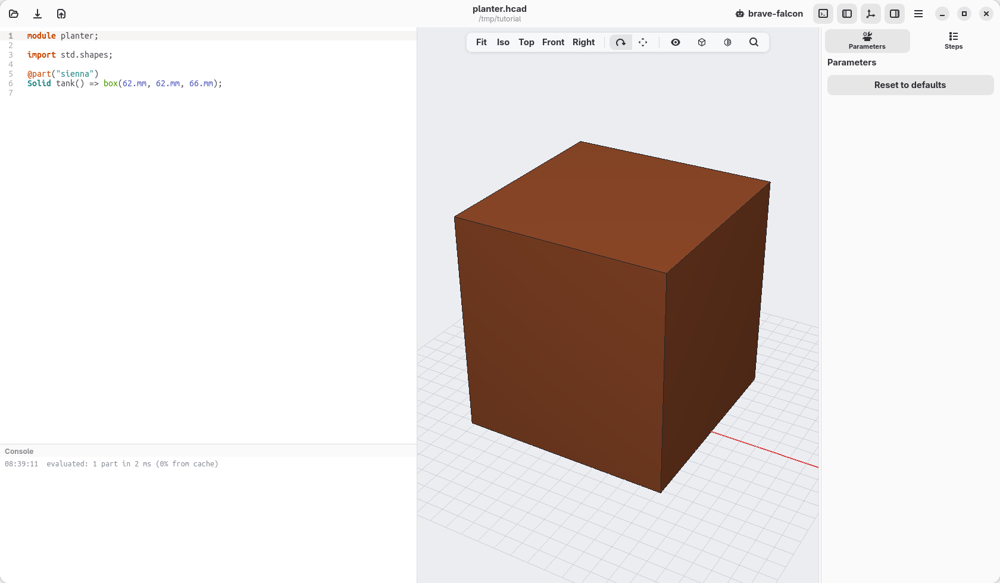
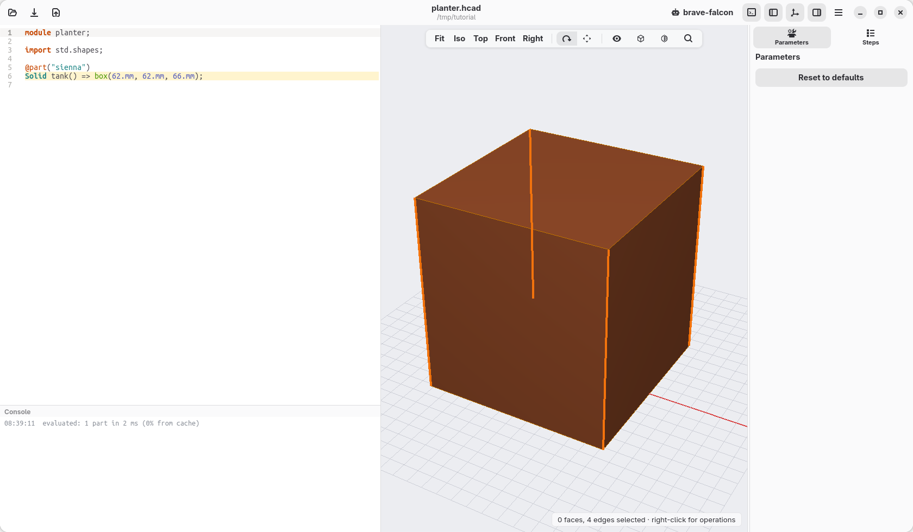
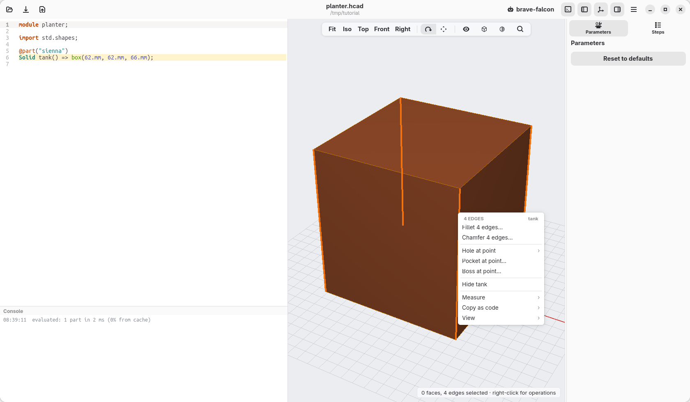
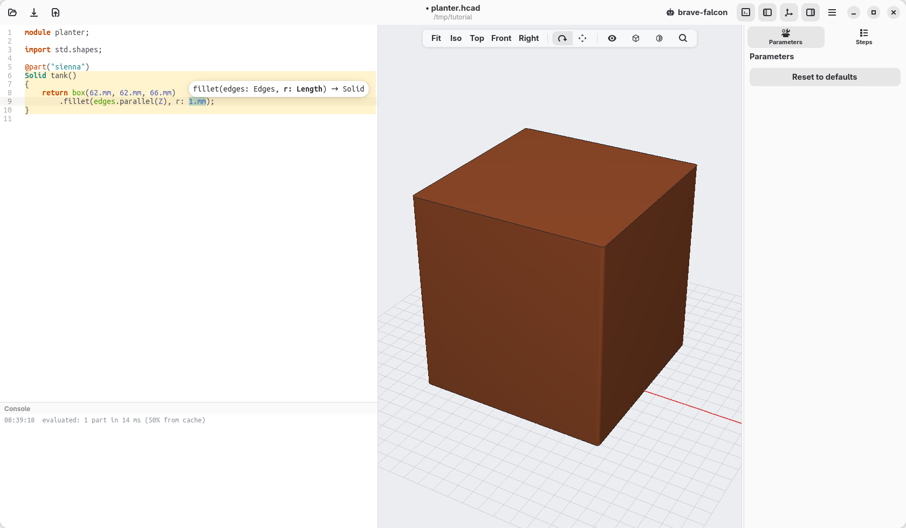
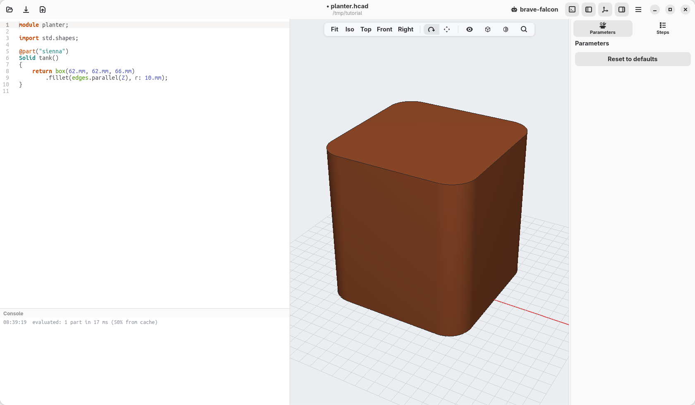

[← The window](02-the-window.md) · [Contents](../TUTORIAL.md) · [Shape the tank →](04-shape-the-tank.md)

# 3. The first block

Every model starts from a simple shape. Ours is a block, and by the end of
this page it has the rounded corners of the tank, the part of the planter
that holds the water.

## A new model

1. Open the menu (☰, top right) and choose **New**, or press Ctrl+N. The bag
   clip appears: every new model starts from it.
2. Select all its code (Ctrl+A) and type, or paste, these lines in its place:

   ```d
   module planter;

   import std.shapes;

   @part("sienna")
   Solid tank() => box(62.mm, 62.mm, 66.mm);
   ```

3. Save it (Ctrl+S) as `planter.hcad`, in a folder of your own.

The view shows a block at once. What the lines say:

- `module planter;` is the name of the model.
- `import std.shapes;` makes the basic shapes available: boxes, cylinders,
  spheres and the like.
- `@part("sienna")` says that what follows is a piece to print, and its
  colour: sienna is a terracotta brown. Any colour name of the web works
  (`"steelblue"`, `"orange"`…), or a code like `"#8FCBB4"`.
- `Solid tank() => box(62.mm, 62.mm, 66.mm);` makes that piece: it is called
  `tank` and it is a box 62 mm wide, 62 mm deep and 66 mm tall. Always write
  the unit, `.mm`, after a size.



## Round the corners with the mouse

The tank should have round corners. You do not need to know how to write
that: select the corners and ask.

1. Click one of the upright edges of the block. It turns orange, and the line
   of code that made it is highlighted in the editor.
2. Hold Shift and click the other upright edges you can see: Shift+click
   adds to what is selected (Shift+click again to take one away).
3. The fourth edge is at the back. Drag with the right mouse button to turn
   the view until you see it, Shift+click it, then click **Iso** in the bar
   over the view to come back. The note at the bottom right counts what you
   selected: *4 edges selected*.

   

4. Right-click one of the selected edges. The menu lists what can be done
   with them.

   

5. Choose **Fillet 4 edges…**. A line appears in the code, and the size of
   the rounding, `1.mm`, is already selected for you to change.

   

6. Type `10.mm`. The corners round off as you type.

Press Esc to empty the selection. If something went wrong, Ctrl+Z undoes it.

## What the mouse wrote

```d
@part("sienna")
Solid tank()
{
    return box(62.mm, 62.mm, 66.mm)
        .fillet(edges.parallel(Z), r: 10.mm);
}
```

A part made in several steps reads better as a list, one step per line:
hackerscad rewrote the one line you typed that way. The part now *returns*
a box, then rounds it:

- `.fillet(…)` rounds edges ("fillet" is the name of a rounded edge);
- `edges.parallel(Z)` says which ones: the edges that run along Z, the
  vertical axis, that is the four upright ones;
- `r: 10.mm` is the radius of the rounding.

The edges are named by what they are, not by where you clicked: if you change
the size of the box later, the same edges are rounded.

## Check

Your window should look like this. If it does not, open
[planter-03.hcad](planter-03.hcad), the model as it is at the end of this
page, and go on from there.



[← The window](02-the-window.md) · [Contents](../TUTORIAL.md) · [Shape the tank →](04-shape-the-tank.md)
