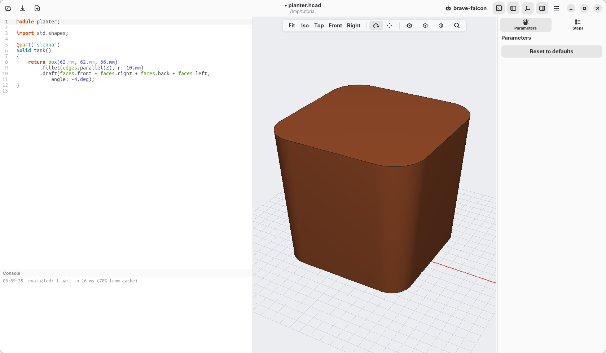
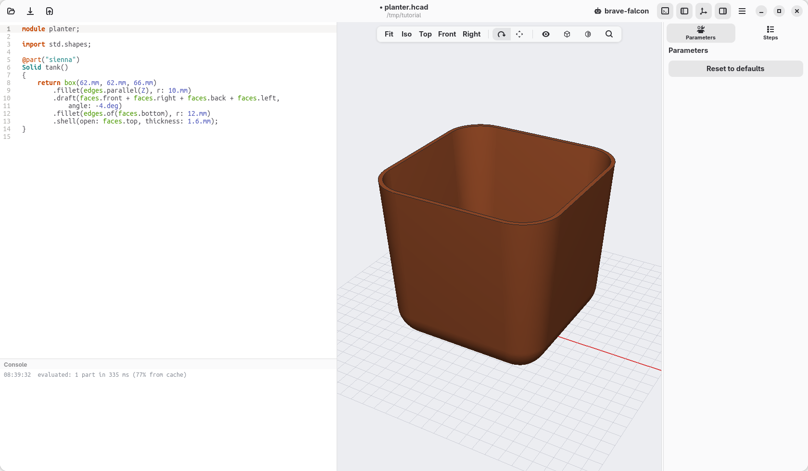
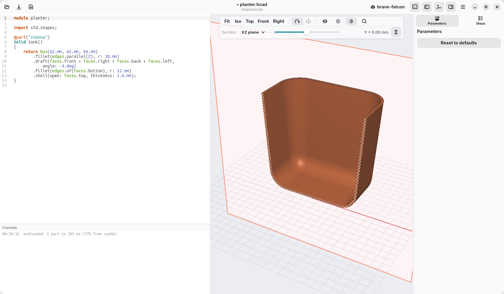

[← The first block](03-the-first-block.md) · [Contents](../TUTORIAL.md) · [Numbers you can change →](05-numbers-you-can-change.md)

# 4. Shape the tank

Three more steps with the mouse and the block becomes the tank: the sides
open out a little, the bottom is rounded, and the inside is hollow.

## Sides that open out

A pot looks better, and comes off a mould or the print bed more easily, when
its sides lean out a little. Tilting a face like that is called a *draft*.

1. Click the front face of the block, then Shift+click the face on the
   right.
2. Turn the view (drag with the right button) until you see the other two
   sides, and Shift+click them too. Then click **Iso** to come back. The note
   at the bottom right says *4 faces selected*.
3. Right-click one of the four faces and choose **Draft 4 faces…**.
4. The angle, `3.deg`, is selected. Type `-4.deg`: 4 degrees, and the minus
   sign makes the sides open out instead of closing in.



## A round bottom

1. Turn the view to look at the block from below, and click its bottom face.
2. Right-click it and choose **Fillet face edges…**: it rounds all the edges
   around that face.
3. Type `12.mm` in place of `1.mm`: a large rounding, which makes the
   bottom soft, like a pot's.

## Hollow it out

1. Click **Iso**, then click the top face.
2. Right-click it and choose **Shell, opening this face…**. *Shell* empties a
   solid, keeping walls of a given thickness, and leaves open the face you
   chose.
3. Type `1.6.mm` in place of `2.mm`: walls 1.6 mm thick, four lines of a
   common 0.4 mm nozzle.



## Look inside

Click the section button in the view bar, between the cube and the
magnifying glass. A plane cuts the model in two and hides the half towards
you: the cut walls are hatched. The slider in the bar moves the plane, the
menu next to it chooses its direction.

To measure the wall, Shift+click its inside and outside faces, right-click,
and open **Measure**: it shows the distance between them.

Click the section button again to close it.

## What the mouse wrote

```d
@part("sienna")
Solid tank()
{
    return box(62.mm, 62.mm, 66.mm)
        .fillet(edges.parallel(Z), r: 10.mm)
        .draft(faces.front + faces.right + faces.back + faces.left,
            angle: -4.deg)
        .fillet(edges.of(faces.bottom), r: 12.mm)
        .shell(open: faces.top, thickness: 1.6.mm);
}
```

One line per step, in the order you made them. The faces are named by where
they look: `faces.front`, `faces.top`… and `edges.of(faces.bottom)` are the
edges around the bottom face. The order matters: rounding comes before the
shell, so the inside follows the round shape too.

## Check



The model at the end of this page: [planter-04.hcad](planter-04.hcad).

[← The first block](03-the-first-block.md) · [Contents](../TUTORIAL.md) · [Numbers you can change →](05-numbers-you-can-change.md)
