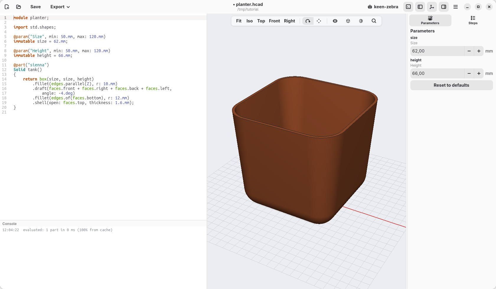
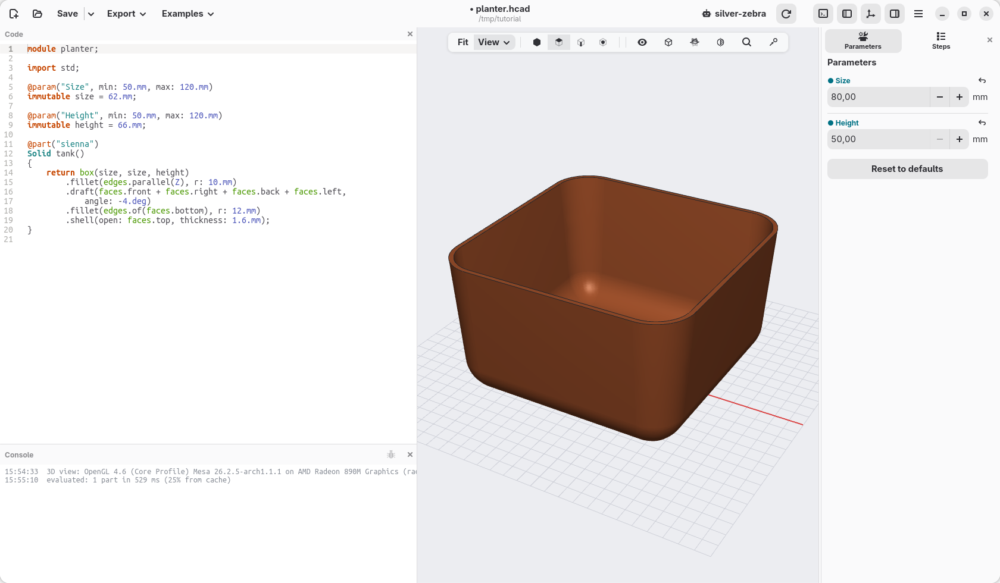

[← Shape the tank](04-shape-the-tank.md) · [Contents](../TUTORIAL.md) · [The pot inside →](06-the-pot-inside.md)

# 5. Numbers you can change

The tank is 62 mm wide and 66 mm tall, because those numbers are in the
code. On this page they become **parameters**: values with a name, which you
can change from the Parameters panel, as you did with the teeth of the clip.

## Name the sizes

Write these lines under `import std.shapes;`:

```d
@param("Size", min: 50.mm, max: 120.mm)
immutable size = 62.mm;

@param("Height", min: 50.mm, max: 120.mm)
immutable height = 66.mm;
```

and in the box use the names instead of the numbers:

```d
    return box(size, size, height)
```

Nothing changes in the view, but the Parameters panel now has **Size** and
**Height**.



What the lines say:

- `immutable size = 62.mm;` gives a name to a value: from here on, `size`
  means 62 mm. *Immutable* means that it does not change while the model is
  built: a name that stays put.
- `@param("Size", min: 50.mm, max: 120.mm)`, on the line above, makes it a
  parameter: it shows in the panel, labelled *Size*, and the panel keeps it
  between 50 and 120 mm. Point at the label to see the name in the code,
  `size`; click it to go to its line.

The tank is `size` wide and deep, and `height` tall: the names say what the
numbers are for, which also makes the code easier to read.

## Try them

In the panel, set **Size** to 80 and **Height** to 50. The tank changes, and
everything the mouse made follows: the rounded corners, the sides leaning out,
the shell. They were made on the edges and faces by name (the upright edges,
the top face), not on points in space, so they stay right on a different
box.



Click **Reset to defaults** to come back to 62 and 66. What you set in the
panel is a trial: the code still says 62 and 66, and that is what is saved.

## Check

The code at the end of this page: [planter-05.hcad](planter-05.hcad).

[← Shape the tank](04-shape-the-tank.md) · [Contents](../TUTORIAL.md) · [The pot inside →](06-the-pot-inside.md)
