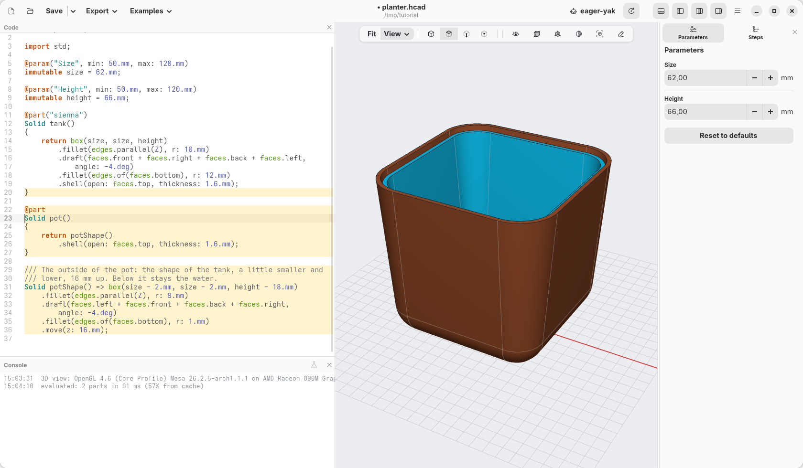
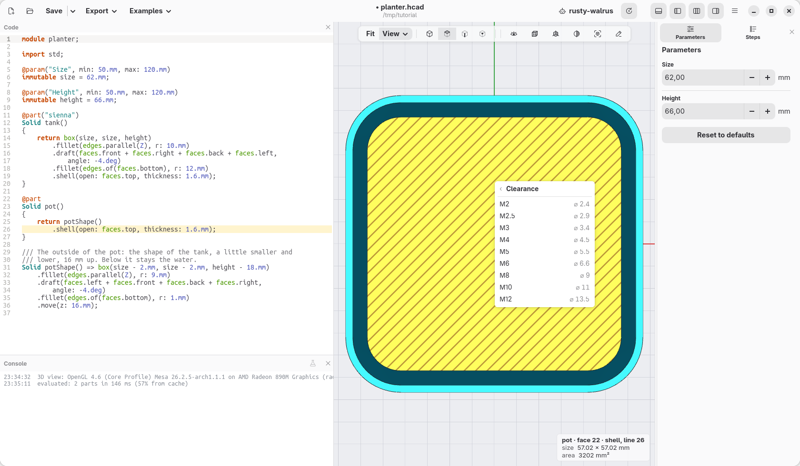
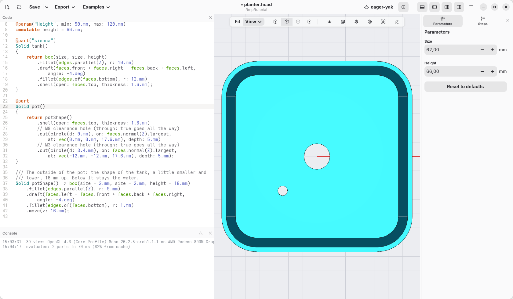
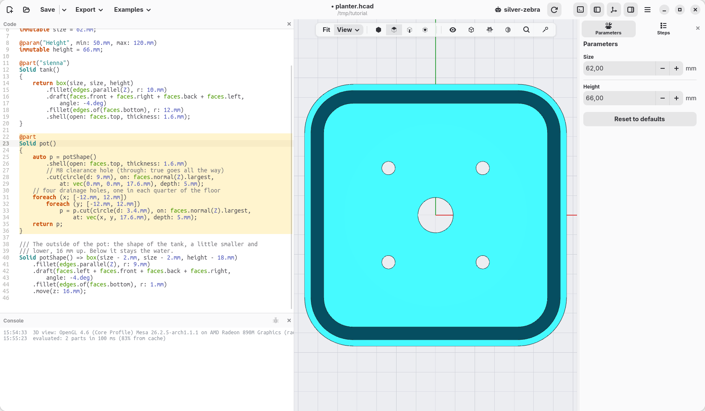
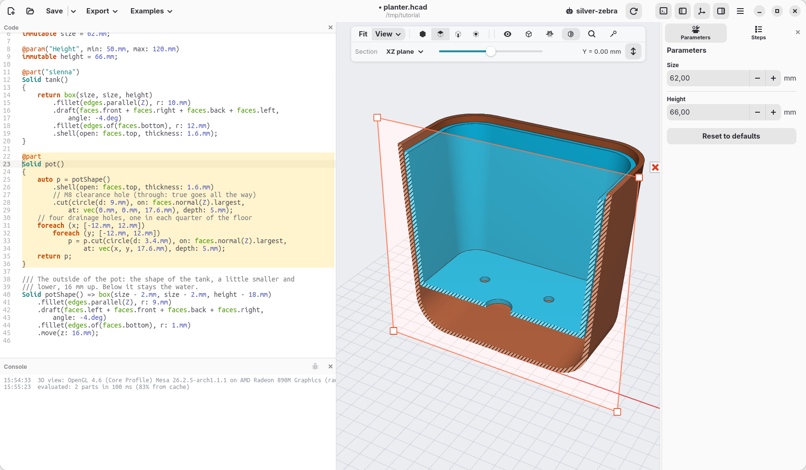

[← Numbers you can change](05-numbers-you-can-change.md) · [Contents](../TUTORIAL.md) · [Reading the model →](07-reading-the-model.md)

# 6. The pot inside

The planter is two pieces: the tank holds the water, the pot holds the soil
and sits in the tank, 16 mm above its floor. A cotton cord through the
bottom of the pot dips in the water and keeps the soil wet. On this page the
pot is made, with its holes.

## The pot

The pot has the shape of the tank, a little smaller and lower. Write this
under the `tank` part:

```d
@part
Solid pot()
{
    return potShape()
        .shell(open: faces.top, thickness: 1.6.mm);
}

/// The outside of the pot: the shape of the tank, a little smaller and
/// lower, 16 mm up. Below it stays the water.
Solid potShape() => box(size - 2.mm, size - 2.mm, height - 18.mm)
    .fillet(edges.parallel(Z), r: 9.mm)
    .draft(faces.left + faces.front + faces.back + faces.right,
        angle: -4.deg)
    .fillet(edges.of(faces.bottom), r: 1.mm)
    .move(z: 16.mm);
```

- `potShape()` is a **function**: a shape with a name, made the same way as
  the tank, then moved 16 mm up (`.move(z: 16.mm)`). It has no `@part`: it
  is not a piece to print, only a shape to use. Page 8 cuts a corner off it.
- It is 2 mm narrower than the tank: 16 mm up, where the pot starts, the
  inside of the tank is about 1 mm narrower than `size` (the walls lean out,
  and they are 1.6 mm thick), so 0.5 mm stays free all around. It is 18 mm
  lower: 16 mm under it, and its rim 2 mm below the rim of the tank.
- `pot()` takes that shape and hollows it out. `@part` without a colour gives
  hackerscad's sky blue (Sky Pop).
- The lines starting with `///` are comments: notes for whoever reads the
  code, ignored by hackerscad. `//` starts a comment too.

For now the pot floats in the tank, with nothing under it: page 8 gives it a
shelf to rest on.



## The holes in the bottom

1. Open the eye in the view bar and untick **tank**: the tank hides, the pot
   stays. Click **Top**.
2. Right-click the middle of the bottom of the pot and choose **At this point
   › Hole › Clearance › M8**: a hole 9 mm wide, for the cord. (The menu sizes holes
   for screws; any size can be typed afterwards.) Make its `at:` `vec(0.mm,
   0.mm, …)`, the middle.

   

3. Right-click the bottom again, towards the front left, and choose **Hole at
   point › Clearance › M3**: a drainage hole 3.4 mm wide, for the water the
   soil does not hold. Make its `at:` `vec(-12.mm, -12.mm, …)`.

   

## Four holes, said once

Four drainage holes are better than one: one in each quarter of the bottom,
at ±12 mm across and ±12 mm deep. You could right-click three more times:
four almost equal lines, which differ only by where. When something repeats,
the code can say it once and list what changes. Replace the `pot` part with:

```d
@part
Solid pot()
{
    auto p = potShape()
        .shell(open: faces.top, thickness: 1.6.mm)
        // M8 clearance hole (through: true goes all the way)
        .cut(circle(d: 9.mm), on: faces.normal(Z).largest,
            at: vec(0.mm, 0.mm, 17.6.mm), depth: 5.mm);
    // four drainage holes, one in each quarter of the floor
    foreach (x; [-12.mm, 12.mm])
        foreach (y; [-12.mm, 12.mm])
            p = p.cut(circle(d: 3.4.mm), on: faces.normal(Z).largest,
                at: vec(x, y, 17.6.mm), depth: 5.mm);
    return p;
}
```

Read it from the top:

- `auto p = …;` gives the pot with its middle hole a name, `p`, instead of
  returning it at once. (`auto` lets hackerscad work out what kind of thing
  it is: here a solid.) The chain of steps is the same as before: a chain is
  one way to write steps that follow each other, a name is another, handy
  when there is more to do with the result.
- `[-12.mm, 12.mm]` is a list of two values.
- `foreach (x; [-12.mm, 12.mm])` repeats what follows once for each value of
  the list, calling it `x` each time. Inside it, a second `foreach` does the
  same with `y`: for each of the two `x`, each of the two `y`, so four holes,
  at (−12, −12), (−12, 12), (12, −12) and (12, 12).
- `p = p.cut(…)` digs a hole in `p`, and `p` becomes the pot with that hole.
  `.cut(…)` digs the circle into the face, 5 mm deep: more than the bottom is
  thick, so it goes through.
- `return p;` hands over the result: the pot with its five holes.



Open the eye again and tick **tank**.

## Check

In section: the pot in the tank, with room for the water below.



The code at the end of this page: [planter-06.hcad](planter-06.hcad).

[← Numbers you can change](05-numbers-you-can-change.md) · [Contents](../TUTORIAL.md) · [Reading the model →](07-reading-the-model.md)
