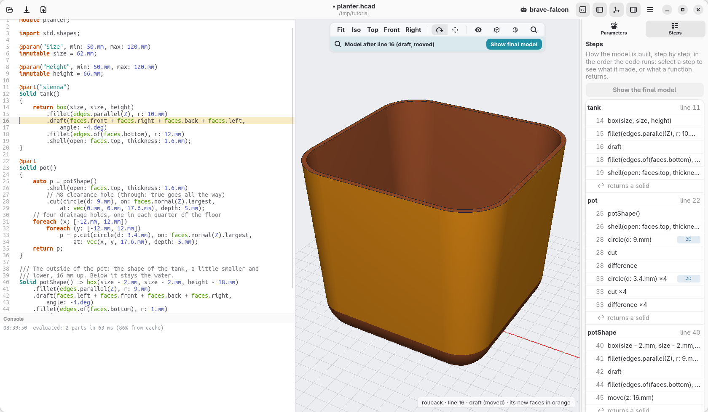
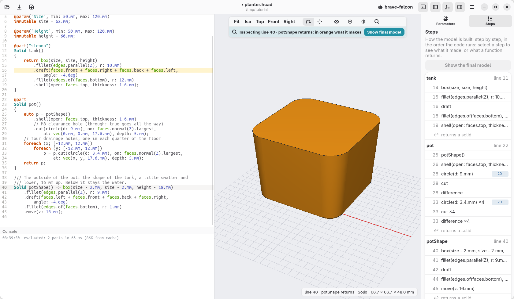
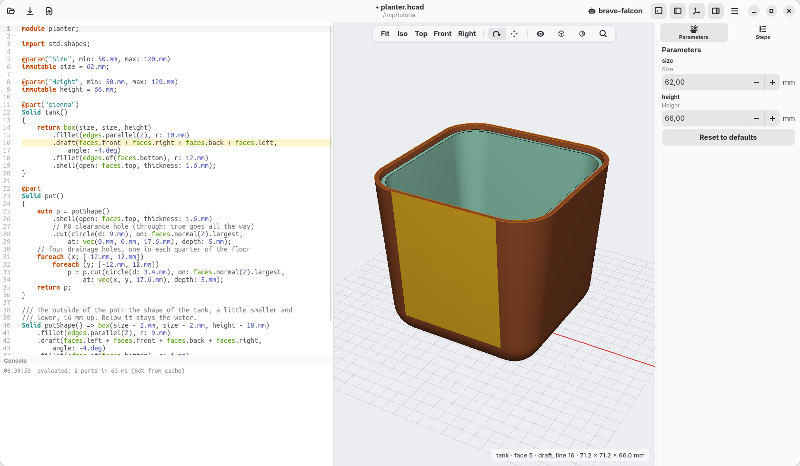

[← The pot inside](06-the-pot-inside.md) · [Contents](../TUTORIAL.md) · [The shelf and the corner →](08-shelf-and-corner.md)

# 7. Reading the model

The model has grown: two parts, a dozen steps, a few dozen lines. You do not
have to read the code to find your way in it: the window shows what each
line does, and which line made what you see. Nothing changes in the model on
this page.

## The steps, one at a time

Open the **Steps** tab, next to Parameters. It lists the steps of the model
in the order they run, grouped by part: for the tank the box, the rounding,
the draft, the second rounding, the shell.

Each row shows its line number and the start of its code. Click the row of
the draft, `16 draft(faces.front + …`. The view goes back to the model as it was right after that
step, and the faces the step made are orange: the four sides, now leaning
out. A bar over the view says which step you are looking at.

Click the other steps to see the tank grow one step at a time. When you are
done, click **Show final model** in the bar, or press Esc.

## What one line makes

Hold Ctrl and click a line of the code: the view shows what that line makes
on its own, in orange, with the rest of the model as a faint ghost. The
magnifying glass in the bar over the view does the same without Ctrl: click
it, then click a line.

Ctrl+click the line `Solid potShape() => box(…)`. It shows the outside of
the pot by itself, as a solid block: the shape that `pot()` then hollows out
and fills with holes.

Click an empty part of the view, or press Esc, to come back.

## From the model to the code

It works the other way round too. Click a face of the model: the line of
code that made it is highlighted, and the note at the bottom right says what
it is.

Click the front of the tank. The note reads *tank · face 5 · draft, line 16*:
that face, as it is now, comes from the draft on line 16 (the box made it,
the draft moved it).

This is the quickest way to answer "where does this come from?" in any
model, including the ones you did not write.

## Check

The model is the same as at the end of the previous page,
[planter-06.hcad](planter-06.hcad).

[← The pot inside](06-the-pot-inside.md) · [Contents](../TUTORIAL.md) · [The shelf and the corner →](08-shelf-and-corner.md)
