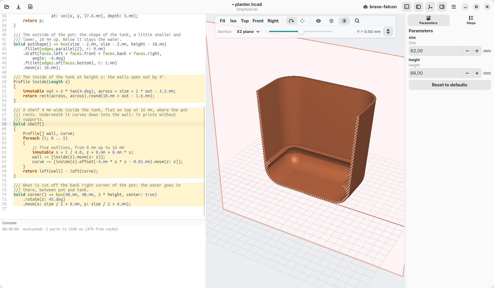
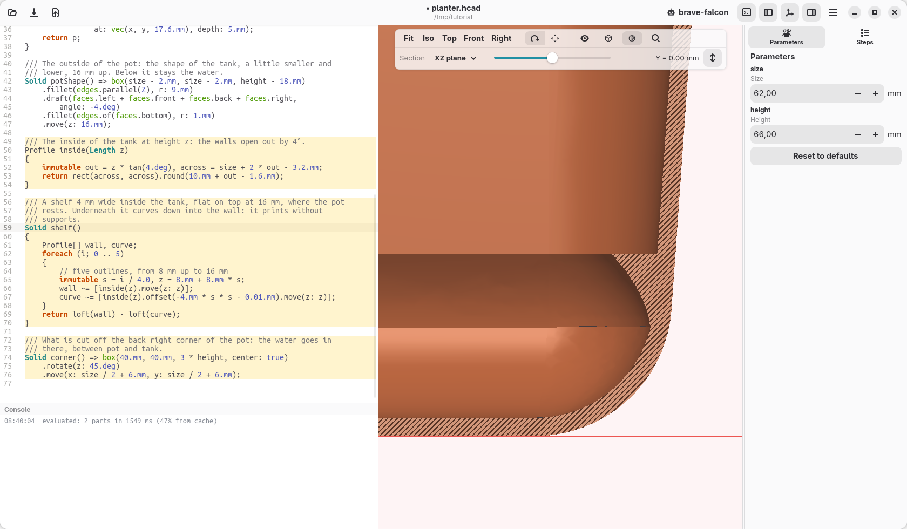
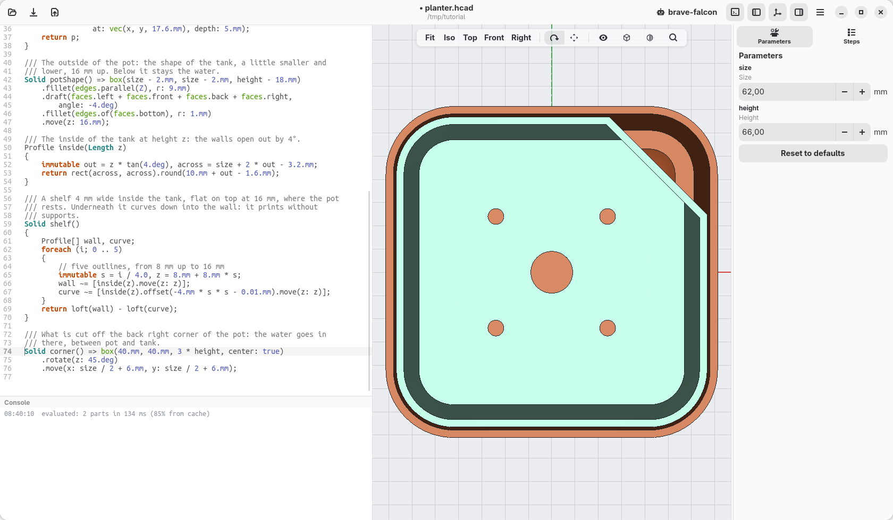
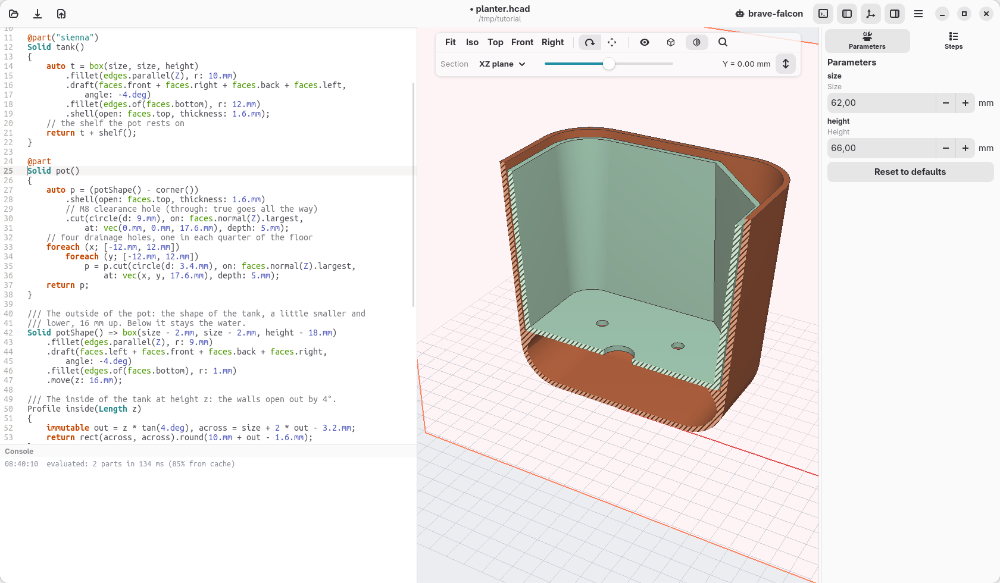
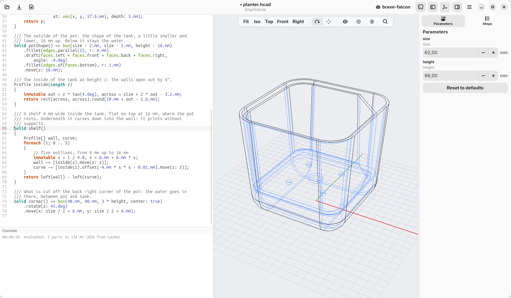

[← Reading the model](07-reading-the-model.md) · [Contents](../TUTORIAL.md) · [Sizes and a check →](09-sizes-and-a-check.md)

# 8. The shelf and the corner

Two things are missing. The pot floats: the tank needs a shelf inside, for
the pot to rest on, 16 mm above the floor. And the water has to reach the
tank, under the pot: a corner cut off the pot leaves a way down. The shelf is
a shape that the mouse does not make, so this page has more code to write,
and it introduces the shapes drawn flat and then raised.

## Profiles: flat shapes

Besides solids (`box`, `cylinder`…), hackerscad has **profiles**: flat
shapes, drawn on the ground (`rect`, `circle`, `polygon`, `text`…). They
combine like solids, and they become solids when raised: `.extrude(10.mm)`
lifts a profile 10 mm, `loft([a, b, c])` passes a smooth surface through
profiles at different heights. Solids and profiles combine with three signs:
`a + b` joins, `a - b` takes `b` away from `a`, `a & b` keeps only what they
have in common.

## The code to add

Write this at the end of the file:

```d
/// The inside of the tank at height z: the walls open out by 4°.
Profile inside(Length z)
{
    immutable out = z * tan(4.deg), across = size + 2 * out - 3.2.mm;
    return rect(across, across).round(10.mm + out - 1.6.mm);
}

/// A shelf 4 mm wide inside the tank, flat on top at 16 mm, where the pot
/// rests. Underneath it curves down into the wall: it prints without
/// supports.
Solid shelf()
{
    Profile[] wall, curve;
    foreach (i; 0 .. 5)
    {
        // five outlines, from 8 mm up to 16 mm
        immutable s = i / 4.0, z = 8.mm + 8.mm * s;
        wall ~= [inside(z).move(z: z)];
        curve ~= [inside(z).offset(-4.mm * s * s - 0.01.mm).move(z: z)];
    }
    return loft(wall) - loft(curve);
}

/// What is cut off the back right corner of the pot: the water goes in
/// there, between pot and tank.
Solid corner() => box(40.mm, 40.mm, 3 * height, center: true)
    .rotate(z: 45.deg)
    .move(x: size / 2 + 6.mm, y: size / 2 + 6.mm);
```

Then add the shelf to the tank. In the `tank` part, change `return box(…`
into `auto t = box(…`, so that the tank gets a name, and after the chain,
after `.shell(…);`, add:

```d
    // the shelf the pot rests on
    return t + shelf();
```



## How the shelf is made

**The outline of the inside.** `inside(z)` is a function that takes a
value: it gives the outline of the inside of the tank at height `z`, a
square with round corners (`rect(…).round(…)`). `Length z` says that what it
takes is a length. The walls lean out by 4°, so the higher, the wider: `out`
is how much wider the tank is at that height than at the bottom (`tan`, from
geometry, turns the angle into that length), and the walls are 1.6 mm thick,
3.2 mm across.

**A list of outlines.** `Profile[] wall, curve;` makes two empty lists of
profiles. `foreach (i; 0 .. 5)` counts from 0 to 4: five times, with
`i` = 0, 1, 2, 3, 4. Each time:

- `s` goes from 0 to 1 (`i / 4.0`: 0, 0.25, 0.5, 0.75, 1), and `z` from 8 mm
  to 16 mm;
- `wall ~= [ … ]` adds to the list `wall` the outline of the inside at
  height `z`, moved up to that height;
- `curve ~= [ … ]` adds the same outline made smaller by
  `4.mm * s * s`: by nothing at the bottom, by a little in the middle
  (1 mm at half height), by 4 mm at the top. Growing as `s * s`, it draws a
  curve.

**Two lofts.** `loft(wall)` is a solid that fills the inside of the tank
from 8 to 16 mm; `loft(curve)` is the same, but narrowing as it rises.
Taking the second from the first leaves a ring against the wall, flat on
top, 4 mm wide, and curving down into the wall underneath. The extra
`0.01.mm` keeps the two lofts from touching at the bottom: two surfaces
exactly on top of each other are hard to cut.



A 3D printer cannot print in the air: each layer has to stand on the one
below. Under a flat shelf it would need supports; under this one each layer
sticks out only a little more than the one below, and it prints by itself.

## A corner to pour the water in

`corner()` is a block 40 by 40 mm, turned by 45° (`.rotate(z: 45.deg)`) so
that it stands on one of its corners, and moved to the back right corner of
the pot (`size / 2` is half the width of the tank). It is three times as tall
as the planter and centred in height (`center: true`): it goes through
everything.

Take it away from the pot: in `pot`, the first line becomes

```d
    auto p = (potShape() - corner())
```

The brackets say what goes first: the corner is taken away from the shape of
the pot, and then the result is hollowed out. Hollowing first, the cut would
leave the pot open on that side.



Pour water there: it fills the tank under the pot. The cord through the
middle hole draws it up into the soil, and looking into the corner you see
how much is left.



## See through it

The cube in the view bar, **Wireframe**: only the edges, the hidden ones in
blue. The shelf and the holes show through the walls.



Set it back to **Shaded with edges**.

## Check

The code at the end of this page: [planter-08.hcad](planter-08.hcad).

[← Reading the model](07-reading-the-model.md) · [Contents](../TUTORIAL.md) · [Sizes and a check →](09-sizes-and-a-check.md)
