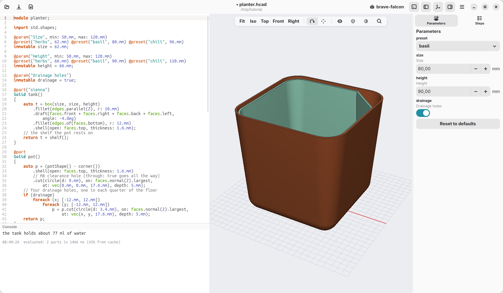
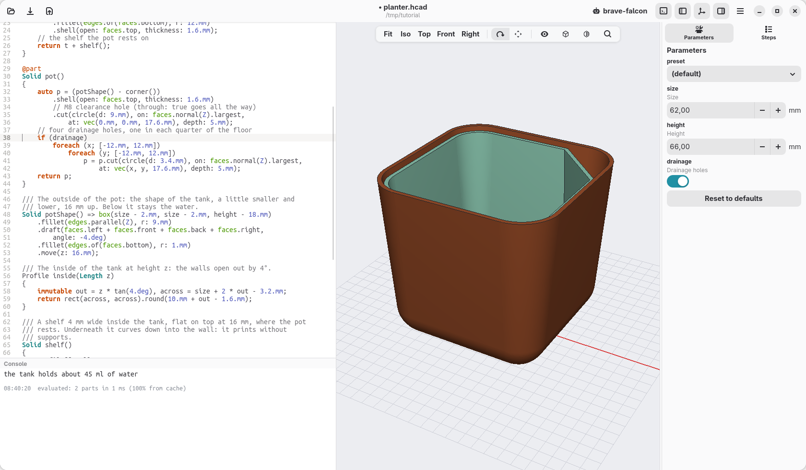
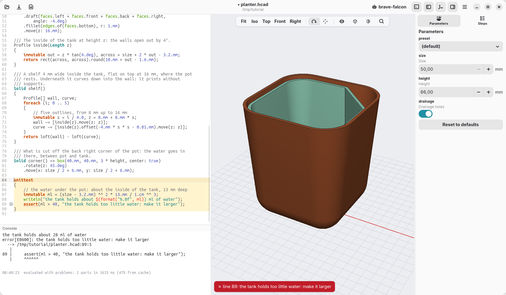

[← The shelf and the corner](08-shelf-and-corner.md) · [Contents](../TUTORIAL.md) · [Print it →](10-print-it.md)

# 9. Sizes, a choice and a check

The planter is done. This page makes it easier to use: ready-made sizes, a
switch to leave out the drainage holes, and a check that warns when a size
does not work.

## Ready-made sizes

A **preset** is a name for a set of parameter values. Add a line under each
`@param`:

```d
@param("Size", min: 50.mm, max: 120.mm)
@preset("herbs", 62.mm) @preset("basil", 80.mm) @preset("chili", 96.mm)
immutable size = 62.mm;

@param("Height", min: 50.mm, max: 120.mm)
@preset("herbs", 66.mm) @preset("basil", 90.mm) @preset("chili", 110.mm)
immutable height = 66.mm;
```

The Parameters panel gets a **preset** menu: *herbs* is the size we built,
for a pot of parsley or chives; *basil* a larger one, 80 by 90 mm; *chili*
the largest, 96 by 110 mm, for a small pepper plant. A preset can set some parameters and leave
the others as they are.



## A choice: drainage holes or not

Indoors, on a shelf, you may not want water to drain through the bottom.
Add a parameter that is yes or no, under `height`:

```d
@param("Drainage holes")
immutable drainage = true;
```

and in `pot`, put `if (drainage)` before the loops of the holes, moving them
in by one step:

```d
    // four drainage holes, one in each quarter of the floor
    if (drainage)
        foreach (x; [-12.mm, 12.mm])
            foreach (y; [-12.mm, 12.mm])
                p = p.cut(circle(d: 3.4.mm), on: faces.normal(Z).largest,
                    at: vec(x, y, 17.6.mm), depth: 5.mm);
```

`if` runs what follows only when its condition holds: here, when `drainage`
is `true`. The panel shows the parameter as a switch: turn it off and the
holes go.



## A check

Some sizes do not make sense: a planter so small that the tank holds almost no
water. A **unittest** is a block of checks that runs every time the model is
built. Add it at the end of the file:

```d
unittest
{
    // the water under the pot: about the inside of the tank, 13 mm deep
    immutable ml = (size - 3.2.mm) ^^ 2 * 13.mm / 1.cm ^^ 3;
    writeln("the tank holds about $(format("%.0f", ml)) ml of water");
    assert(ml > 40, "the tank holds too little water: make it larger");
}
```

- `^^ 2` is "squared": the area of the inside, times the depth of the water,
  is its volume; divided by a cubic centimetre, it is in millilitres.
- `writeln(…)` writes a line in the console. Inside the text, `$(…)` puts a
  value, and `format("%.0f", ml)` writes it without decimals.
- `assert(condition, message)` checks the condition: if it does not hold, the
  message shows in the console and in a red banner over the view, and the
  line is marked in the code.

The console now says *the tank holds about 45 ml of water*. Set **size** to
50 in the panel: the check fails and says why.



Click **Reset to defaults**.

## Check

The code at the end of this page: [planter-09.hcad](planter-09.hcad).

[← The shelf and the corner](08-shelf-and-corner.md) · [Contents](../TUTORIAL.md) · [Print it →](10-print-it.md)
