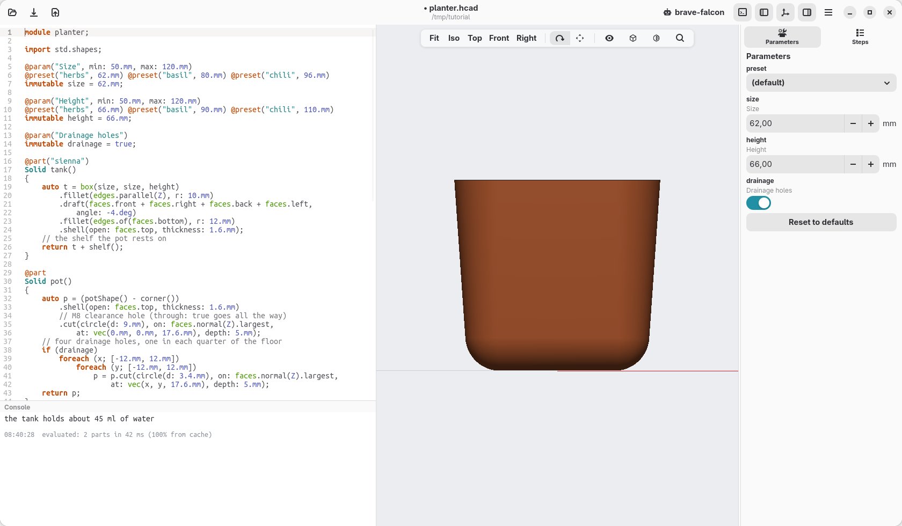

[← Sizes and a check](09-sizes-and-a-check.md) · [Contents](../TUTORIAL.md) · [Let an AI agent help →](11-ai-agents.md)

# 10. Print it

## Export

Click the export button, the third at the top left, and choose **3MF**, then
a name for the file. Ctrl+E does the same with the last format
you used.

- **3MF** keeps the two parts apart and their colours: your slicer opens them
  as two objects. It is the best choice for a 3D printer.
- **STL** is the older format every slicer reads. It holds one part only, so
  with two parts hackerscad saves a zip with one file each, `tank.stl` and
  `pot.stl`.
- **STEP** keeps the exact shapes, each part a separate body, for other CAD
  programs.
- **PNG** is a picture of the view.

The model is exported with the values in the Parameters panel: choose the
preset or the sizes first.

To export one part alone, right-click it in the view and choose **Export
pot**, then the format.

## In the slicer

- Both pieces print **standing as they are**, without supports. The walls lean
  out by only 4°, and the shelf curves gently into the wall.
- The tank holds water: give it **three walls** (perimeters) or more, and use
  PETG if you can. PLA works too, but it is less sure to stay watertight over
  time.
- With a 0.4 mm nozzle the walls, 1.6 mm, are four lines wide.

## Put it together

Thread a cotton cord, about 10 cm, through the middle hole of the pot: half
inside, in the soil, half below, down to the bottom of the tank. Set the pot on
the shelf in the tank, fill it with soil, and pour water into the cut
corner.

[← Sizes and a check](09-sizes-and-a-check.md) · [Contents](../TUTORIAL.md) · [Let an AI agent help →](11-ai-agents.md)
