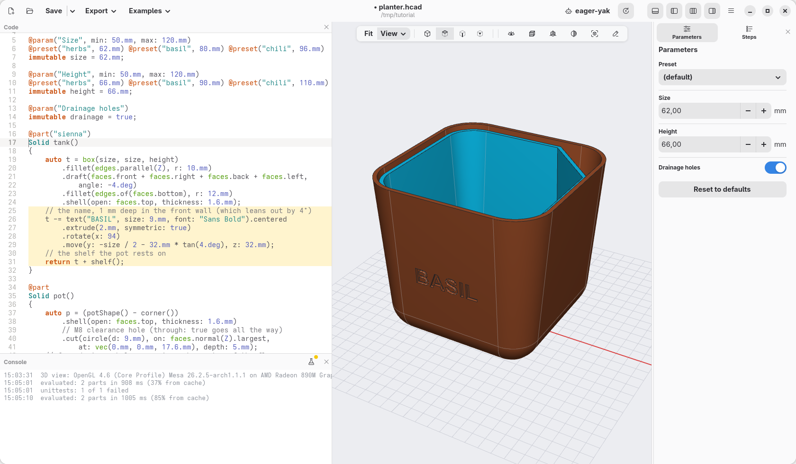

[← Print it](10-print-it.md) · [Contents](../TUTORIAL.md) · [A first sketch: a medal →](12-medal.md)

# 11. Let an AI agent help

An AI agent such as Claude Code, Codex or Antigravity can work on your models
for you: you ask in words, it writes the code, checks it, looks at the result
and fixes it. With the hackerscad window open, it works right there: you see
every change as it happens, and you can undo it with Ctrl+Z.

## Connect the agent

The agent talks to hackerscad through `hcad`, the command line tool that comes
with it, as an *MCP server*. One command connects it; the
[README](../../README.md#using-hackerscad-with-an-ai-agent) gives the command
for each agent and says what to write when `hcad` is not in your `PATH`.

## Ask

With the planter open, ask the agent for example:

> Write BASIL on the front of the tank, in the hackerscad window.

The agent finds the open window, reads the code and adds a few lines to the
tank: a text, raised into a thin solid, tilted 4° like the wall, and taken
away from it, 1 mm deep. The window shows it at once.



```d
    // the name, 1 mm deep in the front wall (which leans out by 4°)
    t -= text("BASIL", size: 9.mm, font: "Sans Bold").centered
        .extrude(2.mm, symmetric: true)
        .rotate(x: 94)
        .move(y: -size / 2 - 32.mm * tan(4.deg), z: 32.mm);
```

`t -= …` is short for `t = t - …`: the tank, less the letters.

## More to ask

- "Make the tank 1 cm taller and add a preset for mint."
- "Make the corner of the pot a little wider, to pour from a bottle."
- "What is the face I selected for? Fillet its edges by 1 mm."

The agent sees what you select in the view and which lines you changed, so
"this face" and "the line I just wrote" work.

To show the agent a place, point at it: turn on **Annotate** in the view bar
(or press A in the view). The view stops still, and you draw on it as on a
screenshot: an arrow, a cross on the exact point, a circle round something,
a line by hand, a text, in the colour you pick. Then ask "make a 5 mm hole
here": the agent reads your marks and what lies under each of them, the part,
the face and the point. The agent draws on the view the same way to show you
what it means, "this wall is too thin". Click a mark to move it, Delete to
remove it; **Done** (or Esc) brings the view back to life, without the marks.

Each window has a name in its header bar (*tidy-pine*, *blue-otter*…): click
it to choose your own. With several windows open, tell the agent which one to
use.

## Check

The model as the agent left it: [planter-11.hcad](planter-11.hcad).

[← Print it](10-print-it.md) · [Contents](../TUTORIAL.md) · [A first sketch: a medal →](12-medal.md)
