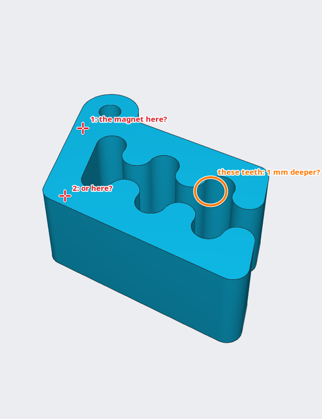

[← Print it](10-print-it.md) · [Contents](../TUTORIAL.md) · [A first sketch: a medal →](12-medal.md)

# 11. Let an AI agent help

An AI agent such as Claude Code, Codex or Antigravity can work on your models
for you: you ask in words, it writes the code, checks it, looks at the result
and fixes it. With the hackerscad window open, it works right there: you see
every change as it happens, and you can undo it with Ctrl+Z.

## Connect the agent

The agent talks to hackerscad through `hcad`, the command line tool that comes
with it, as an *MCP server*, and learns the language from a *skill*, a text it
reads. The [README](../../README.md#using-hackerscad-with-an-ai-agent) gives
the commands for each agent, or a sentence to ask the agent to set it all up
by itself.

## Ask

With the planter open, ask the agent for example:

> Write BASIL on the front of the tank, in the hackerscad window.

The agent finds the open window, reads the code and adds a few lines to the
tank: a text, raised into a thin solid, tilted 4° like the wall, and taken
away from it, 1 mm deep. The window shows it at once.


```d
    // the name, 1 mm deep in the front wall (which leans out by 4°)
    t -= text("BASIL", size: 9.mm, font: "Sans Bold").centered
        .extrude(2.mm, symmetric: true)
        .rotate(x: 94)
        .move(y: -size / 2 - 32.mm * tan(4.deg), z: 32.mm);
```

`t -= …` is short for `t = t - …`: the tank, less the letters.

## More to ask

Changes to the model on screen:

- "Make the tank 1 cm taller and add a preset for mint."
- "Make the corner of the pot a little wider, to pour from a bottle."
- "What is the face I selected for? Fillet its edges by 1 mm."

The agent sees what you select in the view and which lines you changed, so
"this face" and "the line I just wrote" work.

### A part from a file

Give it a 3D file of a part, an STL, an OBJ, a 3MF or a STEP, and it rebuilds
it as a model you can change:

> Rebuild bracket.stl as a hackerscad model I can edit: the holes for M4
> screws, the thickness and the width as parameters.

It asks nothing: the sizes are in the file. It loads the original as a
see-through part next to its copy, reads its holes, its sections and its
roundings, builds the copy step by step, and after every step compares the two,
showing you where they still differ, until they match within a tenth of a
millimetre. What you get is no longer a mesh: a hole is a hole you can move or
make larger, a thickness a number you change.

### A part from a photo

A photo has no scale and shows one side only, so here the agent asks first:

> Here is a photo of the knob of my oven, it broke. Make me a new one.

Its first reply is a short list of questions, numbered: what to measure and
how ("with a caliper, the diameter of the shaft, and across its flat side"),
which sizes matter most (the shaft hole must fit, the outside can be rough),
what the back looks like. Answer the ones you can: it estimates the rest and
makes them parameters, to correct after a test print. If you have no caliper,
say "just estimate".

### A part around a real object

Something that holds, covers or fits another object:

> A stand to keep this keyboard upright on my desk, simple to print, nice to
> look at. The STEP of the keyboard is attached.

With the object's 3D file it takes the sizes from it and shapes the part
around it, keeping the object as a see-through reference to check the fit. It
still asks what changes the result: your printer's bed, the material, which
side goes down, a cable. Without a file, it asks you to measure.

### Fits and threads

> A cap for a water bottle, printed in PETG.

For a thread onto a real thing the agent never guesses: it asks which thread
it is (a bottle's neck, a camera's, a pipe's), or tells you how to find out.
For parts that fit into each other it asks how they will be made, since the
play between them depends on the printer.

### Checks

- "Will it print without supports? Lay it on the bed the best way."
- "Is the wall thick enough everywhere for a 0.4 mm nozzle?"
- "Does the lid close on the box? Show me where they touch."

The agent looks at the pictures it renders, not only at the numbers, and tells
you what it could not check: a fit that needs a test print, a size it estimated.

## What the agent asks first

A good agent asks before it starts, in one message, only what changes the
result most, and says you can answer just some of them:

| When you ask for | It asks | Why |
|---|---|---|
| a copy of a real object | what to measure, and how | a wrong size means printing again |
| a part from a photo | one known size, and the sides it cannot see | a photo has no scale |
| lettering | the font, or offers a similar one | it never swaps a font without asking |
| a fit (a lid, a pin in a hole) | the printer or the process | the play depends on it |
| a thread onto a real thing | which thread | some look alike and do not mix |
| work in a window | which one, when several are open | it never assumes the most recent |

## Point at things

To show the agent a place, point at it: turn on **Annotate** in the view bar
(or press A in the view). The view stops still, and you draw on it as on a
screenshot: an arrow, a cross on the exact point, a circle round something,
a line by hand, a text, in the colour you pick. Then ask "make a 5 mm hole
here": the agent reads your marks and what lies under each of them, the part,
the face and the point. The agent draws on the view the same way to show you
what it means, "this wall is too thin", or to ask which place you mean:



Click a mark to move it, Delete to remove it; right-click it to add a label or
edit its text, **Clear** removes them all. The two buttons by the colours save
the view with its marks as a picture, or copy it to paste in a message: marks
work for showing a person too. **Done** (or Esc) brings the view back to life,
without the marks.

Each window has a name in its header bar (*tidy-pine*, *blue-otter*…): click
it to choose your own. With several windows open, tell the agent which one to
use. You can keep editing between requests: at every turn the agent reads the
code again and works on your version.

## If something goes wrong

| What happens | What to do |
|---|---|
| the agent writes `cube()`, `translate()`, `difference()` | it does not have the skill: install it, or tell it to read `hcad docs` first |
| the agent has no `hcad_*` tools | the server is not added, or the agent was not restarted after adding it |
| every tool appears twice | two servers under different names: remove one |
| the window asks which version to keep | the file was rewritten while the window had changes: keep yours |
| the agent changed the wrong window | say its name |

## Check

The model as the agent left it: [planter-11.hcad](planter-11.hcad).

[← Print it](10-print-it.md) · [Contents](../TUTORIAL.md) · [A first sketch: a medal →](12-medal.md)
