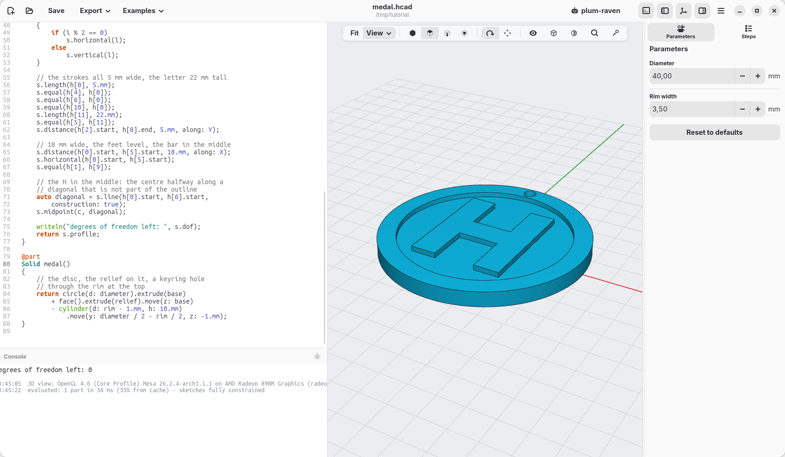
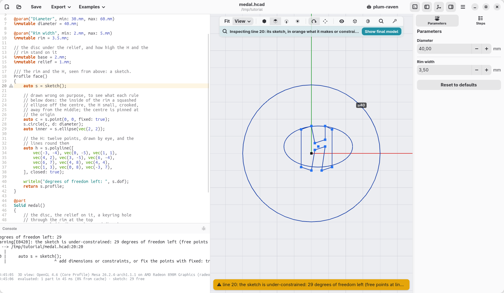
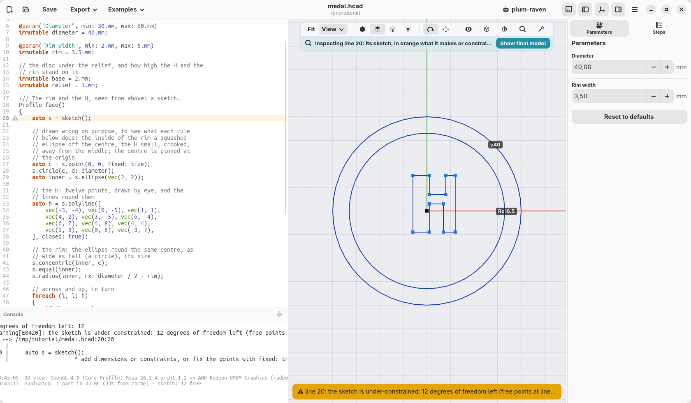
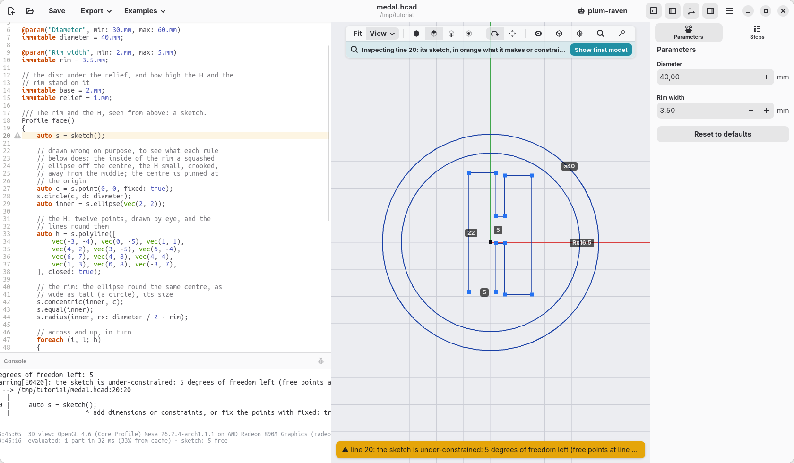
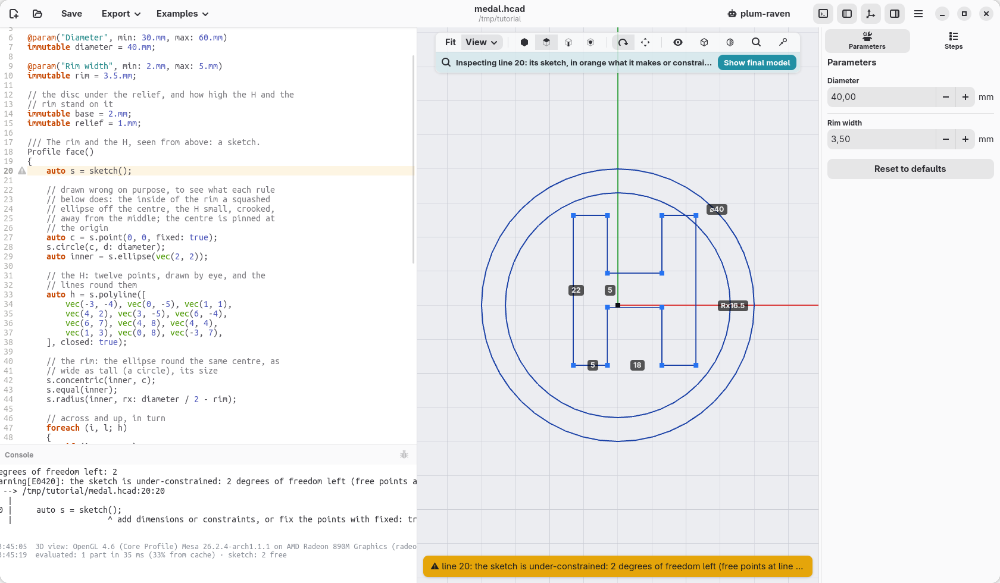
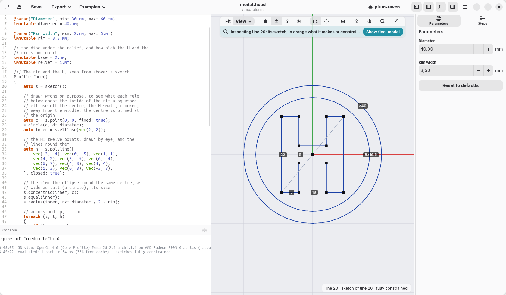
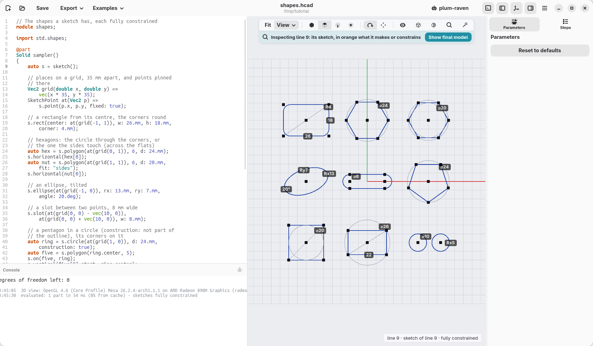
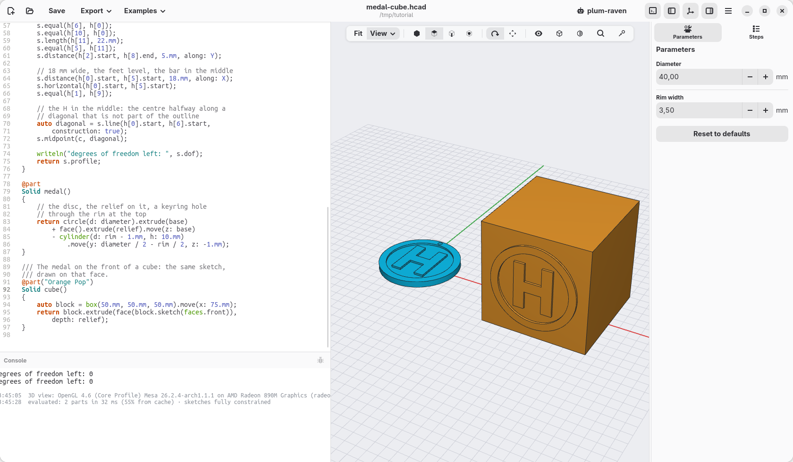

[← Let an AI agent help](11-ai-agents.md) · [Contents](../TUTORIAL.md) · [Carlo, drawn with a sketch →](13-carlo.md)

# 12. A first sketch: a medal

Until now every shape started from numbers: a box so wide, a cylinder so
tall. Some outlines are easier to tell by their rules: "these sides are
level, these strokes are all as wide, the letter sits in the middle". A
**sketch** takes those rules, called **constraints**, and works out where
every corner goes. This page draws a medal with an H and a rim standing out
of it, and adds the rules one at a time, to see what each one does.



## Points and lines

Press **New**, select all the code (Ctrl+A) and paste this over it:

```d
module medal;

import std.shapes;

@param("Diameter", min: 30.mm, max: 60.mm)
immutable diameter = 40.mm;

@param("Rim width", min: 2.mm, max: 5.mm)
immutable rim = 3.5.mm;

// the disc under the relief, and how high the H and the
// rim stand on it
immutable base = 2.mm;
immutable relief = 1.mm;

/// The rim and the H, seen from above: a sketch.
Profile face()
{
    auto s = sketch();

    // drawn wrong on purpose, to see what each rule
    // below does: the inside of the rim a squashed
    // ellipse off the centre, the H small, crooked,
    // away from the middle; the centre is pinned at
    // the origin
    auto c = s.point(0, 0, fixed: true);
    s.circle(c, d: diameter);
    auto inner = s.ellipse(vec(2, 2));

    // the H: twelve points, drawn by eye, and the
    // lines round them
    auto h = s.polyline([
        vec(-3, -4), vec(0, -5), vec(1, 1),
        vec(4, 2), vec(3, -5), vec(6, -4),
        vec(6, 7), vec(4, 8), vec(4, 4),
        vec(1, 3), vec(0, 8), vec(-3, 7),
    ], closed: true);

    writeln("degrees of freedom left: ", s.dof);
    return s.profile;
}

@part
Solid medal()
{
    // the disc, the relief on it, a keyring hole
    // through the rim at the top
    return circle(d: diameter).extrude(base)
        + face().extrude(relief).move(z: base)
        - cylinder(d: rim - 1.mm, h: 10.mm)
            .move(y: diameter / 2 - rim / 2, z: -1.mm);
}
```

What the sketch has so far:

- `auto s = sketch();` starts an empty sketch, on the XY plane.
- `s.point(x, y)` makes a point. Where you put it is only where it starts:
  the constraints move it. `fixed: true` pins this one, the centre, so that
  the drawing cannot float away.
- `s.circle(c, d: …)` is a circle round `c`, the medal's edge.
- `s.ellipse(vec(2, 2))` is an ellipse round a new point that starts at
  (2, 2), its two radii and its turn left to the rules: it starts squashed,
  20 by 12 mm. It will be the inside of the rim.
- `s.polyline([…], closed: true)` puts a point at each position and joins
  them with lines, the last one back to the first: the outline of the H,
  drawn by eye, crooked and too small, as on a napkin.
  It returns the twelve lines, `h[0]` to `h[11]`, from the bottom left
  corner round the letter.
- `s.profile` gives the closed outlines as a profile, to extrude like
  `rect` or `circle`.

The comment says it: everything is drawn wrong on purpose. The medal is
there, but with a small crooked H in a lopsided ring. The console says
*degrees of freedom left: 29*, and a warning that the sketch is
**under-constrained**: nothing says yet what it should be like. Each of the
twelve points of the H can still go anywhere, two ways each (left and right,
up and down): 24; the ellipse can still move two ways, grow two ways and
turn: 5 more. They stay where they were drawn only because nothing moves
them.

Put the cursor anywhere in the sketch's code, from `auto s = sketch();` to
`return s.profile;` (or click the `sketch()` step in **Steps**): the view
shows the sketch from above, the points that can still move in blue, and in
orange what the cursor's line makes. Move the cursor out of it and the medal
comes back; Esc does it too.



## The rim

The rings first. Write this above the `writeln` line:

```d
    // the rim: the ellipse round the same centre, as
    // wide as tall (a circle), its size
    s.concentric(inner, c);
    s.equal(inner);
    s.radius(inner, rx: diameter / 2 - rim);
```

`concentric(a, b)` puts the centre of a circle or an ellipse on another's,
or on a point: here the medal's centre. `equal(ellipse)` makes it as wide as
tall: a circle (it then looks the same however it is turned, so its turn is
no longer a freedom). `radius(ellipse, rx: v)` gives it its size. The ring
is even, 3.5 mm wide all round, and 24 freedoms are left: the H's.


## Level and upright

The sides of an H are level or upright, in turn: `h[0]` along the bottom,
`h[1]` up, `h[2]` across, and so on round the letter. Under the rim:

```d
    // across and up, in turn
    foreach (i, l; h)
    {
        if (i % 2 == 0)
            s.horizontal(l);
        else
            s.vertical(l);
    }
```

`horizontal(line)` keeps a line level, `vertical(line)` upright. The H
straightens, each point moving as little as it can, and the console says 12:
each line kept straight takes one freedom away. The letter is still uneven:
its legs of any width, the bar anywhere.



## Sizes

Then the sizes, under the loop:

```d
    // the strokes all 5 mm wide, the letter 22 mm tall
    s.length(h[0], 5.mm);
    s.equal(h[4], h[0]);
    s.equal(h[6], h[0]);
    s.equal(h[10], h[0]);
    s.length(h[11], 22.mm);
    s.equal(h[5], h[11]);
    s.distance(h[2].start, h[8].end, 5.mm, along: Y);
```

- `length(line, v)` gives a line its length: the bottom of the left leg is
  5 mm, the left side 22.
- `equal(a, b)` makes two lines as long: the other feet and tops are as wide
  as the first, the right side as tall as the left.
- `distance(p, q, v, along: Y)` sets how far two points are apart up and
  down only (`along: X` across). `h[2].start` and `h[8].end` are the corners
  under and over the bar: the bar is 5 mm thick.

The strokes even out and the sizes show on the sketch, but the letter came
out narrow, its right half lower than the left: 5 freedoms are left, its
width, where its right half stands, where the bar is, and where the whole H
is.



## Width, feet and bar

```d
    // 18 mm wide, the feet level, the bar in the middle
    s.distance(h[0].start, h[5].start, 18.mm, along: X);
    s.horizontal(h[0].start, h[5].start);
    s.equal(h[1], h[9]);
```

`horizontal` also takes two points, which it keeps at the same height: here
the outer corners of the two feet. `equal(h[1], h[9])`, the inner side under
the bar as tall as the one over it, puts the bar in the middle. 2 are left:
the H has its shape, but it can still slide, up and down, left and right:
it is a little off the centre.



## In the middle

```d
    // the H in the middle: the centre halfway along a
    // diagonal that is not part of the outline
    auto diagonal = s.line(h[0].start, h[6].start,
        construction: true);
    s.midpoint(c, diagonal);
```

A line with `construction: true` helps placing things but is not part of
the outline. This one runs from the bottom left corner to the top right
one, and `midpoint(p, line)` puts the centre of the medal halfway along it:
the H sits in the middle. Its points turn black: none can move any more. The console says 0: the sketch is **fully
constrained**, and the status bar *sketches fully constrained*. Change the numbers the H
was drawn with, `vec(-3, -4)` to `vec(-6, -2)`: nothing moves. The
points start there, and the rules take them where they belong.



## Outlines and holes

The sketch has three closed outlines, one inside the other: the medal's
edge, the round ellipse, the H. `s.profile` makes the first one solid, the
second a hole in it, the third solid again inside the hole: the rim and the
H, with nothing between them. The medal adds a plain disc under them:
`circle(d: diameter).extrude(base)` is the disc, `face().extrude(relief)`
the rim and the H, moved up onto it, and a small cylinder taken away makes
the hole for a keyring, through the rim.

## Change it

Put the cursor back in the sketch's code and click **22**, the height of the H: type
26 and press Enter. The code changes, and the letter grows, still level,
still in the middle. Its strokes stay 5 mm, because nothing said they
depend on the height. In **Parameters**, set **Diameter** to 50: the rim
follows, and the H stays as it is.

Give two rules that disagree, `s.length(h[5], 20.mm);` with the right side
already as tall as the left, and the sketch cannot be solved: the error
lists the lines that disagree. Take it away again.

While you type, a line is often unfinished for a moment: the view keeps the
last good sketch, faint, and the bar over the view says on which line the
error is, until the code is right again. An error further down, after the
sketch, leaves the sketch drawn as the code made it so far.

The medal made, the sketch is still a click away: right-click a face that
came from it (the rim or the H) and choose **Edit sketch…**, or pick it in
**View › Sketches**, the list of the model's sketches. The cursor goes to
its `sketch()` line, and the view shows it.

## The shapes a sketch has

Lines and circles are not all: a sketch has ready-made shapes, each made of
points, lines and arcs with their rules already in. This
[sampler](12-shapes.hcad) has one of each, every one fully constrained (open
it with **Open**, or paste it over a new model, and put the cursor in its
code):



- `s.rect(center: c, w: 26.mm, h: 18.mm, corner: 4.mm)`: a rectangle from
  its centre, the corners rounded; `s.rect(p, q)` from two opposite corners.
  It gives back its four lines, bottom, right, top, left.
- `s.polygon(c, 6, d: 24.mm)`: a regular polygon, its corners on a circle of
  that size; with `fit: "sides"` its sides touch the circle instead, and `d`
  is the distance across the flats (the spanner size of a nut). It can still
  turn: `s.horizontal(hex[0])` lays its first side flat.
- `s.ellipse(c, rx: 13.mm, ry: 7.mm, angle: 20.deg)`: an ellipse, tilted.
- `s.slot(p, q, w: 8.mm)`: a slot, two half circles round p and q joined by
  straight sides; `s.slot(30.mm, 8.mm, center: c)` by its length, along X.
- `s.teardrop(c, d: 5.mm)`: a round hole with a point on top, which prints
  lying on its side; `flat: true` cuts the point. The sampler leaves it out:
  [page 14](14-going-further.md) shows where it helps.
- `s.on(shape, circle)`: every corner of a shape on the circle, the shape
  inside it; `s.tangent(shape, circle)`: every side touching it, the shape
  round it. A circle with `construction: true` is a guide, not part of the
  outline: a pentagon in one, a square round another, a rectangle in a third
  (one side given, the circle sets the other).
- `s.equal(ellipse)`: an ellipse as wide as tall, a circle, as on the medal.

The same shapes, with the same names and sizes, are profiles of their own:
`rect(26.mm, 18.mm, corner: 4.mm)`, `polygon(6, d: 24.mm)`,
`slot(30.mm, 8.mm)`, centred on the origin unless given a point. Profiles
combine with `+ - &` and move, turn, scale and mirror like solids, while a
sketch draws one outline: use profiles to add up and cut simple shapes, a
sketch when the outline's parts depend on each other (tangent, at a
distance, the same size). A sketch's `s.profile` is a profile too, so the
two mix.

## On the face of a cube

A sketch does not have to lie on the ground: it can be drawn on a face of a
solid. Let `face()` take the sketch it draws on, and the same rim and H go
wherever it is handed. Change its first lines, `Profile face()`, `{` and
`auto s = sketch();`, into:

```d
Profile face(Sketch s = sketch())
{
```

`s` is now given to the function; when nothing is given, it is a new sketch
on XY as before, and the medal does not change. At the end of the file, add
a cube:

```d
/// The medal on the front of a cube: the same sketch,
/// drawn on that face.
@part("Orange Pop")
Solid cube()
{
    auto block = box(50.mm, 50.mm, 50.mm).move(x: 75.mm);
    return block.extrude(face(block.sketch(faces.front)),
        depth: relief);
}
```

`block.sketch(faces.front)` is a sketch on the cube's front face: its centre
is the sketch's origin, x goes right and y up as you look at the face. The
point the medal pins at (0, 0) is the middle of the face, every rule holds
the same, and the medal stands out of it. `block.extrude(profile, depth:)`
raises the profile from the face it was drawn on, 1 mm out.



Put the cursor in `face()` and the view shows its sketch twice, once for
each place it is drawn; on the cube, the face's edges are in it too, in
violet: they are the face's own outline, fixed, and the rules could measure
from them (`s.edges` lists them). [Chapter 14](14-going-further.md#a-sketch-on-a-face) does that, with a groove along
Carlo's jaw.

## What a sketch can do

The constraints a sketch has: `coincident`, `fix`, `horizontal`,
`vertical`, `length`, `distance` (between points, along X or Y, or from a
line), `on` (a point on a line, circle or arc), `parallel`,
`perpendicular`, `angle`, `equal` (lengths or radii), `radius`,
`diameter`, `tangent`, `midpoint`, `symmetric` and `concentric`; besides
lines, circles and the shapes above, `s.arc(centre, start, end)` draws arcs,
and `s.fillet(p, r)` rounds a corner. The [language reference](../LANGUAGE.md) describes each one. The
next page uses many of them to draw Carlo, the clip hackerscad starts with.

The model at the end of this page: [12-medal-cube.hcad](12-medal-cube.hcad).

[← Let an AI agent help](11-ai-agents.md) · [Contents](../TUTORIAL.md) · [Carlo, drawn with a sketch →](13-carlo.md)
