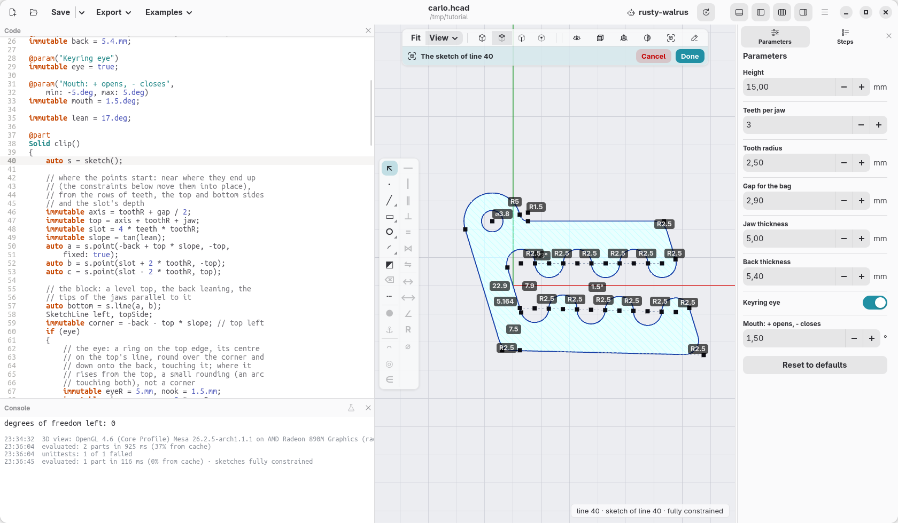
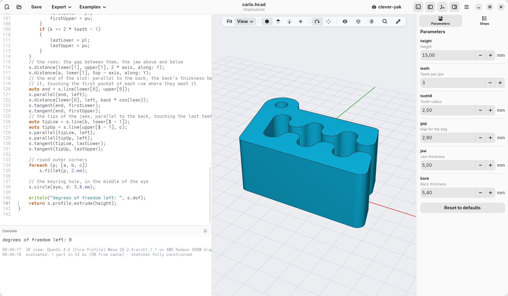
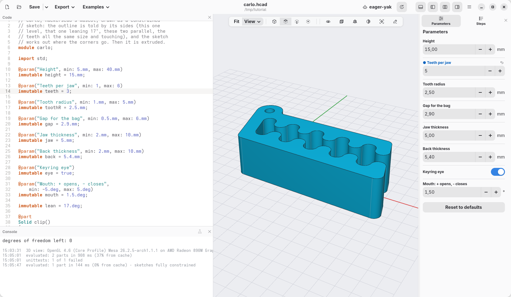

[← A first sketch: a medal](12-medal.md) · [Contents](../TUTORIAL.md) · [A pillow block, drawn with sketches →](14-pillow-block.md)

# 13. Carlo, drawn with a sketch

The clip hackerscad starts with is Carlo, the mascot: a bag clip whose
toothed slot and keyring hole make a little crocodile. A new model takes it
ready-made from a library, `import std;` and then `carlo()`; the first of
the examples shows that library's code, with its numbers as parameters. This
page draws it the same way, with a **constrained sketch**: you say what the
outline is like ("the top is level, the back leans 17°, the teeth are all
2.5 mm and touch each other") and hackerscad works out where every corner
goes. Then the outline is extruded.

Press **New**, select all the code (Ctrl+A) and paste the
[finished model](13-carlo.hcad) over it, or follow the parts below.

## Points, roughly where they go

A sketch starts empty: `auto s = sketch();`. Points are made with
`s.point(x, y)`. Where you put them is only where they start: the
constraints move them. One point is pinned with `fixed: true`, so that the
whole outline does not float away.

```d
auto s = sketch();
immutable slope = tan(lean);
auto a = s.point(-back + top * slope, -top,
    fixed: true);
auto b = s.point(slot + 2 * toothR, -top);
auto c = s.point(slot - 2 * toothR, top);
immutable corner = -back - top * slope; // top left
immutable rise = corner + 2 * eyeR;
auto centre = s.point(corner + eyeR, top);
auto eyeBack = s.point(corner + 3.mm * slope,
    top - 3.mm);
auto nookCentre = s.point(rise + 1.mm,
    top + nook);
auto nookTop = s.point(rise + 1.mm, top);
auto nookEye = s.point(rise - 0.3.mm,
    top + 1.mm);
```

## The block and the eye: level, leaning, tangent

Lines join the points; constraints say what the lines are like. The eye is
an arc round the top corner: its centre on the line of the top, from the
top over the corner down onto the back, which it touches. Where it rises
from the top a small arc rounds the nook, touching both the top and the eye.

```d
auto bottom = s.line(a, b);
auto left = s.line(a, eyeBack);
auto topSide = s.line(c, nookTop);
auto ring = s.arc(centre, nookEye, eyeBack);
auto rounding = s.arc(nookCentre, nookEye,
    nookTop);
s.horizontal(topSide);
s.angle(topSide, left, 90.deg - lean);    // the back leans 17°
s.on(centre, topSide);                    // the eye's centre on the top's line
s.radius(ring, eyeR);
s.tangent(left, ring);                    // the back touches the eye
s.radius(rounding, nook);
s.tangent(topSide, rounding);             // the nook rounded: touching the top…
s.tangent(ring, rounding);                // …and the eye
s.distance(a, centre, 2 * top, along: Y); // the block's height
```

- `horizontal` and `vertical` keep a line level or upright.
- `angle(a, b, v)` sets the angle between two lines (start to end of each),
  turning counter-clockwise from `a` to `b`, or clockwise on the side the
  drawing starts on.
- `on(p, line)` puts a point on a line (on the line it lies on, past its
  ends too), a circle or an arc.
- `tangent(a, b)` makes a line touch an arc or a circle, or two arcs touch
  each other, without crossing. (`s.fillet` rounds a corner between two
  lines only: between a line and an arc, an arc touching both does it.)
- `distance(p, q, v)` sets how far apart two points are; with `along: Y`,
  only up and down.

The eye is optional: a `@param` and an `if` make one sketch or the other.
Without it the back meets the top in a corner, rounded with `s.fillet`:

```d
if (eye)
{
    … the ring, the rounding, the hole …
}
else
{
    auto d = s.point(corner, top);
    left = s.line(a, d);
    topSide = s.line(c, d);
    s.distance(a, d, 2 * top, along: Y);
    s.fillet(d, 2.5.mm);
}
```

`left` and `topSide` are declared before the `if` (`SketchLine left,
topSide;`), so that the constraints after it use whichever lines it made.

## The teeth: arcs, all alike, end to end

Each row of teeth is a chain of half circles, a pocket and a tooth in turn.
A loop makes them: the points along the row, then an arc between each two,
its centre level with them, its radius the tooth radius.

```d
foreach (k; 0 .. 2 * teeth)
{
    immutable x = 2 * toothR * k + toothR;
    auto cl = s.point(x, -axis);
    // counter-clockwise from start to end: left to right
    // goes under
    auto pl = k % 2 == 0
        ? s.arc(cl, lower[k], lower[k + 1])
        : s.arc(cl, lower[k + 1], lower[k]);
    s.radius(pl, toothR);
    s.horizontal(lower[k], cl);
    s.horizontal(lower[k], lower[k + 1]);
    …
}
```

Two arcs share their end point, so they meet; half circles whose ends are
level with their centres meet smoothly, without a corner.

Then the rows are placed: the gap between them and how far they are from
the bottom. The end of the slot leans like the back, the back's thickness
behind it (measured square to the leaning back), and it touches the first
pocket of each row, so the slot ends round, without a corner. The first
pocket of each row starts where the end touches it, not at a point on the
row. The tips of the jaws lean like the back too, and touch the last tooth
of their row in the same way:

```d
auto end = s.line(lower[0], upper[0]);
s.parallel(end, left);
s.distance(lower[0], left, back * cos(lean));   // from a point to a line
s.tangent(end, firstLower);
s.tangent(end, firstUpper);
s.parallel(tipLow, left);
s.parallel(tipUp, left);
s.tangent(tipLow, lastLower);
s.tangent(tipUp, lastUpper);
```

## The mouth

The upper row is level; the lower one tilts by `mouth`, a parameter: down to
open the slot towards the tips, so that the clip slides on easily, up (a
negative angle) to close it, so that it holds tighter. Both rows start on
the end's line, at the point `start`; each row is a **construction line**
(`construction: true`), a line that guides the others but is not part of the
outline, with the lower centres and points `on` it:

```d
auto start = s.point(axis * slope, -axis);
s.on(start, end);
s.distance(a, start, top - axis, along: Y);     // the rows' height
s.distance(start, upper[1], 2 * axis, along: Y); // the gap between them
auto lowerRow = s.line(start, lowerOnRow[$ - 1],
    construction: true);
auto upperRow = s.line(upper[1], lastCentre,
    construction: true);
s.angle(lowerRow, upperRow, mouth);
foreach (p; lowerOnRow[0 .. $ - 1])
    s.on(p, lowerRow);
```

The bottom drops with the lower row, from below `start`: one more point,
`under`, and a construction line from it to `b`, parallel to the row.

## Corners, a hole, and the outline

`s.fillet(p, r)` rounds the corner where two lines meet. A circle inside
the outline becomes a hole: the keyring hole, `s.circle(centre, d: 3.8.mm)`
in the middle of the eye.

```d
foreach (p; [a, b, c])
    s.fillet(p, 2.5.mm);
return s.profile.extrude(height);
```

`s.profile` solves the sketch and gives its closed outline, holes and all,
as a profile: `extrude` stands it up.

## See the sketch

Put the cursor anywhere in the sketch's code, from `auto s = sketch();`
down to `s.profile`, a `foreach`, a brace or a comment included (or click
the `sketch()` step in *Steps*): the view shows it from above, with its
dimensions, and reads like a drawing (**Orthographic** in the display menu
makes it flatter still). Click a dimension to change it: the code changes
with it. Points that can still move are blue; here none can. What the
cursor's line does is orange: `s.tangent(left, ring)` turns the back and
the eye orange, `s.angle(topSide, left, 90.deg - lean)` the two sides and
their 73°, and the `s.fillet` in the loop all three rounded corners. Move
the cursor out of the sketch, or press Esc, and the model comes back; the
pin in the bar over the view keeps the sketch there while you look at
other code. Once the clip is made, right-click any of its faces and choose
**Edit sketch…** to come back here.



`s.dof` is how many ways the sketch can still move: the model writes it in
the console, and here it is 0, a **fully constrained** sketch. Take a
constraint out and the console says which points are free; give two that
disagree and the error points at both.



## Change it

Because the outline is told by its rules, it keeps them when the numbers
change. In **Parameters**, set **Teeth per jaw** to 5: the rows get longer, the block follows, the
back still leans 17°, the slot still ends round and the eye still touches
the back.



The constraints a sketch has: `coincident`, `fix`, `horizontal`,
`vertical`, `length`, `distance` (between points, along X or Y, or from a
line), `on` (a point on a line, circle or arc), `parallel`,
`perpendicular`, `angle`, `equal` (lengths or radii), `radius`,
`diameter`, `tangent`, `midpoint`, `symmetric` and `concentric`; the
[language reference](../LANGUAGE.md) describes each one.

[← A first sketch: a medal](12-medal.md) · [Contents](../TUTORIAL.md) · [A pillow block, drawn with sketches →](14-pillow-block.md)
