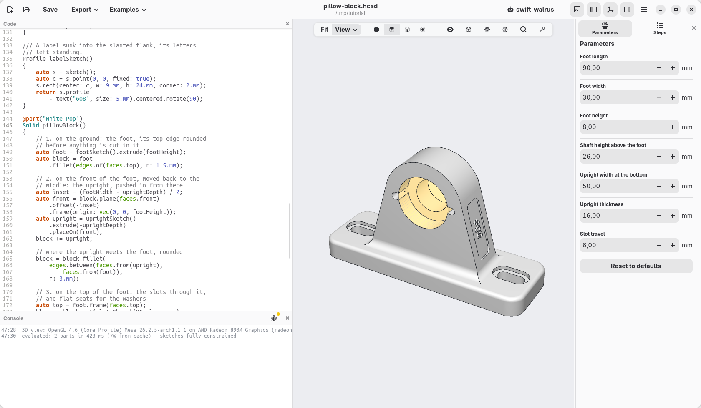
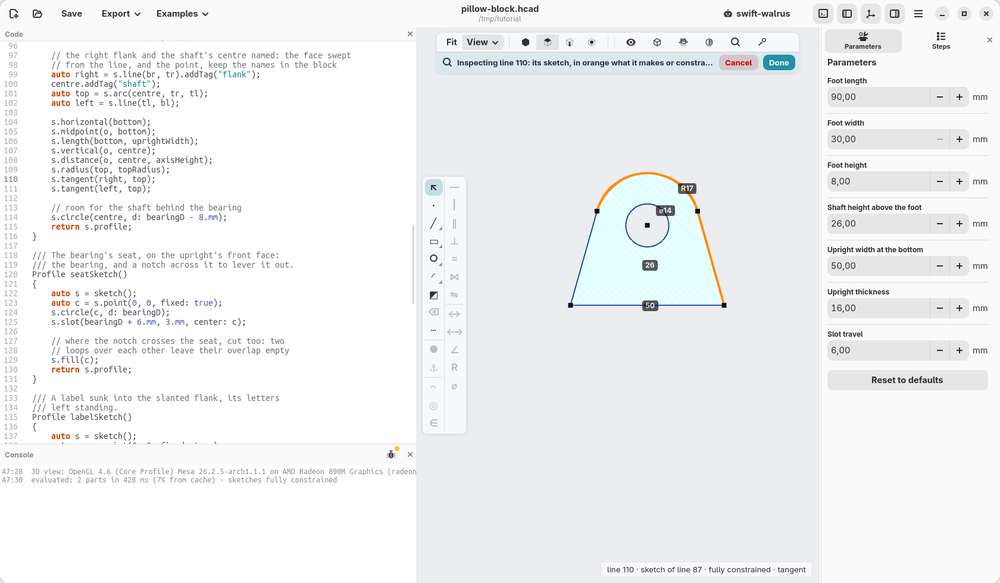
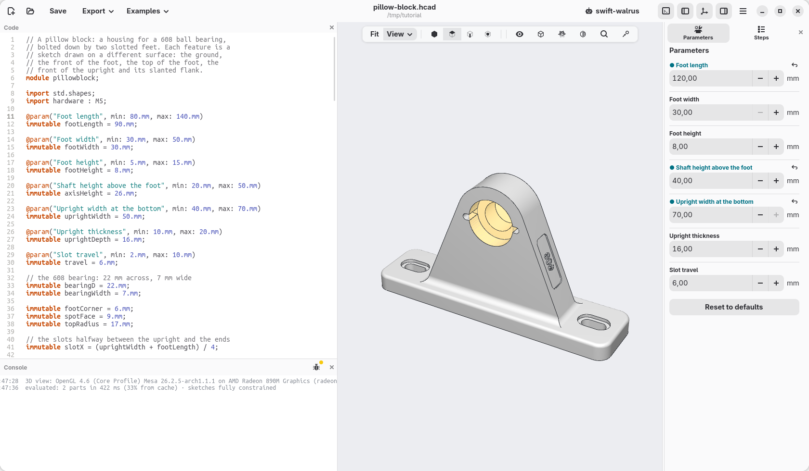
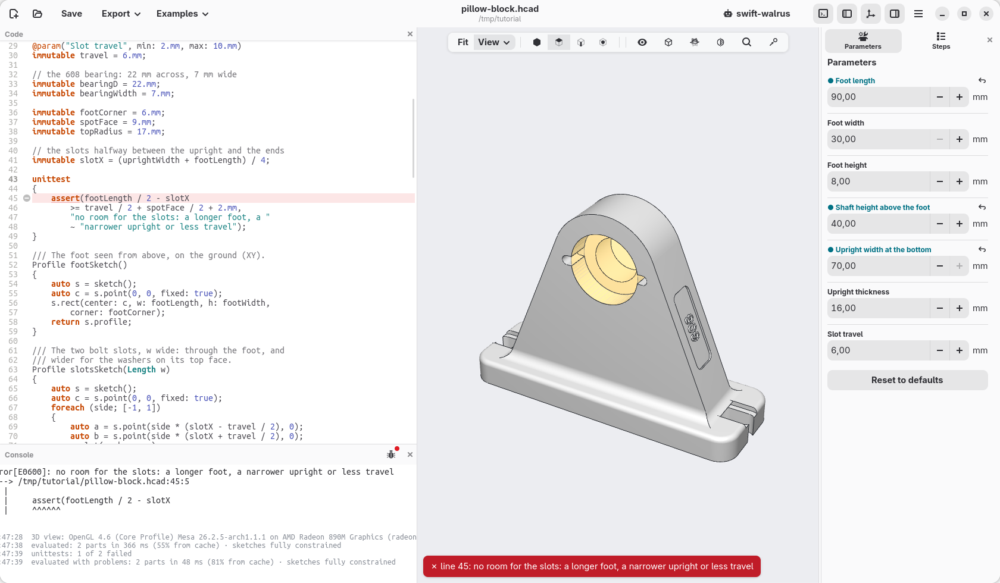

[← Carlo, drawn with a sketch](13-carlo.md) · [Contents](../TUTORIAL.md) · [Going further →](15-going-further.md)

# 14. A pillow block, drawn with sketches

The medal and Carlo were one outline each. A mechanical part is usually
more: a base, something standing on it, holes and seats cut into its
faces. This page makes a **pillow block**, the housing that holds a 608
ball bearing (the one in skateboard wheels, 22 mm across and 7 mm wide)
with the shaft through it, bolted down by two slots that let it slide a
little before the bolts are tightened.



Every feature of it is a sketch drawn on a different surface: the foot on
the ground, the upright on the front of the foot, the slots on the top of
the foot, the bearing's seat on the front of the upright, a label on its
slanted flank. Each sketch is a function of its own, named after what it
draws, so the part reads as a list of what it is made of.

Press **New**, select all the code (Ctrl+A) and paste the
[finished model](14-pillow-block.hcad) over it: this page goes through it
from the top.

## The sizes

The sizes someone may want to change are parameters, the others plain
names. The slots are not a size of their own: they sit halfway between the
upright and the ends of the foot, wherever those are.

```d
// the slots halfway between the upright and the ends
immutable slotX = (uprightWidth + footLength) / 4;

unittest
{
    assert(footLength / 2 - slotX
        >= travel / 2 + spotFace / 2 + 2.mm,
        "no room for the slots: a longer foot, a "
        ~ "narrower upright or less travel");
}
```

The `unittest` is a check, as on [page 9](09-sizes-and-a-check.md): a short
foot under a wide upright leaves no room for the slots and their washers,
and the console says so instead of the slots running into the upright.

## 1. The foot, on the ground

The foot is a rectangle with round corners. One line would make it,
`rect(footLength, footWidth, corner: footCorner)`; drawn in a sketch, its
sizes are dimensions you can click in the view and change.

```d
/// The foot seen from above, on the ground (XY).
Profile footSketch()
{
    auto s = sketch();
    auto c = s.point(0, 0, fixed: true);
    s.rect(center: c, w: footLength, h: footWidth,
        corner: footCorner);
    return s.profile;
}
```

A function that returns a `Profile` is a sketch you can use anywhere: here
it is extruded, and its top edge rounded.

```d
    auto foot = footSketch().extrude(footHeight);
    auto block = foot
        .fillet(edges.of(faces.top), r: 1.5.mm);
```

`edges.of(faces.top)` are the edges round the top face. They are rounded
now, before anything is cut in the foot: later the top face would have the
slots in it, and their rims would be rounded too.

## 2. The upright, on the front of the foot

The upright is drawn as you see it from the front: a bottom side as wide as
`uprightWidth`, a round top centred on the shaft, and two flanks that
**touch** the round top instead of meeting it in a corner. Where the flanks
end, nobody has to work out: `s.tangent` does.

```d
    s.horizontal(bottom);
    s.midpoint(o, bottom);
    s.length(bottom, uprightWidth);
    s.vertical(o, centre);
    s.distance(o, centre, axisHeight);
    s.radius(top, topRadius);
    s.tangent(right, top);
    s.tangent(left, top);
```

Two of its pieces get a name, a *tag*, for later: the right flank, and the
point on the shaft. The face the extrusion makes from the flank's line, and
the point, keep the name wherever the upright goes.

```d
    // the right flank and the shaft's centre named: the face swept
    // from the line, and the point, keep the names in the block
    auto right = s.line(br, tr).addTag("flank");
    centre.addTag("shaft");
```

Put the cursor in `uprightSketch()` and the view shows it from above, with
its dimensions: none of its points is blue, none can still move.



It stands on the front face of the foot, moved back to the middle of it:
`block.plane(faces.front)` is the plane of that face, `.offset(-inset)`
moves it inside, and `.frame(origin: …)` puts the sketch's origin on the
foot's top, X to the right and Y up as you look at it from the front.
`placeOn` stands the extruded profile there, and a negative height pushes
it in, away from you.

```d
    auto inset = (footWidth - uprightDepth) / 2;
    auto front = block.plane(faces.front)
        .offset(-inset)
        .frame(origin: vec(0, 0, footHeight));
    auto upright = uprightSketch()
        .extrude(-uprightDepth)
        .placeOn(front);
    block += upright;
```

### Picking edges by where they came from

Where the upright meets the foot, the edges are rounded. They could be
picked by where they are (on the foot's top, inside the upright's
width…), but then a parameter that moves them would lose them. They are
picked by **where they came from** instead: the edges between a face of
the upright and a face of the foot.

```d
    block = block.fillet(
        edges.between(faces.from(upright),
            faces.from(foot)),
        r: 3.mm);
```

Two shortcuts would go wrong here, and are worth knowing:

- `faces.top` is the face that lies highest. On the foot alone it was the
  foot's top; now it is the round top of the upright.
- `faces.normal(Z)` takes the faces that face up, measured at their centre:
  the round top faces up there too.

`faces.from(foot)` has neither problem: it is the foot's faces, whatever
was added on it.

## 3. The slots, on the top of the foot

Both slots come from one sketch, with a loop: one slot on each side, its
ends `travel` apart, on the long axis, `slotX` from the middle.

```d
    foreach (side; [-1, 1])
    {
        auto a = s.point(side * (slotX - travel / 2), 0);
        auto b = s.point(side * (slotX + travel / 2), 0);
        s.slot(a, b, w: w);

        // on the long axis, slotX from the middle
        s.horizontal(c, a);
        s.horizontal(a, b);
        s.distance(c, a, slotX - travel / 2, along: X);
        s.distance(a, b, travel);
    }
```

The width `w` is the function's argument, so the same sketch cuts twice:
as wide as an M5 bolt's clearance hole all the way through, and 9 mm wide
and 1.5 mm deep, a flat seat for the bolt's head. The frame is the one of the
foot's top: `foot.frame(faces.top)`, taken on the foot alone, where the top
is still the top.

```d
    auto top = foot.frame(faces.top);
    block = block.cut(slotsSketch(M5.clearance),
        on: top, through: true);
    block = block.cut(slotsSketch(spotFace),
        on: top, depth: 1.5.mm);
```

## 4. The bearing's seat, on the front of the upright

The seat is a circle as wide as the bearing, and a slot across it, a notch
to put a screwdriver in and lever the bearing out. The front face of the
upright is picked by where it came from and which way it faces; the frame's
origin goes on the shaft, the point tagged in the sketch: `block.point("shaft")`
is where it ended up, with no height to add up.

```d
    auto face = faces.from(upright)
        .filter(f => f.normal.y < -0.99);
    block = block.cut(seatSketch(),
        on: block.frame(face, origin: block.point("shaft")),
        depth: bearingWidth + 0.2.mm);
```

The seat is 0.2 mm deeper than the bearing is wide, so the bearing does
not stand out of it. Behind it, the smaller hole of the upright's sketch
leaves room for the shaft.

The seat's sketch has one more line, `s.fill(c)`. A profile fills what lies
inside an odd number of loops, so where the notch crosses the circle the two
loops would leave their overlap empty: two little blocks would stay in the
seat, in the bearing's way. `s.fill` makes the area round the centre full,
and the notch is cut all across.

```d
    s.circle(c, d: bearingD);
    s.slot(bearingD + 6.mm, 3.mm, center: c);

    // where the notch crosses the seat, cut too: two
    // loops over each other leave their overlap empty
    s.fill(c);
```

At the end of the model the bearing itself is a see-through part, not
exported: it shows how it goes in, from the front, and a unittest checks
that nothing is in its way.

## 5. A label, on the slanted flank

The last sketch is a sunk panel with the letters left standing: a
rectangle, minus a text. `faces.tagged("flank")` is the face made from the
line tagged in the upright's sketch: the right flank, however much it leans
and whatever was cut since.

```d
    // 5. on the right flank, leaning: the label
    return block.cut(labelSketch(),
        on: block.frame(faces.tagged("flank")), depth: 0.6.mm);
```

On a wall, a frame's X runs to the right and its Y up the slope, as you
look at it from outside: the label reads upwards whichever way the flank
leans.

## Change it

In **Parameters**, set **Upright width at the bottom** to 70 mm, **Shaft
height above the foot** to 40 mm and **Foot length** to 120 mm. The flanks
still touch the round top, the slots move to stay halfway, the fillets
still run where the upright meets the foot, and the label follows its
flank.



Now set **Foot length** back to 90 mm, keeping the wider upright: the
slots have no room left, and the check says so in the console.



The sketches of a part are listed in **View › Sketches**, and right-click
any face a sketch made and choose **Edit sketch…** to go back to it.

[← Carlo, drawn with a sketch](13-carlo.md) · [Contents](../TUTORIAL.md) · [Going further →](15-going-further.md)
