[← A pillow block, drawn with sketches](14-pillow-block.md) · [Contents](../TUTORIAL.md)

# 15. Going further

The planter used boxes, the mouse, profiles, loops and checks. This page is a
tour of what else hackerscad does, one small model at a time: a hook made
ready to print, a label for the planter cut from a drawing, and shorter
stops on sketches, curved shapes, libraries and technical drawings. Each
model is complete: press **New**, select all the code (Ctrl+A), paste the
model over it, and change it as you like.

## Start from an example

**Examples**, next to Export, opens ready models: the bag clip, the
espresso cup of the README, the planter of this tutorial, a **tour of
the language**, the **pillow block** of [chapter 14](14-pillow-block.md),
and the other models of the [examples](../../examples) folder. The tour uses each thing the language has once (`if`, `for`,
`while`, `switch`, functions, structs, lists) and says in a comment what
each one makes appear in the view or in the console. Change a number and
watch.

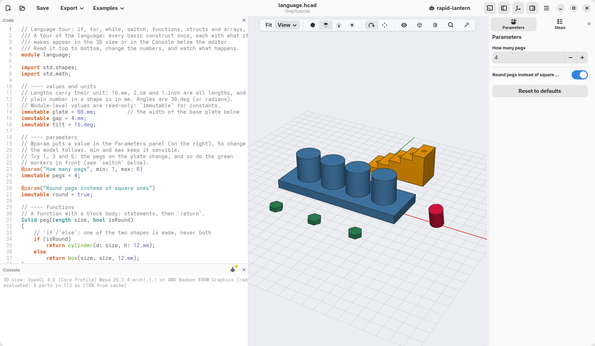

An example opens as a new model, not saved yet: nothing you change is lost
from the original, and Save asks where to keep it.

## A hook, ready to print

A hook for the wall: a plate with a hole for a screw, and an arm. The screw
goes above the arm: what hangs on the arm pulls the top of the plate away
from the wall, and the screw holds it there.

```d
module hook;

import std;

/// A hook for the wall: a plate with a hole for a screw, and an arm to
/// hang things on.
@part("steelblue")
Solid hook()
{
    auto plate = box(30.mm, 4.mm, 60.mm);
    auto arm = box(30.mm, 20.mm, 6.mm).move(y: -12.mm, z: 30.mm);
    return (plate + arm)
        .cut(circle(d: 4.5.mm), on: faces.back,
            at: vec(0.mm, 0.mm, 48.mm), through: true);
}
```

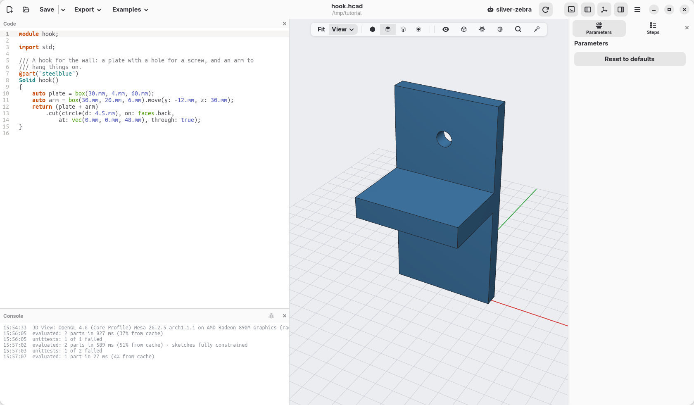

### Pull a face

The arm is a little short. Right-click its end, the small face in front,
and choose **Extrude face…**: type `10.mm` over the value. The face moves
10 mm out and the arm grows with it, its sides still one face each.
**Cut face…** does the opposite, into the material.

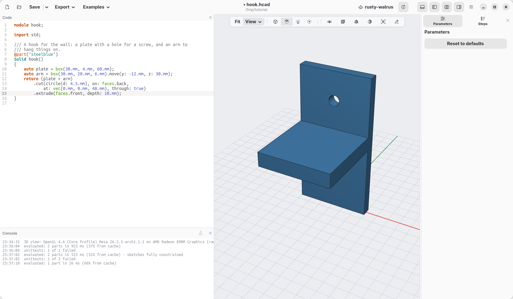

```d
        .extrude(faces.front, depth: 10.mm);
```

### Will it print?

A printer builds a model in layers, from the bottom up. Each layer must rest
on the one below: a surface that faces down, with nothing under it, droops.
Up to about 45° from a wall a layer still rests on the one before; past
that, the slicer adds supports, which you cut away afterwards. Walls thinner
than two lines of the nozzle (0.8 mm for a 0.4 mm nozzle) do not print
well either.

In the cube of the view bar, tick **Printability**: what overhangs is
striped red, thin walls are cross-hatched violet, and the status line gives
their areas.
Turn the view to see the hook from below:

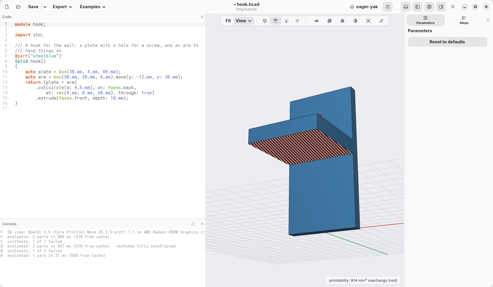

Standing up, the whole underside of the arm hangs in the air, and so does
the top of the screw hole. But nothing says it must print standing up. Add
`.rotate(x: -90)` at the end of the chain, after the `.extrude(…)` (move the
`;` there): the hook lies on its back, the side that goes against the wall
flat on the bed, and the arm grows straight up from it. Nothing hangs any
more, and the screw hole stands upright, round as it is.

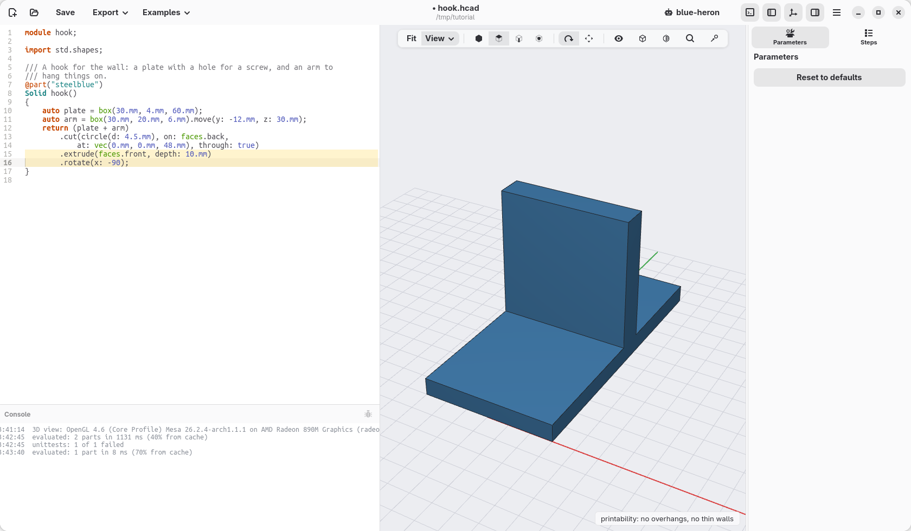

Choosing which way up a part prints is often the whole fix. (A hole that
has to print lying sideways can be a `teardrop(d: 4.5.mm)` in place of the
`circle`: a point at the top, with two 45° sides that print without
supports.)

### A name for a face

On its back, the hook's faces have changed places: `faces.front` now means
another face, and a rounding written after the `.rotate(…)` with it would
land somewhere else. A face you will come back to can be given a name
instead, a *tag*, while it is still where you know it: before the turn, the
arm's end is the front. Then round that face's edges by its name, after the
turn:

```d
        .extrude(faces.front, depth: 10.mm)
        .faces.front.addTag("end")
        .rotate(x: -90)
        .fillet(edges.of(faces.tagged("end")), r: 1.mm);
```

The name stays on the face however the hook is turned, and whatever is cut
or rounded afterwards. In the view, clicking a tagged face shows its name,
and the right-click menu writes it from then on; **Tag face…** in that
menu adds a name to the face you clicked, at the end of the chain.
[Selectors and features](../guides/features.md) says more.

### Make it sturdy

Printed like this, the layers cross the arm where it meets the plate: the
joint between two layers is the weakest place of a print, and the arm would
snap there the first time something heavy hung on it. Two **gussets**,
triangles that tie the arm to the plate, one at each side, spread the load
over many layers. A triangle drawn on the ground, raised 3 mm, then stood up
under the arm:

```d
module hook;

import std;

/// A hook for the wall: a plate with a hole for a screw, and an arm to
/// hang things on.
@part("steelblue")
Solid hook()
{
    auto plate = box(30.mm, 4.mm, 60.mm);
    auto arm = box(30.mm, 20.mm, 6.mm).move(y: -12.mm, z: 30.mm);
    // a gusset: a triangle 20 mm along the arm and 20 mm down the plate,
    // 3 mm thick, stood up under the arm
    auto gusset = polygon([vec(0, 0), vec(0, -20), vec(20, 0)])
        .extrude(3.mm)
        .rotate(y: 90)
        .move(y: -2.mm, z: 30.mm);
    return (plate + arm + gusset.move(x: -15.mm) + gusset.move(x: 12.mm))
        .cut(circle(d: 4.5.mm), on: faces.back,
            at: vec(0.mm, 0.mm, 48.mm), through: true)
        .extrude(faces.front, depth: 10.mm)
        .rotate(x: -90);
}
```

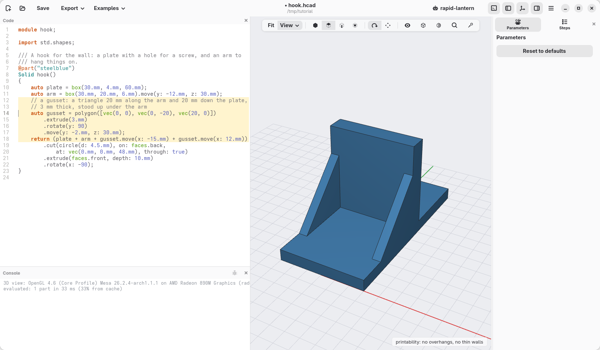

The gussets stand straight up too: still nothing to support. To keep a model
printable as it changes, write it as a check, `assert(hook.overhangs ==
0.mm ^^ 2);` in a `unittest` (`thinWalls` measures the thin walls). The
fields under Printability change the angle and the thinnest wall, for your
printer.

A word of honesty: we would not print this hook. It is not the prettiest
hook ever made, nor the most useful: a flat arm with nothing at its end, and
your jacket will slide off it at the first chance. But it is a start: give
the arm a lip that turns up, round its edges, put a second screw in, and
make a real one.

## A label from a drawing

A label to push into the soil of the planter. The leaf is drawn in a drawing
program (Inkscape, Illustrator, or any that saves SVG), and saved as
[leaf.svg](leaf.svg) next to the model; `load` reads its outline as a flat
shape, like a rectangle or a circle. DXF files, from other CAD programs, work
the same way.

```d
module label;

import std;

/// A label to push into the soil of the planter: a leaf drawn in a drawing
/// program, a stake, and the name of the plant.
@part("forestgreen")
Solid label()
{
    // the outline of the drawing, a flat shape like a rectangle or a circle
    auto leaf = load("leaf.svg").centered;
    auto stake = rect(5.mm, 50.mm).move(y: -30.mm);
    auto name = text("BASIL", size: 6.mm, font: "Sans Bold").centered;
    return (leaf + stake).extrude(2.mm)
        + name.extrude(1.mm).move(z: 2.mm);
}
```

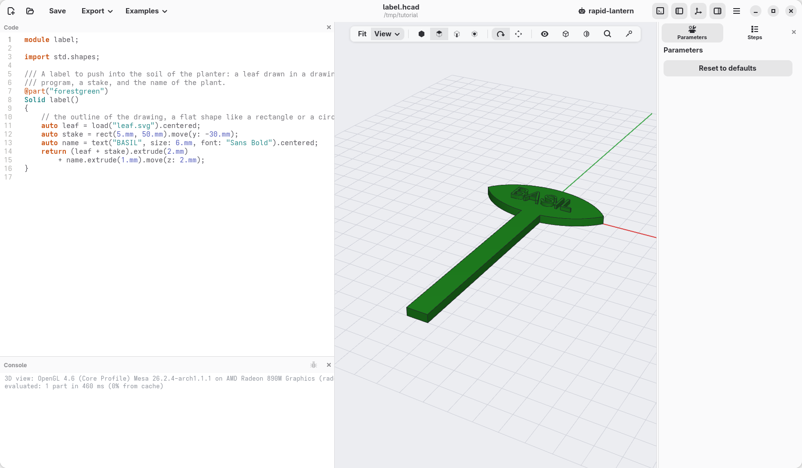

The size comes from the drawing: a leaf 34 mm wide in the drawing program is
34 mm here. An outline inside another is a hole.

## Constrained sketches

For outlines given by their sides rather than by coordinates ("this side is
vertical, that one 30 mm long"), draw a **sketch**: points and lines, then
the constraints, and hackerscad works out where the corners go.

```d
module sketched;

import std;

/// A bracket whose outline is given by its sides: the corners are worked
/// out from the constraints.
@part("goldenrod")
Solid bracket()
{
    auto s = sketch();
    auto a = s.point(0, 0, fixed: true);
    auto b = s.point(40, 0);
    auto c = s.point(40, 30);
    auto d = s.point(0, 10);
    auto bottom = s.line(a, b), right = s.line(b, c);
    auto top = s.line(c, d), left = s.line(d, a);
    s.horizontal(bottom);
    s.vertical(right);
    s.vertical(left);
    s.length(bottom, 50.mm);
    s.length(right, 30.mm);
    s.length(left, 12.mm);
    s.fillet(c, 4.mm);
    return s.profile.extrude(8.mm);
}
```

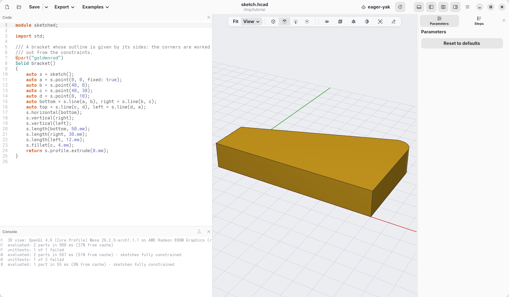

The points start where they are written; the constraints move them (here the
bottom becomes 50 mm, not 40). Put the cursor in the sketch's code (or
click its step in *Steps*) and the view shows the sketch from above with
its dimensions: click one to change it. Points still free to move are blue.
On a line like `s.length(left, 12.mm)` what it makes or constrains turns
orange; the cursor out of the sketch, or Esc, goes back to the model.
**Edit sketch…**, in the right-click menu of a face the sketch made, and
**View › Sketches** bring it back later. [Chapter 13](13-carlo.md) drew Carlo,
the bag clip, this way, from start to end.

### A sketch on a face

A sketch can also be drawn on a flat face of a solid: `body.sketch(faces.top)`.
The face's edges are in it from the start, as **references**: fixed, drawn in
violet, ready to measure from. `s.edges` lists them, the lowest side first and
then round the face the other way from the clock's hands, as a rectangle's
sides (bottom, right, top, left); `s.origin` is the face's centre. Here a groove
runs along Carlo's lower jaw, 3 mm above its bottom side:

```d
module grooved;

import std;

/// Carlo with a groove along its lower jaw, drawn on
/// its top face.
@part
Solid clip()
{
    auto body = carlo();

    // on the top face: Carlo's outline is in the sketch
    // as references, its lowest side first
    auto s = body.sketch(faces.top);
    auto bottom = s.edges[0];
    auto p = s.point(-5, -9), q = s.point(12, -9);
    s.slot(p, q, w: 1.5.mm);

    // both ends 3 mm above the bottom side, the left
    // one 6 mm from its corner, 18 mm long
    s.distance(p, bottom, 3.mm);
    s.distance(q, bottom, 3.mm);
    s.distance(p, bottom.start, 6.mm, along: X);
    s.distance(p, q, 18.mm);
    return body.cut(s.profile, depth: 0.6.mm);
}
```

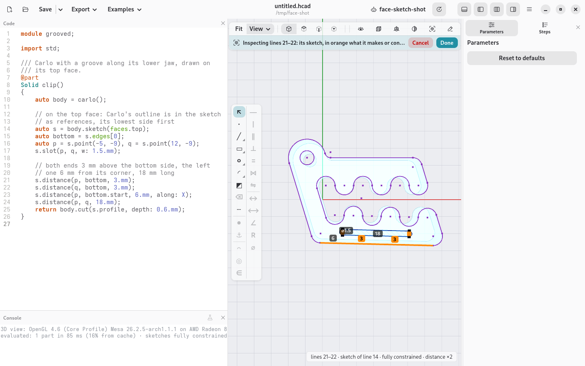

The profile of such a sketch knows where it lies: `body.cut(s.profile, depth:)`
digs it into the face, `body.extrude(s.profile, depth:)` raises it, with no
`on:`. Make Carlo longer or shorter and the groove follows its bottom side.
`s.project(edges.…)` brings other edges of the solid into the sketch, flattened
onto its plane: the rim of a hole underneath, to centre something over it. In
the 3D view, right-click a flat face and choose **Sketch and planes › Sketch on face…**: an empty
sketch on it is written for you, its edges already there, ready to draw on.
Not on a face but on a plane (XY, XZ, YZ, or `auto mid = XY.offset(15.mm)`):
the planes button of the view bar shows them, and **Sketch on plane…** in a
plane's right-click menu (or **New sketch…** in the View menu) writes
`auto s = sketch(XZ);` the same way.
A double click on a flat face (or **Look at face** in the same menu) turns the
view straight at it; with a sketch shown, **Look at sketch** in the right-click
menu turns it back onto the sketch after you have turned it round.

### Drawing and constraining with the mouse

While a sketch is shown, and its code can be written from the window (the
sketch kept in a variable, `auto s = sketch();`, in the model's own file,
not made inside a loop), a bar runs down the left of the view.

Its left column draws: ↖ selects, ∙ puts a point, ╱ draws lines (click
their points; on the first again they close, a double click, Enter or a
right-click ends them), ▭ a rectangle by two corners, ○ a circle by its
centre and a point on it, ◜ an arc by its centre, start and end. A button
with a small mark in its corner has other kinds: right-click it (or click
it again) for its menu. With the lines, ∿ a smooth curve through the points
clicked; with the rectangle, one from its centre, one turned (a side, then
how far the other), a regular polygon (its sides in the menu) and a slot;
with the circle, an ellipse and a teardrop; with the arc, one through three
points. The button keeps the kind chosen last. A click near a point of the
sketch uses that point; near no point, the middle of a line or the place
where two lines cross (construction lines too) shows a mark when you pass
over it, and a click there makes a point that stays there (`s.midpoint`,
or `s.on` both lines). Esc drops what is being drawn. Nothing is written until the shape is done: then
its lines appear at the end of the sketch's code, as you would have typed
them.

With ↖, a click on a point or a line selects it (again: it leaves; on
nothing: none), a drag a box of them (what is wholly inside it; dragged from
right to left, what it touches too). A drag that starts on a point, a line
or a circle moves it: where you let go is written into its `s.point(x, y)`,
and the constraints keep it where they say (a point on a line slides along
it). Right on the middle of a line, or where two lines cross, a mark shows:
a click selects that place, and with a point selected too, Coincident keeps
the point there (`s.midpoint`, or `s.on` both lines). The constraints
that fit what is selected light up; the others say, when you point at
them, what they need. Several lines and
∥: each parallel to the first. The constraints with a value (length,
distance, angle, radius, diameter) ask for it in a field, the size it has
now already written in: Enter writes it. Five lines and a length of 20 mm
make one dimension and the others equal to it, so one number changes them
all. ⌫ (or Delete) takes what is selected out of the code, with what is
drawn on it and the constraints on them. ┄ (or X) turns what is selected
into construction geometry: dashed guides, such as a centre line, to
constrain to, never filled or extruded (again: back); with nothing
selected, it makes what you draw next construction geometry. The area the
profile will fill is tinted, so you see at once what will be extruded and
what is a hole. A loop inside another is a hole, and where two loops
overlap, so is the overlap; ◩ changes that: click inside a closed area and
it turns full or empty, written as a point of its own, drawn in the
areas' colour, and `s.fill(inside)` (or `full: false`). Constrain that
point like any other to keep it in its area when the sketch changes (to
the two places where the circles cross, say); left free, it does not count
among the degrees of freedom. ✂ trims: the piece under the pointer
turns red, between what crosses the line (the whole line when nothing
does), and a click takes it away. The buttons under the constraints
change what is selected: ⇥ carries a line on to another, ⧉ copies an
outline a distance away, ⇆ mirrors across the line selected last, ∷ and
✲ repeat in a row or round the point selected last. Esc goes back a step at a time: the
shape being drawn, then the tool and the selection (back to ↖), and only
then out of the sketch.

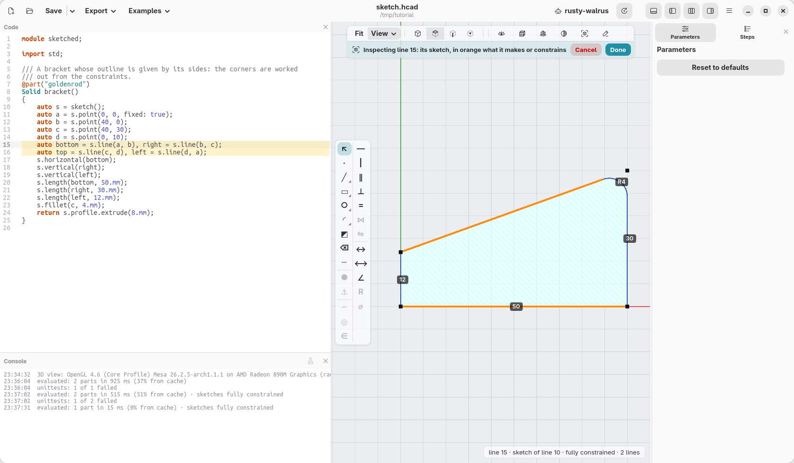

Every tool writes code, which Ctrl+Z takes back and which reads like the
rest: `s.parallel(bottom, top);`. A line that had no name gets one when a
constraint needs it (`auto line2 = s.line(b, c);`).

## Curved shapes: lofts and sweeps

`loft([…])` passes smoothly through outlines at different heights, a vase
here; `.sweep(path)` moves an outline along a curve, the handle.

```d
module jug;

import std;

@part("orange")
Solid jug()
{
    auto body = loft([
        circle(r: 20.mm),
        circle(r: 26.mm).move(z: 40.mm),
        circle(r: 12.mm).move(z: 80.mm),
    ]);
    auto vase = body.shell(open: faces.top, thickness: 2.mm);
    auto curve = spline([
        vec(12.mm, 0.mm, 72.mm), vec(30.mm, 0.mm, 74.mm),
        vec(40.mm, 0.mm, 52.mm), vec(24.mm, 0.mm, 30.mm),
    ]);
    auto handle = circle(d: 7.mm).sweep(curve);
    // the ends of the handle go into the wall: what would show inside goes
    return vase + handle - (body - vase);
}
```

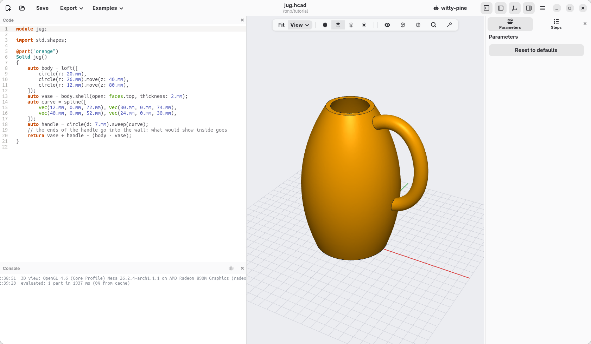

## Libraries: screws, gears, joints, molds

```d
module fixings;

import std;

@part
Solid lid()
{
    auto l = box(50.mm, 50.mm, 6.mm);
    // tools to take away: their top is on z = 0, going down
    l -= hole(M3, 6.mm, "counterbore").move(x: -15.mm, z: 6.mm);
    l -= hole(M3, 6.mm, "insert").move(x: 15.mm, z: 6.mm);
    l -= nutTrap(M3, 3.mm).move(y: 15.mm, z: 6.mm);
    return l;
}

@part("orange")
Solid gear() => spurGear(1.5.mm, 24, 6.mm, bore: 5.mm).move(x: 70.mm);
```

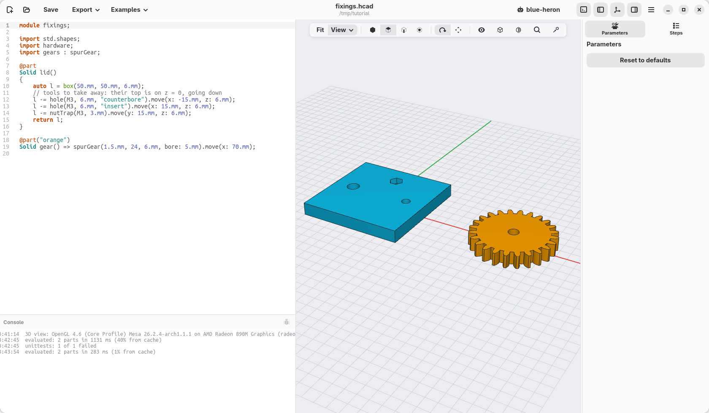

`import std;` brings in all of them; `import std.hardware;` only one, and
`import std.hardware : M3, hole;` only those names.

- `hardware`: screw sizes `M2` to `M8`, screws, nuts, washers, and holes made
  for them (`"clearance"`, `"tap"`, `"insert"`, `"ribs"`, `"counterbore"`,
  `"countersink"`; `"ribs"` leaves three thin ribs a small screw cuts its
  own thread into).
- `threads`: real ISO threads; `gears`: gears and racks; `hinges`, `snaps`,
  `enclosures`: hinges (printed in place, on a pin, snapped together or a
  thin web that bends), snap-fit hooks, boxes with lids.
- `joints`: a part too long for the bed cut in two pieces that lock
  together (a dovetail, pins, Japanese joints, printed dowels), or two parts joined where
  they meet; `flex`: rows of slots that make a stiff part bend; `molds`: a
  two-part mold to cast copies of a part.
  [examples/09_library.hcad](../../examples/09_library.hcad) shows them all,
  and [the guides](../GUIDES.md) explain each one.
- Your own functions go in a file next to the model (`lib/name.hcad`, then
  `import lib.name;`), or in your personal library folder, to use them in
  every project.

## Reference parts

A part that is only there to check the fit, see-through and left out of the
exports:

```d
@part("slategray", alpha: 0.35, export: false)
Solid bottle() => cylinder(d: 13.6.mm, h: 60.mm).move(z: 4.mm);
```

[examples/07_knob.hcad](../../examples/07_knob.hcad) is a knob on the shaft of a
potentiometer, drawn this way.

## Many parts from one function

`@part` makes one part of what a function returns, however many bodies it
has: two halves of a cut become one object to print. `@parts` makes a part of
each separate body instead, and finds how many there are each time the model
is evaluated:

```d
import std;

@param("Where to cut", min: -5.mm, max: 25.mm)
immutable cut = 10.mm;

immutable cutPlane = plane(origin: vec(cut, 0.mm, 0.mm), normal: X);

@parts("Yellow Pop", varied: true)
Solid jaws() => carlo().halves(cutPlane).above;
```

Carlo, the clip of [chapter 13](13-carlo.md), is a good object to try things
on: `import std;` and `carlo()` make one. `halves` cuts in two sides,
`.above` and `.below`. Where the cut crosses Carlo's slot, the side above is
two jaws, and the parts list shows `jaws1`
and `jaws2`, each in its colour (`varied: true`); move `cut` past the slot and
there is one, `jaws`. `split` instead gives every piece of both sides as a list
(`Solid[]`), a part per element with `@parts`: that is what **Split…** in the
right-click menu writes for you. **Colour** in the right-click menu of one
piece colours that piece alone (it writes `.color(…)` on it in the function);
**Default colour of jaws** writes the colour of `@parts`, which the pieces not
coloured on their own take. To pick pieces in code, `.above(plane)`,
`.below(plane)`, `.largest`, `.top`… choose among them, and `.pieces` lists the
bodies of any solid.

## Technical drawings

A function marked `@drawing` makes a sheet with views, dimensions and
sections, to export as PDF, SVG or DXF from the command line (`hcad render -o
tank.pdf`) or by an agent. Added at the end of the planter, this one draws the tank:

```d
@drawing
Drawing sheet()
{
    auto d = drawing(title: "Tank", material: "PETG");
    d.standardViews(tank);
    d.section(tank, XZ, label: "A");
    return d;
}
```

## The command line

`hcad` does what the window does, without it: useful for scripts and for
exporting many sizes at once.

```sh
hcad check planter.hcad                       # parts, sizes, checks
hcad check planter.hcad --printability        # overhangs and thin walls too
hcad render planter.hcad -o planter.3mf       # export
hcad render planter.hcad -o planter-views.png # a picture from four sides
hcad render planter.hcad -o basil.3mf --preset basil
hcad render planter.hcad -o big.3mf -D size=90.mm
hcad docs fillet                              # the reference of one function
```

## When something goes wrong

- **A red underline and a banner over the view:** the code has a mistake. The
  message says what and where, and often how to fix it ("did you mean `r`?").
  Click the banner to go to the line. Meanwhile the view keeps the last model
  that worked.
- **A rounding, a chamfer or a shell fails:** try a smaller size, fewer edges
  at a time, or a different order (round first, then shell). A chamfer or a
  rounding cannot reach into a hole or past the end of a face.
- **The model is slow:** threads, text on curved faces and roundings on many
  edges take the longest. hackerscad remembers every step, so changing a
  parameter recomputes only what depends on it.
- **The view is jerky when you turn it:** the console says at the start which
  OpenGL draws the view (also in ☰ › About hackerscad › Copy debug information). If it
  says it is drawn by the processor, the graphics driver is missing or too
  old: install the one from the maker of the card. In a virtual machine or a
  remote session it is expected; **Smooth edges** off, in the cube of the view
  bar, helps a slow card.
- **"Unknown argument":** the message lists the arguments the function takes;
  `hcad docs` and the cheatsheet (F1) describe each function.

From here, the [language reference](../LANGUAGE.md) describes everything,
and the [examples](../../examples) are complete models to open and change.

[← A pillow block, drawn with sketches](14-pillow-block.md) · [Contents](../TUTORIAL.md)
